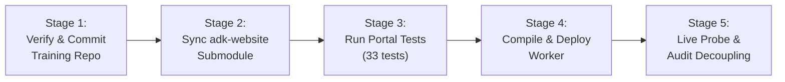

# ADK Course Publisher & Website Sync Skill

This skill governs the end-to-end publishing, building, testing, and deployment lifecycle for the **Google ADK 2.0 Training Platform**, enforcing strict decoupling between the student Python repository and the private Cloudflare/Docusaurus production portal.

---

## 🏛️ Architecture & Separation of Concerns

```
  ┌────────────────────────────────────────────────────────┐
  │      google-adk-training (Public Student Repo)         │
  │      Path: /Users/indersinghchauhan/workspace/...      │
  │ ────────────────────────────────────────────────────── │
  │  • Pure Python course content, labs & solutions        │
  │  • Fast-path validation scripts (verify_lab.py)        │
  │  • Skeletons with TODOs and hidden solutions           │
  │  • ZERO Node.js / npm / Docusaurus / Cloudflare files  │
  └───────────────────────────┬────────────────────────────┘
                              │ git submodule (content/)
                              ▼
  ┌────────────────────────────────────────────────────────┐
  │          adk-website (Private Production Repo)         │
  │          Path: ../adk-website                          │
  │ ────────────────────────────────────────────────────── │
  │  • Docusaurus compiler (198+ pages, 48 modules)        │
  │  • Cloudflare Worker & D1 Database                     │
  │  • Access / OAuth / Secure Edge Routing                │
  │  • Production URL: https://gyanhq.com/adk-training/    │
  └────────────────────────────────────────────────────────┘
```

---

## 🚀 Triggers & When to Use

Activate this skill whenever:
1. **Course content has been updated** and needs to be reflected on the live site:
   - "publish course updates"
   - "deploy lessons to website"
   - "sync changes to gyanhq.com"
2. **Submodule alignment is needed**:
   - "update website submodule"
   - "sync adk-website"
3. **Pre-flight or production health check is needed**:
   - "check website status"
   - "run website regression tests"
   - "verify live site health"
4. **Decoupling integrity check is needed**:
   - "verify no web code in course repo"
   - "check repository separation"

---

## 🔁 1. The 5-Stage Publishing Loop

Whenever publishing course updates, always follow this 5-stage pipeline:



### Stage 1: Verify & Commit Course Changes
Ensure the local Python changes in `google-adk-training` are tested, staged, and pushed:
```bash
cd /Users/indersinghchauhan/workspace/learning/google-adk-training
git status
git add training/ README.md
git commit -m "feat/fix: <description>"
git push origin main
```

### Stage 2: Sync Website Submodule
In the sibling repository `adk-website`, update the `content` submodule to point to the latest commit:
```bash
cd /Users/indersinghchauhan/workspace/learning/adk-website
git submodule update --remote content
```

### Stage 3: Run Portal Regression Suite
Verify that routing, auth, link rewriting, and edge security pass:
```bash
cd /Users/indersinghchauhan/workspace/learning/adk-website/portal
npm test
```
*Expected: 33/33 tests passing.*

### Stage 4: Compile & Deploy Cloudflare Worker
Build all 48 modules and deploy to production:
```bash
cd /Users/indersinghchauhan/workspace/learning/adk-website/portal
npm run build
npm run deploy:production
```

### Stage 5: Live Probe & Decoupling Audit
Verify that the production endpoint is healthy and zero web artifacts exist in the student repo:
```bash
# 1. Probe live site (must return HTTP/2 200 OK)
curl -sI https://gyanhq.com/adk-training/

# 2. Audit student repo cleanliness (must return zero files)
find /Users/indersinghchauhan/workspace/learning/google-adk-training \
  -maxdepth 2 \
  -name "package.json" -o -name "wrangler.jsonc" -o -name "docusaurus.config.js"

# 3. Commit adk-website state
cd /Users/indersinghchauhan/workspace/learning/adk-website
git commit -am "chore: deploy latest course content"
git push origin main
```

---

## 🛠️ 2. One-Command Automation Script

This skill provides an automated bash script that executes all 5 stages safely with rollback and health probes:

```bash
bash .agent/skills/adk-course-publisher/scripts/publish_course.sh
```

### Script Options:
- `--check-only`: Runs tests and builds without deploying to Cloudflare.
- `--skip-push`: Builds and deploys locally without pushing git commits to GitHub remotes.
- `--help`: Shows help and available flags.

---

## 🛡️ 3. Guardrails & Best Practices

1. **Zero Downtime Guarantee:** Never delete or alter routes in `adk-website` without running `npm test`.
2. **Hermetic Submodule:** Always use relative submodule path `../google-adk-training` or GitHub URL `https://github.com/inderanz/google-adk-training.git`.
3. **No Web Artifacts in Public Repo:** `google-adk-training` MUST NOT contain `portal/`, `doc/`, `wrangler.jsonc`, or `package.json`.
4. **Mermaid Validation:** All Mermaid diagrams in `training/module*/README.md` must avoid nested semicolons or unsupported connector syntax that breaks the Docusaurus / Mermaid parser.
