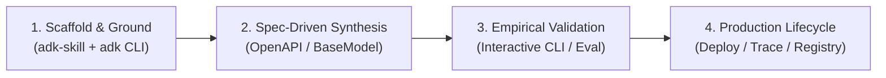

# Google ADK 2.0 Enterprise FDE Workflow Skill

This skill defines the official **Google Forward-Deployed Engineer (FDE)** methodology for building, refactoring, and verifying Google Agent Development Kit (ADK 2.0) applications.

---

## 🏛️ 1. Philosophy: FDE Standard vs. The Novice Guessing Trap

| Dimension | The Novice Trap (Anti-Pattern) | The Google FDE Standard (Best Practice) |
|---|---|---|
| **API Integration** | Hand-writing 500+ lines of custom `requests.get()` / `requests.post()` wrappers. | **Zero-Adapter OpenAPI Synthesis:** Ingesting authoritative OpenAPI 3.0 specs directly via `OpenAPIToolset`. |
| **Tool Contracts** | Returning unvalidated Python dictionaries (`return {"status": "ok"}`). | **Typed Pydantic Schemas:** Defining strict `BaseModel` return types for deterministic JSON schemas. |
| **Security & Identity** | Trusting the LLM to pass `user_id` as a function argument. | **Zero-Trust Identity Injection:** Reading `tool_context.user_id` from secure session tokens. |
| **Development Flow** | Blindly prompting LLMs and hoping code works. | **Skill-Grounded Engineering:** Grounding against `.agent/skills/adk-skill/references/adk-docs.txt` and using `uv run adk` CLI. |
| **Pedagogy & Labs** | Giving away full answers in lab challenges (`lab.md`). | **Active Learning Skeletons:** Providing clear `TODO` skeletons with hints, saving complete solutions for `lab-solution.md`. |

---

## 🔁 2. The 4-Step FDE Development Loop

Whenever building an ADK agent for customer delivery or creating educational modules, execute this 4-step loop:



### Step 1: Scaffold & Ground
1. **Update Documentation:** Sync local reference documentation to ensure current Google ADK 2.0 syntax:
   ```bash
   bash .agent/skills/adk-skill/scripts/update_docs.sh
   ```
2. **Inspect Signatures:** Consult `.agent/skills/adk-skill/references/adk-docs.txt` or installed source code (`.venv`) for exact object signatures.
3. **Scaffold Structure:** Use `uv run adk create <agent_name>` to create standardized project files (`agent.py`, `.env`, `pyproject.toml`).

### Step 2: Spec-Driven Tool Synthesis
* **For REST Services & Microservices:**
  - Load the customer's OpenAPI 3.0 specification file directly:
    ```python
    from google.adk.tools.openapi_tool import OpenAPIToolset

    toolset = OpenAPIToolset.from_file("customer_api_spec.json")
```
  - Ensure every target endpoint has a clean, snake_case `operationId`.
* **For Custom Business Logic:**
  - Define tools as typed Python functions with Pydantic output models.
  - If state or authentication is required, accept `tool_context: ToolContext` as an argument without documenting it in the docstring (ADK removes it from LLM schemas).

### Step 3: Empirical Validation (Zero Trust)
* **Interactive CLI Testing:** Run `uv run adk run .` to verify tool calls, argument serialization, and Gemini responses in real time.
* **Curriculum Evaluation:** When evaluating training modules, run the `adk-student-evaluator` skill to test code in an isolated directory and generate formal pedagogical reports.

### Step 4: Production Lifecycle
* Deploy using official Google Cloud targets (`Cloud Run`, `Agent Runtime`, `GKE`).
* Configure **Cloud Trace** and **BigQuery Agent Analytics** for enterprise observability.
* Enforce **Zero-Trust Token Injection** at the HTTP transport layer—never leak API keys or bearer tokens in LLM prompts.

---

## 🤖 3. Standardized Antigravity Steering Prompt Templates

Use these ready-to-use steering prompts in Antigravity to guarantee high-quality, ADK 2.0 compliant implementations:

### Template A: Enterprise OpenAPI REST Integration
```text
"You are an expert Google ADK 2.0 Forward-Deployed Engineer using the `adk-enterprise-fde-workflow` skill.
Build an agent node connected to the provided OpenAPI 3.0 specification:
1. Ingest the spec using `from google.adk.tools.openapi_tool import OpenAPIToolset`.
2. Ensure all operationId names map cleanly to business intents (e.g. `get_account_balance`).
3. Construct the root agent using `Agent(name='...', model='gemini-2.5-flash', instruction='...', tools=[toolset])`.
4. Inject OAuth2/API Key authentication at the transport layer so credentials never appear in prompts.
5. Provide a line-by-line breakdown explaining how plain English customer requirements were translated into code."
```

### Template B: Stateful Custom Function Tools
```text
"You are an expert Google ADK 2.0 Forward-Deployed Engineer using the `adk-enterprise-fde-workflow` skill.
Implement custom function tools for an enterprise workflow:
1. Define all return types using Pydantic `BaseModel`. Never return raw dicts.
2. Accept `tool_context: ToolContext` for reading user state (`tool_context.state`) and identity (`tool_context.user_id`).
3. Do not include `tool_context` in function docstrings or parameter descriptions.
4. Attach tools to an Agent node using model `gemini-2.5-flash` and singular `instruction='...'`.
5. Access model output using `event.content` or `response.content` (never `.candidates`)."
```

---

## 📚 4. Pedagogical Guidelines for Training Content

When authoring or updating training modules in this repository:
1. **`README.md` (Theory & Enterprise Story):** Ground theory in real enterprise industries (e.g. Banking, Healthcare, Telecom). Include an FDE Requirements-to-Code Matrix and clear Mermaid sequence diagrams.
2. **`lab.md` (Active Learning Challenge):** Technical challenge files MUST use code skeletons with clear `TODO` comments. NEVER include full runnable solutions in `lab.md`. Must include a Hidden Solution section with Base64 hint.
3. **`lab-solution.md` (Instructor / Reference):** Must include complete runnable code, line-by-line teaching comments, Antigravity steering prompt templates, and thorough answers to self-reflection questions.
