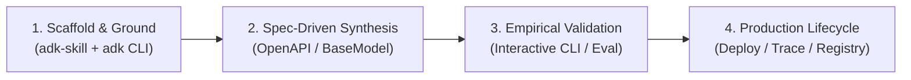

# Enterprise ADK Playbook Index

This page is the master map for turning the ADK training modules into a practical enterprise engineering framework. The goal is not just to learn syntax, but to learn how to translate ambiguous customer requests into reliable, production-ready ADK solutions.

## Why this exists

In real customer work, requirements are rarely crisp. A stakeholder may say:

- "Help us automate support"
- "Make our agents understand images"
- "Use AI to help ops teams"
- "Build a knowledge assistant for our staff"

These are not implementation specs. They are business needs. The real work is to convert them into:

- clear functional requirements
- agent roles and tool boundaries
- session and memory strategy
- operational guardrails
- deployment design
- validation plan

This roadmap connects the learning modules into one reusable design system for enterprise ADK work.

## The big vision

The modules in this course are not isolated examples. Together they form a layered story:

1. Understand the basics of agents and architecture
2. Learn how to run and test them
3. Learn how to operationalize them in code
4. Expand into multimodal and tooling patterns
5. Add enterprise-scale capabilities such as persistence, memory, orchestration, evaluation, and deployment

The enterprise playbooks tie these together so that an agent, engineer, or assistant can reason across modules instead of learning one isolated pattern at a time.

## Cross-module dependency map

| Module | Primary concept | Enterprise value | Related next step |
| --- | --- | --- | --- |
| [Module 01](./module01-intro-to-ai-agents/README.md) | Agent foundations | Problem framing and AI mental model | Module 05 and 06 |
| [Module 05](./module05-running-agents/README.md) | Running and interacting with agents | Execution lifecycle and debugging | Module 06 |
| [Module 06](./module06-programmatic-execution/README.md) | App + Runner + sessions | Production-ready programmatic agent design | Module 07 and 08 |
| [Module 07](./module07-multimodal-and-images/README.md) | Multimodal input | Vision-enabled workflows | Module 08 and 09 |
| [Module 08](./module08-intro-to-tools/README.md) | Tool integration | Real-world action-taking agents | Module 09 and beyond |
| [Module 09](./module09-intro-custom-function-tools/README.md) | Custom tools | Enterprise task automation | Module 10 and 11 |
| [Module 10](./module10-advanced-function-tools/README.md) | Advanced tools | Robust tool orchestration | Modules 11-15 |
| [Module 11](./module11-openapi-tools/README.md) | API integration | External systems integration | Modules 12-18 |
| [Module 11.5](./module11_5-enterprise-credit-underwriting/README.md) | Commercial Credit Triage | OpenAPI Milestone: Underwriting & Drawdowns | Modules 12-18 |
| [Module 12](./module12-built-in-tools-grounding/README.md) | Grounding and retrieval | Knowledge-backed agents | Modules 18-24 |
| [Module 13](./module13_5-firestore-persistence/README.md) | Persistence | Enterprise memory and state | Modules 17-22 |
| [Module 15](./module15-intro-to-multi-agent-systems/README.md) | Multi-agent systems | Distributed reasoning | Modules 16-21 |
| [Module 21](./module21-distributed-graphs/README.md) | Graph-based coordination | Complex agent orchestration | Modules 22-30 |
| [Module 24](./module24-evaluation/README.md) | Evaluation | Quality testing and trust | Modules 25-30 |
| [Module 25](./module25-observability/README.md) | Observability | Production operations | Modules 26-30 |
| [Module 35](./module35-deployment-agent-runtime/README.md) | Deployment runtime | Production rollout | Real-world customer delivery |

## How to use this as an enterprise guide

When a customer gives you a vague or ambiguous requirement, start with this process:

1. Clarify the business problem.
2. Map it to the nearest ADK module pattern.
3. Decide the agent architecture pattern.
4. Choose tools, state, memory, and orchestration strategy.
5. Validate output quality and cost.
6. Deploy with observability and guardrails.

## Forward-deployed engineer operating model

A forward-deployed engineer works differently from a pure researcher or a local prototype builder. They operate at the boundary between customer needs and technical implementation.

Their workflow is usually:

- understand the business context and the real user pain
- turn vague customer language into structured requirements
- identify where AI adds value and where deterministic code is safer
- prototyping the smallest working system
- integrating it with enterprise systems and workflows
- validating quality, cost, and security
- deploying with monitoring and iteration

This roadmap follows that operating model. The ADK modules are not treated as isolated demos; they are connected building blocks for customer-facing systems.

## Module playbook pattern

Each module has a companion enterprise playbook that translates the concept into an engineering workflow. The pattern is:

- Business translation
- Ambiguous requirement framing
- Concrete ADK pattern
- Best practices
- Production risks and guardrails
- Related modules and next steps

## Official ADK and Google references

This roadmap should be reviewed alongside the official Google ADK and Google AI documentation whenever a framework update or product change is expected.

- [Official ADK and Google AI documentation index](./adk-official-docs-index.md)
- ADK home: https://google.github.io/adk-docs/
- ADK tools: https://google.github.io/adk-docs/tools/
- ADK workflows: https://google.github.io/adk-docs/workflows/
- Gemini API docs: https://ai.google.dev/gemini-api/docs
- Vertex AI docs: https://cloud.google.com/vertex-ai/generative-ai/docs

## First module playbook

The first linked enterprise guide is here:

- [Module 05 Enterprise Playbook](./module05-running-agents/enterprise-playbook.md)

This playbook teaches the enterprise mindset for running agents in production: execution lifecycle, debugging, sessions, testing flows, and how to treat runtime behavior as a real system concern rather than just a local demo.

## Recommended engineering sequence for real customer work

Use this sequence when designing a customer solution:

1. Start with customer problem framing.
2. Map to the right module lineage.
3. Build the smallest viable agent.
4. Add relevant tools.
5. Add memory/session or persistence if needed.
6. Add orchestration or multi-agent patterns if scale increases.
7. Validate with examples and real evaluation.
8. Instrument and deploy with production guardrails.

---

## ⚡ The Skill-Driven FDE Development Workflow

Writing hundreds of lines of manual HTTP wrappers or prompting LLMs blindly without grounding leads to brittle architectures, hallucinated APIs, and security holes.

In production Google deployments, Forward-Deployed Engineers follow the **Skill-Driven FDE Workflow**:

### 1. Scaffold & Ground
- Run `bash .agent/skills/adk-skill/scripts/update_docs.sh` to fetch Google's latest official documentation (`llms-full.txt`).
- Scaffold projects using `uv run adk create <project_name>`.

### 2. Spec-Driven Tool Synthesis
- **Zero-Adapter REST Integration:** Feed enterprise OpenAPI 3.0 specs directly into `OpenAPIToolset(spec_str=..., spec_str_type="json")` or `OpenAPIToolset.from_file(...)`.
- **Typed Custom Tools:** Define return models using Pydantic `BaseModel` and extract identity securely from `tool_context.user_id`.

### 3. Empirical Verification (Zero Trust)
- Test interactively with `uv run adk run .`.
- Perform automated student reviews using `adk-student-evaluator`.

### 4. Production Lifecycle
- Deploy via `google-agents-cli-deploy` to Cloud Run, Agent Runtime, or GKE.
- Run automated trajectory benchmarks via `google-agents-cli-eval`.

Refer to the complete skill definition at [adk-enterprise-fde-workflow](file:///.agent/skills/adk-enterprise-fde-workflow/SKILL.md) for full instructions and Antigravity prompt templates.

---

## In short

This roadmap is designed so that a coding agent, forward-deployed engineer, or training participant can follow one connected storyline instead of viewing the modules as isolated labs.

The objective is to move from:

- "I know how an ADK example works"

to:

- "I know how to turn an ambiguous customer requirement into a robust enterprise ADK architecture."

---

## Related enterprise playbooks

- [Module 05 Enterprise Playbook](./module05-running-agents/enterprise-playbook.md)
- [Module 06 Enterprise Playbook](./module06-programmatic-execution/enterprise-playbook.md)
- [Module 07 Enterprise Playbook](./module07-multimodal-and-images/enterprise-playbook.md)
- [Module 08 Enterprise Playbook](./module08-intro-to-tools/enterprise-playbook.md)
- [Module 09 Enterprise Playbook](./module09-intro-custom-function-tools/enterprise-playbook.md)
- [Module 10 Enterprise Playbook](./module10-advanced-function-tools/enterprise-playbook.md)
- [Module 11 Enterprise Playbook](./module11-openapi-tools/enterprise-playbook.md)
- [Module 11.5 Enterprise Playbook](./module11_5-enterprise-credit-underwriting/enterprise-playbook.md)
- [Module 12 Enterprise Playbook](./module12-built-in-tools-grounding/enterprise-playbook.md)
- [Module 13.5 Enterprise Playbook](./module13_5-firestore-persistence/enterprise-playbook.md)
- [Module 15 Enterprise Playbook](./module15-intro-to-multi-agent-systems/enterprise-playbook.md)
- [Module 16 Enterprise Playbook](./module16-static-orchestration/enterprise-playbook.md)
- [Module 17 Enterprise Playbook](./module17-structured-routing/enterprise-playbook.md)
- [Module 18 Enterprise Playbook](./module18-dynamic-orchestration/enterprise-playbook.md)

This roadmap is intentionally connected so a coding agent can move from concept to execution to multimodal workflows without losing the broader enterprise architecture context.
---

## Official References

- Google ADK docs (latest): https://google.github.io/adk-docs/
- Google AI / Gemini docs: https://ai.google.dev/
- Google GenAI Python SDK reference: https://googleapis.github.io/python-genai/
- Context7 / current SDK lookup for the exact installed version and API signatures
- Related module path: review the surrounding modules for continuity, prerequisites, and follow-on concepts

