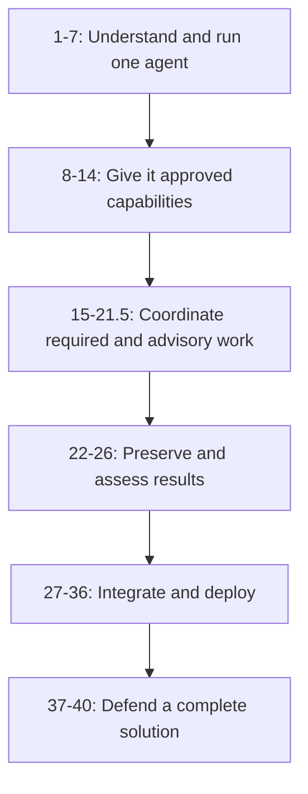

# Learn one banking story through three perspectives

Meera is an analyst at the Pune branch of fictional Sovereign Horizon Bank. She is preparing a review for fictional Acme Robotics. She wants to find the right records, explain missing documents, obtain specialist advice and prepare a review pack. A person remains responsible for consequential banking decisions.

This story connects the course. Individual labs remain separate learning checkpoints: some use weather, railway or shopping examples, and some use synthetic banking records. A connection between lessons is not a claim that all examples already form one deployed application. Follow each lab's stated contract and dependency baseline.

## Three learners, one observable standard

| Perspective | Question to ask at each chapter | Evidence of understanding |
|---|---|---|
| New to Python and ADK | What does each object mean, who calls this function, and what value comes back? | Draw one request, explain the code, predict a changed input and compare with execution. |
| Experienced engineer learning ADK | Which runtime guarantee does this API provide, and which guarantee remains our responsibility? | Compare alternatives; inspect contracts, concurrency, failure, state and version behavior. |
| Google FDE working with the bank | Which customer problem justifies this component, who owns its facts and how will we prove success? | Agreed requirement, service/identity map, normal and failure scenarios, acceptance evidence and handover owner. |

Do all three eventually. A beginner can begin with a single dictionary and a small trace. An experienced engineer should still explain the business requirement before adding infrastructure. An FDE should be able to point from a customer's sentence to the code and evidence that implement it.

## The story has six stages

This diagram shows learning dependencies, not a runnable ADK graph. The decimal modules are intermediate chapters, not optional material merely because their numbers contain a decimal.

### Stage 1: understand one request before creating a team

Modules 1–7 distinguish model, agent, tool, App, Runner, session, invocation, Content and Part. Meera first needs one useful assistant, a reproducible environment and an understood message boundary. The learner should know when Python constructs an object and when the runtime actually invokes it.

Checkpoint: explain one user request without calling everything “the agent.” Identify the model call, the session scope and the returned events. A browser or CLI demonstration proves a different claim from a deployed authenticated request.

### Stage 2: connect to facts and permitted operations

Modules 8–14 teach function tools, ToolContext, API contracts, gateway identity, grounding, confirmation, persistence and adapters. Meera can now ask an authorized records desk instead of relying on remembered or invented status.

Checkpoint: distinguish the model's proposed argument from trusted identity, current facts and the backend's authority to act. Explain why a session update does not commit a banking transaction. Decide whether an existing function, OpenAPI operation or third-party tool is the simplest supported integration.

### Stage 3: choose the right kind of coordination

Modules 15–21.5 cover consultation, required collection, routing, conditional work, delegation, revision and remote ownership. Each adds a requirement, not merely another agent.

| What the customer actually says | Starting pattern | Why | What it does not guarantee |
|---|---|---|---|
| “Get specialist advice and answer me.” | Module 15: `AgentTool` | Coordinator receives a result and continues. | The model will always choose the tool. |
| “Both independent checks must run.” | Module 16: fan-out and `JoinNode` | Required dependencies are explicit. | Both sources describe the same business version. |
| “If documents are missing, collect them first.” | Module 17: explicit routing | Approved conditions select the destination. | A queue write or approval actually occurred. |
| “Only these cases need an extra check.” | Module 18: dynamic node | Code schedules applicable child work. | Arbitrary model-generated work is permitted. |
| “Let me keep talking to the specialist.” | Module 19: appropriate delegation mode | Dialogue ownership matches the user experience. | Every local mode works with every remote service. |
| “Return a corrected draft, within three attempts.” | Module 20: bounded revision | Feedback and exit rules are explicit. | Correct citation IDs prove correct prose. |
| “The regional team operates that specialist.” | Module 21: A2A boundary | Ownership can be separated across services. | The protocol authenticates every business user automatically. |

Checkpoint: defend the simplest sufficient composition in Module 21.5. Explain which parts are deterministic code, which use Gemini reasoning and which remain customer integrations.

### Stage 4: preserve, assess and investigate outcomes

Modules 22–26 distinguish preference state, memory, exact file versions, evaluations, traces, content inspection and lifecycle hooks. Meera needs the assistant to remember her preferred format without treating yesterday's conversation as today's case truth.

Checkpoint: retrieve an exact artifact version, inspect a failed evaluation, locate a failed tool operation, and explain which callback can prevent execution versus only replace a returned result. Use the [integrated banking exercise](./module26-callbacks/integrated-lab.md) to connect these responsibilities.

### Stage 5: integrate with an application and its operating environment

Modules 27–36 add MCP, interfaces, live streaming, runtime choices and employee-facing registration. A local tool, remote tool service, deployed agent and registered enterprise agent are different boundaries.

Checkpoint: show authenticated deployed invocation and authorized access to a real dependency. Then demonstrate discovery and use through the selected employee interface. A URL, a container revision or a successful registration is not a substitute for that evidence.

### Stage 6: transfer the patterns and defend the limits

Modules 37–40 ask learners to combine components and justify resilience, plugins, skills and distributed operation. The shopping and incident-response scenarios test whether the earlier concepts transfer beyond a copied banking fixture.

Checkpoint: label implemented, simulated and proposed components. Explain remote failures, source authority, user permissions, persistence and action approval. A simulated store, regex inspection or printed telemetry line must not be presented as a verified managed integration.

## Turn a customer sentence into code in seven steps

Start with: “Before our analyst meeting, check both required records, tell me what is missing, and show which version you used.”

1. **Name the business objects.** Analyst, case, required document, source version and review pack need defined identifiers.
2. **Name the operations.** Read records, compare completeness, combine evidence and save the pack are separate functions or capabilities.
3. **Find the dependencies.** “Both” may require two branches; “before” creates a prerequisite; “which version” requires explicit lineage.
4. **Identify authoritative owners.** An analyst's statement is not the same as a receipt recorded by the case service.
5. **Write failures before code.** Missing record, denied access, unavailable source, mismatched version and invalid input need different results.
6. **Choose supported ADK and Google components.** Prefer native interfaces at each boundary; do not create custom orchestration or storage simply because another class can be written.
7. **Define observable acceptance.** What exact request, events, stored values and user outcome prove each promise? Separate local mechanism checks from live model and deployed-service evidence.

For the detailed banking service map and integration contracts, continue with the [FDE learning guide](./module15-intro-to-multi-agent-systems/fde-learning-guide.md).

## Use the lab as an experiment

Before running code, write the expected input, next operation, returned value and failure outcome. Run one checkpoint. Inspect the events or stored records appropriate to that concept. Change one condition and predict again. Only then compare with the complete solution.

Comments should explain why a line exists: “compare IDs before combining evidence” is more useful than “this is an if statement.” Learn Python syntax beside its purpose, then explain it without reading the comment. If you cannot identify which operation calls Gemini or writes a record, pause at that boundary before adding another component.

Use diagrams in two ways: an execution diagram explains what the supplied program does; a customer architecture diagram proposes how real services connect. Never interpret the second as a test result for the first.

## Read verification claims precisely

The [teaching review record](./teaching-review.md) identifies the scope and limits of this course-wide pass. The [banking verification record](./module15-intro-to-multi-agent-systems/review-notes.md) contains the earlier executable checks for Modules 13.5–26. A documentation review does not certify a deployment or establish model quality.

API names that retain `VertexAi` or `agent_engine` can coexist with current product naming. Use the public symbol actually supplied by the pinned SDK. Check the [official ADK documentation](https://adk.dev/) and [Agent Platform overview](https://docs.cloud.google.com/gemini-enterprise-agent-platform/agents) when upgrading, then repeat the relevant tests.
