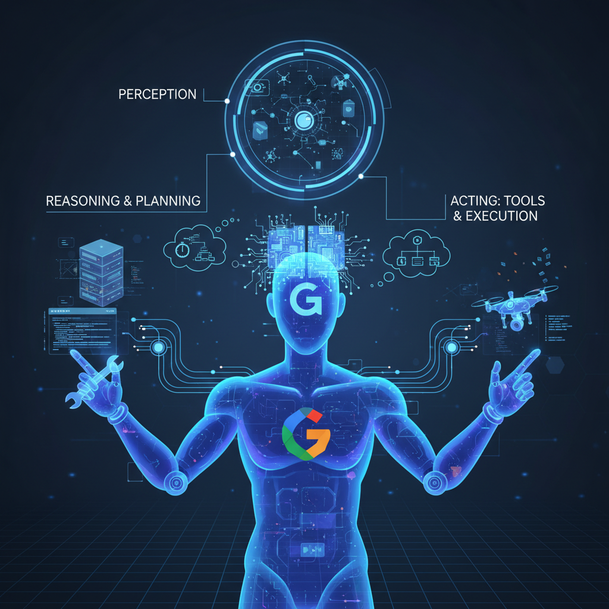
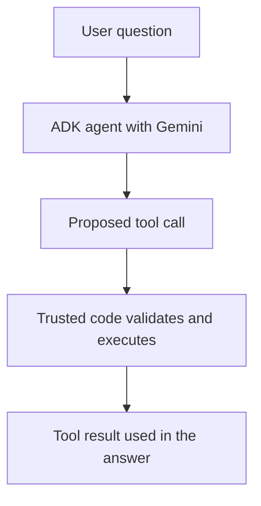

# Module 1: Introduction to AI Agents

## Before you begin: what this module teaches

**ADK concept: agents, models and bounded capabilities.**

A model generates text or proposes a tool call. An agent combines that model with instructions and permitted tools. A tool is application code that performs a defined operation. ADK coordinates execution and records events. The model proposing “read this case” is different from trusted code authorizing and performing the read. A workflow is a composition of steps; its nodes need not all be AI agents.

**Where you would use this in real work.**

Meera at a fictional Pune bank branch wants help preparing a company meeting. Some work is language work: explaining why documents are needed. Some work is exact: checking whether the case service recorded their receipt. Start by separating those tasks before deciding to build an agent.

**Connection to Gemini Enterprise Agent Platform and Google Cloud.**

ADK is the application framework, Gemini supplies model reasoning, and Agent Runtime is a managed hosting choice introduced later. Firestore or a bank API owns the actual case facts. A local agent definition does not provision those services.

**By the end, you should be able to:**

- Explain model, agent, tool and workflow using four different responsibilities.
- Separate a language task from an exact rule in the customer request.
- Draw one input, one permitted operation and one observable result.

### Review this lesson through three perspectives

- **Python/ADK beginner:** Trace a question about documents without claiming they were received.
- **Experienced engineer:** Compare a plain function, a single agent and an agent-plus-tool design.
- **Bank FDE:** Ask what employee task should improve and what the assistant must never decide.

Use the [guided lab](./lab.md) to observe the mechanism, then compare with the [solution](./lab-solution.md). The banking scenario above explains how to transfer the concept; a lab using a railway, weather or shopping fixture does not implement a live bank integration.

## Draw the execution boundary

One tool-using request; the model can also answer without requesting a tool.

<!-- TEACHER_NOTE_START -->
**Teacher's note (ADK instructor view):**
- **Learning goal:** Explain the concept clearly from beginner to advanced, with a simple mental model first.
- **Why it matters:** Connect the concept to real Google agentic workflows, Python engineering habits, and production-ready decisions.
- **Version watch:** Validate against the latest official ADK / Google docs before teaching; call out deprecations or migration notes when needed.
- **Module linkage:** Connect this idea to the previous and next modules so learners see the progression across the course.
<!-- TEACHER_NOTE_END -->

## Theory

### The Rise of AI Agents

In the rapidly evolving landscape of artificial intelligence, we are moving beyond simple chatbots and predictive models. The next frontier is **AI Agents**: autonomous systems that can understand goals, make plans, and use tools to interact with their environment to accomplish complex tasks.

Unlike traditional programs that follow a rigid set of instructions, an agent can reason, adapt, and act on its own. This paradigm shift is powered by the sophisticated reasoning capabilities of Large Language Models (LLMs) like Google's Gemini.

### What is an AI Agent?

An AI Agent is a system that can:

1.  **Perceive its environment:** It takes in information, such as a user's request in natural language.
2.  **Reason and Plan:** It uses an LLM as its "brain" to break down a high-level goal into a sequence of smaller, actionable steps.
3.  **Act using Tools:** It executes those steps by interacting with its environment. This could mean calling an API, searching a database, running a piece of code, or even using another agent.
4.  **Observe the Outcome:** It analyzes the results of its actions and adjusts its plan accordingly until the goal is achieved.

Think of an agent as an autonomous worker that you can delegate complex tasks to, moving from just "chatting" with an AI to collaborating with it.

### Introducing the Google Agent Development Kit (ADK)

Building robust, production-ready AI agents is a complex task. It involves much more than just prompting an LLM. You need to manage conversation history, handle tool integrations, orchestrate complex workflows, evaluate performance, and deploy the agent to a scalable infrastructure.

The **Google Agent Development Kit (ADK)** is a comprehensive framework designed to solve these challenges. It provides developers with the tools and structure needed to build, manage, evaluate, and deploy sophisticated AI-powered agents seamlessly on the **Gemini Enterprise Agent Platform** (formerly known as Vertex AI).

#### The ADK Philosophy

The ADK is built on a philosophy of **modularity, flexibility, and scalability**. It provides a set of core primitives that you can compose like building blocks to create everything from simple, single-purpose agents to complex, multi-agent systems.

#### Core Concepts of ADK 2.0: The Graph Architecture

ADK supports ordinary agents, agent teams, template workflows and explicit graph workflows. Learn a single agent first, then choose a composition when the task requires it. A graph is a useful way to describe dependencies; it is not a compulsory wrapper around every application.

*   **Node:** The fundamental building block. A node is a discrete unit of work. It can be an **Agent** (powered by an LLM), a **Function Tool** (pure code), or even another nested **Workflow**.
*   **Edge:** Defines the flow of control and data between nodes. Edges can be linear (sequential), branched (conditional), or even cyclic (loops).
*   **Workflow:** The container and orchestrator. A Workflow defines the structure of your graph and manages the transitions between nodes using the **Workflow Runtime**.
*   **App & Runner:** The infrastructure layer. An **App** wraps your root agent or workflow, and a **Runner** (like the `InMemoryRunner`) executes it, handling session state and telemetry.
*   **Tool:** Capability interfaces that can be assigned to Agent nodes (e.g., Search, Database access).
*   **Session & State:** Record a scoped conversation and its working values. A separate memory service can retrieve selected past context; neither replaces the current business record.

In this course, you will learn to think in **Graphs and Nodes**, mastering ADK 2.0 to build scalable, production-grade AI applications.

### Key Takeaways
- AI Agents are autonomous systems that perceive, reason, and act using tools.
- ADK offers graph composition as well as agent and template composition. Nodes can be ordinary functions; multiple nodes do not automatically mean multiple AI agents.
- The **Workflow Runtime** is the engine that orchestrates complex multi-agent interactions on the **Gemini Enterprise Agent Platform**.

## Continue the course story

Previous: [Course introduction](../README.md) · Next: [Module 02](../module02-environment-setup/README.md) · [See how the concepts build](../learning-journey.md)

Before continuing, explain one input, one ADK execution boundary and one failure outcome from this module. Use the next chapter to add a new customer requirement, not merely another component.

<!-- © 2026 Inder Chauhan (https://github.com/inderanz/google-adk-training). All rights reserved. Ref: IC-ADK-module01-intro-to-ai-agents-README -->
---

## Official References

- Google ADK docs (latest): https://google.github.io/adk-docs/
- Gemini API (multimodal): https://ai.google.dev/gemini-api/docs
- Google GenAI Python SDK reference: https://googleapis.github.io/python-genai/
- Vertex AI generative guidance: https://cloud.google.com/vertex-ai/generative-ai
- Cloud Vision and OCR: https://cloud.google.com/vision

