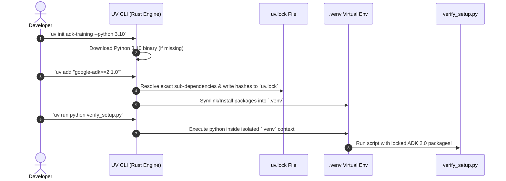

# Lab Solution: Environment Setup & UV Workspace Verification

## Overview & Goal

This document provides the complete, production-ready implementation and verification playbook for Module 2.

Beyond providing raw CLI commands, this solution guide acts as an **FDE Engineering Playbook**. It breaks down how a **Google Forward-Deployed Engineer (FDE)** initializes Python 3.10+ workspaces using `uv`, configures secure authentication credentials in `.env`, and implements setup verification scripts with line-by-line pedagogical explanations.

---

### 💡 FDE & Instructor Hint: Steering AI Assistants (Antigravity)

When setting up project environments or asking **Antigravity** to write verification scripts or environment configurations, use this **Module 02 Master Steering Prompt**:

> **Master Antigravity Steering Prompt Template (Module 02 - Environment Setup & UV Tooling):**
> *"You are an expert Google ADK 2.0 Forward-Deployed Engineer. Configure and verify a Google ADK 2.0 environment using modern Python 3.10+ and `uv` package management:*
> 1. *Always use `uv` native commands (`uv init adk-training --python 3.10`, `uv add "google-adk>=2.1.0" python-dotenv`) instead of global `pip install`.*
> 2. *Structure authentication in `.env` using `GOOGLE_API_KEY` for AI Studio or `GOOGLE_GENAI_USE_VERTEXAI="1"` / `GOOGLE_CLOUD_PROJECT` for Vertex AI/Agent Platform.*
> 3. *Write environment verification scripts using modern `from google.adk import Agent` and run them strictly via `uv run python verify_setup.py`.*
> 4. *If optional extras are needed (LiteLLM, GCP, MCP), use `uv add "google-adk[extensions]"` or `uv add "google-adk[mcp]"`.*
> 5. *Never hardcode API keys in source code; load them via `python-dotenv` or system environment variables."*

---

## 🏛️ Part 1: The FDE Architectural Mental Model

### From Plain English Requirements to ADK 2.0 Code

In enterprise software engineering, initializing a development environment is more than running a installer. "Global pip installs" cause dependency drift, broken C-extension builds, and version conflicts across developer machines.

As a Google FDE, your job is to enforce **Hermetic Environment Isolation** using `uv` (Astral's high-performance Rust-based Python package manager).

Here is the exact Requirements-to-Code Matrix for this lab:

| # | Business Requirement | FDE Engineering Risk / Challenge | ADK 2.0 Solution Pattern | CLI / Code Implementation |
|---|---|---|---|---|
| **1** | *"Create a clean, isolated Python 3.10+ project directory."* | **Python Version Drift:** Machines with legacy Python 3.8/3.9 fail to parse modern typing. | **Automated Python Provisioning:** Use `uv init` with explicit `--python 3.10` target. | `uv init adk-training --python 3.10` |
| **2** | *"Install Google ADK 2.1+ and dotenv securely without global pip installs."* | **Dependency Conflicts:** Installing packages globally corrupts system tools. | **Isolated Lockfile Management:** Use `uv add` to write locked dependencies to `uv.lock`. | `uv add "google-adk>=2.1.0" python-dotenv` |
| **3** | *"Manage API keys safely without committing secrets to version control."* | **Credential Leakage:** Hardcoding API keys in `.py` files leads to accidental git commits. | **Dotenv Secret Isolation:** Load secrets from `.env` (added to `.gitignore`). | `.env` settings:<br/>`GOOGLE_API_KEY="AIzaSy..."` |
| **4** | *"Verify that the ADK environment can connect to Gemini and generate tokens."* | **False Environment Confidence:** Installing packages doesn't guarantee API connectivity. | **Sanity Verification Script:** Run a lightweight verification script via `uv run`. | `uv run python verify_setup.py` |

---

## ⚙️ Part 2: Step-by-Step Implementation Guide

### Step 1: Initialize Project Directory with UV

<!-- TEACHER_NOTE_START -->
**Teacher's note (ADK instructor view):**
- **Learning goal:** Explain the concept clearly from beginner to advanced, with a simple mental model first.
- **Why it matters:** Connect the concept to real Google agentic workflows, Python engineering habits, and production-ready decisions.
- **Version watch:** Validate against the latest official ADK / Google docs before teaching; call out deprecations or migration notes when needed.
- **Module linkage:** Connect this idea to the previous and next modules so learners see the progression across the course.
<!-- TEACHER_NOTE_END -->
```bash
# 1. Initialize project with explicit Python 3.10+ specification
# uv will automatically download Python 3.10 if it is missing from your machine!
uv init adk-training --python 3.10

# 2. Navigate into workspace
cd adk-training
```

---

### Step 2: Install ADK 2.0 Dependencies

<!-- TEACHER_NOTE_START -->
**Teacher's note (ADK instructor view):**
- **Learning goal:** Explain the concept clearly from beginner to advanced, with a simple mental model first.
- **Why it matters:** Connect the concept to real Google agentic workflows, Python engineering habits, and production-ready decisions.
- **Version watch:** Validate against the latest official ADK / Google docs before teaching; call out deprecations or migration notes when needed.
- **Module linkage:** Connect this idea to the previous and next modules so learners see the progression across the course.
<!-- TEACHER_NOTE_END -->
```bash
# Add Google ADK 2.1+ and python-dotenv package dependencies
uv add "google-adk>=2.1.0" python-dotenv
```

---

### Step 3: Configure Environment Credentials (`.env`)

Create `.env` in your `adk-training/` project root directory:

#### Option A: Google AI Studio (API Key)
```env
GOOGLE_API_KEY=your_actual_gemini_api_key_here
```

#### Option B: Google Cloud Vertex AI (Service Account / ADC)
```env
GOOGLE_GENAI_USE_VERTEXAI=1
GOOGLE_CLOUD_PROJECT=your_gcp_project_id
GOOGLE_CLOUD_QUOTA_PROJECT=your_gcp_project_id
GOOGLE_CLOUD_LOCATION=us-central1
```

---

### Step 4: Write Setup Verification Script (`verify_setup.py`)

Create `verify_setup.py` in your `adk-training/` workspace directory:

<!-- TEACHER_NOTE_START -->
**Teacher's note (ADK instructor view):**
- **Learning goal:** Explain the concept clearly from beginner to advanced, with a simple mental model first.
- **Why it matters:** Connect the concept to real Google agentic workflows, Python engineering habits, and production-ready decisions.
- **Version watch:** Validate against the latest official ADK / Google docs before teaching; call out deprecations or migration notes when needed.
- **Module linkage:** Connect this idea to the previous and next modules so learners see the progression across the course.
<!-- TEACHER_NOTE_END -->
```python
"""
ADK 2.0 Environment Verification Script

This script verifies that:
1. Virtual environment dependencies are active.
2. Credentials in `.env` are loaded properly.
3. ADK `Agent` nodes can connect to Gemini and return responses.
"""

import asyncio
import os
from dotenv import load_dotenv
from google.adk import Agent
from google.adk.apps import App
from google.adk.runners import InMemoryRunner

# Step 1: Load environment variables from .env
load_dotenv()


async def verify_environment():
    print("🔍 Testing ADK 2.0 Environment Setup...")

    # Step 2: Verify API Key or GCP Project exists
    has_api_key = bool(os.getenv("GOOGLE_API_KEY"))
    has_vertex = os.getenv("GOOGLE_GENAI_USE_VERTEXAI") == "1"

    if not (has_api_key or has_vertex):
        print("❌ Error: No valid authentication found in .env!")
        print("Please configure GOOGLE_API_KEY or GOOGLE_GENAI_USE_VERTEXAI=1.")
        return

    print("🚀 Initializing test Agent node...")

    # Step 3: Create simple test agent
    test_agent = Agent(
        name="setup_verifier",
        model="gemini-2.5-flash",
        instruction="Reply with exactly: 'ADK 2.0 is Ready!' and nothing else.",
    )

    app = App(name="verification_app", root_agent=test_agent)
    runner = InMemoryRunner(app=app)

    print("📡 Connecting to Gemini API...")

    # Step 4: Run test query
    events = await runner.run_debug("Test connection", user_id="test_admin")

    for event in events:
        if event.is_final_response():
            response_text = event.content.parts[0].text
            print(f"✅ Agent Response: {response_text}")
            print("🎉 SETUP COMPLETE! You are ready to build ADK 2.0 agents.")


if __name__ == "__main__":
    asyncio.run(verify_environment())
```

Execute the verification script using `uv`:
<!-- TEACHER_NOTE_START -->
**Teacher's note (ADK instructor view):**
- **Learning goal:** Explain the concept clearly from beginner to advanced, with a simple mental model first.
- **Why it matters:** Connect the concept to real Google agentic workflows, Python engineering habits, and production-ready decisions.
- **Version watch:** Validate against the latest official ADK / Google docs before teaching; call out deprecations or migration notes when needed.
- **Module linkage:** Connect this idea to the previous and next modules so learners see the progression across the course.
<!-- TEACHER_NOTE_END -->
```bash
uv run python verify_setup.py
```

---

## 🔬 Part 3: Deep Breakdown of UV Package Management & MCP Ground Truth

Here is the sequence diagram showing how `uv` manages virtual environments and lockfiles deterministically:

<!-- TEACHER_NOTE_START -->
**Teacher's note (ADK instructor view):**
- **Learning goal:** Explain the concept clearly from beginner to advanced, with a simple mental model first.
- **Why it matters:** Connect the concept to real Google agentic workflows, Python engineering habits, and production-ready decisions.
- **Version watch:** Validate against the latest official ADK / Google docs before teaching; call out deprecations or migration notes when needed.
- **Module linkage:** Connect this idea to the previous and next modules so learners see the progression across the course.
<!-- TEACHER_NOTE_END -->


---

## 🚀 FDE Playbook: Supercharging Coding Agents with MCP & ADK Ground Truth

When consulting with enterprise customers or configuring AI coding agents (such as Google Antigravity, Claude Code, Cursor, or Codex) to build production-grade ADK applications, standard out-of-the-box LLMs often struggle because their training data predates recent breaking changes (such as ADK 2.0 object models and ADK 2.9 features).

As an FDE or Technical Consultant, you can equip any modern coding agent with **live, verified ground truth** by setting up Model Context Protocol (MCP) servers and runtime inspection.

### 1. The Architectural Blueprint: The 3-Tier Ground Truth Model

To prevent hallucinations and guarantee accurate, enterprise-grade ADK code:

```text
┌─────────────────────────────────────────────────────────────┐
│ Tier 1: Upstream MCP Documentation (adk-docs / llms.txt)    │  <- Official design patterns & latest features
├─────────────────────────────────────────────────────────────┤
│ Tier 2: Local Runtime Reflection (.venv / help / dir)        │  <- Exact installed type signatures & parameters
├─────────────────────────────────────────────────────────────┤
│ Tier 3: Empirical Simulation (Execution & Verification)      │  <- Zero runtime crashes verified locally
└─────────────────────────────────────────────────────────────┘
```

---

### 2. MCP Server Configuration Guide for Any Coding Agent

Modern coding agents support the **Model Context Protocol (MCP)**. You can provide live documentation feeds to Antigravity, Claude Code, or Cursor using standard configuration files.

#### A. Antigravity Configuration (`~/.gemini/config/mcp_config.json`)

<!-- TEACHER_NOTE_START -->
**Teacher's note (ADK instructor view):**
- **Learning goal:** Explain the concept clearly from beginner to advanced, with a simple mental model first.
- **Why it matters:** Connect the concept to real Google agentic workflows, Python engineering habits, and production-ready decisions.
- **Version watch:** Validate against the latest official ADK / Google docs before teaching; call out deprecations or migration notes when needed.
- **Module linkage:** Connect this idea to the previous and next modules so learners see the progression across the course.
<!-- TEACHER_NOTE_END -->
```json
{
  "mcpServers": {
    "adk-docs": {
      "command": "npx",
      "args": ["-y", "@google/adk-docs-mcp"],
      "env": {
        "DOCS_SOURCE_URL": "https://adk.dev/llms.txt"
      }
    },
    "gemini-api-docs": {
      "command": "npx",
      "args": ["-y", "@google/gemini-docs-mcp"]
    },
    "filesystem": {
      "command": "npx",
      "args": ["-y", "@modelcontextprotocol/server-filesystem", "/path/to/workspace"]
    }
  }
}
```

---

### 3. FDE Inspection Runbook: Troubleshooting Syntax & Verifying Code Without Memorizing APIs

When onboarding a customer team or troubleshooting in a live workshop, use these four progressive diagnostic steps:

#### Step 1: Zero-Syntax Verification with `uv`
Check installed versions and complete dependency trees without writing any Python:
<!-- TEACHER_NOTE_START -->
**Teacher's note (ADK instructor view):**
- **Learning goal:** Explain the concept clearly from beginner to advanced, with a simple mental model first.
- **Why it matters:** Connect the concept to real Google agentic workflows, Python engineering habits, and production-ready decisions.
- **Version watch:** Validate against the latest official ADK / Google docs before teaching; call out deprecations or migration notes when needed.
- **Module linkage:** Connect this idea to the previous and next modules so learners see the progression across the course.
<!-- TEACHER_NOTE_END -->
```bash
# Display full graphical dependency tree with exact resolved versions
uv tree

# Query installed ADK package directly
uv pip list | grep google-adk
```

#### Step 2: Single-Line Dynamic Version Check
Confirm the installed version in `.venv` rather than host Python:
<!-- TEACHER_NOTE_START -->
**Teacher's note (ADK instructor view):**
- **Learning goal:** Explain the concept clearly from beginner to advanced, with a simple mental model first.
- **Why it matters:** Connect the concept to real Google agentic workflows, Python engineering habits, and production-ready decisions.
- **Version watch:** Validate against the latest official ADK / Google docs before teaching; call out deprecations or migration notes when needed.
- **Module linkage:** Connect this idea to the previous and next modules so learners see the progression across the course.
<!-- TEACHER_NOTE_END -->
```bash
uv run python -c "import google.adk; print(google.adk.__version__)"
```

#### Step 3: Interactive Sandbox Inspection (`dir()` and `help()`)
Teach customer developers how to discover exact classes, methods, and parameters live in the terminal:
<!-- TEACHER_NOTE_START -->
**Teacher's note (ADK instructor view):**
- **Learning goal:** Explain the concept clearly from beginner to advanced, with a simple mental model first.
- **Why it matters:** Connect the concept to real Google agentic workflows, Python engineering habits, and production-ready decisions.
- **Version watch:** Validate against the latest official ADK / Google docs before teaching; call out deprecations or migration notes when needed.
- **Module linkage:** Connect this idea to the previous and next modules so learners see the progression across the course.
<!-- TEACHER_NOTE_END -->
```bash
uv run python
```
<!-- TEACHER_NOTE_START -->
**Teacher's note (ADK instructor view):**
- **Learning goal:** Explain the concept clearly from beginner to advanced, with a simple mental model first.
- **Why it matters:** Connect the concept to real Google agentic workflows, Python engineering habits, and production-ready decisions.
- **Version watch:** Validate against the latest official ADK / Google docs before teaching; call out deprecations or migration notes when needed.
- **Module linkage:** Connect this idea to the previous and next modules so learners see the progression across the course.
<!-- TEACHER_NOTE_END -->
```python
>>> import google.adk
>>> # 1. See every exposed symbol:
>>> dir(google.adk)
>>> # 2. View full interactive documentation and signatures:
>>> help(google.adk)
>>> # 3. Inspect a specific component (e.g., Agent or Runner):
>>> from google.adk import Agent
>>> help(Agent)
>>> exit()
```

#### Step 4: Golden Rules for ADK 2.0
* **`LlmResponse`**: Never use `.candidates`. Use `.content` directly.
* **`LlmRequest`**: Access prompt history via `.contents`.
* **Events**: Use modern event methods (e.g. `event.is_final_response()`).
* **Environment Execution**: Always run commands via `uv run` to ensure isolation inside `.venv`.

---

## ❓ Self-Reflection & Interview Prep

1. **Why is `uv` considered a major upgrade over traditional tools like `pip` and `venv`?**
   * *Answer:* `uv` is written in Rust, making package resolution up to 10-100x faster than `pip`. It automatically manages Python version downloads, lockfiles (`uv.lock`), and virtual environments in a single unified tool.

2. **What is the purpose of the `uv.lock` file?**
   * *Answer:* `uv.lock` records the exact cryptographic hashes and resolved versions for every package and transitive dependency. This guarantees deterministic, identical builds across all developer machines and CI/CD pipelines.

---

## 📚 Official References

- **Google ADK Documentation:** https://google.github.io/adk-docs/
- **UV Documentation:** https://docs.astral.sh/uv/

<!-- © 2026 Inder Chauhan (https://github.com/inderanz/google-adk-training). All rights reserved. Ref: IC-ADK-module02-environment-setup-lab-solution -->
---

## Official References

- Google ADK docs (latest): https://google.github.io/adk-docs/
- Google AI / Gemini docs: https://ai.google.dev/
- Google GenAI Python SDK reference: https://googleapis.github.io/python-genai/
- Context7 / current SDK lookup for the exact installed version and API signatures
- Related module path: review the surrounding modules for continuity, prerequisites, and follow-on concepts

