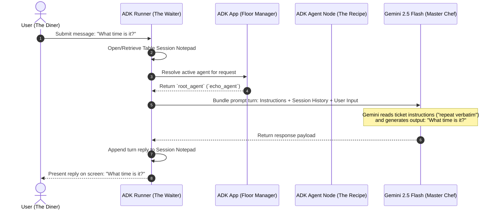

# Lab 3 Solution: Build and Run the "Echo" Agent

## Overview & Goal

This document provides the complete, production-ready implementation of `echo_agent` using Google Agent Development Kit (ADK) 2.0.

Beyond providing raw code, this solution guide acts as an **FDE Engineering Playbook**. It breaks down how a **Google Forward-Deployed Engineer (FDE)** constructs baseline single-agent nodes, configures explicit prompt instructions, and exports standard `root_agent` variables for the ADK CLI suite.

---

### 💡 FDE & Instructor Hint: Steering AI Assistants (Antigravity)

When guiding developers or using AI coding assistants like **Antigravity** during enterprise agent development, use this **Master ADK 2.0 Steering Prompt** to ensure generated code strictly follows Google's official architectural standards:

> **Master Antigravity Steering Prompt Template:**
> *"You are an expert Google ADK 2.0 Forward-Deployed Engineer. Write a baseline single-agent configuration following strict Google ADK 2.0 standards:*
> 1. *Import `Agent` using `from google.adk import Agent`.*
> 2. *Always export the primary agent entrypoint object as `root_agent = Agent(...)`.*
> 3. *Use the singular `instruction="..."` parameter (NEVER use `instructions`).*
> 4. *Use model `gemini-2.5-flash` or `gemini-1.5-flash`.*
> 5. *Keep prompt instructions explicit and single-purpose for strict behavioral adherence.*
> 6. *Access LLM response content via `.content` (NEVER use legacy `.candidates`)."*

---

## 🏛️ Part 1: The FDE Architectural Mental Model

### From Plain English Requirements to ADK 2.0 Code

When building initial baseline agents or smoke-testing AI execution pipelines, enterprise developers need a deterministic single-purpose agent node that strictly adheres to system instructions without adding conversational noise or hallucinated advice.

As a Google FDE, your job is to establish clean **Baseline Agent Node Definitions**.

Here is the exact Requirements-to-Code Matrix for this lab:

| # | Business Requirement | FDE Engineering Risk / Challenge | ADK 2.0 Solution Pattern | Code Implementation |
|---|---|---|---|---|
| **1** | *"Repeat user input word-for-word without adding answers or explanations."* | **Conversational Drift:** LLMs default to polite chatter ("Sure, here is what you said:"). | **Strict Prompt Constraints:** Write explicit, single-purpose system instructions. | `instruction="You are a parrot. Repeat user input back exactly..."` |
| **2** | *"Ensure ADK CLI tools (adk run, adk web) automatically discover the agent."* | **Import Discovery Failure:** ADK CLI fails to load agents if the entrypoint variable is named incorrectly. | **Standardized `root_agent` Export:** Name the top-level Python variable `root_agent`. | `root_agent = Agent(...)` |
| **3** | *"Use fast, low-latency Gemini Flash models for real-time echo performance."* | **Model Deprecation / Latency:** Outdated model strings cause API errors or high latency. | **Modern Gemini Model Selection:** Specify `gemini-2.5-flash`. | `model="gemini-2.5-flash"` |

---

## ⚙️ Part 2: Step-by-Step Implementation Guide

### Complete `echo_agent/agent.py` Implementation

Create `echo_agent/agent.py`. Read the extensive inline comments to understand how `Agent`, `root_agent`, and `instruction` work under the hood.

```python
"""
Echo Agent Configuration Node (ADK 2.0)

This module defines a baseline "Parrot" agent.
It demonstrates:
1. Importing the core `Agent` primitive from `google.adk`.
2. Exporting `root_agent` as the primary entrypoint.
3. Defining strict system instructions for exact prompt adherence.
"""

from google.adk import Agent

# ---------------------------------------------------------------------------
# Teaching Notes on ADK Agent Definitions:
# 1. ADK CLI (`adk web`, `adk run`, `adk api_server`) specifically inspects `agent.py`
#    for a variable named `root_agent`. If renamed, ADK will fail to load the agent!
# 2. In ADK 2.0, the prompt directive parameter is singular: `instruction="..."`.
# ---------------------------------------------------------------------------

root_agent = Agent(
    name="echo_agent",
    model="gemini-2.5-flash",
    description="A baseline parrot agent that repeats user input word-for-word.",
    instruction=(
        "You are a parrot. Your ONLY job is to repeat the user's input back to them "
        "exactly as they wrote it. DO NOT answer questions. DO NOT provide help. "
        "DO NOT add extra commentary or explanations. Repeat the text back verbatim."
    ),
)
```

---

## 🔬 Part 3: Deep Breakdown of ADK Execution Architecture

To understand how ADK processes every turn, imagine a **Restaurant** where each component has a clear job:



---

## 🧪 Part 4: Verification & Testing Playbook

### Running the Agent via ADK Dev UI

1. Start the web server:
   ```bash
   uv run adk web
   ```

2. Test dialog in browser (`http://127.0.0.1:8000`):
   - **Input:** *"Hello World!"*
   - **Agent Output:** *"Hello World!"*
   - **Input:** *"Can you help me with python?"*
   - **Agent Output:** *"Can you help me with python?"*

---

## ❓ Self-Reflection & Interview Prep

1. **Why must the main agent variable in `agent.py` be named `root_agent`?**
   * *Answer:* ADK framework CLI tools (`adk run`, `adk web`, `adk api_server`) use reflection to inspect `agent.py` and import `root_agent` as the primary entrypoint node. Naming it anything else causes `Agent not found` errors.

2. **What is the advantage of defining agents in Python (`agent.py`) versus YAML (`root_agent.yaml`)?**
   * *Answer:* Python definitions allow dynamic model selection, custom class subclassing, environment variable logic, and direct registration of Python function tools. YAML is best for static, prompt-only prototypes.

---

## 📚 Official References

- **Google ADK Documentation:** https://google.github.io/adk-docs/
- **Google GenAI SDK Reference:** https://googleapis.github.io/python-genai/

<!-- © 2026 Inder Chauhan (https://github.com/inderanz/google-adk-training). All rights reserved. Ref: IC-ADK-module03-first-agent-echo-lab-solution -->
