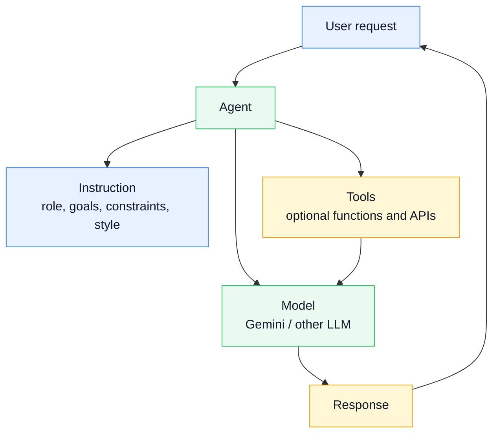
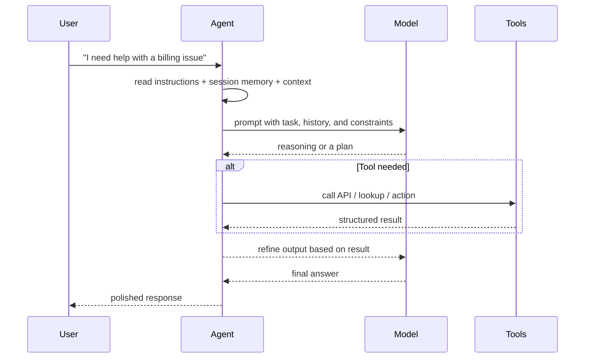

# Module 4: Core Agent Concepts: Agent Deep Dive

## Theory

### The "Brain" of the Operation

At the heart of most applications you build with the ADK is the **`Agent`**. This is the component that acts as the "thinking" part of your application. It uses the power of a Large Language Model (LLM) like Gemini to understand user requests, reason about them, and decide on a course of action.

In ADK 2.0, the `Agent` class (formerly `Agent`) is the primary node type for LLM-powered reasoning. Unlike a traditional program that follows a fixed, deterministic path, an `Agent` is non-deterministic. It interprets the context of a conversation and its own instructions to dynamically figure out what to do next. This flexibility is what makes agents so powerful.

Building an effective `Agent` requires a clear understanding of its core configuration parameters. In this module, we'll take a deep dive into the most important one: the `instruction`.

### A simple mental model: what the Agent actually is

<!-- TEACHER_NOTE_START -->
**Teacher's note (ADK instructor view):**
- **Learning goal:** Explain the concept clearly from beginner to advanced, with a simple mental model first.
- **Why it matters:** Connect the concept to real Google agentic workflows, Python engineering habits, and production-ready decisions.
- **Version watch:** Validate against the latest official ADK / Google docs before teaching; call out deprecations or migration notes when needed.
- **Module linkage:** Connect this idea to the previous and next modules so learners see the progression across the course.
<!-- TEACHER_NOTE_END -->


A helpful way to think about it:

- **Instruction** = the agent's job description
- **Model** = the reasoning engine
- **Tools** = the hands and eyes it can use to do work
- **Output** = the result that comes back to the user

### The request lifecycle inside one agent

<!-- TEACHER_NOTE_START -->
**Teacher's note (ADK instructor view):**
- **Learning goal:** Explain the concept clearly from beginner to advanced, with a simple mental model first.
- **Why it matters:** Connect the concept to real Google agentic workflows, Python engineering habits, and production-ready decisions.
- **Version watch:** Validate against the latest official ADK / Google docs before teaching; call out deprecations or migration notes when needed.
- **Module linkage:** Connect this idea to the previous and next modules so learners see the progression across the course.
<!-- TEACHER_NOTE_END -->


This is the core pattern of agent behavior: the agent does not just “guess once.” It reads context, reasons, may call tools, and then produces a final answer in the right format.

### Defining the Agent's Identity

Every `Agent` has a few basic identity parameters:

*   **`name` (Required):** A unique identifier for the agent (e.g., `echo_agent`).
*   **`description` (Optional):** A short summary of the agent's purpose.
*   **`model` (Required):** The specific LLM that powers the agent (e.g., `gemini-3.5-flash`).

### The Art of the Instruction

While the `name` and `model` are essential, the **`instruction`** parameter is where you truly shape your agent's behavior. The instruction is the master prompt that is sent to the LLM with every user request. It is your primary tool for controlling the agent.

A well-crafted instruction tells the agent:

*   **Its Persona:** How should it behave? Is it a formal assistant, a witty pirate, a helpful teacher?
    *   *Example:* `"You are a cheerful and enthusiastic assistant."`
*   **Its Core Goal:** What is its primary function?
    *   *Example:* `"Your main goal is to help users find information about movies."`
*   **Its Constraints and Rules:** What should it *not* do? Are there topics it should avoid?
    *   *Example:* `"You must never give financial advice. If asked, politely decline."`
    *   **Production Readiness:** Defining clear constraints is a critical practice for ensuring the safety and reliability of an agent in a production environment.
*   **Its Process:** If the task involves multiple steps, you can outline them.
    *   *Example:* `"First, ask the user for their location. Second, find the weather for that location. Third, report the weather to the user."`
*   **Its Output Format:** How should it format its responses?
    *   *Example:* `"Always present your final answer as a JSON object with a 'result' key."`

### Tips for Effective Instructions (Prompt Engineering)

Crafting good instructions is a skill often called "prompt engineering." Here are some tips:

*   **Be Clear and Specific:** Ambiguity is the enemy. The more precise your instructions, the more reliable the agent's behavior will be.
*   **Use Simple Language:** Write instructions as if you were talking to a person. Avoid jargon.
*   **Provide Examples (Few-Shot Prompting):** One of the most powerful techniques is to include examples directly in the instruction. This is especially useful for categorization tasks.

    **Python Example (`agent.py`):**
    ```python
    from google.adk import Agent

    root_agent = Agent(
        name="support_classifier",
        model="gemini-3.5-flash",
        instruction="""
          You are a customer support triage agent. 
          Your purpose is to read the user's message and categorize it into one of three departments: "billing", "technical", or "general".
          You must also determine the urgency as "high" or "low".
          Do not try to solve the user's problem; only respond with the categorization and urgency.

          Example User Input: "I was overcharged on my last invoice."
          Example Agent Output: Category: billing, Urgency: high

          Example User Input: "How do I reset my password?"
          Example Agent Output: Category: technical, Urgency: low
          
          Example User Input: "What are your business hours?"
          Example Agent Output: Category: general, Urgency: low
        """
    )
    ```

    **YAML Alternative (`root_agent.yaml`):**
    ```yaml
    instruction: |
      You are a customer support triage agent. 
      Your purpose is to read the user's message and categorize it into one of three departments: "billing", "technical", or "general".
      You must also determine the urgency as "high" or "low".
      Do not try to solve the user's problem; only respond with the categorization and urgency.

      Example User Input: "I was overcharged on my last invoice."
      Example Agent Output: Category: billing, Urgency: high

      Example User Input: "How do I reset my password?"
      Example Agent Output: Category: technical, Urgency: low
      
      Example User Input: "What are your business hours?"
      Example Agent Output: Category: general, Urgency: low
    ```
*   **Iterate and Refine:** Your first instruction will rarely be your last. Test your agent with different inputs and refine the instruction based on its responses.

In the lab for this module, you will practice this skill by building a structured version of this Support Classifier agent.

### Advanced Configuration: Structured Output & State

In many production scenarios, you don't just want a text response; you need **structured data**. ADK 2.0 provides two powerful parameters for this:

#### 1. Enforcing JSON with `output_schema`
You can pass a Pydantic model to the `output_schema` parameter. This forces the LLM to respond *only* with a JSON object that matches that schema.

<!-- TEACHER_NOTE_START -->
**Teacher's note (ADK instructor view):**
- **Learning goal:** Explain the concept clearly from beginner to advanced, with a simple mental model first.
- **Why it matters:** Connect the concept to real Google agentic workflows, Python engineering habits, and production-ready decisions.
- **Version watch:** Validate against the latest official ADK / Google docs before teaching; call out deprecations or migration notes when needed.
- **Module linkage:** Connect this idea to the previous and next modules so learners see the progression across the course.
<!-- TEACHER_NOTE_END -->
```python
from pydantic import BaseModel
from google.adk import Agent

class SentimentOutput(BaseModel):
    sentiment: str
    confidence: float

analyzer_agent = Agent(
    name="sentiment_analyzer",
    model="gemini-3.5-flash",
    instruction="Analyze the sentiment of the user's message.",
    output_schema=SentimentOutput # Force JSON output
)
```

Why this matters so much in agentic systems: an LLM is extremely powerful at generating text, but it is not naturally a strict data pipeline. It may produce a sentence, a list, or a slightly different format than you expect. `output_schema` gives you a contract that says: “This is the exact shape of the result I want.”

Think of it like this:

- A normal LLM response is like a human giving a free-form answer in a conversation.
- A Pydantic model is like a strict intake form or a well-defined API contract.
- The model must fill in the fields in the exact format you expect.

This is extremely important in real-world AI agents because agents often feed data to other systems: databases, APIs, workflows, dashboards, automation pipelines, or even other agents. If your agent says something vague like “This is positive, maybe neutral,” your downstream code may break or make the wrong decision. With `output_schema`, you convert messy AI output into reliable, typed Python objects.

A good mental model is: 

> “The LLM generates a candidate answer, and Pydantic acts as a quality gate before the answer becomes usable by the rest of the system.”

In other words, the agent can be creative, but the final output is still governed by a strict contract.

For Python developers, Pydantic is one of the most important libraries in modern AI and backend engineering because it does both of these jobs at once:

1. It validates data types and required fields.
2. It turns raw data into clean Python objects you can work with in code.

Example:

<!-- TEACHER_NOTE_START -->
**Teacher's note (ADK instructor view):**
- **Learning goal:** Explain the concept clearly from beginner to advanced, with a simple mental model first.
- **Why it matters:** Connect the concept to real Google agentic workflows, Python engineering habits, and production-ready decisions.
- **Version watch:** Validate against the latest official ADK / Google docs before teaching; call out deprecations or migration notes when needed.
- **Module linkage:** Connect this idea to the previous and next modules so learners see the progression across the course.
<!-- TEACHER_NOTE_END -->
```python
from pydantic import BaseModel

class ResumeSummary(BaseModel):
    skills: list[str]
    experience_years: int
    seniority: str

summary = ResumeSummary(
    skills=["python", "agents", "google-adk"],
    experience_years=4,
    seniority="mid"
)
```

If someone passes incorrect data, Pydantic will raise an error instead of letting bad data silently flow through the app. That is a huge advantage in agentic systems, where output quality matters more than “it sounded right.”

This becomes even more powerful when combined with ADK agents. Instead of trusting the model to “format it correctly,” you define the structure in advance, and the model is asked to produce output that matches it. This is one of the foundational patterns for building reliable agent workflows, especially when your agent is doing:

- classification
- extraction
- summarization for downstream systems
- tool call results that must be structured
- multi-agent handoff between specialized agents

A simple analogy: imagine a team of assistants writing a report. Without a template, each assistant may write the answer in a different way. With a Pydantic schema, you give them a fixed form: `title`, `summary`, `status`, `owner`, `next_steps`. Now every result is machine-readable and dependable.

That is the real value of `output_schema`: it turns unstructured AI output into structured, executable business data.

**Note:** ADK 2.0 supports using `output_schema` and `tools` together -- the agent can still call tools during its thought loop, and structure is only enforced on the final output. `output_schema` is best suited for data extraction, classification, or formatting tasks where the final answer needs a strict shape.

#### 2. Passing Data with `output_key`
The `output_key` parameter (a string) tells the ADK to take the final text of the agent's response and save it automatically into the session state dictionary (`ctx.session.state`).

<!-- TEACHER_NOTE_START -->
**Teacher's note (ADK instructor view):**
- **Learning goal:** Explain the concept clearly from beginner to advanced, with a simple mental model first.
- **Why it matters:** Connect the concept to real Google agentic workflows, Python engineering habits, and production-ready decisions.
- **Version watch:** Validate against the latest official ADK / Google docs before teaching; call out deprecations or migration notes when needed.
- **Module linkage:** Connect this idea to the previous and next modules so learners see the progression across the course.
<!-- TEACHER_NOTE_END -->
```python
agent = Agent(
    # ...
    output_key="analysis_result" # Saves output to state['analysis_result']
)
```

This is one of the most important patterns in agentic systems because it lets one agent produce a result and another agent consume it later without you manually copying values around in Python.

A good way to think about `output_key` is this:

- `output_schema` decides the shape of the answer.
- `output_key` decides where that answer is stored for later use.

So if you are building a workflow where Agent A extracts user intent, and Agent B uses that intent to decide what tool to call, then `output_key` becomes a shared memory slot for the workflow.

Imagine a real business scenario:

1. Agent A analyzes an incoming customer complaint.
2. It saves the extracted result under `output_key="ticket_summary"`.
3. Agent B reads that value from session state and decides whether to route the ticket to billing, support, or technical.

Without `output_key`, you would need to manually pass the result by function call or custom state management. That works for small apps, but it becomes messy in multi-agent systems. `output_key` gives you a clean, built-in memory channel between agents.

A simple analogy:

> `output_schema` is the template for the form. `output_key` is the label on the folder where you store the completed form for the next team member to pick up.

This matters because real agent applications are rarely one agent doing one isolated task. In production systems, agents collaborate in workflows, pass context forward, and rely on shared state.

For example:

<!-- TEACHER_NOTE_START -->
**Teacher's note (ADK instructor view):**
- **Learning goal:** Explain the concept clearly from beginner to advanced, with a simple mental model first.
- **Why it matters:** Connect the concept to real Google agentic workflows, Python engineering habits, and production-ready decisions.
- **Version watch:** Validate against the latest official ADK / Google docs before teaching; call out deprecations or migration notes when needed.
- **Module linkage:** Connect this idea to the previous and next modules so learners see the progression across the course.
<!-- TEACHER_NOTE_END -->
```python
class CustomerIntent(BaseModel):
    intent: str
    urgency: str
    customer_id: str

intent_agent = Agent(
    name="intent_classifier",
    model="gemini-3.5-flash",
    instruction="Identify customer intent and urgency from the message.",
    output_schema=CustomerIntent,
    output_key="customer_intent"
)
```

Now the agent is doing two things at once:

1. It returns a structured, validated response.
2. It stores that response in session state under `customer_intent`.

Later, another agent or tool can read that value and continue the workflow.

This is essential for building multi-agent systems where one agent's output is needed as another agent's input.

### Key Takeaways
- The **`Agent`** class is the "brain" of an ADK 2.0 application.
- The `instruction` parameter is the most powerful tool for controlling behavior.
- **`output_schema`**: Enforces strict JSON output via Pydantic on the final response -- the agent can still call tools during its thought loop; only the final answer is constrained to the schema.
- **`output_key`**: Automatically saves the agent's response into the session state for cross-node data passing.

<!-- © 2026 Inder Chauhan (https://github.com/inderanz/google-adk-training). All rights reserved. Ref: IC-ADK-module04-agent-deep-dive-README -->
---

## Official References

- Google ADK docs (latest): https://google.github.io/adk-docs/
- Google AI / Gemini docs: https://ai.google.dev/
- Google GenAI Python SDK reference: https://googleapis.github.io/python-genai/
- Context7 / current SDK lookup for the exact installed version and API signatures
- Related module path: review the surrounding modules for continuity, prerequisites, and follow-on concepts

