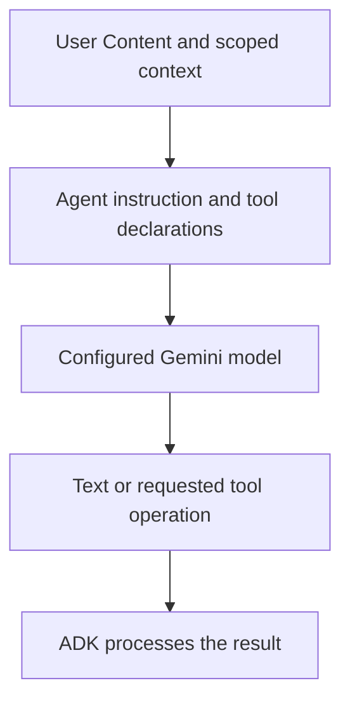
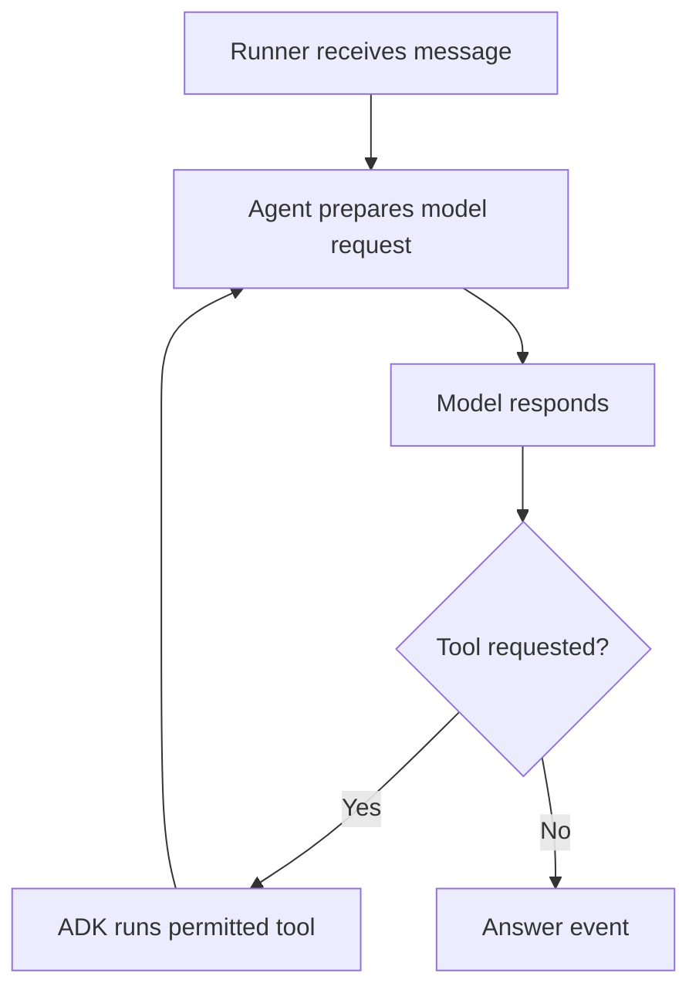

# Module 4: Core Agent Concepts: Agent Deep Dive

## Before you begin: what this module teaches

**ADK concept: Agent configuration, instructions, structured output and output state.**

name identifies the configured role; description helps another component choose it; instruction guides its behavior. output_schema describes the expected response shape. output_key stores an agent output under a chosen state key for later use. A schema is like the branch's standard form: completing its boxes does not prove the information written in them is true. Module 17 will distinguish a classification result from an actual routing signal.

**Where you would use this in real work.**

Meera asks the assistant to classify a request so the next application step can read the answer. A sentence such as “probably document help” is inconvenient to consume. A small form with named fields makes the result easier to validate and inspect.

**Connection to Gemini Enterprise Agent Platform and Google Cloud.**

Gemini generates the proposed result; ADK applies its supported output/state contract. A downstream banking operation still needs authoritative facts and authorization. State persistence depends on the SessionService selected for the application.

**By the end, you should be able to:**

- Explain description versus instruction without treating either as an access rule.
- Define a small result contract and handle invalid or unsupported output.
- Follow a saved output key into the next consumer and identify its scope.

### Review this lesson through three perspectives

- **Python/ADK beginner:** Read one Pydantic field and identify its Python type and allowed values.
- **Experienced engineer:** Test unsupported intent, malformed output and stale state separately.
- **Bank FDE:** Ask who owns each classification category and what happens when the request is ambiguous.

Use the [guided lab](./lab.md) to observe the mechanism, then compare with the [solution](./lab-solution.md). The banking scenario above explains how to transfer the concept; a lab using a railway, weather or shopping fixture does not implement a live bank integration.

## Theory

### The "Brain" of the Operation

At the heart of most applications you build with the ADK is the **`Agent`**. This is the component that acts as the "thinking" part of your application. It uses the power of a Large Language Model (LLM) like Gemini to understand user requests, reason about them, and decide on a course of action.

In ADK 2.0, the `Agent` class (an alias of `LlmAgent`) is the primary node type for LLM-powered reasoning. Unlike a traditional program that follows a fixed, deterministic path, an `Agent` is non-deterministic. It interprets the context of a conversation and its own instructions to dynamically figure out what to do next. This flexibility is what makes agents so powerful.

Building an effective `Agent` requires a clear understanding of its core configuration parameters. In this module, we'll take a deep dive into the most important one: the `instruction`.

### A simple mental model: what the Agent actually is




A helpful way to think about it:

- **Instruction** = the agent's job description
- **Model** = the reasoning engine
- **Tools** = the hands and eyes it can use to do work
- **Output** = the result that comes back to the user

### The request lifecycle inside one agent



This is the core pattern of agent behavior: the agent does not just “guess once.” It reads context, reasons, may call tools, and then produces a final answer in the right format.

### Defining the Agent: `Agent` vs `LlmAgent` Under the Hood

When working with Google ADK in Python, you will often see both of these import styles in codebases:

```python
from google.adk import Agent

# vs
from google.adk.agents.llm_agent import LlmAgent
```

Both run identically. But as an agent architect, it is critical to understand what is happening under the hood.

#### 1. What is the Difference?
In short: **There is zero functional difference at runtime. `Agent` is simply an "alias" (shortcut) for `LlmAgent`.**

Here is what is happening under the hood:

```
Internal File: google/adk/agents/llm_agent.py
   └── class LlmAgent(...)            <-- The real, actual class!

Top-Level File: google/adk/__init__.py
   └── from google.adk.agents.llm_agent import LlmAgent as Agent   <-- The friendly shortcut
```

Because `google.adk` creates that alias in its `__init__.py`, when you ask Python:

```python
>>> import google.adk
>>> help(google.adk.Agent)
```

Python inspects the real object behind that name and tells you:
> *“Help on class LlmAgent in module google.adk.agents.llm_agent”*

---

#### 2. Why Did Google ADK Do This? (The Facade Pattern)

This is a well-known Python design pattern called the **Facade Pattern** (or "Curated Public API"):

1. **For 95% of Users (Beginners & Everyday Devs):**
   You don't want to type long nested paths:
   ```python
   # ❌ Cumbersome and hard to remember
   from google.adk.agents.llm_agent import LlmAgent
   ```
   Google exposes the most common class right at the front door:
   ```python
   # ✅ Clean, elegant, easy to read
   from google.adk import Agent
   ```

2. **For Advanced Architecture (Multi-Agent Systems & Framework Extenders):**
   Internally, ADK supports multiple kinds of agents:
   *   **`LlmAgent`**: An agent driven by an LLM (Gemini, Claude, GPT, etc.).
   *   **`WorkflowAgent`**: An agent driven strictly by a code/graph state machine without an LLM reasoning loop.
   *   **`CustomAgent`**: Custom agents inheriting directly from `BaseAgent`.

   By naming the class `LlmAgent` internally, the ADK team keeps their architecture clean, modular, and extensible. But since 99% of agents built today are LLM-based, they aliased `LlmAgent` $\rightarrow$ `Agent` as the default!

---

#### 3. Deconstructing that Massive `help(LlmAgent)` Signature

When you run `help(google.adk.Agent)`, Python prints dozens of parameters in the constructor. Don't let it intimidate you!

Every single parameter in that constructor falls into one of **5 Logical Buckets**:

```
                       ┌───────────────────────────────┐
                       │           LlmAgent            │
                       └───────────────┬───────────────┘
          ┌──────────────┬─────────────┼──────────────┬──────────────┐
          ▼              ▼             ▼              ▼              ▼
     [1. Identity]  [2. Brain]    [3. Tools]    [4. Schemas]   [5. Callbacks]
      name           model         tools         input_schema   before_agent
      description    instruction   planner       output_schema  after_agent
                     config        code_executor state_schema   before_tool
```

*   **Bucket 1: Identity (Who am I?)**
    *   `name`: Unique ID of the agent (e.g., `"customer_support"`).
    *   `description`: What this agent does (other agents read this when deciding whether to delegate work to it).
*   **Bucket 2: The Brain & Reasoning (How do I think?)**
    *   `model`: The LLM foundation (e.g. `"gemini-3.5-flash"`).
    *   `instruction`: The system prompt / persona that shapes behavior.
    *   `generate_content_config`: Generation hyperparameters (`temperature`, `top_p`, `max_output_tokens`).
    *   `planner`: Optional planning engine (e.g. ReAct / Plan-and-Solve).
*   **Bucket 3: Capabilities & Hands (What can I do?)**
    *   `tools`: Python functions, API tools, or MCP toolsets the agent can execute.
    *   `code_executor`: Allows the agent to run Python code in a sandbox (e.g. `GkeCodeExecutor`).
*   **Bucket 4: Enterprise Contracts (Data validation with Pydantic)**
    *   `input_schema`: Forces input data into a typed Pydantic model before the agent runs.
    *   `output_schema`: Forces the LLM to reply with structured JSON conforming to a schema.
    *   `state_schema`: Types the variables stored in session memory.
*   **Bucket 5: Enterprise Governance & Lifecycle (Callbacks)**
    *   `before_model_callback` / `after_model_callback`: Inspect, sanitize, or log requests and responses (great for PII masking or prompt injection defense).
    *   `before_tool_callback` / `after_tool_callback`: Audit, permit, or alter tool calls before they execute (human-in-the-loop authorization).
    *   `on_tool_error_callback`: Graceful error recovery if an external API goes down.

---

#### 🧠 Mental Model & Rule of Thumb

| Import Style | When to use it |
| :--- | :--- |
| **`from google.adk import Agent`** | **Recommended Standard**. Clean, concise, and future-proof. Use this in 99% of your scripts. |
| **`from google.adk.agents import LlmAgent`** | **Advanced / Explicit Architecture**. Use when building complex multi-agent systems with different types of agents (e.g. mixing `LlmAgent` and `WorkflowAgent`) and wanting absolute clarity in your codebase. |

---

### Core Agent Identity Parameters

Every `Agent` has a few basic identity parameters:

*   **`name` (Required):** A unique identifier for the agent (e.g., `echo_agent`).
*   **`description` (Optional):** A short summary of the agent's purpose.
*   **`model` (Required):** The specific LLM that powers the agent (e.g., `gemini-3.5-flash`).

### The Art of the Instruction

While the `name` and `model` are essential, the **`instruction`** parameter is where you truly shape your agent's behavior. The instruction is the master prompt that is sent to the LLM with every user request. It is your primary tool for controlling the agent.

A well-crafted instruction tells the agent:

*   **Its Persona:** How should it behave? Is it a formal assistant, a witty pirate, a helpful teacher?
    *   *Example:* `"You are a cheerful and enthusiastic assistant."`
*   **Its Core Goal:** What is its primary function?
    *   *Example:* `"Your main goal is to help users find information about movies."`
*   **Its Constraints and Rules:** What should it *not* do? Are there topics it should avoid?
    *   *Example:* `"You must never give financial advice. If asked, politely decline."`
    *   **Production Readiness:** Defining clear constraints is a critical practice for ensuring the safety and reliability of an agent in a production environment.
*   **Its Process:** If the task involves multiple steps, you can outline them.
    *   *Example:* `"First, ask the user for their location. Second, find the weather for that location. Third, report the weather to the user."`
*   **Its Output Format:** How should it format its responses?
    *   *Example:* `"Always present your final answer as a JSON object with a 'result' key."`

### Tips for Effective Instructions (Prompt Engineering)

Crafting good instructions is a skill often called "prompt engineering." Here are some tips:

*   **Be Clear and Specific:** Ambiguity is the enemy. The more precise your instructions, the more reliable the agent's behavior will be.
*   **Use Simple Language:** Write instructions as if you were talking to a person. Avoid jargon.
*   **Provide Examples (Few-Shot Prompting):** One of the most powerful techniques is to include examples directly in the instruction. This is especially useful for categorization tasks.

    **Python Example (`agent.py`):**
    ```python
    from google.adk import Agent

    root_agent = Agent(
        name="support_classifier",
        model="gemini-3.5-flash",
        instruction="""
          You are a customer support triage agent.
          Your purpose is to read the user's message and categorize it into one of three departments: "billing", "technical", or "general".
          You must also determine the urgency as "high" or "low".
          Do not try to solve the user's problem; only respond with the categorization and urgency.

          Example User Input: "I was overcharged on my last invoice."
          Example Agent Output: Category: billing, Urgency: high

          Example User Input: "How do I reset my password?"
          Example Agent Output: Category: technical, Urgency: low

          Example User Input: "What are your business hours?"
          Example Agent Output: Category: general, Urgency: low
        """,
    )
    ```

    **YAML Alternative (`root_agent.yaml`):**
    ```yaml
    instruction: |
      You are a customer support triage agent.
      Your purpose is to read the user's message and categorize it into one of three departments: "billing", "technical", or "general".
      You must also determine the urgency as "high" or "low".
      Do not try to solve the user's problem; only respond with the categorization and urgency.

      Example User Input: "I was overcharged on my last invoice."
      Example Agent Output: Category: billing, Urgency: high

      Example User Input: "How do I reset my password?"
      Example Agent Output: Category: technical, Urgency: low

      Example User Input: "What are your business hours?"
      Example Agent Output: Category: general, Urgency: low
    ```
*   **Iterate and Refine:** Your first instruction will rarely be your last. Test your agent with different inputs and refine the instruction based on its responses.

In the lab for this module, you will practice this skill by building a structured version of this Support Classifier agent.

### Advanced Configuration: Structured Output & State

In enterprise and production AI engineering, getting a free-form string back from an LLM is rarely enough. Downstream microservices, SQL databases, customer portals, and workflow state machines cannot reliably parse sentences like *"Sure, the user seems happy with a score around 0.8"*. They require **typed, validated, machine-readable JSON**.

Furthermore, multi-agent systems require a way for Agent A to write data into memory so Agent B can consume it later without custom spaghetti code.

ADK 2.0 provides two foundational parameters in `LlmAgent` for this exact architecture:
1. **`output_schema`**: Forces the LLM to output strictly formatted JSON conforming to a Pydantic model.
2. **`output_key`**: Automatically stores the generated result into session state (`ctx.session.state[key]`).

---

#### 🔍 Driving the Code from `help(google.adk.Agent)`

As an engineer or instructor, you don't need to guess how these work. Look at their exact definitions directly from the Python terminal:

```python
>>> import google.adk
>>> # Check where schemas and state belong in the constructor:
>>> help(google.adk.Agent)
```

In the constructor, you will find:
*   `output_schema: Union[dict[Any, Any], type, google.genai.types.Schema, ..., NoneType] = None`
*   `output_key: Optional[str] = None`
*   `state_schema: type[pydantic.main.BaseModel] | None = None`

Notice how ADK accepts standard Python types, Pydantic `BaseModel`, or raw schemas for `output_schema`, and a simple `str` for `output_key`.

---

#### 1. Enforcing JSON with `output_schema` (The Quality Gate)

Passing a Pydantic model to `output_schema` requests structured output through the supported model/runtime path. Validate the returned data and handle provider errors, refusal, truncation and schema failures. A valid JSON shape does not prove that its facts are supported or that its proposed action is authorized.

```
┌────────────────────────────────────────────────────────────────────────┐
│                        STRUCTURED OUTPUT FLOW                          │
│                                                                        │
│   User Prompt: "The service was fast, but the price is too high."      │
│         │                                                              │
│         ▼                                                              │
│   ┌───────────┐      Constrained Decoding      ┌──────────────────┐    │
│   │ Gemini    │ ─────────────────────────────▶ │ Raw JSON Payload │    │
│   │ 3.5 Flash │    (No preamble, No markdown)  └────────┬─────────┘    │
│   └───────────┘                                         │              │
│                                                         ▼              │
│                                               ┌───────────────────┐    │
│                                               │ Pydantic Quality  │    │
│                                               │ Gate Validation   │    │
│                                               └─────────┬─────────┘    │
│                                                         │              │
│                                    ┌────────────────────┴───────────┐  │
│                                    ▼                                ▼  │
│                            [Valid Object]                    [Validation Error]
│                     SentimentOutput(sentiment="mixed",      Auto-rejected before
│                                     confidence=0.88)        hitting application!
└────────────────────────────────────────────────────────────────────────┘
```

##### Code Example:
```python
from google.adk import Agent
from pydantic import BaseModel, Field


# Step 1: Define your enterprise data contract using Pydantic
class SentimentOutput(BaseModel):
    sentiment: str = Field(
        description="Overall sentiment category: positive, negative, or mixed"
    )
    confidence: float = Field(
        ge=0.0, le=1.0, description="Confidence score between 0.0 and 1.0"
    )


# Step 2: Bind the contract to output_schema
analyzer_agent = Agent(
    name="sentiment_analyzer",
    model="gemini-3.5-flash",
    instruction="Analyze the sentiment of the user's message accurately.",
    output_schema=SentimentOutput,  # 🎯 Enforces strict JSON matching SentimentOutput
)
```

##### Why this is critical for Production:
1. **Zero Regex / Parsing Code**: You never have to write brittle regex or string splitting (`response.split(":")`) to parse LLM answers.
2. **Deterministic Downstream APIs**: You can immediately call `db.insert(result.model_dump())` or send the JSON to an event bus (e.g. Google Cloud Pub/Sub, Kafka).
3. **Tools + Schema Coexistence**: In ADK 2.0, an agent can still call tools during its multi-step thinking process; the `output_schema` is only applied when emitting its final answer to the user or downstream workflow.

---

#### 2. Passing Data Across Agents with `output_key`

In real enterprise systems, an AI application is almost never a single isolated agent. It is a **pipeline** or a **collaborative team**.

`output_key` solves the data handoff challenge: it instructs the ADK runtime to take the validated final response and automatically write it into the shared session state dictionary (`ctx.session.state[output_key]`).

```
┌───────────────────────────────────────────────────────────────────────────────┐
│                    CROSS-AGENT STATE SHARING WITH output_key                  │
│                                                                               │
│  User: "My account was locked after 3 failed password attempts!"              │
│      │                                                                        │
│      ▼                                                                        │
│  ┌───────────────────────────────┐                                            │
│  │   Triage Agent                │                                            │
│  │   output_key="ticket_info"    │                                            │
│  └───────────────┬───────────────┘                                            │
│                  │                                                            │
│                  │ Writes structured JSON directly into Session Memory        │
│                  ▼                                                            │
│  ┌─────────────────────────────────────────────────────────────────────────┐  │
│  │               ADK Shared Session State (`ctx.session.state`)            │  │
│  │                                                                         │  │
│  │   "ticket_info": {                                                      │  │
│  │       "category": "security",                                           │  │
│  │       "urgency": "critical",                                            │  │
│  │       "customer_id": "cust_9821"                                        │  │
│  │   }                                                                     │  │
│  └─────────────────────────────────────────────────────────────────────────┘  │
│                  ▲                                                            │
│                  │ Reads directly from Session Memory                         │
│                  │                                                            │
│  ┌───────────────┴───────────────┐                                            │
│  │   Security Specialist Agent   │                                            │
│  │   Reads: state['ticket_info'] │                                            │
│  │   Action: Unlocks account & sends 2FA SMS                                  │
│  └───────────────────────────────┘                                            │
└───────────────────────────────────────────────────────────────────────────────┘
```

---

#### 3. Combining Both: The Complete Enterprise Pattern

Here is a composition example showing how `output_schema` and `output_key` work together. A customer pipeline also needs validation, authorization, failure handling and evaluation:

```python
from enum import Enum
from google.adk import Agent
from pydantic import BaseModel, Field


# 1. Define clean enumerations and schemas
class Department(str, Enum):
    BILLING = "billing"
    TECHNICAL = "technical"
    SECURITY = "security"
    GENERAL = "general"


class SupportTicket(BaseModel):
    department: Department = Field(
        description="The target department to handle this issue"
    )
    urgency: str = Field(description="Priority: 'low', 'medium', or 'high'")
    summary: str = Field(description="1-sentence summary of the user's issue")
    action_needed: bool = Field(description="True if human intervention is required")


# 2. Configure the triage agent with BOTH schema and output_key
triage_agent = Agent(
    name="triage_agent",
    model="gemini-3.5-flash",
    instruction="""
      You are an enterprise support triage specialist.
      Evaluate the incoming customer request and classify it accurately into a SupportTicket.
    """,
    output_schema=SupportTicket,  # 📋 Enforces strict SupportTicket JSON contract
    output_key="current_ticket",  # 💾 Stores the result into ctx.session.state['current_ticket']
)
```

#### 🧠 Instructor's Analogy: The Form & The Folder

| Concept | Real-World Analogy | Purpose |
| :--- | :--- | :--- |
| **`output_schema`** | **The Official Standardized Form** | Defines the expected response shape; the application must still check meaning, evidence and authorization. |
| **`output_key`** | **The Labeled Filing Folder in the Shared Cabinet** | Labels where the completed form is placed so the next department (the next agent in the graph) can find it immediately. |

---

### Key Takeaways
- **`Agent` vs `LlmAgent`**: `Agent` is a curated top-level alias (Facade pattern) for `LlmAgent`. Both run identically, but knowing the alias pattern helps you navigate ADK internals and multi-agent system designs.
- **The 5 Constructor Buckets**: Every parameter on `LlmAgent` maps to **Identity**, **Brain & Reasoning**, **Capabilities & Tools**, **Enterprise Contracts (Schemas)**, or **Lifecycle Governance (Callbacks)**.
- The **`Agent`** class is the primary "brain" of an ADK 2.0 application.
- The `instruction` parameter is the most powerful tool for controlling persona, constraints, and task behavior.
- **`output_schema`**: Enforces strict JSON output via Pydantic on the final response -- the agent can still call tools during its thought loop; only the final answer is constrained to the schema.
- **`output_key`**: Automatically saves the agent's response into the session state for cross-node data passing.

{/* © 2026 Inder Chauhan (https://github.com/inderanz/google-adk-training). All rights reserved. Ref: IC-ADK-module04-agent-deep-dive-README */}
---


## Official References

- Google ADK docs (latest): https://google.github.io/adk-docs/
- Gemini API (multimodal): https://ai.google.dev/gemini-api/docs
- Google GenAI Python SDK reference: https://googleapis.github.io/python-genai/
- Vertex AI generative guidance: https://cloud.google.com/vertex-ai/generative-ai
- Cloud Vision and OCR: https://cloud.google.com/vision

## Continue the course story

Previous: [Module 03](../module03-first-agent-echo/README.md) · Next: [Module 04.5](../module04_5-multi-model-litellm/README.md) · [See how the concepts build](../learning-journey.md)

Before continuing, explain one input, one ADK execution boundary and one failure outcome from this module. Use the next chapter to add a new customer requirement, not merely another component.

