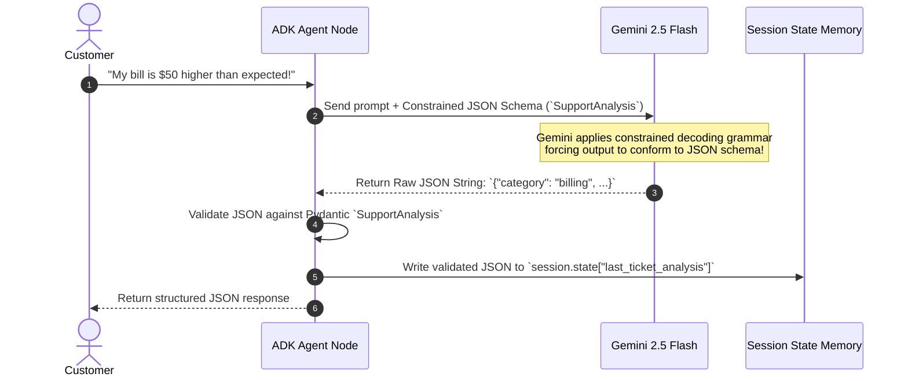

# Lab 4 Solution: Customer Support Analyzer (Structured Output & State Keys)

## Overview & Goal

This document provides the complete, production-ready implementation of `support_analyzer/agent.py` using Google Agent Development Kit (ADK) 2.0.

Beyond providing raw code, this solution guide acts as an **FDE Engineering Playbook**. It breaks down how a **Google Forward-Deployed Engineer (FDE)** translates business requirements for automated support ticket triaging into typed Pydantic models, activates native constrained decoding via `output_schema`, and persists structured data in session memory using `output_key`.

---

### 💡 FDE & Instructor Hint: Steering AI Assistants (Antigravity)

When guiding developers or using AI coding assistants like **Antigravity** during enterprise agent development, use this **Master ADK 2.0 Steering Prompt** to ensure generated code strictly follows Google's official architectural standards:

> **Master Antigravity Steering Prompt Template:**
> *"You are an expert Google ADK 2.0 Forward-Deployed Engineer. Write an ADK 2.0 Agent node with structured output following strict standards:*
> 1. *Define all structured output schemas using Pydantic `BaseModel`.*
> 2. *Set `output_schema=YourModel` on the `Agent(...)` definition to activate native constrained decoding.*
> 3. *Use `output_key="state_key_name"` to automatically persist structured output to `session.state`.*
> 4. *Use `from google.adk import Agent`.*
> 5. *Access LLM response content via `.content` (NEVER use legacy `.candidates`).*
> 6. *Use singular `instruction="..."` and model `gemini-2.5-flash`."*

---

## 🏛️ Part 1: The FDE Architectural Mental Model

### From Plain English Requirements to ADK 2.0 Code

When building an enterprise support triage system, downstream microservices (e.g. Jira ticket creation, routing engines, escalate-to-human workflows) need guaranteed JSON data. Prompting an LLM with *"please reply in JSON"* fails in production because LLMs add conversational preambles (`"Sure, here is your JSON:"`) or hallucinate key names (`"issue_type"` instead of `"category"`).

As a Google FDE, your job is to enforce **Guaranteed Type Safety** using Pydantic models and ADK's native `output_schema` parameter.

Here is the exact Requirements-to-Code Matrix for this lab:

| # | Business Requirement | FDE Engineering Risk / Challenge | ADK 2.0 Solution Pattern | Code Implementation |
|---|---|---|---|---|
| **1** | *"Classify support tickets into category, sentiment, and summary."* | **Schema Drift:** Plain text responses cannot be parsed by automated downstream microservices. | **Pydantic Contract Definition:** Define a `BaseModel` schema representing exact output keys. | `class SupportAnalysis(BaseModel):`<br/>`category: str`<br/>`sentiment: str`<br/>`summary: str` |
| **2** | *"Force Gemini to respond ONLY with valid JSON matching the schema."* | **Prompt Preamble Hallucination:** Text prompts often include markdown headers or explanatory intro text. | **Native Constrained Decoding:** Pass `output_schema=SupportAnalysis` into the `Agent` definition. | `Agent(..., output_schema=SupportAnalysis)` |
| **3** | *"Save the resulting JSON analysis in memory so next agents in the pipeline can read it."* | **Loss of State:** Parsing text out of message histories for subsequent nodes is error-prone. | **Automatic State Key Persistence:** Set `output_key="last_ticket_analysis"` to store JSON in `session.state`. | `Agent(..., output_key="last_ticket_analysis")` |

---

## ⚙️ Part 2: Step-by-Step Implementation Guide

### Complete `support_analyzer/agent.py` Implementation

Create `support_analyzer/agent.py`. Read the extensive inline comments to understand how Pydantic models, constrained decoding, and `output_key` work under the hood.

<!-- TEACHER_NOTE_START -->
**Teacher's note (ADK instructor view):**
- **Learning goal:** Explain the concept clearly from beginner to advanced, with a simple mental model first.
- **Why it matters:** Connect the concept to real Google agentic workflows, Python engineering habits, and production-ready decisions.
- **Version watch:** Validate against the latest official ADK / Google docs before teaching; call out deprecations or migration notes when needed.
- **Module linkage:** Connect this idea to the previous and next modules so learners see the progression across the course.
<!-- TEACHER_NOTE_END -->
```python
"""
Customer Support Analyzer Agent Node (ADK 2.0)

This module demonstrates structured output enforcement and automatic state persistence.
It covers:
1. Defining a Pydantic `BaseModel` API contract.
2. Activating native constrained decoding via `output_schema`.
3. Auto-persisting validated JSON outputs to `session.state` via `output_key`.
"""

from google.adk import Agent
from pydantic import BaseModel, Field


# ============================================================================
# SECTION 1: PYDANTIC STRUCTURED OUTPUT SCHEMA CONTRACT
# ============================================================================
class SupportAnalysis(BaseModel):
    """API Output Contract for support ticket classification and sentiment analysis."""

    category: str = Field(
        description="Ticket category: 'billing', 'technical', or 'general'."
    )
    sentiment: str = Field(
        description="Customer sentiment polarity: 'positive', 'negative', or 'neutral'."
    )
    summary: str = Field(
        description="A concise 1-sentence summary of the customer's core issue."
    )


# ============================================================================
# SECTION 2: ROOT AGENT NODE CONFIGURATION
# ============================================================================
# Setting `output_schema=SupportAnalysis` instructs Gemini to restrict token generation
# to valid JSON matching the Pydantic schema.
# Setting `output_key="last_ticket_analysis"` automatically writes the validated JSON
# into `tool_context.state["last_ticket_analysis"]` after every completed turn.

root_agent = Agent(
    name="support_analyzer_agent",
    model="gemini-2.5-flash",
    description="An enterprise agent that categorizes customer support tickets and extracts sentiment.",
    instruction="""
You are an expert customer support analyzer.
Your job is to read user support tickets and:
1. Determine the category ("billing", "technical", or "general").
2. Analyze the customer's sentiment ("positive", "negative", or "neutral").
3. Write a 1-sentence summary of the core issue.

You MUST respond strictly with a JSON object matching the requested schema.
Do NOT attempt to resolve the issue or provide advice.
""",
    # Native constrained decoding enforcer
    output_schema=SupportAnalysis,
    # Automatic session state persistence key
    output_key="last_ticket_analysis",
)
```

---

## 🔬 Part 3: Deep Breakdown of Constrained Decoding & State Mechanics

Here is the exact runtime sequence when an `output_schema` agent executes:

<!-- TEACHER_NOTE_START -->
**Teacher's note (ADK instructor view):**
- **Learning goal:** Explain the concept clearly from beginner to advanced, with a simple mental model first.
- **Why it matters:** Connect the concept to real Google agentic workflows, Python engineering habits, and production-ready decisions.
- **Version watch:** Validate against the latest official ADK / Google docs before teaching; call out deprecations or migration notes when needed.
- **Module linkage:** Connect this idea to the previous and next modules so learners see the progression across the course.
<!-- TEACHER_NOTE_END -->


---

## 🧪 Part 4: Verification & Dev UI State Inspection

### 1. Interactive Terminal Test

Run the agent in terminal mode:
<!-- TEACHER_NOTE_START -->
**Teacher's note (ADK instructor view):**
- **Learning goal:** Explain the concept clearly from beginner to advanced, with a simple mental model first.
- **Why it matters:** Connect the concept to real Google agentic workflows, Python engineering habits, and production-ready decisions.
- **Version watch:** Validate against the latest official ADK / Google docs before teaching; call out deprecations or migration notes when needed.
- **Module linkage:** Connect this idea to the previous and next modules so learners see the progression across the course.
<!-- TEACHER_NOTE_END -->
```bash
uv run adk run support_analyzer
```

```text
[user]: I've been trying to connect to wifi for 3 hours and it keeps dropping.
[support_analyzer_agent]: {
  "category": "technical",
  "sentiment": "negative",
  "summary": "Customer experiencing persistent wifi connection drops for three hours."
}
```

---

### 2. Dev UI State Inspection (`uv run adk web`)

Launch the visual debugger:
<!-- TEACHER_NOTE_START -->
**Teacher's note (ADK instructor view):**
- **Learning goal:** Explain the concept clearly from beginner to advanced, with a simple mental model first.
- **Why it matters:** Connect the concept to real Google agentic workflows, Python engineering habits, and production-ready decisions.
- **Version watch:** Validate against the latest official ADK / Google docs before teaching; call out deprecations or migration notes when needed.
- **Module linkage:** Connect this idea to the previous and next modules so learners see the progression across the course.
<!-- TEACHER_NOTE_END -->
```bash
uv run adk web
```

1. Open `http://127.0.0.1:8000` in your browser.
2. Select `support_analyzer` and issue a test prompt.
3. Open the **State Tab** on the right side:
   - Notice `ctx.session.state["last_ticket_analysis"]` contains the exact JSON dict ready for downstream multi-agent nodes!

---

## ❓ Self-Reflection & Interview Prep

1. **Why is `output_schema` better than relying on text prompt instructions like "respond in JSON"?**
   * *Answer:* Prompt instructions are probabilistic and frequently fail by adding preamble text, markdown formatting, or incorrect key names. `output_schema` requests a supported structured response contract. Handle generation/schema failures and validate returned data; schema conformance does not prove factual correctness or authorization.

2. **Can an agent still invoke tools while `output_schema` is set?**
   * *Answer:* Yes! In ADK 2.0, an agent can freely invoke tools during its reasoning loop to gather data. `output_schema` only constrains the *final response turn* returned to the caller.

---

## 📚 Official References

- **Google ADK Documentation:** https://google.github.io/adk-docs/
- **Google GenAI SDK Reference:** https://googleapis.github.io/python-genai/

<!-- © 2026 Inder Chauhan (https://github.com/inderanz/google-adk-training). All rights reserved. Ref: IC-ADK-module04-agent-deep-dive-lab-solution -->
---

## Official References

- Google ADK docs (latest): https://google.github.io/adk-docs/
- Google AI / Gemini docs: https://ai.google.dev/
- Google GenAI Python SDK reference: https://googleapis.github.io/python-genai/
- Context7 / current SDK lookup for the exact installed version and API signatures
- Related module path: review the surrounding modules for continuity, prerequisites, and follow-on concepts

