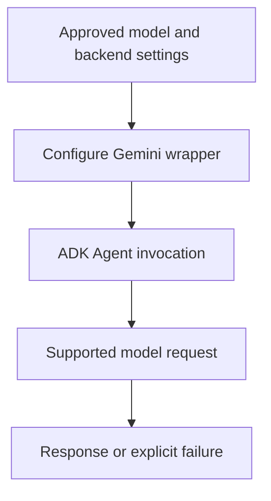

# Module 4.5: Professional Model Configuration, Resiliency & Portability

## Before you begin: what this module teaches

**ADK concept: Gemini configuration, request retries and optional provider adapters.**

A model ID selects a model. A Gemini object exposes supported model-wrapper settings. Retry means attempting again; backoff delays later attempts; jitter spreads concurrent retries. These settings concern a particular request boundary. They do not repair invalid permissions, guarantee answer quality or make a repeated bank write harmless.

**Where you would use this in real work.**

The branch assistant works during a demonstration but a model request sometimes times out under load. The engineer must decide which failures may be retried and how long the analyst should wait. Creating a custom model subclass is not the starting requirement.

**Connection to Gemini Enterprise Agent Platform and Google Cloud.**

Use Gemini through the selected Google enterprise backend for this course. Project, location, credential and model access must agree. LiteLlm is an optional adapter for a deliberately chosen other provider; its presence does not preserve Google-specific data and identity guarantees.

**By the end, you should be able to:**

- Choose between a model ID and a configured Gemini instance for a stated need.
- Explain retry count, delay and whole-request budget separately.
- Prefer supported configuration over unnecessary client overrides.

### Review this lesson through three perspectives

- **Python/ADK beginner:** Read the retry configuration and explain each named argument.
- **Experienced engineer:** Measure behavior for transient failures versus denied access.
- **Bank FDE:** Agree latency, location and evaluated model choices with the bank's platform owner.

Use the [guided lab](./lab.md) to observe the mechanism, then compare with the [solution](./lab-solution.md). The banking scenario above explains how to transfer the concept; a lab using a railway, weather or shopping fixture does not implement a live bank integration.

## Draw the execution boundary

Configuration choices feed execution; retry settings do not create a business recovery policy.



## Theory: configure a model without inventing a framework

### A model ID and a configured model object

Passing a supported model ID as `Agent(model=...)` is valid in deployed applications as well as prototypes. Use a `Gemini` model object when you need supported configuration such as request retry options. Neither spelling is a maturity level or an automatic reliability guarantee.

```python
import os
from google.adk.agents import Agent
from google.adk.models import Gemini
from google.genai import types

# Read the evaluated model choice from deployment configuration.
# Configure enterprise backend, project, location and credentials separately.
model = Gemini(
    model=os.environ["GEMINI_MODEL"],
    retry_options=types.HttpRetryOptions(attempts=3, initial_delay=1),
)
root_agent = Agent(
    name="document_explainer",
    model=model,
    instruction="Explain the supplied document checklist; do not invent case status.",
)
```

`os.environ["GEMINI_MODEL"]` reads a required setting and fails if it is absent. `HttpRetryOptions` is a Google GenAI configuration object. The model wrapper uses it for supported HTTP retries; it does not make a business write duplicate-safe. Check total elapsed time and retryable errors for the SDK version in your lockfile.

### Retries, backoff and jitter

A retry is another attempt after failure. Backoff increases the delay between attempts. Jitter varies the delay so many callers do not all retry at once. These mechanisms help transient failures, but cannot fix invalid permissions or a permanently malformed request. Repeated model calls also consume time and may consume budget.

Separate HTTP retry policy, workflow-node retry policy and a model's attempt to repair a tool call. They operate at different boundaries and their limits can multiply. Module 38 revisits the complete failure budget.

### Prefer configuration and small factories before subclassing

A factory is an ordinary function that returns a configured object. Use one when several agents need the same supported settings. Overriding a model's client property is an advanced extension with maintenance and resource-lifecycle obligations; it is not Google's required production pattern.

Python's `cached_property` caches a computed value on an instance. It does not create a process-wide singleton, guarantee a single evaluation under concurrent access, enforce read-only access, or guarantee socket reuse. The HTTP client owns its connection behavior. See the [Python cached_property contract](https://docs.python.org/3/library/functools.html#functools.cached_property).

### Where LiteLLM fits

ADK's `LiteLlm` adapter is useful when a project intentionally uses another supported model provider. For this course's Google enterprise path, begin with Gemini and its supported configuration. Changing provider can change tool calling, structured output, auth, safety and data-location behavior; portability of the Python interface is not proof of equivalent behavior.

Consult [ADK's Gemini model guidance](https://adk.dev/agents/models/google-gemini/) and evaluate the model available in the bank's approved project and location. Do not select a model solely because an old example embeds its name.

## Continue the course story

Previous: [Module 04](../module04-agent-deep-dive/README.md) · Next: [Module 05](../module05-running-agents/README.md) · [See how the concepts build](../learning-journey.md)

Before continuing, explain one input, one ADK execution boundary and one failure outcome from this module. Use the next chapter to add a new customer requirement, not merely another component.

<!-- © 2026 Inder Chauhan (https://github.com/inderanz/google-adk-training). All rights reserved. Ref: IC-ADK-module04_5-multi-model-litellm-README -->
---


## Official References

- Google ADK docs (latest): https://google.github.io/adk-docs/
- Gemini API (multimodal): https://ai.google.dev/gemini-api/docs
- Google GenAI Python SDK reference: https://googleapis.github.io/python-genai/
- Vertex AI generative guidance: https://cloud.google.com/vertex-ai/generative-ai
- Cloud Vision and OCR: https://cloud.google.com/vision

