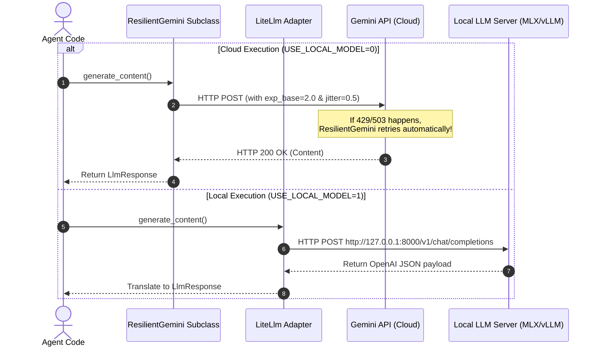

# Lab 4.5 Solution: Professional Model Configuration, Resiliency & Portability

## Overview & Goal

This document provides the complete, production-ready implementation of `support_analyzer/agent.py` using Google Agent Development Kit (ADK) 2.0.

Beyond providing raw code, this solution guide acts as an **FDE Engineering Playbook**. It breaks down how a **Google Forward-Deployed Engineer (FDE)** analyzes requirements for enterprise model resiliency, centralizes HTTP retry policies via `Gemini` subclassing, enables local offline LLM testing via `LiteLlm`, and keeps structured output contracts (`SupportAnalysis`) completely orthogonal to model selection.

---

### 💡 FDE & Instructor Hint: Steering AI Assistants (Antigravity)

When guiding developers or using AI coding assistants like **Antigravity** during enterprise agent development, use this **Master ADK 2.0 Steering Prompt** to ensure generated code strictly follows Google's official architectural standards:

> **Master Antigravity Steering Prompt Template:**
> *"You are an expert Google ADK 2.0 Forward-Deployed Engineer. Write a resilient, multi-model ADK 2.0 agent configuration following strict standards:*
> 1. *Use `from google.adk.models import Gemini` or `from google.adk.models.lite_llm import LiteLlm` for model definitions.*
> 2. *Subclass `Gemini` or wrap third-party models in `LiteLlm` (e.g. `LiteLlm(model="openai/gpt-4o")` or `LiteLlm(model="anthropic/claude-3-5-sonnet")`).*
> 3. *Define structured output using Pydantic `BaseModel` and set `output_schema` + `output_key`.*
> 4. *Override `api_client` using `@cached_property` to inject custom `google.genai.Client` retry policies (`HttpOptions(retry_config=...)`).*
> 5. *Access LLM response content via `.content` (NEVER use legacy `.candidates`).*
> 6. *Use `from google.adk import Agent` with singular `instruction="..."`."*

---

## 🏛️ Part 1: The FDE Architectural Mental Model

### From Plain English Requirements to ADK 2.0 Code

In production enterprise deployments, network blips, regional quotas, and rate limits happen. If an agent crashes on the first HTTP 429 or 503 error, users experience broken workflows. Furthermore, developers need zero-cost local LLM testing (e.g. MLX-LM, Ollama, vLLM) on their laptops without altering production code.

As a Google FDE, your job is to build **Model Resiliency & Abstraction Layers** while preserving a single, unbroken structured-output contract (`SupportAnalysis`).

Here is the exact Requirements-to-Code Matrix for this lab:

| # | Business Requirement | FDE Engineering Risk / Challenge | ADK 2.0 Solution Pattern | Code Implementation |
|---|---|---|---|---|
| **1** | *"Centralize HTTP retry policies so all agents in the fleet share identical backoff settings."* | **Code Duplication:** Defining retry headers in every agent file creates drift and maintenance headaches. | **Gemini Model Subclassing:** Inherit from `google.adk.models.Gemini` and override `api_client`. | `class ResilientGemini(Gemini): ...` |
| **2** | *"Prevent simultaneous retry storms (thundering herd) during Google Cloud outages."* | **Thundering Herd Attack:** Retrying requests at exact integer intervals overwhelms recovering servers. | **Exponential Backoff + Jitter:** Set `exp_base=2.0` and `jitter=0.5` inside `HttpRetryOptions`. | `HttpRetryOptions(max_delay=10, exp_base=2.0, jitter=0.5)` |
| **3** | *"Allow developers to test offline using local OpenAI-compatible inference servers."* | **Cloud Cost & Lock-in:** Forcing developers to hit cloud APIs during local dev incurs costs and latency. | **LiteLlm Adapter Integration:** Wrap local endpoints in `LiteLlm(model="openai/...", api_base=...)`. | `LiteLlm(model=f"openai/{local_model}", api_base=local_url)` |
| **4** | *"Ensure switching from Gemini to local models never breaks JSON schema validation."* | **Coupled Schema Validation:** Coupling JSON validation to LLM drivers breaks when swapping models. | **Orthogonal Agent Schema Binding:** Set `output_schema` on `Agent`, keeping validation independent of model choice. | `Agent(model=model_to_use, output_schema=SupportAnalysis)` |

---

## ⚙️ Part 2: Step-by-Step Implementation Guide

### Complete Implementation (`support_analyzer/agent.py`)

Create `support_analyzer/agent.py`. Read the extensive inline comments to understand how `ResilientGemini`, `@cached_property`, `LiteLlm`, and `output_schema` work under the hood.

```python
"""
Resilient Support Analyzer Agent Node (ADK 2.0)

This module demonstrates professional enterprise LLM model configuration:
1. Subclassing `Gemini` with custom `HttpRetryOptions` and `@cached_property`.
2. Integrating `LiteLlm` for environment-driven local model fallbacks.
3. Preserving Pydantic `SupportAnalysis` structured output contracts.
"""

import os
from functools import cached_property
from pydantic import BaseModel
from google.adk import Agent
from google.adk.models import Gemini
from google.adk.models.lite_llm import LiteLlm
from google.genai import Client, types


# ============================================================================
# SECTION 1: STRUCTURED OUTPUT SCHEMA (STABLE API CONTRACT)
# ============================================================================
class SupportAnalysis(BaseModel):
    """Structured output schema enforced across all model backends."""
    category: str
    sentiment: str
    summary: str


# ============================================================================
# SECTION 2: RESILIENT GEMINI SUBCLASS WITH RETRY POLICIES
# ============================================================================
class ResilientGemini(Gemini):
    """Production-ready Gemini model subclass with exponential backoff & jitter.

    Teaching Note on `@cached_property`:
    - `@cached_property` builds the `google.genai.Client` once on initial access
      and caches the result on the instance.
    - This avoids repeated authentication handshakes and TLS negotiations on every turn.
    """

    @cached_property
    def api_client(self) -> Client:
        """Constructs the low-level GenAI Client with production HTTP retry options."""
        return Client(
            project=os.environ.get("GOOGLE_CLOUD_PROJECT"),
            location="us-central1",
            http_options=types.HttpOptions(
                retry_options=types.HttpRetryOptions(
                    # Maximum delay between retries in seconds
                    max_delay=10,
                    # Exponential growth multiplier (2.0 = doubles wait time per attempt)
                    exp_base=2.0,
                    # Jitter introduces 50% random noise to prevent thundering herd storms
                    jitter=0.5,
                )
            ),
        )


# ============================================================================
# SECTION 3: ENVIRONMENT-DRIVEN MODEL SELECTION
# ============================================================================
# If `USE_LOCAL_MODEL=1`, route requests through LiteLlm to local inference stack.
# Otherwise, default to production ResilientGemini cloud endpoint.
if os.getenv("USE_LOCAL_MODEL") == "1":
    local_url = os.getenv("LOCAL_MODEL_URL", "http://127.0.0.1:8000/v1")
    local_model = os.getenv("LOCAL_MODEL_NAME", "default_model")

    # LiteLlm adapter converts ADK model calls into OpenAI wire protocol
    model_to_use = LiteLlm(
        model=f"openai/{local_model}",
        api_base=local_url,
        api_key="local-only",
        timeout=90,
        extra_body={
            "top_k": 20,
            "chat_template_kwargs": {"enable_thinking": False},
        },
    )
else:
    # Production Cloud Gemini 2.5 Flash with custom resiliency
    model_to_use = ResilientGemini(
        model=os.getenv("GEMINI_MODEL", "gemini-2.5-flash")
    )


# ============================================================================
# SECTION 4: AGENT NODE CONFIGURATION
# ============================================================================
# Key Design Insight: `output_schema` and `output_key` are bound to `Agent`,
# NOT the model. Swapping `model_to_use` from Cloud Gemini to Local LiteLlm
# does NOT alter the downstream structured output contract!
root_agent = Agent(
    name="support_analyzer_agent",
    model=model_to_use,
    description="An agent that categorizes customer support tickets and extracts sentiment.",
    instruction="""
You are an expert customer support analyzer. Your task is to:
1. Determine the category of the user's issue ("billing", "technical", or "general").
2. Analyze the sentiment of the message ("positive", "negative", or "neutral").
3. Write a concise, 1-sentence summary of the user's issue.

You MUST respond only with a JSON object matching the requested schema.
""",
    output_schema=SupportAnalysis,
    output_key="last_ticket_analysis",
)
```

---

## 🔬 Part 3: Under the Hood of Multi-Model Resiliency

Here is the architectural comparison between Cloud `ResilientGemini` and Local `LiteLlm`:



---

## 🧪 Part 4: Verification & Local Testing Playbook

### Running Against Local Inference (MLX-LM / Ollama / vLLM)

1. **Start Local OpenAI Server:**
   ```bash
   curl -s http://127.0.0.1:8000/v1/models
   ```

2. **Execute Agent in Local Mode:**
   ```bash
   USE_LOCAL_MODEL=1 \
   LOCAL_MODEL_URL="http://127.0.0.1:8000/v1" \
   LOCAL_MODEL_NAME="default_model" \
   uv run adk run support_analyzer
   ```

---

## ❓ Self-Reflection & Interview Prep

1. **Why is `jitter` necessary inside `HttpRetryOptions`?**
   * *Answer:* Without jitter, multiple retrying clients back off at identical time intervals (1s, 2s, 4s), causing synchronized "thundering herd" spikes that re-crash recovering servers. Jitter adds a random offset to smooth traffic out.

2. **Why is `@cached_property` used for `api_client` instead of constructing a new client inside every method call?**
   * *Answer:* `Client` construction involves loading environment credentials, initializing SSL context pools, and parsing headers. `@cached_property` builds the client once per model instance and re-uses it across turns, significantly reducing latency.

---

## 📚 Official References

- **Google ADK Documentation:** https://google.github.io/adk-docs/
- **Google GenAI SDK Reference:** https://googleapis.github.io/python-genai/

<!-- © 2026 Inder Chauhan (https://github.com/inderanz/google-adk-training). All rights reserved. Ref: IC-ADK-module04_5-multi-model-litellm-lab-solution -->
