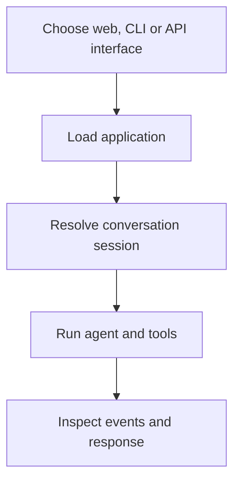

# Module 5: Running and Interacting with Agents

## Before you begin: what this module teaches

**ADK concept: ADK development interfaces and their execution boundaries.**

adk web provides a development interface, adk run provides terminal interaction, and adk api_server exposes programmatic endpoints. The entry package and configured services determine the agent that runs. A process listening on a port is a server; a user conversation is a session. Restarting a process can discard development storage even if the code is unchanged.

**Where you would use this in real work.**

Meera needs an interactive demonstration; an engineer needs a repeatable command; the bank portal needs an API. These are different ways to invoke an application, not three different kinds of reasoning agent.

**Connection to Gemini Enterprise Agent Platform and Google Cloud.**

The local server can use Gemini through the approved Google backend. Deploying the application to Agent Runtime or Cloud Run comes later. Running api_server does not add product authentication or make a debug interface suitable for public banking access.

**By the end, you should be able to:**

- Select the interface appropriate to a demonstration, script or application.
- Explain process lifetime versus conversation lifetime.
- Inspect events instead of inferring tool execution from polished prose.

### Review this lesson through three perspectives

- **Python/ADK beginner:** Run one message and identify the selected application.
- **Experienced engineer:** Repeat a failure through the CLI and API to isolate interface versus agent behavior.
- **Bank FDE:** Decide which demonstration data and development interfaces may be shown to a client.

Use the [guided lab](./lab.md) to observe the mechanism, then compare with the [solution](./lab-solution.md). The banking scenario above explains how to transfer the concept; a lab using a railway, weather or shopping fixture does not implement a live bank integration.

## Draw the execution boundary

Choose one interface for the task. These are alternative entry points to execution.

## Theory

### Bringing Your Agent to Life

Creating an agent configuration is the first step, but to test and use your agent, you need to run it. The ADK provides a powerful and flexible command-line interface (CLI) that offers several ways to run your agent, each suited for different stages of the development lifecycle.

Understanding these different execution modes is key to efficiently developing, debugging, and eventually deploying your agents.

### 1. Interactive Development: `uv run adk web`

The `uv run adk web` command is your primary tool during development. It starts a local web server that hosts the **ADK Developer UI**.

**Key Features:**

*   **Chat Interface:** Provides a user-friendly chat window to interact with your agent in real-time.
*   **Trace View:** This is the most powerful feature. It gives you a detailed, step-by-step visualization of your agent's execution flow. You can see the exact prompts sent to the LLM, which tools were called with which arguments, the data returned by the tools, and any changes to the agent's internal state. This is invaluable for debugging.
*   **Session Management:** The UI allows you to manage different conversation sessions, so you can test how your agent behaves over multiple interactions.
*   **No Code Changes Needed:** You can test and iterate on your `root_agent.yaml` configuration without restarting the server. Simply save your changes, and the UI will use the updated configuration for the next conversation.

The Dev UI is the best way to get immediate feedback and deep insight into your agent's reasoning process.

### 2. Headless Interaction: `uv run adk run`

The `uv run adk run` command allows you to interact with your agent directly from your terminal, without a graphical user interface.

**Key Features:**

*   **Command-Line Chat:** It drops you into a simple, text-based chat session with your agent.
*   **Quick Testing:** It's a fast way to test a specific input or a simple conversation without the overhead of launching a web browser.
*   **Scripting and Automation:** Because it runs in the terminal, `uv run adk run` can be used in automated testing scripts. You can pipe input to it and check the output to verify the agent's behavior.

This mode is ideal for quick checks and for integrating agent tests into a continuous integration (CI) pipeline.

### 3. Deployment and Integration: `uv run adk api_server`

The `uv run adk api_server` command runs your agent as a standalone HTTP server, exposing its functionality through a RESTful API.

**Key Features:**

*   **API Endpoints:** It creates standard API endpoints (e.g., `/run_sse`, `/list-apps`) that allow other applications to communicate with your agent programmatically. Notably, `/run_sse` uses Server-Sent Events for real-time, streaming interactions.
*   **Decoupled Architecture:** This is how you would typically run your agent in a production or staging environment. Your user-facing application (e.g., a web app, a mobile app) would make HTTP requests to this agent server.
*   **Scalability:** Running the agent as an API server allows it to be containerized (e.g., with Docker) and deployed to scalable infrastructure like Cloud Run or Google Kubernetes Engine.

This mode is essential because it turns the agent from a local experiment into a real service boundary. In practice, your web app, workflow engine, or internal business tool calls the agent over HTTP instead of embedding model logic directly into the same process. That is the point where the agent becomes part of a larger production system rather than a developer-only prototype.

In the lab for this module, you will get hands-on experience with all three of these commands, giving you a complete toolkit for running and interacting with your agents.

### The ADK 2.0 CLI Engine

While these commands feel like magic, they are powered by the **App** and **Runner** architecture you learned about in earlier modules. 

*   `uv run adk web` and `uv run adk run` instantiate an **InMemoryRunner** for fast, local development.
*   `uv run adk api_server` provides a production-style environment where sessions and state are managed by the framework (and can be backed by Firestore, as you will see in Module 13.5).

### Key Takeaways
- `uv run adk web`: The primary tool for interactive development and debugging, featuring a chat UI and a detailed Trace View.
- `uv run adk run`: A headless, command-line interface for quick tests and automated scripting.
- `uv run adk api_server`: Runs the agent as a standalone HTTP server, exposing a RESTful API for integration and deployment.
- All CLI commands leverage the core **App** and **Runner** engine of ADK 2.0.

## Enterprise Lens: How this maps to real customer work

This module is not just about running a local agent. It is about choosing the right execution model for the problem:

- local debugging for fast iteration
- CLI execution for validation and automation
- API-based runtime for production integration

For the larger enterprise storyline, use this companion guide:

- [Module 05 Enterprise Playbook](./enterprise-playbook.md)
- [Enterprise ADK Playbook Index](../enterprise-adk-roadmap.md)

These links connect this module to the broader ADK architecture journey instead of treating it as an isolated example.

## Official ADK / Google references

Use the official Google and ADK documentation as the current source of truth when updating runtime, CLI, or deployment guidance:

- ADK documentation home: https://google.github.io/adk-docs/
- ADK agent and runtime concepts: https://google.github.io/adk-docs/agents/
- ADK workflows and execution model: https://google.github.io/adk-docs/workflows/
- Gemini API docs: https://ai.google.dev/gemini-api/docs
- Vertex AI generative AI docs: https://cloud.google.com/vertex-ai/generative-ai/docs

These references should be checked alongside the lab when the framework evolves or when customer environments require a production-ready runtime decision.

## Continue the course story

Previous: [Module 04.5](../module04_5-multi-model-litellm/README.md) · Next: [Module 06](../module06-programmatic-execution/README.md) · [See how the concepts build](../learning-journey.md)

Before continuing, explain one input, one ADK execution boundary and one failure outcome from this module. Use the next chapter to add a new customer requirement, not merely another component.

<!-- © 2026 Inder Chauhan (https://github.com/inderanz/google-adk-training). All rights reserved. Ref: IC-ADK-module05-running-agents-README -->
---

## Official References

- Google ADK docs (latest): https://google.github.io/adk-docs/
- Gemini API (multimodal): https://ai.google.dev/gemini-api/docs
- Google GenAI Python SDK reference: https://googleapis.github.io/python-genai/
- Vertex AI generative guidance: https://cloud.google.com/vertex-ai/generative-ai
- Cloud Vision and OCR: https://cloud.google.com/vision

