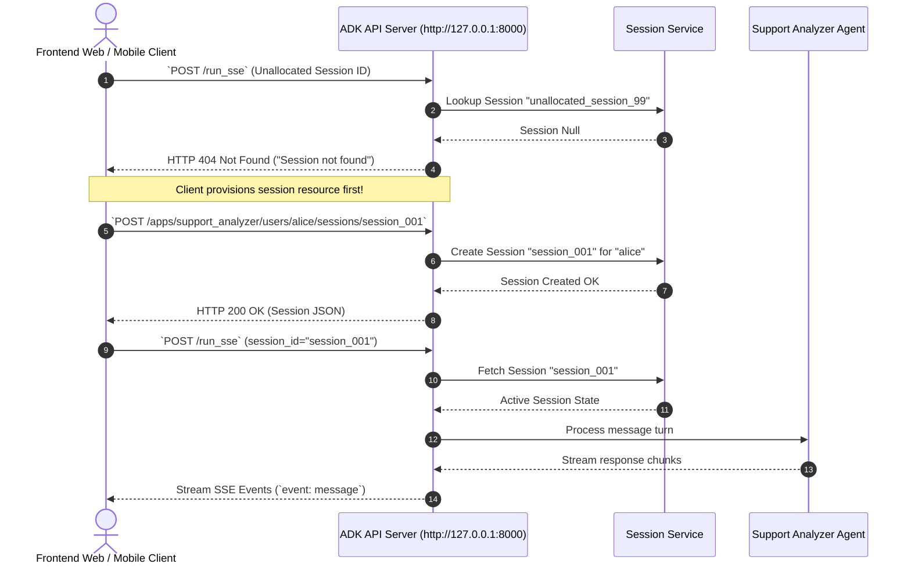

# Lab 5 Solution: Exploring ADK Execution Modes (Web, CLI, API Server)

## Overview & Goal

This document provides the complete operational guide for running ADK 2.0 agents across all execution environments using the `adk` CLI suite.

Beyond providing raw CLI commands, this solution guide acts as an **FDE Engineering Playbook**. It breaks down how a **Google Forward-Deployed Engineer (FDE)** selects the correct operational mode (`adk web`, `adk run`, `adk api_server`), manages REST session resources via `curl`, and instruments agent execution for local development, automated testing, and cloud microservice deployments.

---

### 💡 FDE & Instructor Hint: Steering AI Assistants (Antigravity)

When guiding developers or using AI coding assistants like **Antigravity** during enterprise agent development, use this **Master ADK 2.0 Steering Prompt** to ensure generated code strictly follows Google's official architectural standards:

> **Master Antigravity Steering Prompt Template:**
> *"You are an expert Google ADK 2.0 Forward-Deployed Engineer. Configure and launch ADK 2.0 agent execution environments following strict Google standards:*
> 1. *To launch the interactive visual debugger: `uv run adk web`.*
> 2. *To execute in headless interactive CLI mode: `uv run adk run <agent_directory_name>`.*
> 3. *To serve agents as an HTTP/REST microservice: `uv run adk api_server`.*
> 4. *Ensure `agent.py` exports `root_agent = Agent(...)` using `from google.adk import Agent`.*
> 5. *Access LLM response content via `.content` (NEVER use legacy `.candidates`)."*

---

## 🏛️ Part 1: The FDE Architectural Mental Model

### From Plain English Requirements to ADK 2.0 Code

When transitioning AI agents from prototype to production, enterprise teams have diverse deployment requirements: developers need a visual trace UI, automated test scripts need a headless terminal interface, and frontend web applications need an HTTP/REST microservice.

As a Google FDE, your job is to select and configure the right **ADK Execution Boundary** for each environment.

Here is the exact Requirements-to-Code Matrix for this lab:

| # | Business Requirement | FDE Engineering Risk / Challenge | ADK 2.0 Solution Pattern | CLI / API Implementation |
|---|---|---|---|---|
| **1** | *"Visual debug agent thought processes, prompt inputs, and state variables locally."* | **Black-Box Reasoning:** Debugging prompt logic without visual waterfall traces is slow. | **Interactive Dev UI Server:** Launch local web server with full trace & state inspection tabs. | `uv run adk web` |
| **2** | *"Execute agent queries headlessly in terminal scripts or CI/CD testing pipelines."* | **GUI Dependency:** Automated test runner pipelines cannot open web browsers. | **Headless Terminal Runner:** Run instant CLI prompt loop directly in terminal. | `uv run adk run support_analyzer` |
| **3** | *"Expose agents as a cloud REST microservice for web apps, mobile apps, or Slack bots."* | **Service Architecture:** Custom web clients need standardized HTTP / SSE streaming endpoints. | **Production API Microservice Server:** Host OpenAPI REST endpoints with server-sent event (SSE) support. | `uv run adk api_server` |
| **4** | *"Enforce strict session state allocation before processing HTTP requests."* | **Stateless 404 Failure:** Sending messages to non-existent session IDs causes `Session not found`. | **Explicit REST Session Provisioning:** Call session allocation endpoint prior to `/run_sse`. | Step 1: `POST /apps/.../sessions/...`<br/>Step 2: `POST /run_sse` |

---

## ⚙️ Part 2: Step-by-Step Implementation Guide

### Part 1: Visual Interactive Debugging (`uv run adk web`)

Run the visual debugger from your main training workspace:

```bash
# 1. Start the ADK Web Dev Server
uv run adk web
```

#### What Happens Under the Hood:
- ADK automatically scans child directories for `agent.py` or `root_agent.yaml` definitions.
- Serves an interactive React Dev UI at `http://127.0.0.1:8000`.
- Provides a **Waterfall Trace View** displaying LLM prompt inputs, latency metrics, and tool execution spans.
- Provides a **State View** displaying live `session.state` key-value pairs (e.g., `last_ticket_analysis`).

---

### Part 2: Headless Terminal Execution (`uv run adk run`)

Run the agent headlessly inside your command-line terminal:

```bash
# 2. Run interactive terminal runner for support_analyzer
uv run adk run support_analyzer
```

#### Interactive Terminal Session:
```text
[user]: My bill is $50 higher than expected this month!
[support_analyzer_agent]: {
  "category": "billing",
  "sentiment": "negative",
  "summary": "Customer inquiry regarding a $50 overcharge on monthly bill."
}
```

---

### Part 3: Enterprise Microservice REST Server (`uv run adk api_server`)

Launch the production REST microservice:

```bash
# 3. Start the ADK REST API Microservice Server
uv run adk api_server
```

#### 🛠️ REST API Integration Walkthrough (`curl` Client Protocol)

##### Step A: The Intentional Failure (Demonstrating Session Enforcement)
Open a separate terminal window and send an un-allocated request:

```bash
curl -X POST http://127.0.0.1:8000/run_sse \
     -H "Content-Type: application/json" \
     -d '{
           "app_name": "support_analyzer",
           "user_id": "alice",
           "session_id": "unallocated_session_99",
           "new_message": {"role": "user", "parts": [{"text": "Hello"}]}
         }'
```

**HTTP 404 Response:**
```json
{"detail": "Session not found"}
```

> **FDE Teaching Note:** Unlike `adk web` or `adk run` (which auto-allocate sessions), `api_server` is an enterprise zero-trust microservice. It requires explicit session provisioning before processing content!

##### Step B: The Fix (Explicit Session Provisioning)
Provision the session resource via the HTTP REST API:

```bash
curl -X POST http://127.0.0.1:8000/apps/support_analyzer/users/alice/sessions/session_001
```

**HTTP 200 OK Response:**
```json
{
  "id": "session_001",
  "appName": "support_analyzer",
  "userId": "alice",
  "state": {},
  "events": [],
  "lastUpdateTime": 1774843200.0
}
```

##### Step C: Streaming Execution (`/run_sse`)
Now transmit the user message to the newly provisioned session:

```bash
curl -X POST http://127.0.0.1:8000/run_sse \
     -H "Content-Type: application/json" \
     -d '{
           "app_name": "support_analyzer",
           "user_id": "alice",
           "session_id": "session_001",
           "new_message": {"role": "user", "parts": [{"text": "I was overcharged on my bill."}]}
         }'
```

**Server-Sent Events (SSE) Response Stream:**
```text
event: message
data: {"author": "support_analyzer_agent", "content": {"parts": [{"text": "{\"category\": \"billing\", \"sentiment\": \"negative\", \"summary\": \"User overcharged on bill.\"}"}]}}
```

---

## 🔬 Part 3: Under the Hood of ADK REST API Architecture

Here is the exact protocol flow when a frontend client communicates with `adk api_server`:



---

## 🧪 Part 4: Verification & Operational Summary

| Execution Mode | Command | Key Target Use Case | Session Lifecycle |
|---|---|---|---|
| **Web Dev UI** | `uv run adk web` | Visual prompt debugging, waterfall tracing, live state inspection | Auto-provisioned by Dev UI |
| **CLI Runner** | `uv run adk run <agent>` | Quick terminal testing, CI/CD automated test scripts | Auto-provisioned by CLI runner |
| **API Server** | `uv run adk api_server` | Production HTTP microservices, React/Angular frontends, Slack bots | Explicit REST provisioning (`POST /apps/.../sessions/...`) |

---

## ❓ Self-Reflection & Interview Prep

1. **Why does `uv run adk api_server` require two separate terminal windows for testing with `curl`?**
   * *Answer:* `uv run adk api_server` is a long-running background process listening for incoming HTTP socket connections on port 8000. Running `curl` in a second terminal simulates a client application (such as a web browser or mobile app) sending requests over the network to the backend server.

2. **When should a developer use `adk web` versus `adk api_server`?**
   * *Answer:* `adk web` is used during local development and debugging to inspect LLM prompt inputs, token latency, and session state variables in a visual browser UI. `adk api_server` is used when deploying the agent as a production microservice to be consumed programmatically by external frontend or backend applications.

---

## 📚 Official References

- **Google ADK Documentation:** https://google.github.io/adk-docs/
- **ADK Agents & Runtimes:** https://google.github.io/adk-docs/agents/
- **Google GenAI SDK Reference:** https://googleapis.github.io/python-genai/

<!-- © 2026 Inder Chauhan (https://github.com/inderanz/google-adk-training). All rights reserved. Ref: IC-ADK-module05-running-agents-lab-solution -->
