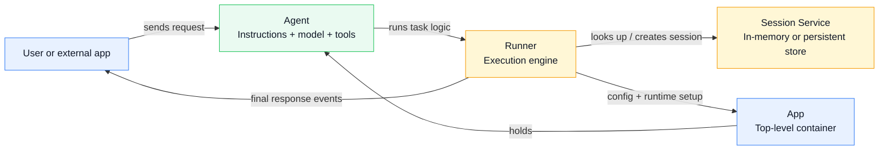
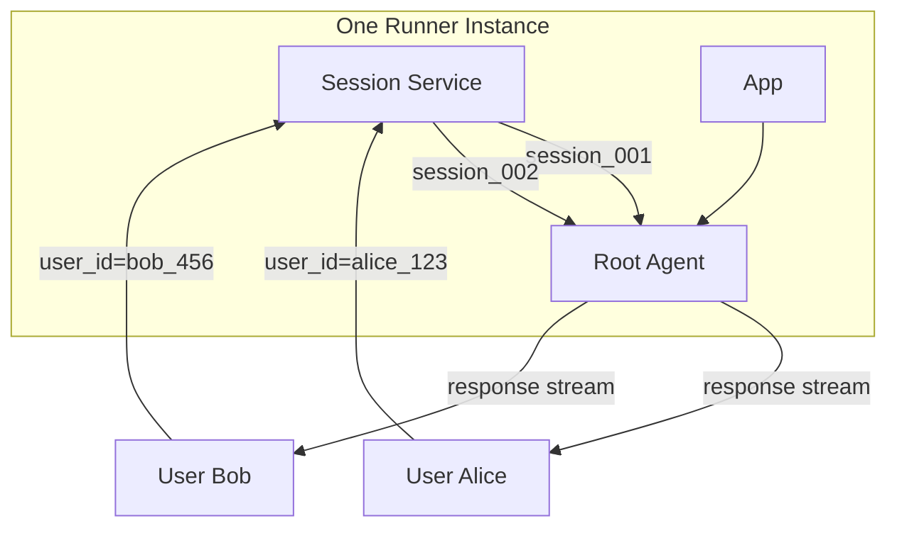
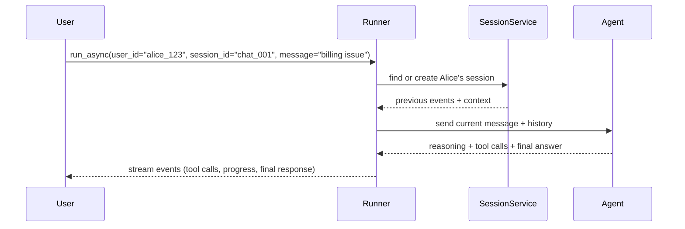
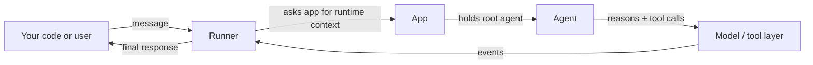
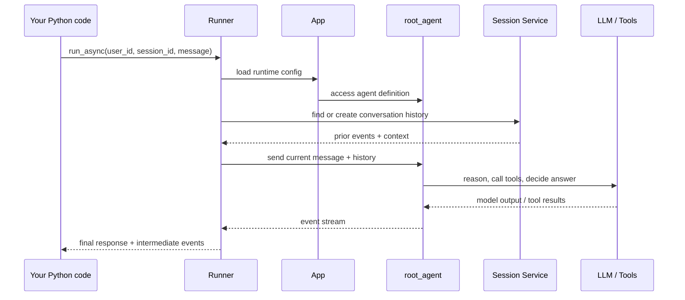
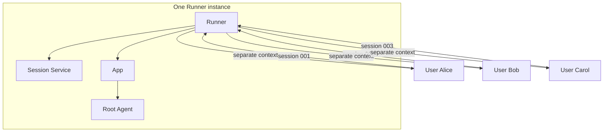
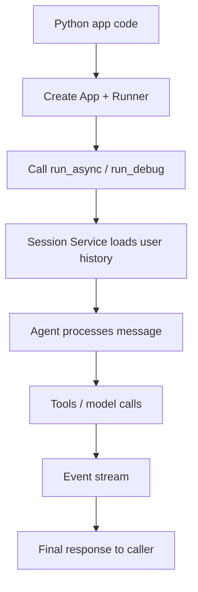

# Module 6: Programmatic Execution: Apps and Runners

## Theory

Until now, you've used the ADK CLI (`uv run adk web`, `uv run adk run`) to interact with your agents. While great for testing, real-world applications (like a Discord bot or a web backend) need to trigger agents programmatically from within Python code.

To do this, you need to understand the relationship between three core objects: the **Agent**, the **App**, and the **Runner**.

### The "Three Pillars" of ADK Architecture

Think of building an agentic application like setting up a smart office:

#### 1. The Agent: The Intelligence
The `Agent` (or `root_agent`) is the employee. It has instructions, a model, and (soon) tools. It's the "thinking" part of your application.
*   **Role:** Reasoning and task execution.
*   **Scope:** Specific to the agent's logic.

#### 2. The App: The Infrastructure
The `App` is the office building. It's a top-level container that holds the `root_agent` and manages global operational concerns.
*   **Role:** Configuration and lifecycle management.
*   **Key Responsibilities:** Managing global plugins, context caching, and resumability configurations. It separates operational infrastructure from the agent's logic.

#### 3. The Runner: The Motor
The `Runner` is the management system that actually makes things happen. It receives a message from a user and "runs" it through the App.
*   **Role:** Orchestration and session management.
*   **The Singleton Pattern:** In most applications, you create **one Runner instance** for your entire application. This single Runner is designed to handle multiple users and multiple sessions simultaneously.
### Visual Mental Model: Agent, App, and Runner

<!-- TEACHER_NOTE_START -->
**Teacher's note (ADK instructor view):**
- **Learning goal:** Explain the concept clearly from beginner to advanced, with a simple mental model first.
- **Why it matters:** Connect the concept to real Google agentic workflows, Python engineering habits, and production-ready decisions.
- **Version watch:** Validate against the latest official ADK / Google docs before teaching; call out deprecations or migration notes when needed.
- **Module linkage:** Connect this idea to the previous and next modules so learners see the progression across the course.
<!-- TEACHER_NOTE_END -->


A useful way to remember this is:
- **Agent** = the intelligence
- **App** = the runtime container
- **Runner** = the execution engine that drives the conversation

### A One-Runner-Many-Users View

<!-- TEACHER_NOTE_START -->
**Teacher's note (ADK instructor view):**
- **Learning goal:** Explain the concept clearly from beginner to advanced, with a simple mental model first.
- **Why it matters:** Connect the concept to real Google agentic workflows, Python engineering habits, and production-ready decisions.
- **Version watch:** Validate against the latest official ADK / Google docs before teaching; call out deprecations or migration notes when needed.
- **Module linkage:** Connect this idea to the previous and next modules so learners see the progression across the course.
<!-- TEACHER_NOTE_END -->


This is why the Runner can serve many users at once: every message is paired with a specific `user_id` and `session_id`, and the Session Service keeps the histories separate.

### Why sessions matter

<!-- TEACHER_NOTE_START -->
**Teacher's note (ADK instructor view):**
- **Learning goal:** Explain the concept clearly from beginner to advanced, with a simple mental model first.
- **Why it matters:** Connect the concept to real Google agentic workflows, Python engineering habits, and production-ready decisions.
- **Version watch:** Validate against the latest official ADK / Google docs before teaching; call out deprecations or migration notes when needed.
- **Module linkage:** Connect this idea to the previous and next modules so learners see the progression across the course.
<!-- TEACHER_NOTE_END -->


In short:
- the **Runner** decides how execution flows
- the **Session Service** preserves conversation state
- the **Agent** does the reasoning
### Understanding Runners and Sessions

A common question is: *"Where are the conversations stored?"*

The Runner doesn't store data itself. It uses a **Session Service** to find or create conversation threads.

*   **`InMemoryRunner`**: Automatically uses an `InMemorySessionService`. It's perfect for local development because it's fast and requires no setup, but **all data is lost** when your Python script stops.
*   **`Runner` (Base Class)**: In production, you use the base `Runner` class and inject a persistent service, like `FirestoreSessionService` (which you will learn about in Module 13.5). This allows your agent to remember users across restarts and across different server instances.

### How the Runner Isolates Users

When you call a Runner method, you must provide two unique identifiers:
1.  **`user_id`**: Identifies who is talking (e.g., "alice_123").
2.  **`session_id`**: Identifies the specific conversation thread (e.g., "billing_dispute_001").

<!-- TEACHER_NOTE_START -->
**Teacher's note (ADK instructor view):**
- **Learning goal:** Explain the concept clearly from beginner to advanced, with a simple mental model first.
- **Why it matters:** Connect the concept to real Google agentic workflows, Python engineering habits, and production-ready decisions.
- **Version watch:** Validate against the latest official ADK / Google docs before teaching; call out deprecations or migration notes when needed.
- **Module linkage:** Connect this idea to the previous and next modules so learners see the progression across the course.
<!-- TEACHER_NOTE_END -->
```python
# The Runner uses these IDs to find the correct history in its Session Service
async for event in runner.run_async(
    user_id="alice_123", 
    session_id="chat_001", 
    new_message=message
):
    # Process events...
```

The Runner uses these IDs to look up the correct conversation history. This ensures that Alice's conversation never leaks into Bob's, even though they are both being processed by the same Runner instance.

### Minimal Programmatic Setup

To run an agent from Python, your `main.py` typically follows this flow:

<!-- TEACHER_NOTE_START -->
**Teacher's note (ADK instructor view):**
- **Learning goal:** Explain the concept clearly from beginner to advanced, with a simple mental model first.
- **Why it matters:** Connect the concept to real Google agentic workflows, Python engineering habits, and production-ready decisions.
- **Version watch:** Validate against the latest official ADK / Google docs before teaching; call out deprecations or migration notes when needed.
- **Module linkage:** Connect this idea to the previous and next modules so learners see the progression across the course.
<!-- TEACHER_NOTE_END -->
```python
import asyncio
from google.adk.apps import App
from google.adk.runners import InMemoryRunner
from agent import root_agent # Your agent from Module 04

# 1. Wrap the agent in an App
# In ADK 2.0, 'root_agent' is a required named argument.
app = App(name="my_support_app", root_agent=root_agent)

# 2. Instantiate a Runner for that App
# The Runner now takes the 'app' instance directly.
runner = InMemoryRunner(app=app)

async def main():
    # 3. Execute!
    # Tip: run_debug() is the recommended method for programmatic testing.
    # It handles the async event stream and returns a list of Event objects.
    events = await runner.run_debug("I have a billing problem.", user_id="user_123")
    
    for event in events:
        if event.is_final_response():
            print(f"Agent Response: {event.content.parts[0].text}")

if __name__ == "__main__":
    asyncio.run(main())
```

### Key Takeaways
- **Agent**: Defines the persona and logic.
- **App**: A container for the agent and global configurations (Plugins, Caching).
- **Runner**: The execution engine. You typically use one Runner to serve many users.
- **Isolation**: The ADK ensures session isolation using `user_id` and `session_id`.
- **`run_debug()`**: A convenient method for quick programmatic testing without manually handling async event streams.

### The simplest possible explanation

<!-- TEACHER_NOTE_START -->
**Teacher's note (ADK instructor view):**
- **Learning goal:** Explain the concept clearly from beginner to advanced, with a simple mental model first.
- **Why it matters:** Connect the concept to real Google agentic workflows, Python engineering habits, and production-ready decisions.
- **Version watch:** Validate against the latest official ADK / Google docs before teaching; call out deprecations or migration notes when needed.
- **Module linkage:** Connect this idea to the previous and next modules so learners see the progression across the course.
<!-- TEACHER_NOTE_END -->


Think of it as:
- **User code** starts the conversation
- **Runner** is the executor
- **App** is the container and startup context
- **Agent** is the intelligence

### The full lifecycle of one request

<!-- TEACHER_NOTE_START -->
**Teacher's note (ADK instructor view):**
- **Learning goal:** Explain the concept clearly from beginner to advanced, with a simple mental model first.
- **Why it matters:** Connect the concept to real Google agentic workflows, Python engineering habits, and production-ready decisions.
- **Version watch:** Validate against the latest official ADK / Google docs before teaching; call out deprecations or migration notes when needed.
- **Module linkage:** Connect this idea to the previous and next modules so learners see the progression across the course.
<!-- TEACHER_NOTE_END -->


This is the key idea: the Runner does not think for you; it orchestrates, tracks, and returns the event stream. The Agent does the reasoning work.

### The "same runner, many users" picture

<!-- TEACHER_NOTE_START -->
**Teacher's note (ADK instructor view):**
- **Learning goal:** Explain the concept clearly from beginner to advanced, with a simple mental model first.
- **Why it matters:** Connect the concept to real Google agentic workflows, Python engineering habits, and production-ready decisions.
- **Version watch:** Validate against the latest official ADK / Google docs before teaching; call out deprecations or migration notes when needed.
- **Module linkage:** Connect this idea to the previous and next modules so learners see the progression across the course.
<!-- TEACHER_NOTE_END -->


Notice the important pattern:
- one Runner can serve many users
- each user gets their own session and context
- the system separates identity from runtime logic

### The easiest interview answer

If someone asks, "What is the difference between Agent, App, and Runner?" you can say:

- **Agent** = the brain and policy
- **App** = the runtime box that contains the brain
- **Runner** = the engine that executes work and keeps session state

A quick sentence to remember:

> The Agent decides what to do; the App owns the runtime context; the Runner moves the work through a session and returns the events.

### A practical mental model for coding

<!-- TEACHER_NOTE_START -->
**Teacher's note (ADK instructor view):**
- **Learning goal:** Explain the concept clearly from beginner to advanced, with a simple mental model first.
- **Why it matters:** Connect the concept to real Google agentic workflows, Python engineering habits, and production-ready decisions.
- **Version watch:** Validate against the latest official ADK / Google docs before teaching; call out deprecations or migration notes when needed.
- **Module linkage:** Connect this idea to the previous and next modules so learners see the progression across the course.
<!-- TEACHER_NOTE_END -->


This is the real rhythm of programmatic execution in ADK:
1. create the runtime
2. attach the agent
3. call the runner with the user/session metadata
4. process the returned events
5. return the final answer to the calling code

If you remember only one thing from this module, remember this:
- the **Agent** thinks
- the **App** owns the runtime context
- the **Runner** executes and keeps user sessions separate

## Enterprise Lens: How this maps to real customer work

This module is the runtime foundation of the forward-deployed engineering pattern. According to the latest Google ADK guidance, the framework is designed to move from simple agent prototypes to reliable production systems, and the docs explicitly point to workflow evolution when the task grows beyond a single-agent pattern.

For a customer engagement, this matters because you need to decide:

- whether a single agent is enough
- if the workflow should hold user and session state
- where deterministic code stops and AI reasoning begins
- how to design services that can be tested, traced, and deployed

Use the enterprise companion guide for this module:

- [Module 06 Enterprise Playbook](./enterprise-playbook.md)
- [Enterprise ADK Playbook Index](../enterprise-adk-roadmap.md)

This keeps the runtime concepts tied to the broader enterprise ADK story instead of treating them as isolated Python mechanics.

## Official ADK / Google references

Use the official Google and ADK documentation as the current source of truth for runtime, session, and workflow guidance:

- ADK documentation home: https://google.github.io/adk-docs/
- ADK agents and app/runtime concepts: https://google.github.io/adk-docs/agents/
- ADK workflow and orchestration docs: https://google.github.io/adk-docs/workflows/
- Gemini API docs: https://ai.google.dev/gemini-api/docs
- Google Cloud AI docs: https://cloud.google.com/vertex-ai/generative-ai/docs

These references should be reviewed when updating the runtime model, session design, or production deployment pattern for ADK applications.

<!-- © 2026 Inder Chauhan (https://github.com/inderanz/google-adk-training). All rights reserved. Ref: IC-ADK-module06-programmatic-execution-README -->
---

## Official References

- Google ADK docs (latest): https://google.github.io/adk-docs/
- Google AI / Gemini docs: https://ai.google.dev/
- Google GenAI Python SDK reference: https://googleapis.github.io/python-genai/
- Context7 / current SDK lookup for the exact installed version and API signatures
- Related module path: review the surrounding modules for continuity, prerequisites, and follow-on concepts

