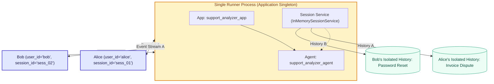
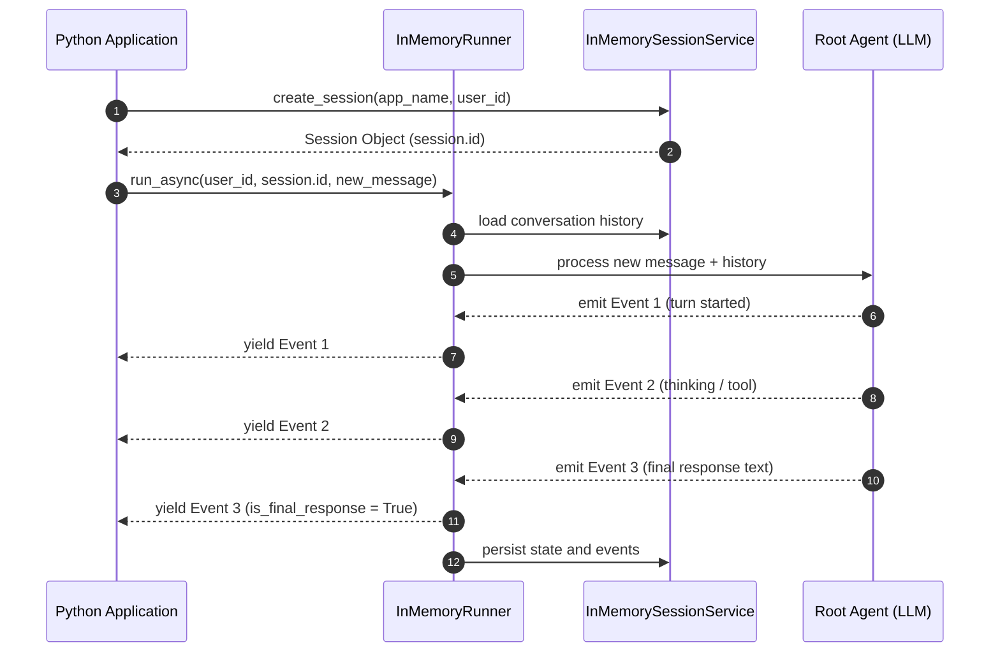

# Module 6: Programmatic Execution: Apps and Runners

## Theory

Until now, you interacted with agents via the Agent Development Kit (ADK) Command-Line Interface (`uv run adk web`, `uv run adk run`). The CLI is great for initial prototyping, exploratory conversations, and debugging prompts in your terminal.

However, production applications do not live in interactive terminals. Whether you are building a **FastAPI backend**, a **Slack or Discord bot**, an **event-driven Cloud Function**, or a **scheduled batch worker**, your system must invoke, steer, and inspect agents **programmatically directly from Python code**.

To run an agent from Python, you must understand how ADK 2.0 separates intelligence, configuration, and orchestration across three fundamental objects: the **Agent**, the **App**, and the **Runner**.

---

### The Three Pillars of ADK Architecture

ADK 2.0 uses a modular separation of concerns. Instead of having a single monolithic class handle prompts, HTTP connections, and session storage, ADK divides responsibilities across three dedicated architectural layers:

```mermaid
flowchart TD
    subgraph Architecture["ADK 2.0 Runtime Architecture"]
        direction TB
        subgraph AppLayer["App (Operational Container)"]
            AgentLayer["Agent (Intelligence & Decision Engine)"]
        end
        RunnerLayer["Runner (Execution Engine & Orchestration)"]
    end

    UserApp["Your Python Application (API, Bot, Script)"] -->|1. Invocations (user_id, session_id, message)| RunnerLayer
    RunnerLayer -->|2. Resolves session state| SessionStore["Session Service (In-Memory or Store)"]
    RunnerLayer -->|3. Loads runtime policies| AppLayer
    RunnerLayer -->|4. Drives conversation & tool loops| AgentLayer
    AgentLayer -->|5. Streams events| RunnerLayer
    RunnerLayer -->|6. Yields Event stream| UserApp

    classDef container fill:#f8fafc,stroke:#64748b,color:#0f172a;
    classDef agentBox fill:#dbeafe,stroke:#2563eb,stroke-width:2px,color:#1e3a8a;
    classDef appBox fill:#e0e7ff,stroke:#4f46e5,stroke-width:2px,color:#312e81;
    classDef runnerBox fill:#fef3c7,stroke:#d97706,stroke-width:2px,color:#78350f;
    classDef userBox fill:#ecfdf5,stroke:#059669,stroke-width:2px,color:#064e3b;

    class Architecture,SessionStore container;
    class AgentLayer agentBox;
    class AppLayer appBox;
    class RunnerLayer runnerBox;
    class UserApp userBox;
```

#### 1. The Agent: The Intelligence
The `Agent` (or `root_agent`) represents the brain. It is defined using instructions, a selected LLM model (e.g., Gemini or a local LiteLLM model), structured output schemas, and tools.
*   **Primary Responsibility:** Reasoning, prompt construction, and decision-making.
*   **What it does NOT do:** It does not know about incoming HTTP requests, WebSocket connections, database drivers, or how many users are chatting simultaneously. It is a pure, stateless decision engine.

#### 2. The App: The Operational Container
The `App` is the top-level configuration container that wraps your `root_agent`.
*   **Primary Responsibility:** Global lifecycle settings, application identification (`name`), shared plugins, caching policies, and event compaction.
*   **Why it exists:** In production systems, operational concerns (e.g., token caching, enterprise authorization plugins, rate-limiting guards) belong to the *application environment*, not hardcoded inside the agent's prompt or reasoning logic.

#### 3. The Runner: The Orchestration Engine
The `Runner` is the execution workhorse. It receives messages from your Python application, coordinates with the `SessionService` to load conversation history, invokes the agent, records state updates, and yields an asynchronous stream of `Event` objects.
*   **Primary Responsibility:** Orchestration, state transition, and multi-tenant session isolation.
*   **The Singleton Pattern:** In typical production services, you instantiate **only one Runner instance** for your entire process. That single Runner concurrently handles requests from hundreds or thousands of unique users across distinct sessions.

---

### Python Fundamentals: Why is ADK Asynchronous (`async` / `await`)?

If you are new to asynchronous programming in Python, you might wonder why ADK code requires `async def`, `await`, and `asyncio.run()`.

```text
Synchronous (Blocking) Model:
Thread 1: [ Send prompt to LLM ] ------------ Waiting for 3s ------------> [ Parse Response ]
(Entire thread is frozen; other incoming requests are completely blocked)

Asynchronous (Event Loop) Model:
Thread 1: [ Send prompt to LLM ]
              │ (Yields control to Event Loop)
              ├──> [ Handle User B's message ]
              ├──> [ Read User C's session data from memory ]
          [ LLM returns bytes ] <── (Event Loop wakes up caller)
          [ Process Event & Stream Response ]
```

Large language models do not return answers in a few CPU clock cycles; they generate tokens over network connections that take hundreds of milliseconds to several seconds.
*   **The Problem with Synchronous Code:** If execution blocked the active thread while waiting for the LLM network socket, a web server would freeze, unable to respond to any other user until that single query finished.
*   **The `asyncio` Solution:** ADK methods like `run_async()` and `run_debug()` are Python **coroutines**. When waiting for model responses or network I/O, they yield execution back to Python's event loop so your application remains fast, responsive, and highly concurrent.

#### Quick Syntax Refresher:
1.  **`async def main():`** Declares an asynchronous coroutine function.
2.  **`await runner.run_debug(...)`:** Pauses `main()` until the operation completes, without blocking other concurrent tasks on the event loop.
3.  **`async for event in runner.run_async(...):`** Asynchronously iterates over streaming events as they arrive across the network.
4.  **`asyncio.run(main())`:** The standard library entry point that creates, starts, and tears down the asyncio event loop for your script.

---

### Multi-Tenant State Isolation: One Runner, Many Users

A fundamental design requirement for production AI agents is **session isolation**. If Alice asks the agent for assistance with an invoice and Bob asks about password recovery, their conversation histories and session states must never cross-pollinate.

The Runner achieves complete isolation by requiring two addressing keys for every interaction:
1.  **`user_id`**: Identifies the actor or entity communicating with the agent (e.g., `"alice_101"`, `"employee_482"`).
2.  **`session_id`**: Identifies a specific conversation thread or ticket (e.g., `"ticket_nov_2026_01"`, `"chat_window_882"`).



*   **`InMemoryRunner`**: Automatically instantiates an `InMemorySessionService`. It holds session histories in a Python dictionary in RAM. It is fast, requires zero database configuration, and is ideal for unit tests, local experimentation, and command-line scripts. All session history is cleared when the process exits.
*   **Production `Runner`**: Allows you to supply persistent session backends (such as database or cloud storage services) so sessions survive process restarts and can be shared across horizontally scaled server replicas.

---

### Minimal Programmatic Setup

Here is the complete, minimal Python script required to wire an Agent, an App, and a Runner together and execute a query programmatically.

```python
import asyncio
from google.adk.apps import App
from google.adk.runners import InMemoryRunner

# Import the agent you built and tested in previous modules
from support_analyzer.agent import root_agent


# 1. Wrap the agent inside an App container
# In ADK 2.0, 'root_agent' is a required keyword argument.
app = App(
    name="support_app",
    root_agent=root_agent,
)

# 2. Instantiate the Runner with your App
# InMemoryRunner manages sessions in RAM and configures default local credentials.
runner = InMemoryRunner(app=app)


async def main() -> None:
    # 3. Execute query using run_debug()
    # run_debug() automatically initializes a debug session, executes the
    # prompt against the agent, and aggregates all output into a list of Event objects.
    user_query = "I was charged twice on invoice INV-9021. Please help!"
    print(f"Sending prompt to agent: {user_query}\n")

    events = await runner.run_debug(
        user_messages=user_query,
        user_id="customer_alice",
        session_id="ticket_session_001",
    )

    # 4. Iterate over the returned events
    for event in events:
        # ADK 2.0 Object Pattern: Filter for the complete final answer
        if event.is_final_response():
            # Safely extract text from the Content parts
            if event.content and event.content.parts:
                final_text = event.content.parts[0].text
                print(f"Agent Final Response:\n{final_text}")


if __name__ == "__main__":
    # Start the Python asyncio event loop
    asyncio.run(main())
```

---

### Line-by-Line Pedagogical Breakdown

Let us dissect each section of `main.py` so you understand what happens beneath the surface:

#### 1. Imports
*   `import asyncio`: Provides the event loop to schedule and run asynchronous coroutines.
*   `from google.adk.apps import App`: The operational container class that binds your agent to application-level configurations.
*   `from google.adk.runners import InMemoryRunner`: The local execution motor that provides built-in memory session tracking.
*   `from support_analyzer.agent import root_agent`: The reasoning unit we developed earlier. Notice that the agent definition remains clean and self-contained; it does not care how it is called.

#### 2. Creating the `App`
```python
app = App(name="support_app", root_agent=root_agent)
```
*   `name`: A unique identifier string for this application runtime.
*   `root_agent`: The primary entry point agent that handles initial messages.

#### 3. Instantiating the `InMemoryRunner`
```python
runner = InMemoryRunner(app=app)
```
*   `InMemoryRunner` acts as a facade over `Runner`. Under the hood, it constructs an `InMemorySessionService`, binds your `app`, and sets up local memory storage without requiring database connection strings or environment variables.

#### 4. Calling `run_debug()`
```python
events = await runner.run_debug(
    user_messages=user_query,
    user_id="customer_alice",
    session_id="ticket_session_001",
)
```
*   **Why `run_debug()`?** When writing test scripts or verifying agent behavior, handling streaming async generators adds boilerplate. `run_debug()` is a convenience method provided by ADK that:
    1. Checks if the session `ticket_session_001` exists; if not, it automatically creates it for `customer_alice`.
    2. Runs the prompt through the agent pipeline.
    3. Gathers all generated stream chunks into a Python `list[Event]`.
*   Note that `await` is required: this is a coroutine call that yields to the event loop until the model finishes generating.

#### 5. Unpacking the ADK Event Model
```python
for event in events:
    if event.is_final_response():
        print(event.content.parts[0].text)
```
*   **What is an `Event`?** In ADK, every step in an agent's lifecycle produces an `Event` object. During a single turn, the agent might emit:
    *   System events (session initialization, model start).
    *   Thought events (internal reasoning trace).
    *   Tool call events (function execution requests and returns).
    *   Response events (chunks of natural language output).
*   **`event.is_final_response()`:** This is a core ADK 2.0 accessor. It returns `True` only for the terminal event that contains the complete, validated response intended for the end user. Checking this prevents intermediate thoughts or debug payloads from accidentally printing as the answer.
*   **`event.content.parts[0].text`:**
    > [!IMPORTANT]
    > **ADK 2.0 API Accuracy:** Never use `.candidates` on response objects. ADK 2.0 normalizes model responses directly onto the `.content` attribute (`types.Content`), which contains a list of `types.Part` objects. Text answers reside in `part.text`.

---

### Advanced Progression: Real-Time Event Streaming with `run_async()`

While `run_debug()` is convenient for quick unit tests and command-line scripts, it buffers all events in memory until the agent completely finishes responding.

In production applications (like a web chat widget or streaming API endpoint), buffering causes high perceived latency. Users expect tokens to stream across the screen immediately. To stream responses in real-time, use **`run_async()`**.

#### The Architecture of Streaming Execution
Unlike `run_debug()`, which returns a static list, `run_async()` is an **asynchronous generator** (`AsyncGenerator[Event, None]`) that yields `Event` objects the moment the model or tool emits them.



#### Production Streaming Script

Here is how to implement streaming execution using `run_async()`:

```python
import asyncio
from google.adk.apps import App
from google.adk.runners import InMemoryRunner
from google.genai import types
from support_analyzer.agent import root_agent


app = App(name="streaming_support_app", root_agent=root_agent)
runner = InMemoryRunner(app=app)


async def main() -> None:
    user_id = "user_streaming_01"

    # Step 1: Explicitly initialize a session via the session service
    # In production workflows, session creation is managed explicitly before turns start.
    session = await runner.session_service.create_session(
        app_name=app.name,
        user_id=user_id,
    )
    print(f"Created active session: {session.id} for user: {user_id}\n")

    # Step 2: Format the user message as a google.genai types.Content object
    # run_async requires incoming messages to be typed Content instances.
    user_message = types.Content(
        role="user",
        parts=[types.Part.from_text(text="Can I get an update on ticket #4401?")],
    )

    print("Agent Response Stream: ", end="", flush=True)

    # Step 3: Stream events in real-time using 'async for'
    async for event in runner.run_async(
        user_id=user_id,
        session_id=session.id,
        new_message=user_message,
    ):
        # Inspect metadata: identify who produced this event
        author = event.author or "system"

        # Check if the event contains content parts
        if event.content and event.content.parts:
            for part in event.content.parts:
                if part.text:
                    # Print each streamed chunk as it arrives from the model
                    print(part.text, end="", flush=True)

        # Detect completion of the entire conversational turn
        if event.is_final_response():
            print("\n\n[Turn Complete: Final response verified]")


if __name__ == "__main__":
    asyncio.run(main())
```

---

### Comparison: `run_debug()` vs. `run_async()`

| Capability | `runner.run_debug()` | `runner.run_async()` |
| :--- | :--- | :--- |
| **Primary Use Case** | Unit testing, rapid verification, simple CLI scripts. | Production web APIs (FastAPI, SSE, WebSockets), real-time UI streaming. |
| **Input Format** | Plain `str` or `list[str]`. | Strongly typed `types.Content` object. |
| **Return Type** | `Coroutine -> list[Event]` (Buffered list). | `AsyncGenerator[Event, None]` (Streaming generator). |
| **Session Handling** | Automatically creates session if missing. | Expects an existing `session_id` in the Session Service. |
| **Perceived Latency** | High (waits until entire generation finishes). | Low (yields tokens/events as they arrive). |
| **Event Inspection** | Loop over list after all work is done. | React immediately as each event is emitted. |

---

### Common Pitfalls to Avoid

> [!CAUTION]
> #### Pitfall 1: Re-instantiating the Runner on Every Request
> **The Anti-Pattern:** Creating `runner = InMemoryRunner(app=app)` inside a FastAPI route handler or function body.
> **Why it fails:** If you instantiate a new Runner on each incoming request, a fresh in-memory session service is created every time. Conversation history is instantly lost between turns, and memory allocations spike.
> **The Fix:** Create your Runner as a **singleton** at module level or in your application's startup lifecycle (`lifespan`), and reuse it across all incoming requests.

> [!WARNING]
> #### Pitfall 2: Accessing Deprecated Response Attributes
> **The Anti-Pattern:** Attempting to read `event.candidates[0].content.parts[0].text`.
> **Why it fails:** In ADK 2.0, `.candidates` is removed from high-level event representations. Calling it will raise an `AttributeError`.
> **The Fix:** Always access `event.content.parts[0].text` directly.

> [!NOTE]
> #### Pitfall 3: Reusing a Single `session_id` for Different Users
> **The Anti-Pattern:** Hardcoding `session_id="global_session"` across your application.
> **Why it fails:** All users will write into the same history, causing catastrophic context pollution and security leaks.
> **The Fix:** Dynamically generate or look up UUIDs for each unique chat session or support ticket.

---

### Key Takeaways

1.  **Programmatic Invocation:** Real-world agent integration requires driving the agent via Python code using the `App` and `Runner` classes.
2.  **Separation of Concerns:**
    *   **`Agent`** defines *what* the system thinks (prompts, models, schemas).
    *   **`App`** defines *where* the agent runs (shared configuration, plugins, compaction).
    *   **`Runner`** defines *how* the conversation executes (orchestration loop, session tracking).
3.  **Concurrency via `asyncio`:** ADK uses asynchronous coroutines and generators so a single server process can handle multiple conversations concurrently without blocking during model network calls.
4.  **Session Isolation:** Every call to a runner requires `user_id` and `session_id`. The Session Service keeps customer histories completely separated.
5.  **Event-Driven Communication:** Agents communicate via `Event` objects. Use `event.is_final_response()` and `event.content.parts` to read answers deterministically.

---

## Official References

- [Google ADK Documentation](https://google.github.io/adk-docs/)
- [ADK Agents & Apps Architecture](https://google.github.io/adk-docs/agents/)
- [Google GenAI Python SDK Documentation](https://googleapis.github.io/python-genai/)
- [Python `asyncio` Standard Library Guide](https://docs.python.org/3/library/asyncio.html)
