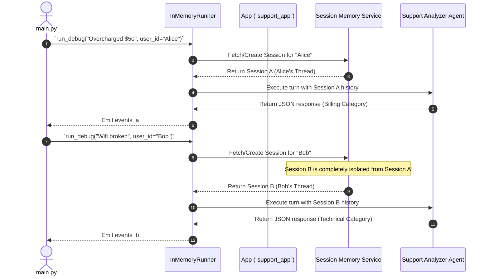

# Lab 6 Solution: Programmatic Execution with Apps and Runners

## Overview & Goal

This document provides the complete, production-ready implementation of `support_analyzer/main.py` using Google Agent Development Kit (ADK) 2.0.

Beyond providing raw code, this solution guide acts as an **FDE Engineering Playbook**. It breaks down how a **Google Forward-Deployed Engineer (FDE)** analyzes business requirements for multi-tenant Python backends, separates application infrastructure from AI intelligence using `App` and `Runner` primitives, and enforces multi-user session isolation.

---

### 💡 FDE & Instructor Hint: Steering AI Assistants (Antigravity)

When guiding developers or using AI coding assistants like **Antigravity** during enterprise agent development, use this **Master ADK 2.0 Steering Prompt** to ensure generated code strictly follows Google's official architectural standards:

> **Master Antigravity Steering Prompt Template:**
> *"You are an expert Google ADK 2.0 Forward-Deployed Engineer. Write programmatic Python agent execution code following strict ADK 2.0 standards:*
> 1. *Use `from google.adk.apps import App` and `from google.adk.runners import InMemoryRunner` (or `DatabaseRunner`).*
> 2. *Initialize `app = App(name="my_app", root_agent=root_agent)`.*
> 3. *Initialize `runner = InMemoryRunner(app=app)`.*
> 4. *Execute using `await runner.run_debug("prompt text", user_id="user_123")` or `runner.run_async(...)`.*
> 5. *Inspect response events using `event.is_final_response()` and access content via `event.content` (NEVER `.candidates`)."*

---

## 🏛️ Part 1: The FDE Architectural Mental Model

### From Plain English Requirements to ADK 2.0 Code

When an enterprise customer requests an agent backend (e.g. for a web server, Slack bot, or microservice), they need multiple users to interact with the AI simultaneously. If user histories cross-contaminate, User B will see sensitive billing details from User A.

As a Google FDE, your job is to establish clean **Software Architecture Separation** and **Session Isolation**.

Here is the exact Requirements-to-Code Matrix for this lab:

| # | Business Requirement | FDE Engineering Risk / Challenge | ADK 2.0 Solution Pattern | Code Implementation |
|---|---|---|---|---|
| **1** | *"Separate operational application settings from AI prompt logic."* | **Monolithic Coupling:** Hardcoding server settings inside agent prompts breaks reusability. | **App / Agent Separation:** `Agent` holds prompt intelligence; `App` holds infrastructure. | `app = App(name="support_app", root_agent=root_agent)` |
| **2** | *"Execute agent logic programmatically from Python scripts without CLI UI."* | **CLI Binding:** Relying on `adk web` or interactive terminals prevents custom backend integration. | **Programmatic Runner Engine:** Use `InMemoryRunner` to orchestrate event loops in Python code. | `runner = InMemoryRunner(app=app)` |
| **3** | *"Guarantee that User A (Alice) and User B (Bob) have isolated memory spaces."* | **Session Contamination:** Sharing a single history thread leaks user data. | **User ID Session Scoping:** Pass `user_id` parameter into runner calls to partition state. | `await runner.run_debug("...", user_id="Alice")`<br/>`await runner.run_debug("...", user_id="Bob")` |
| **4** | *"Simplify local terminal testing with automatic event printing."* | **Async Event Parsing Complexity:** Writing custom stream loops for basic testing creates boilerplate. | **Debug Execution Mode:** Use `runner.run_debug()` for high-level local terminal execution. | `events_a = await runner.run_debug(...)` |

---

## ⚙️ Part 2: Step-by-Step Implementation Guide

### Complete Implementation (`support_analyzer/main.py`)

Create `support_analyzer/main.py`. Read the extensive inline comments to understand how `App`, `Runner`, and `user_id` session isolation work under the hood.

```python
"""
Support Analyzer Programmatic Execution Entrypoint (ADK 2.0)

This module demonstrates programmatic execution of ADK 2.0 agents.
It covers:
1. Wrapping root_agent in an App container.
2. Initializing an InMemoryRunner execution engine.
3. Multi-tenant user session isolation (`user_id="Alice"` vs `user_id="Bob"`).
4. Inspecting event response payloads with `event.is_final_response()`.
"""

import asyncio
from dotenv import load_dotenv
from google.adk.apps import App
from google.adk.runners import InMemoryRunner
from agent import root_agent

# Load environment secrets (.env)
load_dotenv()

# ============================================================================
# SECTION 1: INFRASTRUCTURE CONTAINER & RUNNER ENGINE
# ============================================================================
# Mental Model:
# - `Agent` (root_agent) = The Employee (Intelligence, Prompt, Tools)
# - `App` (app) = The Office Building (Infrastructure, Name, Plugins)
# - `Runner` (runner) = The Work Supervisor (Execution loop, Session Memory)

# 1. Create the App container wrapper
app = App(name="support_app", root_agent=root_agent)

# 2. Instantiate the Runner execution engine
runner = InMemoryRunner(app=app)


# ============================================================================
# SECTION 2: PROGRAMMATIC MULTI-TENANT EXECUTION
# ============================================================================
async def main():
    print("--- User A (Alice: Billing Issue) ---")

    # 3. Run execution for Alice
    # `run_debug` is a high-level helper that streams tokens and prints to stdout automatically.
    # Passing `user_id="Alice"` opens Alice's isolated memory thread.
    events_a = await runner.run_debug(
        "I was overcharged $50 on my monthly bill.",
        user_id="Alice"
    )

    # Optional programmatic event inspection:
    # `events_a` is a list of Event objects emitted during execution.
    for event in events_a:
        if event.is_final_response():
            # Access LLM content safely via `event.content`
            json_output = event.content.parts[0].text
            print(f"\n[Programmatic Verification] Alice's Output: {json_output}")

    print("\n" + "=" * 50 + "\n")

    print("--- User B (Bob: Technical Issue) ---")

    # 4. Run execution for Bob
    # Even though we use the SAME runner instance, passing `user_id="Bob"`
    # creates a completely separate, isolated conversation session.
    # Bob will NOT see Alice's billing problem in his memory context!
    events_b = await runner.run_debug(
        "My wifi router is not connecting to the internet.",
        user_id="Bob"
    )

    for event in events_b:
        if event.is_final_response():
            json_output = event.content.parts[0].text
            print(f"\n[Programmatic Verification] Bob's Output: {json_output}")


if __name__ == "__main__":
    asyncio.run(main())
```

---

## 🔬 Part 3: Deep Breakdown of App & Runner Architecture

Here is the exact architectural diagram showing how ADK 2.0 manages multi-tenant sessions programmatically:



---

## 🧪 Part 4: Verification & Testing Playbook

Execute the programmatic script using UV:
```bash
uv run python support_analyzer/main.py
```

#### Expected Terminal Output
```text
--- User A (Alice: Billing Issue) ---
{"category": "billing", "sentiment": "negative", "summary": "Customer overcharged $50 on bill."}

[Programmatic Verification] Alice's Output: {"category": "billing", ...}

==================================================

--- User B (Bob: Technical Issue) ---
{"category": "technical", "sentiment": "neutral", "summary": "Customer experiencing wifi connectivity issues."}

[Programmatic Verification] Bob's Output: {"category": "technical", ...}
```

---

## ❓ Self-Reflection & Interview Prep

1. **Why is the `App` class considered "infrastructure" while the `Agent` is considered "intelligence"?**
   * *Answer:* `Agent` defines prompt instructions, model selection, and tool capabilities (the "brain"). `App` defines application identity, global logging plugins, session services, and execution bounds (the "container"). This separation allows the same `Agent` node to be re-used across different `App` targets (e.g. web microservice vs batch script).

2. **What would happen if you omitted `user_id` or used the same `user_id` for both Alice and Bob?**
   * *Answer:* If `user_id` is omitted or identical, ADK routes both requests into the **same default session memory**. The agent would receive Bob's wifi query with Alice's prior billing history attached, contaminating context and confusing the LLM.

3. **In a production web framework (e.g., FastAPI or Flask), how should `Runner` be initialized?**
   * *Answer:* `Runner` should be initialized as a **singleton / global instance** when the server boots up. Re-instantiating `Runner` inside every HTTP request handler destroys in-memory session caches and wastes initialization overhead.

---

## 📚 Official References

- **Google ADK Documentation:** https://google.github.io/adk-docs/
- **Google GenAI SDK Reference:** https://googleapis.github.io/python-genai/

<!-- © 2026 Inder Chauhan (https://github.com/inderanz/google-adk-training). All rights reserved. Ref: IC-ADK-module06-programmatic-execution-lab-solution -->
