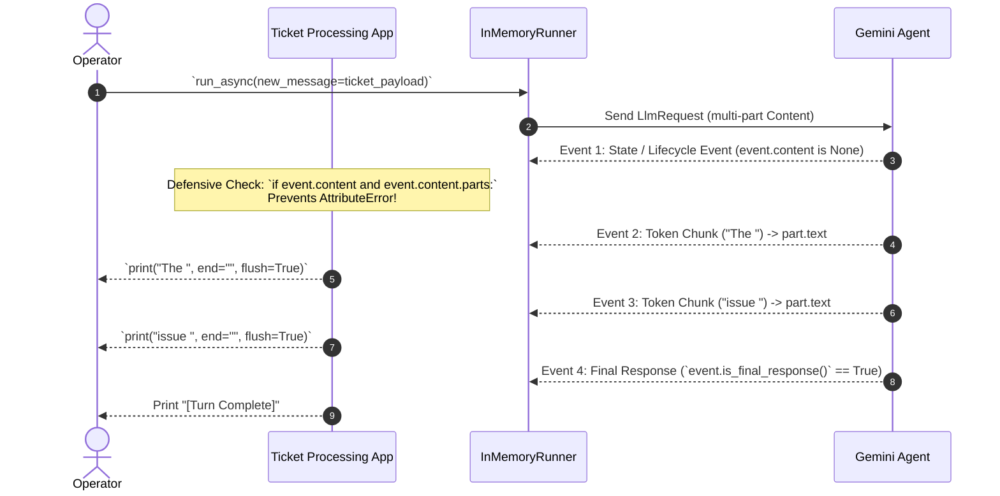

# Lab Solution 6.5: Programmatic Types & Advanced Content Modeling

## Overview & Goal

This document provides the complete, production-ready implementation of `ticket_processor.py` using Google Agent Development Kit (ADK) 2.0.

Beyond providing raw code, this solution guide acts as an **FDE Engineering Playbook**. It breaks down how a **Google Forward-Deployed Engineer (FDE)** analyzes requirements for enterprise ticket processing pipelines, constructs typed multi-part `types.Content` turns, manages explicit session instances, and parses asynchronous token streams defensively.

---

### 💡 FDE & Instructor Hint: Steering AI Assistants (Antigravity)

When guiding developers or using AI coding assistants like **Antigravity** during enterprise agent development, use this **Master ADK 2.0 Steering Prompt** to ensure generated code strictly follows Google's official architectural standards:

> **Master Antigravity Steering Prompt Template:**
> *"You are an expert Google ADK 2.0 Forward-Deployed Engineer. Write programmatic ADK 2.0 multi-part Content construction code following strict standards:*
> 1. *Use `from google.genai import types` to construct `types.Content` and `types.Part`.*
> 2. *Build explicit multi-part turns: `types.Content(role="user", parts=[types.Part.from_text(...), types.Part.from_bytes(...)])`.*
> 3. *Pass `types.Content` objects directly to `runner.run_async(content=...)` or `runner.run_debug(...)`.*
> 4. *Inspect resulting `Event` objects: check `event.is_final_response()` and read `event.content.parts[0].text`.*
> 5. *Access response content using `.content` (NEVER `.candidates`)."*

---

## 🏛️ Part 1: The FDE Architectural Mental Model

### From Plain English Requirements to ADK 2.0 Code

When building enterprise intake automation (e.g. IT Helpdesk, Customer Service, Security Triage), customer requests arrive with system metadata (Ticket ID, Priority, SLA level) attached to the issue description. Passing raw unstructured strings forces the LLM to guess where metadata ends and user input begins.

As a Google FDE, your job is to enforce **Structured Turn Modeling** using `google.genai.types`.

Here is the exact Requirements-to-Code Matrix for this lab:

| # | Business Requirement | FDE Engineering Risk / Challenge | ADK 2.0 Solution Pattern | Code Implementation |
|---|---|---|---|---|
| **1** | *"Attach ticket metadata (ID, Priority) cleanly alongside user description."* | **Prompt Contamination:** Mixing metadata with user text can confuse the model's role context. | **Multi-Part Typed Content:** Build separate `types.Part` objects for metadata and user text inside one `types.Content`. | `types.Content(role="user", parts=[part_header, part_body])` |
| **2** | *"Execute agent logic programmatically from Python scripts without opening web UI."* | **Infrastructure Binding:** Agents must be decoupled from UI tools for background job processing. | **App & Runner Container Architecture:** Instantiate `App(root_agent=...)` and execute via `InMemoryRunner`. | `app = App(name=..., root_agent=root_agent)`<br/>`runner = InMemoryRunner(app=app)` |
| **3** | *"Create and track independent user sessions for background ticket queues."* | **Session State Leakage:** Un-scoped execution mixes ticket history across different processing jobs. | **Explicit Session Creation:** Call `runner.session_service.create_session()` explicitly before streaming. | `session = await runner.session_service.create_session(app_name=app.name, user_id=user_id)` |
| **4** | *"Stream output tokens in real-time without crashing on empty lifecycle events."* | **Event Stream Crashes:** Iterating `event.content.parts` crashes with `AttributeError` on non-content events. | **Defensive Event Stream Parsing:** Perform `if event.content and event.content.parts:` checks before reading text. | `if event.content and event.content.parts:`<br/>`for part in event.content.parts:` |

---

## ⚙️ Part 2: Step-by-Step Implementation Guide

### Complete Implementation (`ticket_processor.py`)

Save this file as `ticket_processor.py` in your `support_analyzer/` directory alongside `agent.py`:

<!-- TEACHER_NOTE_START -->
**Teacher's note (ADK instructor view):**
- **Learning goal:** Explain the concept clearly from beginner to advanced, with a simple mental model first.
- **Why it matters:** Connect the concept to real Google agentic workflows, Python engineering habits, and production-ready decisions.
- **Version watch:** Validate against the latest official ADK / Google docs before teaching; call out deprecations or migration notes when needed.
- **Module linkage:** Connect this idea to the previous and next modules so learners see the progression across the course.
<!-- TEACHER_NOTE_END -->
```python
"""
Enterprise Ticket Processor (ADK 2.0)

This module demonstrates programmatic multi-part content assembly,
explicit session initialization, and defensive event stream parsing.
"""

import asyncio
import logging
from dotenv import load_dotenv

# --- Step 1: ADK and Google GenAI Imports ---
from google.adk.apps import App
from google.adk.runners import InMemoryRunner
from google.genai import types
from agent import root_agent

# Suppress verbose debug logs from network clients
logging.getLogger("google.adk").setLevel(logging.WARNING)

load_dotenv()

# --- Step 2: Infrastructure Initialization ---
# The App encapsulates the agent with an application name
app = App(name="ticket_processing_app", root_agent=root_agent)

# The Runner orchestrates session state and execution
runner = InMemoryRunner(app=app)


def build_ticket_payload(
    ticket_id: str, priority: str, user_description: str
) -> types.Content:
    """Constructs a strongly-typed multi-part Content object for an enterprise ticket.

    Teaching Note on Multi-Part Turns:
    - `types.Part.from_text(...)` constructs individual typed parts.
    - Combining header parts and body parts inside `types.Content(role="user", parts=[...])`
      allows Gemini to process metadata headers distinctly from raw user text.
    """
    # Create the structured metadata header part
    part_header = types.Part.from_text(
        text=f"[TICKET_METADATA] ID: {ticket_id} | Priority: {priority}"
    )

    # Create the main user description part
    part_body = types.Part.from_text(text=f"[USER_DESCRIPTION] {user_description}")

    # Assemble into a Content turn with role="user"
    return types.Content(
        role="user",
        parts=[part_header, part_body],
    )


async def main() -> None:
    user_id = "fde_operator_01"

    # --- Step 3: Explicit Session Creation ---
    # Create the session explicitly in the SessionService before streaming
    session = await runner.session_service.create_session(
        app_name=app.name,
        user_id=user_id,
    )
    print(f"Initialized active session: {session.id} for operator: {user_id}\n")

    # --- Step 4: Build the Typed Payload ---
    ticket_payload = build_ticket_payload(
        ticket_id="INC-9941",
        priority="HIGH",
        user_description="Our database replica is out of sync and billing jobs are failing.",
    )

    print("Agent Response Stream: ", end="", flush=True)

    # --- Step 5: Stream with run_async ---
    async for event in runner.run_async(
        user_id=user_id,
        session_id=session.id,
        new_message=ticket_payload,
    ):
        # --- Step 6: Defensive Stream Inspection ---
        # 1. Prevent AttributeError if event.content is None
        # 2. Iterate parts safely and check if part.text exists
        if event.content and event.content.parts:
            for part in event.content.parts:
                if part.text:
                    print(part.text, end="", flush=True)

        # Check turn completion flag
        if event.is_final_response():
            print("\n\n[Turn Complete: Final response verified]")


if __name__ == "__main__":
    asyncio.run(main())
```

---

## 🔬 Part 3: Deep Breakdown of Event Stream Ingestion

Here is the exact event streaming pipeline when running `runner.run_async()`:

<!-- TEACHER_NOTE_START -->
**Teacher's note (ADK instructor view):**
- **Learning goal:** Explain the concept clearly from beginner to advanced, with a simple mental model first.
- **Why it matters:** Connect the concept to real Google agentic workflows, Python engineering habits, and production-ready decisions.
- **Version watch:** Validate against the latest official ADK / Google docs before teaching; call out deprecations or migration notes when needed.
- **Module linkage:** Connect this idea to the previous and next modules so learners see the progression across the course.
<!-- TEACHER_NOTE_END -->


### Why Defensive Checks are Required

<!-- TEACHER_NOTE_START -->
**Teacher's note (ADK instructor view):**
- **Learning goal:** Explain the concept clearly from beginner to advanced, with a simple mental model first.
- **Why it matters:** Connect the concept to real Google agentic workflows, Python engineering habits, and production-ready decisions.
- **Version watch:** Validate against the latest official ADK / Google docs before teaching; call out deprecations or migration notes when needed.
- **Module linkage:** Connect this idea to the previous and next modules so learners see the progression across the course.
<!-- TEACHER_NOTE_END -->
```python
if event.content and event.content.parts:
    for part in event.content.parts:
        if part.text:
            print(part.text, end="", flush=True)
```

1. **`event.content` Can Be `None`:** ADK emits lifecycle, checkpoint, and telemetry events during execution where `event.content` is empty. Without `if event.content:`, Python throws `AttributeError: 'NoneType' object has no attribute 'parts'`.
2. **Short-Circuit Logical `and`:** Python evaluates `event.content` first. If `None`, it immediately aborts evaluating `event.content.parts`, preventing runtime crashes.
3. **`part.text` Can Be `None`:** If Gemini emits a tool call (`part.function_call`), `part.text` is `None`. Checking `if part.text:` ensures your terminal UI never prints literal `None` strings.
4. **`end=""` & `flush=True`:** `end=""` prevents vertical column splitting between token chunks. `flush=True` forces stdout buffers to render typewriter-style text immediately.

---

## 🧪 Part 4: Verification & Testing Playbook

Execute the processor using UV:
<!-- TEACHER_NOTE_START -->
**Teacher's note (ADK instructor view):**
- **Learning goal:** Explain the concept clearly from beginner to advanced, with a simple mental model first.
- **Why it matters:** Connect the concept to real Google agentic workflows, Python engineering habits, and production-ready decisions.
- **Version watch:** Validate against the latest official ADK / Google docs before teaching; call out deprecations or migration notes when needed.
- **Module linkage:** Connect this idea to the previous and next modules so learners see the progression across the course.
<!-- TEACHER_NOTE_END -->
```bash
uv run python support_analyzer/ticket_processor.py
```

#### Expected Terminal Output
```text
Initialized active session: sess_12345 for operator: fde_operator_01

Agent Response Stream: {
  "category": "technical",
  "sentiment": "negative",
  "summary": "Database replica desynchronization causing billing job failures."
}

[Turn Complete: Final response verified]
```

---

## ❓ Self-Reflection & Interview Prep

1. **Why separate `part_header` and `part_body` into two distinct `Part` objects rather than combining them into one string?**
   * *Answer:* Separating metadata from user descriptions keeps payload boundaries explicit. In multimodal systems, this allows appending binary parts (images, logs) without breaking text template formatting.

2. **What is the difference between `run_debug()` and `run_async()`?**
   * *Answer:* `run_debug()` is a synchronous blocking helper that automatically prints event responses to terminal stdout. `run_async()` is an asynchronous generator yielding `Event` objects in real-time, designed for production WebSockets, APIs, and microservices.

---

## 📚 Official References

- **Google ADK Documentation:** https://google.github.io/adk-docs/
- **Google GenAI SDK Reference:** https://googleapis.github.io/python-genai/

<!-- © 2026 Inder Chauhan (https://github.com/inderanz/google-adk-training). All rights reserved. Ref: IC-ADK-module06_5-programmatic-execution-lab-solution -->
---

## Official References

- Google ADK docs (latest): https://google.github.io/adk-docs/
- Google AI / Gemini docs: https://ai.google.dev/
- Google GenAI Python SDK reference: https://googleapis.github.io/python-genai/
- Context7 / current SDK lookup for the exact installed version and API signatures
- Related module path: review the surrounding modules for continuity, prerequisites, and follow-on concepts

