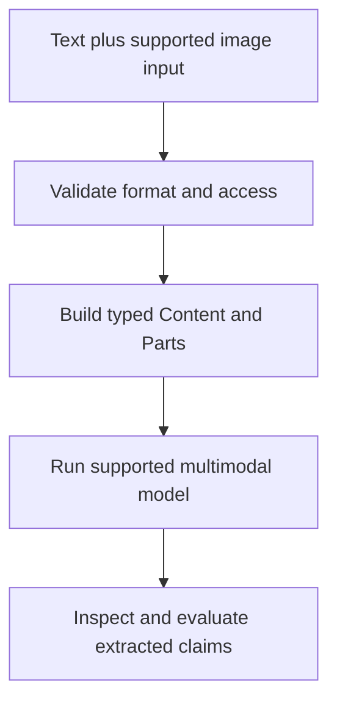

# Module 7: Multimodal and Image Processing

## Before you begin: what this module teaches

**ADK concept: multimodal evidence and model capability boundaries.**

Multimodal means the request or response includes supported modalities such as text, image or audio. The message contains parts; the chosen model must support their formats and limits. Extraction proposes what content says. Validation checks types and constraints. Verification establishes whether an authoritative source supports the claim. These are separate steps.

**Where you would use this in real work.**

An analyst receives a scanned invoice and asks for a summary of visible fields. The image is evidence to inspect, not proof that the invoice is authentic or that the amount is payable. The assistant must keep those meanings separate.

**Connection to Gemini Enterprise Agent Platform and Google Cloud.**

Gemini handles supported multimodal reasoning through ADK. Document AI or other approved extraction services may fit specialized document-processing requirements, but this lesson does not automatically provision them. Store and transmit customer files only through the agreed Google service path.

**By the end, you should be able to:**

- Build a supported image-plus-question request.
- Report unreadable or uncertain content without inventing fields.
- Explain why recognizing an amount does not authorize a transaction.

### Review this lesson through three perspectives

- **Python/ADK beginner:** Point to the text and image parts in the request.
- **Experienced engineer:** Evaluate rotated, low-quality and contradictory documents with explicit criteria.
- **Bank FDE:** Ask whether the customer needs summarization, extraction, authenticity checks or all three.

Use the [guided lab](./lab.md) to observe the mechanism, then compare with the [solution](./lab-solution.md). The banking scenario above explains how to transfer the concept; a lab using a railway, weather or shopping fixture does not implement a live bank integration.

## Theory

### Why Multimodal Matters

Many real-world applications require agents to understand and process more than just text. **Multimodal models**, like Gemini, can process text and images together, enabling a powerful new class of vision-enabled agents.

**Benefits**:

*   👁️ **Vision Understanding**: Analyze images to extract information, identify objects, and understand visual context.
*   🎨 **Image Generation**: Create new images from text descriptions.
*   🧠 **Multimodal Reasoning**: Combine visual and textual information to answer complex questions.
*   📄 **Document Analysis**: Extract text and structure from images of documents (OCR).

> [!NOTE]
> **Foundational Prerequisites: Programmatic Types & Sessions**
> Before building vision agents, ensure you are comfortable with how ADK packages multimodal payloads (`types.Part.from_bytes`, `types.Blob`, and `types.Content`) and executes them via `runner.run_async()`.
>
> For an in-depth, beginner-to-advanced breakdown with line-by-line Python explanations, see [**Module 6.5: Programmatic Execution with Strong Types**](../module06_5-programmatic-execution/README.md).

### The `types.Part` Object

As introduced in [Module 06.5](../module06_5-programmatic-execution/README.md), the fundamental building block for multimodal content in the ADK is the `types.Part` object from the `google.genai.types` library. A user's prompt is packaged as a structured `types.Content` turn containing a list of `Part` objects.

A `Part` can contain:
*   **Text:** `types.Part.from_text(text="Describe this image")`
*   **Image Data (via Bytes):** `types.Part.from_bytes(data=image_bytes, mime_type="image/jpeg")`
*   **Image Data (via Blob):** `types.Part(inline_data=types.Blob(data=image_bytes, mime_type="image/png"))`

When you send a list of these parts inside a `types.Content` turn to a vision-capable model like `gemini-2.5-flash`, the model reasons about the text and the visual elements together.

#### Example: Building a Vision Agent
To send an image to an agent programmatically, package it into a `types.Content` turn and execute it via the ADK `Runner`:

```python
# File: main.py
import asyncio
from google.adk import Agent
from google.adk.apps import App
from google.adk.runners import InMemoryRunner
from google.genai import types

# 1. Define the vision-capable agent
agent = Agent(
    name="vision_expert",
    model="gemini-2.5-flash",
    instruction="You are an expert visual product analyst. Describe the provided image in detail.",
)

# 2. Wrap in an App and initialize the InMemoryRunner
app = App(name="vision_app", root_agent=agent)
runner = InMemoryRunner(app=app)


async def main():
    # 3. Read image bytes from local disk
    with open("product.jpg", "rb") as f:
        image_bytes = f.read()

    # 4. Construct the multimodal turn with types.Content and types.Part
    multimodal_turn = types.Content(
        role="user",
        parts=[
            types.Part.from_text(
                text="What product is shown in this picture and what are its key features?"
            ),
            types.Part.from_bytes(data=image_bytes, mime_type="image/jpeg"),
        ],
    )

    # 5. Programmatic execution via run_async
    # (Refer to Module 06.5 for full session creation and event streaming details)
    session = await runner.session_service.create_session(
        app_name="vision_app",
        user_id="analyst_1",
    )

    async for event in runner.run_async(
        user_id="analyst_1",
        session_id=session.id,
        new_message=multimodal_turn,
    ):
        if event.content and event.content.parts:
            for part in event.content.parts:
                if part.text:
                    print(part.text, end="", flush=True)
    print()


if __name__ == "__main__":
    asyncio.run(main())
```

### Image Generation

Beyond understanding images, some models can also **generate** them. Services like **Agent Platform Imagen** provide text-to-image capabilities. You can create a custom tool that takes a text description, calls the image generation API, and returns the resulting image.

This allows you to build agents that can:
*   Create product mockups from a description.
*   Generate illustrations for a story.
*   Create charts and diagrams from data.

In the lab, you will build a "Visual Product Catalog Analyzer" that uses a single, vision-capable agent to analyze a product image and generate a marketing description from that analysis.

> **Going Further:** the lab below only covers *understanding* images (analysis), not *generating* them -- actually calling an image-generation model is a separate integration (a custom tool wrapping the Imagen API) and is out of scope here. If you want to try it hands-on, the shape is the same pattern as any other custom tool from Module 9: a function that calls the generation API and returns image bytes as a `types.Part` (the same `Part` type you're about to use for analysis, just produced instead of consumed).

### Key Takeaways
- Multimodal models like Gemini can process text and images together, enabling vision-enabled agents.
- The `google.genai.types.Part` object is the building block for multimodal content, allowing you to combine text and image data in a single prompt.
- Vision-capable agents can be used for a wide range of tasks, including image analysis, document understanding, and multimodal reasoning.
- You can create custom tools to integrate with image generation services like Agent Platform Imagen.

## Enterprise Lens: How this maps to real customer work

This module represents a common forward-deployed engineer pattern: take a business need with visual inputs, package the modality correctly, and integrate it into an operating workflow with validation and business logic.

The latest ADK guidance also highlights the broader design decision: start simple, then move to workflows when the task complexity, context needs, or orchestration requirements grow.

Use the enterprise companion guide here:

- [Module 06.5: Programmatic Execution with Strong Types](../module06_5-programmatic-execution/README.md)
- [Module 07 Enterprise Playbook](./enterprise-playbook.md)
- [Enterprise ADK Playbook Index](../enterprise-adk-roadmap.md)

This ensures the multimodal lesson connects to the broader ADK enterprise architecture story instead of staying isolated as a demo.

## Concept Diagram (Basic → Advanced)

The diagram below shows a high-level flow from raw user input (text and images) through preprocessing, multimodal fusion, model selection, post-processing and production delivery. Use it to explain the mental model to learners before diving into code.


How to read this diagram:

- Start at **User Input**: can be text-only, image-only, or multimodal.
- **Preprocessing** prepares data for the model (image transforms, OCR for text extraction, tokenization for text).
- **Encoders** extract modality-specific features; fusion combines them for reasoning.
- **Model selection** chooses a model that supports the required modalities and SLOs (Gemini for multimodal, a local model for offline/dev, or an ensemble).
- **Post-processing** translates model outputs into structured results (entities, summaries, or actions).
- **Agent Action** executes the chosen workflow (call tools, store results, return user-facing content).
- **Operational concerns** cover safety, cost, latency, and observability for production systems.

## Official ADK / Google references

Use the official Google and ADK documentation as the current source of truth for multimodal prompt design, image inputs, and model capability updates:

- ADK documentation home: https://google.github.io/adk-docs/
- ADK agents overview: https://google.github.io/adk-docs/agents/
- Gemini API multimodal docs: https://ai.google.dev/gemini-api/docs/multimodal
- Google AI Studio / Gemini docs: https://ai.google.dev/gemini-api/docs
- Vertex AI multimodal guidance: https://cloud.google.com/vertex-ai/generative-ai/docs/multimodal

These references should be reviewed whenever the training content is updated for a new model version or multimodal input behavior change.

## Continue the course story

Previous: [Module 06.5](../module06_5-programmatic-execution/README.md) · Next: [Module 08](../module08-intro-to-tools/README.md) · [See how the concepts build](../learning-journey.md)

Before continuing, explain one input, one ADK execution boundary and one failure outcome from this module. Use the next chapter to add a new customer requirement, not merely another component.

<!-- © 2026 Inder Chauhan (https://github.com/inderanz/google-adk-training). All rights reserved. Ref: IC-ADK-module07-multimodal-and-images-README -->
---


## Official References

- Google ADK docs (latest): https://google.github.io/adk-docs/
- Gemini API (multimodal): https://ai.google.dev/gemini-api/docs
- Google GenAI Python SDK reference: https://googleapis.github.io/python-genai/
- Vertex AI generative guidance: https://cloud.google.com/vertex-ai/generative-ai
- Cloud Vision and OCR: https://cloud.google.com/vision

