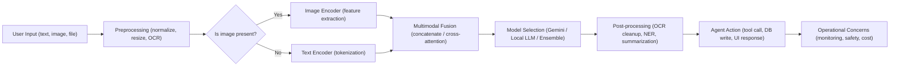

# Module 7: Multimodal and Image Processing

## Theory

### Why Multimodal Matters

Many real-world applications require agents to understand and process more than just text. **Multimodal models**, like Gemini, can process text and images together, enabling a powerful new class of vision-enabled agents.

**Benefits**:

*   👁️ **Vision Understanding**: Analyze images to extract information, identify objects, and understand visual context.
*   🎨 **Image Generation**: Create new images from text descriptions.
*   🧠 **Multimodal Reasoning**: Combine visual and textual information to answer complex questions.
*   📄 **Document Analysis**: Extract text and structure from images of documents (OCR).

### The `types.Part` Object

The fundamental building block for multimodal content in the ADK is the `types.Part` object from the `google.genai` library. A user's prompt is no longer just a string, but a list of `Part` objects.

A `Part` can contain:
*   **Text:** `types.Part.from_text(text="Describe this image")`
*   **Image Data:** `types.Part(inline_data=types.Blob(data=image_bytes, mime_type='image/png'))`

When you send a list of these parts to a vision-capable model like `gemini-3.5-flash`, the model can reason about the text and the image(s) together.

#### Example: Building a Vision Agent
To send an image to an agent programmatically, you package it into a list and run it via an `App`:

<!-- TEACHER_NOTE_START -->
**Teacher's note (ADK instructor view):**
- **Learning goal:** Explain the concept clearly from beginner to advanced, with a simple mental model first.
- **Why it matters:** Connect the concept to real Google agentic workflows, Python engineering habits, and production-ready decisions.
- **Version watch:** Validate against the latest official ADK / Google docs before teaching; call out deprecations or migration notes when needed.
- **Module linkage:** Connect this idea to the previous and next modules so learners see the progression across the course.
<!-- TEACHER_NOTE_END -->
<!-- TEACHER_NOTE_START -->
**Teacher's note (ADK instructor view):**
- **Learning goal:** Explain the concept clearly from beginner to advanced, with a simple mental model first.
- **Why it matters:** Connect the concept to real Google agentic workflows, Python engineering habits, and production-ready decisions.
- **Version watch:** Validate against the latest official ADK / Google docs before teaching; call out deprecations or migration notes when needed.
- **Module linkage:** Connect this idea to the previous and next modules so learners see the progression across the course.
<!-- TEACHER_NOTE_END -->
```python
from google.adk import Agent
from google.adk.apps import App
from google.adk.runners import InMemoryRunner
from google.genai import types

# 1. Define the agent
agent = Agent(
    name="vision_expert",
    model="gemini-3.5-flash",
    instruction="Describe the provided image in detail."
)

# 2. Wrap in an App
app = App(name="vision_app", root_agent=agent)
runner = InMemoryRunner(app=app)

# 3. Construct the multimodal list
multimodal_prompt = [
    "What is in this picture?",
    types.Part(inline_data=types.Blob(data=image_bytes, mime_type="image/jpeg"))
]

# 4. Run!
# response = await runner.run_debug(multimodal_prompt)
```

### Image Generation

Beyond understanding images, some models can also **generate** them. Services like **Agent Platform Imagen** provide text-to-image capabilities. You can create a custom tool that takes a text description, calls the image generation API, and returns the resulting image.

This allows you to build agents that can:
*   Create product mockups from a description.
*   Generate illustrations for a story.
*   Create charts and diagrams from data.

In the lab, you will build a "Visual Product Catalog Analyzer" that uses a single, vision-capable agent to analyze a product image and generate a marketing description from that analysis.

> **Going Further:** the lab below only covers *understanding* images (analysis), not *generating* them -- actually calling an image-generation model is a separate integration (a custom tool wrapping the Imagen API) and is out of scope here. If you want to try it hands-on, the shape is the same pattern as any other custom tool from Module 9: a function that calls the generation API and returns image bytes as a `types.Part` (the same `Part` type you're about to use for analysis, just produced instead of consumed).

### Key Takeaways
- Multimodal models like Gemini can process text and images together, enabling vision-enabled agents.
- The `google.genai.types.Part` object is the building block for multimodal content, allowing you to combine text and image data in a single prompt.
- Vision-capable agents can be used for a wide range of tasks, including image analysis, document understanding, and multimodal reasoning.
- You can create custom tools to integrate with image generation services like Agent Platform Imagen.

## Enterprise Lens: How this maps to real customer work

This module represents a common forward-deployed engineer pattern: take a business need with visual inputs, package the modality correctly, and integrate it into an operating workflow with validation and business logic.

The latest ADK guidance also highlights the broader design decision: start simple, then move to workflows when the task complexity, context needs, or orchestration requirements grow.

Use the enterprise companion guide here:

- [Module 07 Enterprise Playbook](./enterprise-playbook.md)
- [Enterprise ADK Playbook Index](../enterprise-adk-roadmap.md)

This ensures the multimodal lesson connects to the broader ADK enterprise architecture story instead of staying isolated as a demo.

## Concept Diagram (Basic → Advanced)

The diagram below shows a high-level flow from raw user input (text and images) through preprocessing, multimodal fusion, model selection, post-processing and production delivery. Use it to explain the mental model to learners before diving into code.

<!-- TEACHER_NOTE_START -->
**Teacher's note (ADK instructor view):**
- **Learning goal:** Explain the concept clearly from beginner to advanced, with a simple mental model first.
- **Why it matters:** Connect the concept to real Google agentic workflows, Python engineering habits, and production-ready decisions.
- **Version watch:** Validate against the latest official ADK / Google docs before teaching; call out deprecations or migration notes when needed.
- **Module linkage:** Connect this idea to the previous and next modules so learners see the progression across the course.
<!-- TEACHER_NOTE_END -->


How to read this diagram:

- Start at **User Input**: can be text-only, image-only, or multimodal.
- **Preprocessing** prepares data for the model (image transforms, OCR for text extraction, tokenization for text).
- **Encoders** extract modality-specific features; fusion combines them for reasoning.
- **Model selection** chooses a model that supports the required modalities and SLOs (Gemini for multimodal, a local model for offline/dev, or an ensemble).
- **Post-processing** translates model outputs into structured results (entities, summaries, or actions).
- **Agent Action** executes the chosen workflow (call tools, store results, return user-facing content).
- **Operational concerns** cover safety, cost, latency, and observability for production systems.

## Official ADK / Google references

Use the official Google and ADK documentation as the current source of truth for multimodal prompt design, image inputs, and model capability updates:

- ADK documentation home: https://google.github.io/adk-docs/
- ADK agents overview: https://google.github.io/adk-docs/agents/
- Gemini API multimodal docs: https://ai.google.dev/gemini-api/docs/multimodal
- Google AI Studio / Gemini docs: https://ai.google.dev/gemini-api/docs
- Vertex AI multimodal guidance: https://cloud.google.com/vertex-ai/generative-ai/docs/multimodal

These references should be reviewed whenever the training content is updated for a new model version or multimodal input behavior change.

<!-- © 2026 Inder Chauhan (https://github.com/inderanz/google-adk-training). All rights reserved. Ref: IC-ADK-module07-multimodal-and-images-README -->
---


## Official References

- Google ADK docs (latest): https://google.github.io/adk-docs/
- Gemini API (multimodal): https://ai.google.dev/gemini-api/docs
- Google GenAI Python SDK reference: https://googleapis.github.io/python-genai/
- Vertex AI generative guidance: https://cloud.google.com/vertex-ai/generative-ai
- Cloud Vision and OCR: https://cloud.google.com/vision

