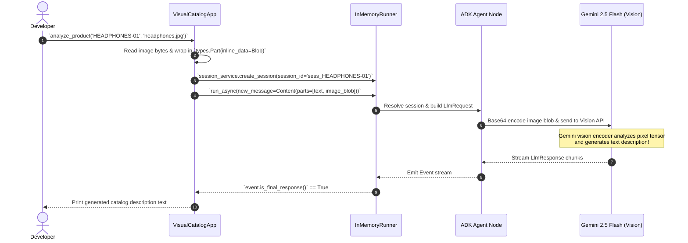

# Lab 7 Solution: Building a Visual Product Catalog Analyzer

## Overview & Goal

This document provides the complete, production-ready implementation of `visual_catalog` using Google Agent Development Kit (ADK) 2.0.

Beyond providing raw code, this solution guide acts as an **FDE Engineering Playbook**. It breaks down how a **Google Forward-Deployed Engineer (FDE)** analyzes business requirements for computer vision & multimodal AI applications, packages binary images into typed Google GenAI `types.Part` objects, and manages asynchronous multi-part sessions using `InMemoryRunner`.

---

### 💡 FDE & Instructor Hint: Steering AI Assistants (Antigravity)

When guiding developers or using AI coding assistants like **Antigravity** during enterprise agent development, use this **Master ADK 2.0 Steering Prompt** to ensure generated code strictly follows Google's official architectural standards:

> **Master Antigravity Steering Prompt Template:**
> *"You are an expert Google ADK 2.0 Forward-Deployed Engineer. Write multimodal agent execution code using strict ADK 2.0 & Google GenAI standards:*
> 1. *Use `from google.genai import types` to build multimodal input parts.*
> 2. *Create image/media parts: `types.Part.from_bytes(data=image_bytes, mime_type="image/jpeg")` or `types.Part.from_uri(...)`.*
> 3. *Combine image parts and text parts into a single `types.Content(role="user", parts=[image_part, text_part])`.*
> 4. *Pass the multimodal `types.Content` turn to `await runner.run_async(content=...)` or `await runner.run_debug(content=...)*.
> 5. *Access LLM response content via `event.content` (NEVER use legacy `.candidates`)."*

---

## 🏛️ Part 1: The FDE Architectural Mental Model

### From Plain English Requirements to ADK 2.0 Code

When an enterprise customer (like an e-commerce retailer) wants to automate product catalog generation, they need their AI system to "see" product photos and write marketing descriptions. However, Large Language Models do not open file paths directly on local disk drives.

As a Google FDE, your job is to convert raw file system paths into **Typed Multimodal Blobs** and package them into ADK `types.Content` turns.

Here is the exact Requirements-to-Code Matrix for this lab:

| # | Business Requirement | FDE Engineering Risk / Challenge | ADK 2.0 Solution Pattern | Code Implementation |
|---|---|---|---|---|
| **1** | *"Read product photos (PNG/JPEG) from disk and feed them into the AI model."* | **File System Disconnect:** LLMs cannot read paths like `c:\images\headphones.jpg`. | **Binary Blob Wrapping:** Open file in `rb` binary mode and wrap bytes in `types.Part(inline_data=types.Blob(...))`. | `types.Part(inline_data=types.Blob(data=bytes, mime_type="image/jpeg"))` |
| **2** | *"Send both text instructions and the image together in a single prompt turn."* | **Payload Fragmentation:** Sending text and image separately loses contextual binding. | **Multi-Part Content Assembly:** Pass both text and image `Part` objects inside `types.Content(parts=[...])`. | `types.Content(role="user", parts=[text_part, image_part])` |
| **3** | *"Execute vision requests programmatically for multiple products in a batch pipeline."* | **Session Conflict:** Batch items overwrite history if sessions aren't explicitly isolated. | **Explicit Session Management:** Call `runner.session_service.create_session()` for each product ID. | `await runner.session_service.create_session(session_id=f"sess_{product_id}")` |
| **4** | *"Stream and inspect final response events from the async execution engine."* | **Partial Response Confusion:** Async generators emit intermediate thinking events before final text. | **Final Response Filtering:** Iterate `async for event in runner.run_async()` and filter with `event.is_final_response()`. | `if event.is_final_response(): text = event.content.parts[0].text` |

---

## ⚙️ Part 2: Step-by-Step Implementation Guide

### Complete `visual_catalog/main.py` Implementation

Create `visual_catalog/main.py`. Read the extensive inline comments to understand how image byte encoding, multimodal message assembly, and session streaming work under the hood.

<!-- TEACHER_NOTE_START -->
**Teacher's note (ADK instructor view):**
- **Learning goal:** Explain the concept clearly from beginner to advanced, with a simple mental model first.
- **Why it matters:** Connect the concept to real Google agentic workflows, Python engineering habits, and production-ready decisions.
- **Version watch:** Validate against the latest official ADK / Google docs before teaching; call out deprecations or migration notes when needed.
- **Module linkage:** Connect this idea to the previous and next modules so learners see the progression across the course.
<!-- TEACHER_NOTE_END -->
```python
"""
Visual Product Catalog Analyzer (ADK 2.0)

This module demonstrates how to build a production multimodal AI pipeline.
It covers:
1. Converting local image files into typed `types.Part` blobs.
2. Assembling multi-part `types.Content` turns combining text and vision.
3. Explicit session creation using `runner.session_service`.
4. Asynchronous event streaming with `runner.run_async()`.
"""

import asyncio
import logging
import os

from dotenv import load_dotenv
from google.adk import Agent
from google.adk.apps import App
from google.adk.runners import InMemoryRunner
from google.genai import types

# Suppress noisy HTTP logs from underlying client libraries
logging.getLogger("google.adk").setLevel(logging.WARNING)


# ============================================================================
# SECTION 1: MULTIMODAL FILE CONVERSION HELPER
# ============================================================================
def load_image_from_file(file_path: str) -> types.Part:
    """Reads a local image file and converts it into a Google GenAI `types.Part`.

    Teaching Note on Multimodal Ingestion:
    - The LLM does not read file paths directly. We must read the binary bytes
      and declare the explicit MIME type (e.g. 'image/jpeg', 'image/png').
    - `types.Blob` holds binary data + mime_type.
    - `types.Part` wraps the blob so it can be added to a `types.Content` message list.

    Args:
        file_path: Absolute or relative file path to the image.

    Returns:
        A typed `types.Part` object ready for multimodal payload assembly.
    """
    # 1. Read file in binary mode ('rb')
    with open(file_path, "rb") as f:
        image_bytes = f.read()

    # 2. Determine correct MIME type from extension
    mime_type = "image/png" if file_path.lower().endswith(".png") else "image/jpeg"

    # 3. Construct and return typed inline Part
    return types.Part(
        inline_data=types.Blob(data=image_bytes, mime_type=mime_type)
    )


# ============================================================================
# SECTION 2: MULTIMODAL APPLICATION CLASS
# ============================================================================
class VisualCatalogApp:
    """Enterprise application wrapper orchestrating visual product catalog generation."""

    def __init__(self):
        # A. Define the Vision Agent Node
        # Gemini 2.5 Flash natively supports high-resolution multimodal vision analysis
        self.agent = Agent(
            name="catalog_writer",
            model="gemini-2.5-flash",
            instruction="""
You are an expert product catalog writer.
Your task is to analyze the provided product photo and write a compelling,
professional web catalog description.
Highlight key visible features, build materials, color schemes, and ideal customer use cases.
""".strip(),
        )

        # B. Wrap Agent inside the App Infrastructure Container
        self.app = App(name="visual_catalog", root_agent=self.agent)

        # C. Initialize Execution Runner
        self.runner = InMemoryRunner(app=self.app)

    async def analyze_product(self, product_id: str, image_path: str):
        """Processes a single product image and prints the catalog description.

        Teaching Note on Async Execution & Sessions:
        - When using `run_async`, you MUST create the session explicitly via `session_service`.
        - `user_id` and `session_id` isolate memory threads between product processing runs.

        Args:
            product_id: Unique product SKU or identifier.
            image_path: Path to the product image on disk.
        """
        print(f"\n--- Processing Product: {product_id} ---")

        user_id = "catalog_admin"
        session_id = f"sess_{product_id}"

        # Step 1: Create session explicitly in session_service
        await self.runner.session_service.create_session(
            app_name=self.app.name,
            user_id=user_id,
            session_id=session_id,
        )

        # Step 2: Convert local image into a typed Part blob
        image_part = load_image_from_file(image_path)

        # Step 3: Build multi-part Content message (Text + Image)
        # Note: Order matters! Place text prompt first, followed by visual image parts.
        multimodal_msg = types.Content(
            role="user",
            parts=[
                types.Part.from_text(
                    f"Analyze product ID '{product_id}' and write a web catalog description."
                ),
                image_part,
            ],
        )

        # Step 4: Stream response events asynchronously from runner
        print("📸 Sending image bytes to Gemini Vision...")
        async for event in self.runner.run_async(
            user_id=user_id,
            session_id=session_id,
            new_message=multimodal_msg,
        ):
            # Inspect event stream and extract final response text
            if event.is_final_response():
                description = event.content.parts[0].text
                print(f"✅ Generated Catalog Description:\n{description}\n")


# ============================================================================
# SECTION 3: BATCH PIPELINE ORCHESTRATION
# ============================================================================
async def main():
    """Main batch processing entrypoint."""
    load_dotenv()

    # Instantiate catalog app pipeline
    catalog_app = VisualCatalogApp()

    # Batch queue of product SKUs and local image paths
    products_to_process = [
        ("HEADPHONES-01", "../headphones.jpg"),
        ("LAPTOP-02", "../laptop.jpg"),
    ]

    for product_id, path in products_to_process:
        if os.path.exists(path):
            await catalog_app.analyze_product(product_id, path)
            await asyncio.sleep(1)  # Respect rate limits between batch items
        else:
            print(f"⚠️ Warning: Image file not found at path '{path}'")


if __name__ == "__main__":
    asyncio.run(main())
```

---

## 🔬 Part 3: Deep Dive — Multimodal Streaming Architecture

Here is the exact sequence showing how image bytes flow from your local Python script into Gemini 2.5 Flash vision encoders via ADK 2.0:

<!-- TEACHER_NOTE_START -->
**Teacher's note (ADK instructor view):**
- **Learning goal:** Explain the concept clearly from beginner to advanced, with a simple mental model first.
- **Why it matters:** Connect the concept to real Google agentic workflows, Python engineering habits, and production-ready decisions.
- **Version watch:** Validate against the latest official ADK / Google docs before teaching; call out deprecations or migration notes when needed.
- **Module linkage:** Connect this idea to the previous and next modules so learners see the progression across the course.
<!-- TEACHER_NOTE_END -->


---

## 🧪 Part 4: Verification & Testing Playbook

### Running the Multimodal Pipeline

Execute the script using UV:
<!-- TEACHER_NOTE_START -->
**Teacher's note (ADK instructor view):**
- **Learning goal:** Explain the concept clearly from beginner to advanced, with a simple mental model first.
- **Why it matters:** Connect the concept to real Google agentic workflows, Python engineering habits, and production-ready decisions.
- **Version watch:** Validate against the latest official ADK / Google docs before teaching; call out deprecations or migration notes when needed.
- **Module linkage:** Connect this idea to the previous and next modules so learners see the progression across the course.
<!-- TEACHER_NOTE_END -->
```bash
uv run python visual_catalog/main.py
```

#### Expected Terminal Output
```text
--- Processing Product: HEADPHONES-01 ---
📸 Sending image bytes to Gemini Vision...
✅ Generated Catalog Description:
Introducing the Premium Wireless Over-Ear Headphones. Featuring a sleek matte-black ergonomic finish, cushioned memory-foam earcups, and brushed aluminum accents...
```

---

## ❓ Self-Reflection & Interview Prep

1. **Why do we need `load_image_from_file` instead of passing the string `'../headphones.jpg'` directly to Gemini?**
   * *Answer:* Gemini is a cloud-hosted API service that does not have access to your local hard drive or filesystem paths. `load_image_from_file` reads raw binary bytes and wraps them into a base64 inline `types.Blob` container that ADK can transmit over HTTP.

2. **Why must we call `create_session` manually when using `run_async`?**
   * *Answer:* High-level CLI commands (like `run_debug` or `adk run`) auto-initialize sessions for developer convenience. Production programmatic execution (`run_async`) gives developers fine-grained control over session isolation, persistence backends, and multi-tenant user threads, requiring explicit session creation.

3. **How would you modify this code to analyze a multi-page PDF contract instead of a JPEG image?**
   * *Answer:* Simply change the MIME type in `types.Blob(data=pdf_bytes, mime_type="application/pdf")`. The rest of the `types.Content` assembly and `run_async` execution pipeline remains identical!

---

## 📚 Official References

- **Google ADK Documentation:** https://google.github.io/adk-docs/
- **Google GenAI SDK Multimodal Guide:** https://googleapis.github.io/python-genai/

<!-- © 2026 Inder Chauhan (https://github.com/inderanz/google-adk-training). All rights reserved. Ref: IC-ADK-module07-multimodal-and-images-lab-solution -->
---

## Official References

- Google ADK docs (latest): https://google.github.io/adk-docs/
- Google AI / Gemini docs: https://ai.google.dev/
- Google GenAI Python SDK reference: https://googleapis.github.io/python-genai/
- Context7 / current SDK lookup for the exact installed version and API signatures
- Related module path: review the surrounding modules for continuity, prerequisites, and follow-on concepts

