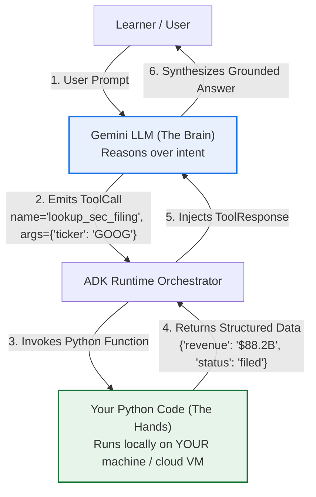
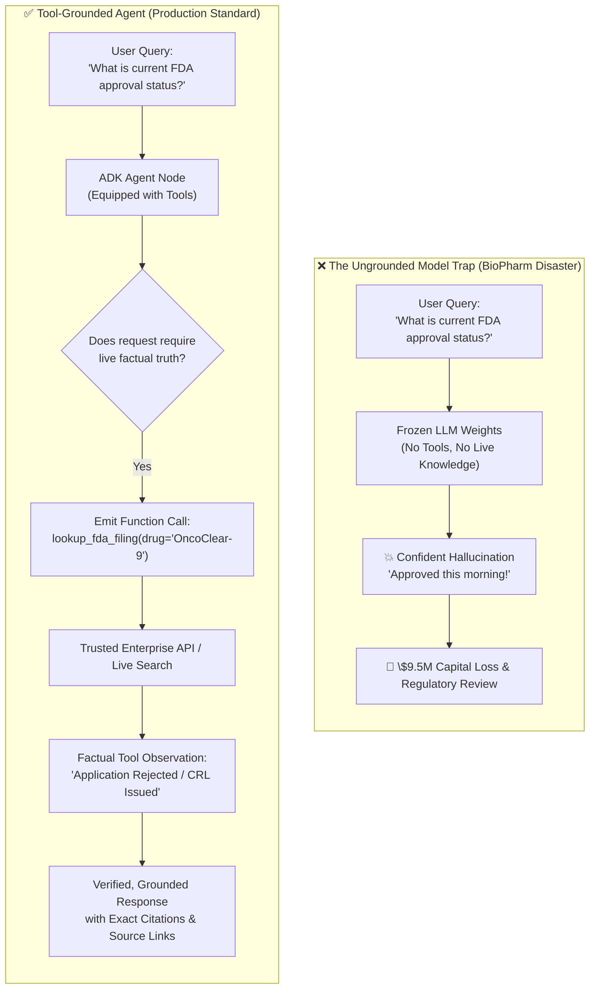
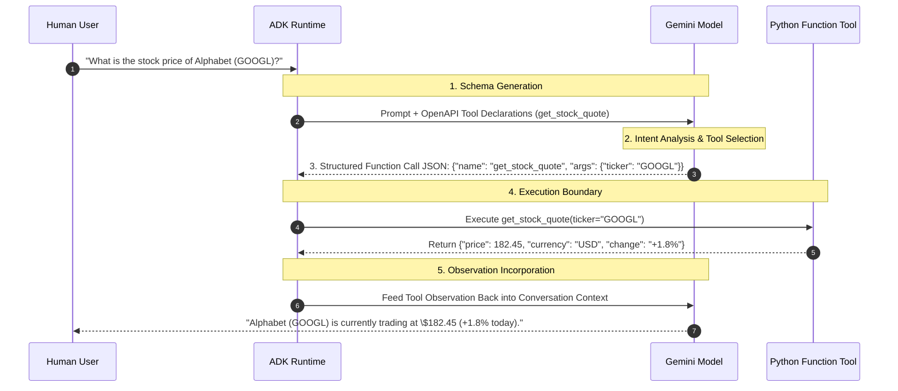

# Module 8: Introduction to Tools

## Before you begin: what this module teaches

**ADK concept: tool declarations, model requests and runtime execution.**

A tool declaration describes a capability and its arguments to the model. A function call is the model's request to use it. ADK resolves the request and runs application code. A function response returns the result for subsequent reasoning. The tool is like the branch records desk: the assistant can request a lookup, but the desk must still check access and report unavailable/missing records honestly.

**Where you would use this in real work.**

Meera asks, “Has the ownership register arrived?” The model cannot know the current answer from its training. It needs a narrowly defined operation that reads the authorized case record.

**Connection to Gemini Enterprise Agent Platform and Google Cloud.**

Use native ADK function tools or an appropriate supported integration. The bank API or Google-backed record service owns the facts; Gemini explains their returned meaning. An instruction to use a tool is behavior to evaluate, not a guarantee that every request invokes it.

**By the end, you should be able to:**

- Draw declaration, function call, execution and result as separate stages.
- Choose a read-only tool before adding a consequential write.
- Explain why a plausible answer is not evidence of a tool call.

### Review this lesson through three perspectives

- **Python/ADK beginner:** Identify arguments and results in one trace.
- **Experienced engineer:** Test out-of-order, missing and invalid tool requests.
- **Bank FDE:** Agree the smallest permitted operation and its source of truth.

Use the [guided lab](./lab.md) to observe the mechanism, then compare with the [solution](./lab-solution.md). The banking scenario above explains how to transfer the concept; a lab using a railway, weather or shopping fixture does not implement a live bank integration.

## Draw the execution boundary
## The Great Transition: From Prompts to Programmatic Execution

A tool call is proposed by the model and executed by trusted application code.
> [!IMPORTANT]
> **The Mental Shift:** In Modules 01 through 07, you interacted with Gemini through **prompts**. You asked a question, and the model generated text from its static weights.
> Starting in Module 08, you transition from **prompting an LLM** to **building an agent that controls software**.

### 1. Comparative Mental Models

#### Until Module 07: Pure Prompting (Generative & Frozen)
```mermaid
flowchart TB
  A[Gemini receives tool declaration] --> B[Model requests named tool]
  B --> C[ADK resolves the call]
  C --> D[Tool validates and performs operation]
  D --> E[Result returns to model context]
flowchart LR
    User["Learner / User"] -- "User Prompt" --> LLM["Gemini LLM<br/>(Frozen Weights)"]
    LLM -- "Generated Text Response<br/>(May hallucinate facts)" --> User
```

#### From Module 08 Onward: Agentic Tool Execution (Deterministic & Grounded)


---

### 2. The Core Insight: Who Runs the Code?

A common stumbling block for developers new to AI agents is the belief that the Large Language Model executes your code in the cloud.

> **Crucial Reality Check:**
> **Gemini does NOT execute your Python code.**
> Gemini is an orchestrator of intent. When you equip an agent with tools:
> 1. ADK inspects your Python function name, type annotations, and docstrings.
> 2. ADK translates those into a standard OpenAPI JSON schema (`FunctionDeclaration`) and sends it to Gemini.
> 3. Gemini decides *if* and *when* to call that function, outputting a structured JSON request (`ToolCall`).
> 4. **Your local Python interpreter (or cloud container) executes the function.**
> 5. The return value is fed back to Gemini so it can formulate a factual, grounded response.

```
       ┌────────────────────────────────────────────────────────┐
       │                   THE AGENT DIVISION                   │
       ├──────────────────────────┬─────────────────────────────┤
       │     GEMINI (THE BRAIN)   │      PYTHON (THE HANDS)     │
       ├──────────────────────────┼─────────────────────────────┤
       │ • Understands language   │ • Connects to databases     │
       │ • Decides WHICH tool     │ • Calls external REST APIs  │
       │ • Extracts arguments     │ • Performs exact math       │
       │ • Explains results       │ • Enforces security & auth  │
       │ • CANNOT access internet │ • Runs deterministically    │
       │   or private databases   │   on your CPU / container   │
       └──────────────────────────┴─────────────────────────────┘
```

---

### 3. The Three Invariants of Production Tool Engineering

1. **Type Annotations are the API Contract:** Because Gemini reads your Python type hints to generate tool schemas, untyped arguments (`def lookup(ticker):`) lead to model confusion and schema failures. Always write strict type hints (`def lookup(ticker: str) -> dict:`).
2. **Docstrings are Prompt Engineering:** The docstring is the only manual Gemini reads to know *why* and *when* to invoke your function. A vague docstring guarantees tool hallucination or missed invocations.
3. **Zero-Trust Boundary:** The model is an external caller. Treat arguments from Gemini with the same scrutiny as input from an untrusted web form: validate bounds, sanitize strings, and never trust an LLM with raw SQL injection vectors.


## Theory

### 1. The Scenario: The Hallucinated FDA Approval Crisis at BioPharm Global

To understand why tools are the cornerstone of production AI engineering, consider **BioPharm Global**, a specialized biotechnology hedge fund managing \$12B in quantitative and fundamental healthcare portfolios.

Ahead of a major pharmaceutical earnings cycle, BioPharm's internal engineering team deployed an internal research assistant called **"BioIntel"**. Designed to help senior analysts digest regulatory filings, biomedical research papers, and trial progress, BioIntel was powered by a cutting-edge large language model. Eager to ship quickly, the developers deployed the model in a pure chat configuration—**without connecting any external tools or live search grounding**.

At 9:02 AM on a Tuesday, thirty minutes before market open, a portfolio manager received a breaking alert on terminal screens regarding a Phase 3 oncology trial for *OncoClear-9*, a flagship lung cancer therapeutic developed by a key portfolio company. The manager asked BioIntel:

> *"What is the current FDA regulatory approval status for OncoClear-9, and did the Phase 3 trial meet its primary endpoint?"*

Because the model lacked tools, it could not access the live internet or the FDA's real-time EDGAR portal. Constrained by static pre-training weights that had absorbed optimistic 2023 press releases, the model hallucinated with absolute, convincing authority:

> *"OncoClear-9 received expedited FDA approval this morning after demonstrating a statistically significant 42% reduction in tumor progression. Commercial rollout is slated for Q3."*

Believing the AI had synthesized the morning's breaking disclosure, the trading desk placed an aggressive \$14M leveraged long position at market open.

**The Reality:** The FDA had actually issued a **Complete Response Letter (CRL) rejecting the application** due to liver toxicity concerns published at 8:45 AM.

Within 45 minutes, the stock cratered **68%**, wiping out **\$9.5M in capital** in a single morning, triggering emergency risk freezes, and prompting an immediate inquiry from compliance regulators.



---

### 2. What is a Tool? The "Brain vs. Hands" Mental Model

In traditional software, your code is deterministic: if you write a function to fetch weather data, it runs when called.

In an LLM without tools, the model is purely generative: it predicts the most statistically probable sequence of tokens based on frozen training data. It has no eyes, no hands, and no connection to current reality.

**A Tool is an interface that connects the model's reasoning capabilities with trusted external execution:**
* The **Agent (LLM)** is the **"Brain"**: It reads user intent, breaks complex goals into steps, decides *which* tool to call, and formats arguments.
* The **Tool** is the **"Hands"**: It executes deterministic Python code, connects to databases, calls cloud APIs, queries Google Search, or mutates external systems.

> [!IMPORTANT]
> **The Golden Rule of Agent Tools:**
> The LLM **never** runs your Python code directly. The LLM only generates a structured text request (a JSON schema) proposing to call a function. The **ADK runtime** intercepts that proposal, securely executes your Python function in your application's environment, and hands the factual output back to the model.

---

### 3. The 5-Stage Function Calling Protocol

How does a probabilistic neural network invoke a typed Python function? Google ADK orchestrates this through a standardized 5-stage cycle known as **Function Calling**:



#### Detailed Breakdown of the 5 Stages:
1. **Schema Generation (ADK $\rightarrow$ Gemini):**
   When you initialize an `Agent(tools=[my_function])`, the ADK inspects your Python function’s name, docstring, type hints, and parameter defaults, translating them automatically into an **OpenAPI 3.0 JSON Schema**. This schema is injected into Gemini's tool declaration block.
2. **Intent Analysis & Selection (Gemini):**
   Gemini receives the user's prompt alongside the tool schemas. If the model determines that answering the query requires external data, it selects the appropriate tool.
3. **Structured Function Call Emission (Gemini $\rightarrow$ ADK):**
   Instead of outputting conversational text, Gemini returns a special `ToolCall` part containing the tool name and validated JSON arguments matching the schema.
4. **Execution Boundary (ADK $\rightarrow$ Python Runtime):**
   The ADK runtime verifies the call against registered tools, unpacks the arguments, and executes your Python code inside your local environment using your application's credentials.
5. **Observation Context Incorporation (ADK $\rightarrow$ Gemini $\rightarrow$ User):**
   The tool's return value (string, dictionary, or list) is wrapped in a `ToolResponse` part and fed back to Gemini. Gemini digests the observation, verifies its factual content, and synthesizes a natural language answer with complete accuracy.

---

### 4. Tool Types in the Google ADK Ecosystem

The Google ADK provides three primary tiers of tools:

1. **Built-in Grounding Tools (e.g., `google_search`):**
   - Out-of-the-box grounding services hosted by Google.
   - Enables live web research with automatic inline source citations and Google Search grounding metadata.
   - *Best for:* Current events, market trends, public regulatory updates, and fact-checking.
2. **Custom Function Tools (`FunctionTool`):**
   - Standard Python functions (synchronous or `async`) wrapped via `FunctionTool(func)`.
   - ADK automatically derives parameter schemas and descriptions from your Python docstrings.
   - *Best for:* Internal databases, enterprise ERP microservices, calculation engines, and proprietary algorithms.
3. **Advanced Tool Interfaces (Toolsets & MCP):**
   - **OpenAPI Toolsets (Module 11):** Automatically generate dozens of tools from a single Swagger/OpenAPI YAML specification.
   - **Model Context Protocol / MCP (Module 27 & 28):** Connect agents to external MCP tool servers (PostgreSQL, GitHub, Slack) via open standards.
   - **Agent-as-a-Tool (`AgentTool`, Module 15):** Wrap another specialized agent as a callable tool for hierarchical multi-agent delegation.

---

### 5. Parameter Schemas: How ADK Reads Python Signatures

When building custom tools, **type hints and docstrings are not optional formatting—they are the model's programming manual.**

Gemini uses your parameter descriptions to decide what data to pass. Consider this official pattern from the Google ADK specification:

```python
def lookup_company_filing(
    ticker: str, filing_type: str = "10-K", year: int = 2026
) -> dict:
    """Retrieves authoritative SEC company filings for fundamental analysis.

    Args:
        ticker (str): The official stock ticker symbol (e.g. 'GOOGL', 'AAPL'). Mandatory.
        filing_type (str, optional): The SEC filing type ('10-K' for annual, '10-Q' for quarterly, '8-K' for material events). Defaults to '10-K'.
        year (int, optional): The fiscal filing year. Defaults to 2026.

    Returns:
        dict: A structured dictionary containing filing status, revenue, and executive risk factors.
    """
    # Business logic here...
    return {"ticker": ticker, "status": "filed", "filing_type": filing_type}
```

#### How ADK Translates This Signature:
* **Required Parameters:** `ticker` has a type hint (`str`) but no default value. ADK marks it as **`required: ["ticker"]`** in the OpenAPI schema. Gemini will refuse to call the tool without asking the user for a ticker if one wasn't provided.
* **Optional Parameters:** `filing_type` and `year` have default values (`"10-K"`, `2026`). ADK marks them as optional.
* **Docstring Parameter Hints:** Gemini reads the text under `Args:` to understand allowed formats (e.g. *"Must be a 3-letter code"*).

---

### 6. A Word of Confidence: Crossing the Chasm from Chatbot to Agent

Take a moment to appreciate what you are building in this module.

Up to Module 07, you worked with models in conversational mode: text in, text out. You observed the limits of static knowledge cutoffs and the ever-present danger of factual hallucinations.

**Module 08 is where your code crosses the chasm from a simple chatbot into an autonomous Agent.**

When your agent successfully emits its first function call, inspects real-world data, and speaks back with cited, verified truth, you are no longer just prompting an AI model. **You are building an autonomous enterprise system.**

---

### Key Takeaways
- **Tools** empower agents to interact with live external environments, databases, and APIs, permanently solving the limitation of static model knowledge cutoffs.
- The interaction between model and code is governed by the **5-Stage Function Calling Protocol**. The LLM proposes the call; your trusted Python runtime executes it.
- **Python Type Hints and Docstrings** are the schema definition language for Gemini. Clean docstrings directly dictate tool invocation accuracy.
- The Google ADK supports **Built-in Grounding Tools** (`google_search`), **Custom Function Tools** (`FunctionTool`), and **Protocol-Based Tools** (`OpenAPIToolset`, MCP).

## Enterprise Lens: How this maps to real customer work

This is the point where the agent becomes a business operator rather than just a conversational interface. In customer work, the real question is not simply whether the model can call a tool, but whether the tool layer is safe, deterministic, and aligned with enterprise requirements.

The current Google ADK guidance emphasizes that production agents increasingly rely on tool integrations, workflow orchestration, and structured execution beyond a single prompt loop.

Use the enterprise companion guide here:

- [Module 08 Enterprise Playbook](./enterprise-playbook.md)
- [Enterprise ADK Playbook Index](../enterprise-adk-roadmap.md)

This keeps the tooling lesson connected to the larger architecture story and the forward-deployed engineering model.

## Official ADK / Google references

Use the official Google and ADK documentation as the current source of truth for tooling, grounding, and function-calling guidance:

- ADK docs home: https://google.github.io/adk-docs/
- ADK tools documentation: https://google.github.io/adk-docs/tools/
- Gemini API docs: https://ai.google.dev/gemini-api/docs
- Google Search grounding docs: https://ai.google.dev/gemini-api/docs/google-search
- Vertex AI docs: https://cloud.google.com/vertex-ai/generative-ai/docs

These references should be checked whenever new tool behavior, grounding capabilities, or function-calling changes are introduced by the platform.

## Continue the course story

Previous: [Module 07](../module07-multimodal-and-images/README.md) · Next: [Module 09](../module09-intro-custom-function-tools/README.md) · [See how the concepts build](../learning-journey.md)

Before continuing, explain one input, one ADK execution boundary and one failure outcome from this module. Use the next chapter to add a new customer requirement, not merely another component.

<!-- © 2026 Inder Chauhan (https://github.com/inderanz/google-adk-training). All rights reserved. Ref: IC-ADK-module08-intro-to-tools-README -->
---


## Official References

- Google ADK docs (latest): https://google.github.io/adk-docs/
- Gemini API (multimodal): https://ai.google.dev/gemini-api/docs
- Google GenAI Python SDK reference: https://googleapis.github.io/python-genai/
- Vertex AI generative guidance: https://cloud.google.com/vertex-ai/generative-ai
- Cloud Vision and OCR: https://cloud.google.com/vision

