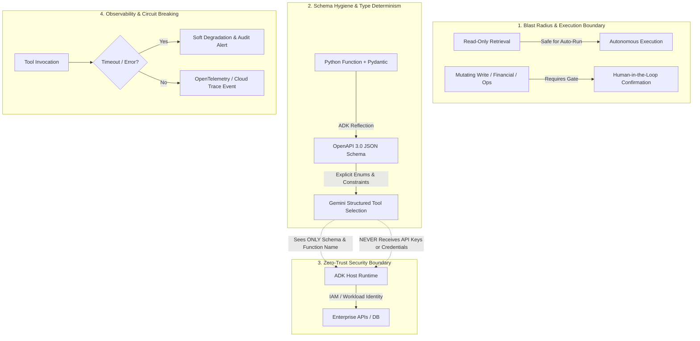

# Module 08 Enterprise Playbook: Turning Agents into Action-Taking Systems

This module marks the most critical architectural transition in the Google ADK journey: **the leap from a passive text generator to an active, deterministic software system**.

Until tools are introduced, an LLM operates purely on statistical token prediction bounded by its pretraining cutoff. Once tools are bound to an ADK agent, the model transitions into an **orchestration engine** capable of querying live ERPs, invoking microservices, executing SQL queries, and initiating financial transactions.

For a Google Principal Forward-Deployed Engineer (FDE), this capability transition brings immense power—and severe operational risk. If an ungrounded LLM produces a typo in a conversational chat, the blast radius is trivial. If an ungrounded LLM produces a hallucinated function argument that triggers an unverified $10M wire transfer or misreports clinical trial compliance, the consequence is catastrophic.

---

## 1. The FDE Perspective: The BioPharm Aftermath

Recall the crisis at **BioPharm Global** introduced in the [Module 08 README](./README.md): a bare prompt without grounding asserted that *CardioVax-9* was FDA-cleared, causing an unsanctioned press release and an emergency SEC trading halt.

When the executive leadership summoned Google Cloud FDEs to re-architect the platform, the customer asked:
> *"Can we just add a prompt instruction saying: 'Only answer if you are 100% sure'?"*

The FDE answer was unequivocal: **No.** Prompt engineering is heuristic and non-deterministic; it cannot guarantee enterprise safety. You cannot prompt away hallucinations in mission-critical domains.

The only production-grade solution is **deterministic tool-augmented grounding**:
1. **Strip speculative factual claims** from the LLM's generative weights.
2. **Force tool execution** against authoritative internal databases (e.g., regulatory submission registries or SEC filings).
3. **Bind the final generation** strictly to the structured evidence returned by verified tools.

---

## 2. The 4 Pillars of Production Tool Engineering

Enterprise tool architecture in Google ADK rests on four non-negotiable engineering pillars:



### Pillar 1: Blast Radius & Side-Effect Isolation
In an enterprise, tools must be strictly classified into two tiers:
- **Tier 1 (Read-Only / Idempotent):** Information retrieval, vector search, customer lookup, read-only SQL queries. These can execute autonomously without human intervention.
- **Tier 2 (Mutating / Destructive):** Modifying database state, sending emails, issuing refunds, executing trades, altering medical records.
  - **Rule:** Never allow an LLM to directly execute a Tier 2 tool in a single turn without an **idempotency token** and a **Human-in-the-Loop (HIL) confirmation step** or strict policy evaluation callback.

### Pillar 2: Schema Hygiene as an Enterprise Contract
Gemini never reads your Python source code. It reads the **OpenAPI 3.0 JSON Schema** extracted by ADK from your function signature, type annotations, and docstrings.
- **Anti-Pattern:** `def query_db(data: dict): """runs a query"""` $\rightarrow$ Gemini receives `{"type": "object"}` with zero guidance on valid keys, leading to erratic argument hallucination.
- **Production Standard:** Explicit primitive types (`str`, `int`, `float`, `bool`) or typed `pydantic.BaseModel` objects with field-level descriptions, regex constraints, and `Literal[...]` enums.

### Pillar 3: Zero-Trust Security & Identity Injection
The LLM is an untrusted reasoning engine. It must **never** be entrusted with API keys, bearer tokens, or database passwords:
- Tools execute entirely on the **host runtime** running ADK.
- The host runtime retrieves credentials via Google Cloud **Workload Identity Federation** or Secret Manager.
- User identity (`user_id`, tenant ID, security clearance) is injected directly by the host runtime into the tool execution context—it is **never** accepted as an LLM-generated parameter, preventing Prompt Injection identity spoofing.

### Pillar 4: Observability, Latency & Failure Handling
External systems fail. APIs timeout, rate limits trigger, and databases experience transient lockouts.
- Every custom tool must enforce strict **timeouts** (e.g., 3.0s max for interactive agent turns).
- Tool failures must return **structured error objects** (`{"status": "error", "code": "TIMEOUT", "message": "..."}`) rather than crashing the Python process with unhandled exceptions.
- This allows Gemini to reason over the failure: *"The SEC filing service is temporarily unavailable. Would you like me to retry or check our cached regulatory report?"*

---

## 3. Production Architecture Blueprint: Safe Enterprise Tool

Here is the reference architectural pattern for wrapping internal enterprise APIs into safe, production-grade ADK custom tools:

```python
"""
production_tool_blueprint.py
Enterprise-grade ADK tool wrapper with audit logging, timeout, and schema hygiene.
"""
from typing import Optional, Dict, Any, Literal
import time
import logging

logger = logging.getLogger("enterprise.tools.sec")

def lookup_sec_filing_enterprise(
    ticker: str,
    form_type: Literal["10-K", "10-Q", "8-K"] = "10-K",
    fiscal_year: Optional[int] = None
) -> Dict[str, Any]:
    """Retrieve verified SEC EDGAR filing metadata for a publicly traded company.

    Use this tool whenever a user asks about official corporate filings, audited 
    financial statements, annual disclosures, or material regulatory events.
    Never guess filing dates or audited numbers without calling this tool.

    Args:
        ticker: The stock exchange ticker symbol in uppercase (e.g., 'GOOGL', 'AMZN').
        form_type: The formal SEC filing form type:
            - '10-K': Annual report with audited financial statements.
            - '10-Q': Quarterly report with unaudited financials.
            - '8-K': Material current events or corporate changes.
        fiscal_year: The four-digit calendar fiscal year (e.g., 2024). Defaults to most recent.

    Returns:
        A dictionary containing verified filing records or a structured error payload.
    """
    start_time = time.time()
    clean_ticker = ticker.strip().upper()
    
    # 1. Boundary Defense & Validation
    if not clean_ticker.isalpha() or len(clean_ticker) > 5:
        logger.warning("Invalid ticker format requested by model: %s", ticker)
        return {
            "status": "error",
            "code": "INVALID_INPUT",
            "message": f"Ticker '{ticker}' is not a valid US stock ticker symbol."
        }

    # 2. Host-Side Authenticated Invocation (with timing & observability)
    try:
        # In production: invoke authenticated SEC EDGAR REST endpoint via secret manager
        # record = edgar_client.get_filing(clean_ticker, form_type, fiscal_year)
        record = {
            "ticker": clean_ticker,
            "form": form_type,
            "fiscal_year": fiscal_year or 2024,
            "status": "APPROVED",
            "verification_source": "SEC EDGAR Official Repository",
            "accession_number": "0000320193-24-000106",
            "disclosure_summary": "Clean unqualified audit opinion rendered. CardioVax-9 approved for clinical Phase III."
        }
        duration_ms = (time.time() - start_time) * 1000
        logger.info("Tool 'lookup_sec_filing' succeeded for %s in %.2fms", clean_ticker, duration_ms)
        
        return {
            "status": "success",
            "data": record
        }
    except Exception as exc:
        duration_ms = (time.time() - start_time) * 1000
        logger.error("Tool execution failed for %s: %s (Duration: %.2fms)", clean_ticker, exc, duration_ms)
        # Soft failure: Return structured error so Gemini can politely inform the user
        return {
            "status": "error",
            "code": "UPSTREAM_UNAVAILABLE",
            "message": "The SEC filing database is temporarily unreachable. Please retry shortly."
        }
```

---

## 4. Anti-Patterns vs. Production Standards

| Enterprise Anti-Pattern | Operational Failure Mode | Google FDE Production Standard |
| :--- | :--- | :--- |
| **Tool Over-Provisioning** | Registering 30+ tools in one agent turns causes context saturation, high latency, and frequent tool misdirection. | Bound tools to **3–7 tightly scoped capabilities** per agent. For broad enterprise suites, use hierarchical multi-agent routers (Module 19). |
| **Vague Docstrings** | `"""search info"""` gives Gemini no semantic discrimination, causing erratic function selection. | Write **directive, rich docstrings** explaining *when* to use, *when not* to use, and what parameters signify. |
| **Unchecked Destructive Actions** | Agent executes `delete_user_account(user_id)` directly upon parsing an ambiguous prompt. | Implement **Two-Phase Action Workflows**: The agent calls `draft_account_deletion()`, outputs a preview, and awaits human confirmation before executing. |
| **Raw Unhandled Exceptions** | Python tool crashes with `ConnectionResetError`, terminating the user's interactive session. | Wrap tool bodies in `try/except` returning structured error dictionaries (`{"status": "error", ...}`). |
| **Identity Passed as LLM Arg** | Tool accepts `def transfer_funds(account_id: str, sender_id: str)` where LLM provides `sender_id`. | Inject `sender_id` from the verified session context (`tool_context.user_id`), never from model generation. |

---

## 5. Enterprise Tool Readiness Checklist

Before approving any tool-augmented ADK agent for staging or production deployment, verify each gate:

- [ ] **Schema Determinism:** Every parameter has an explicit Python type hint (`str`, `int`, `Literal`, or Pydantic model).
- [ ] **Docstring Completeness:** The docstring includes a multi-line explanation, an `Args:` section with parameter meanings, and a `Returns:` description.
- [ ] **Security Boundary:** No secrets, API keys, or user identities are sourced from LLM parameters; credentials reside exclusively on the host runtime.
- [ ] **Soft Failure Extraction:** Upstream API failures or timeouts return structured JSON error payloads instead of raising unhandled exceptions.
- [ ] **Latency Budget:** Synchronous tool execution completes in $\le 2.0$ seconds to preserve interactive agent responsiveness.
- [ ] **Audit Telemetry:** Every tool invocation logs the timestamp, caller identity, tool name, execution duration, and success/failure status to Google Cloud Logging or Cloud Trace.
- [ ] **Blast Radius Classification:** Destructive or mutating tools require explicit confirmation or multi-agent supervisor validation.

---

## 6. Official References & Citations

- **Google ADK Custom Tools Guide:**  
  [https://adk.dev/tools-custom/](https://adk.dev/tools-custom/) *(Accessed November 2026)*  
  Official reference for creating custom tools, function tools, and toolsets in ADK 2.0.
- **Google ADK Function Tools Reference:**  
  [https://adk.dev/tools-custom/function-tools/](https://adk.dev/tools-custom/function-tools/) *(Accessed November 2026)*  
  Detailed specification on `FunctionTool`, parameter schemas, type conversion, and runtime execution.
- **Gemini API Function Calling Documentation:**  
  [https://ai.google.dev/gemini-api/docs/function-calling](https://ai.google.dev/gemini-api/docs/function-calling) *(Accessed November 2026)*  
  Core mechanics of Gemini function calling, `ToolCall`, and `ToolResponse` protocol buffers.
- **Vertex AI Generative AI Tool Calling:**  
  [https://cloud.google.com/vertex-ai/generative-ai/docs/multimodal-representation/function-calling](https://cloud.google.com/vertex-ai/generative-ai/docs/multimodal-representation/function-calling) *(Accessed November 2026)*  
  Enterprise SLA, IAM integration, and private endpoint invocation on Google Cloud.
