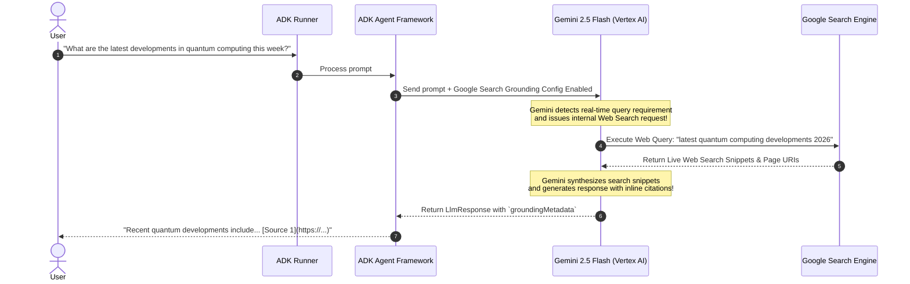

# Lab 8 Solution: Creating a "Researcher" Agent with Google Search Grounding

## Overview & Goal

This document provides the complete, production-ready implementation of `researcher_agent` using Google Agent Development Kit (ADK) 2.0.

Beyond providing raw code, this solution guide acts as an **FDE Engineering Playbook**. It breaks down how a **Google Forward-Deployed Engineer (FDE)** analyzes business requirements for real-time market research, configures GCP Vertex AI grounding infrastructure, and integrates built-in tools like `google_search` into ADK agents.

---

### 💡 FDE & Instructor Hint: Steering AI Assistants (Antigravity)

When guiding developers or using AI coding assistants like **Antigravity** during enterprise agent development, use this **Master ADK 2.0 Steering Prompt** to ensure generated code strictly follows Google's official architectural standards:

> **Master Antigravity Steering Prompt Template:**
> *"You are an expert Google ADK 2.0 Forward-Deployed Engineer. Write an ADK 2.0 Agent configuration using built-in tools following strict standards:*
> 1. *Use built-in grounding tool `google_search` for live web search capabilities.*
> 2. *Attach tools via `tools=[google_search]` in the `Agent(...)` constructor.*
> 3. *Use `from google.adk import Agent` and `from google.adk.tools import google_search`.*
> 4. *Ensure environment is configured for Vertex AI when using grounding (`GOOGLE_GENAI_USE_VERTEXAI=1`).*
> 5. *Use model `gemini-2.5-flash` with explicit search instructions.*
> 6. *Access LLM response content via `.content` (NEVER legacy `.candidates`)."*

---

## 🏛️ Part 1: The FDE Architectural Mental Model

### From Plain English Requirements to ADK 2.0 Code

When an enterprise customer requests an AI research assistant to summarize current events, stock trends, or industry news, relying purely on the LLM's frozen training weights is a liability. The LLM will either state its knowledge cutoff date or hallucinate outdated facts.

As a Google FDE, your job is to enforce **Live Information Grounding** by connecting Gemini directly to Google Search via Vertex AI.

Here is the exact Requirements-to-Code Matrix for this lab:

| # | Business Requirement | FDE Engineering Risk / Challenge | ADK 2.0 Solution Pattern | Code Implementation |
|---|---|---|---|---|
| **1** | *"Answer queries about live sports scores, recent news, or current stock prices."* | **Outdated Knowledge Cutoff:** Static LLM weights cannot know real-time events. | **Built-in Grounding Tool:** Pass `google_search` into the agent's tool list. | `from google.adk.tools import google_search`<br/>`tools=[google_search]` |
| **2** | *"Verify that search results are backed by trusted web citations."* | **Unverifiable Output:** Un-grounded text cannot be audited for factual accuracy. | **Google Search Grounding Metadata:** Gemini automatically embeds `groundingMetadata` and web citations. | Inspect `event.content` and Dev UI `groundingMetadata` |
| **3** | *"Use Google Cloud enterprise infrastructure for search compliance."* | **API Key Restrictions:** Grounding tools require full GCP project credentials via Vertex AI. | **Vertex AI Configuration:** Set `GOOGLE_GENAI_USE_VERTEXAI=1` in environment. | `.env` settings:<br/>`GOOGLE_GENAI_USE_VERTEXAI=1` |
| **4** | *"Ensure the agent knows WHEN to search vs. when to use general reasoning."* | **Unnecessary Search Latency:** Searching for basic math or static facts wastes API quota. | **Explicit System Instructions:** Steer the model to invoke `google_search` only when up-to-date facts are needed. | `instruction="Use google_search for recent events..."` |

---

## ⚙️ Part 2: Step-by-Step Implementation Guide

### Step 1: Initialize Project Directory & Environment

```bash
# 1. Create a new ADK 2.0 agent project using UV
uv run adk create researcher_agent

# 2. Navigate into the created agent folder
cd researcher_agent
```

Configure Vertex AI credentials in `.env`:
```env
GOOGLE_GENAI_USE_VERTEXAI=1
GOOGLE_CLOUD_PROJECT=your_actual_gcp_project_id
GOOGLE_CLOUD_LOCATION=us-central1
```

> [!IMPORTANT]
> The `google_search` grounding tool requires a Google Cloud project with the Vertex AI API (`aiplatform.googleapis.com`) enabled.

---

### Step 2: Configure Agent Node (`agent.py`)

Open `researcher_agent/agent.py`. Read the extensive inline comments explaining how built-in tool import, prompt steering, and model definitions work under the hood.

```python
"""
Researcher Agent Configuration Node (ADK 2.0)

This module configures Gemini 2.5 Flash with Google's built-in `google_search`
grounding tool for live, cited web research.
"""

from google.adk import Agent
from google.adk.tools import google_search

# ---------------------------------------------------------------------------
# Teaching Notes on Built-in Grounding Tools:
# 1. Unlike custom Python function tools, `google_search` is a built-in ADK handle.
# 2. When passed in `tools=[google_search]`, ADK enables Gemini's native Web Search
#    grounding pipeline via Vertex AI.
# 3. Gemini automatically formulates search queries, executes the web search,
#    reads web snippets, and generates answers with inline citations.
# ---------------------------------------------------------------------------

root_agent = Agent(
    name="researcher_agent",
    model="gemini-2.5-flash",
    description="An enterprise research assistant grounded in live Google Web Search.",
    # Singular 'instruction' parameter (ADK 2.0 standard)
    instruction="""
You are an expert enterprise research assistant.

Grounding Steering Rules:
1. Your job is to answer user queries with absolute factual accuracy.
2. If a query asks about recent news, current events, recent tech announcements, sports scores, or financial trends, you MUST use the `google_search` tool.
3. Do NOT rely on your internal training weights for facts that could have changed recently.
4. Synthesize search results into clear, professional summaries and cite source facts accurately.
""",
    # Attach built-in google_search handle directly
    tools=[google_search],
)
```

---

## 🔬 Part 3: Deep Dive — How Built-in Grounding Works Under the Hood

It is crucial to understand the architectural difference between **Custom Python Function Tools** (Module 9 & 10) and **Built-in Grounding Tools** (Module 8):



### Contrast Matrix: Custom Tools vs. Built-in Grounding Tools

| Dimension | Custom Function Tools (e.g. `calculate_gst`) | Built-in Grounding Tools (e.g. `google_search`) |
|---|---|---|
| **Execution Location** | Executed locally inside your Python runtime process. | Executed server-side on Google Cloud infrastructure. |
| **Trace Visibility** | Shows a distinct `execute_tool` span in ADK Dev UI. | Shows `groundingMetadata` inside the `call_llm` span. |
| **Credentials Required** | Google AI Studio Key or GCP Credentials. | Full GCP Project with Vertex AI API enabled. |
| **Data Returned** | Structured Pydantic models or JSON dictionaries. | Natural language text with `groundingMetadata` citations. |

---

## 🧪 Part 4: Verification & Dev UI Trace Inspection

### 1. Interactive Terminal Mode

Run the agent in your terminal:
```bash
uv run adk run .
```

#### Test Conversation
```text
[user]: Who won the latest Formula 1 Grand Prix?
[agent]: The latest Formula 1 Grand Prix was won by... [citing live web results].
```

---

### 2. Visual Trace Inspection (Dev UI)

Launch the ADK Web UI:
```bash
uv run adk web .
```

1. Open `http://localhost:8000` in your browser.
2. Select `researcher_agent` and ask a live question (e.g. *"What is the current stock price of Google?"*).
3. Open the **Trace Tab** on the right:
   - Click the `call_llm` (`generate_content`) span.
   - Expand `groundingMetadata`:
     - Inspect `web_search_queries`: see the exact search query Gemini generated (e.g. `["GOOGL stock price current"]`).
     - Inspect `grounding_chunks`: see the live web URIs and page title snippets retrieved by Google.

---

## ❓ Self-Reflection & Interview Prep

1. **Why does `google_search` require `GOOGLE_GENAI_USE_VERTEXAI=1` instead of a standard Google AI Studio API key?**
   * *Answer:* Web Search Grounding leverages Google Cloud's enterprise Vertex AI Search infrastructure, compliance controls, and privacy guarantees. It requires project-level authentication via Application Default Credentials (ADC) or Service Accounts rather than lightweight Studio API keys.

2. **How can a developer confirm that Gemini actually searched the web rather than answering from memory?**
   * *Answer:* By inspecting the `groundingMetadata` object in the LLM response payload (visible in `event.content` or the ADK Dev UI Trace tab). If grounding was triggered, `groundingMetadata` will contain the `web_search_queries` generated by Gemini and the list of source `grounding_chunks` used to build the answer.

---

## 📚 Official References

- **Google ADK Documentation:** https://google.github.io/adk-docs/
- **Google GenAI SDK Reference:** https://googleapis.github.io/python-genai/
- **Vertex AI Grounding Docs:** https://cloud.google.com/vertex-ai/generative-ai/docs/grounding/overview

<!-- © 2026 Inder Chauhan (https://github.com/inderanz/google-adk-training). All rights reserved. Ref: IC-ADK-module08-intro-to-tools-lab-solution -->
