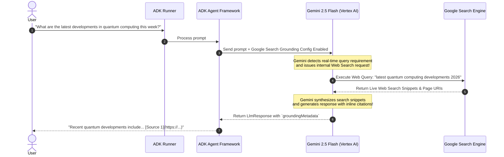

# Lab 8 Solution: Creating a "Researcher" Agent with Google Search Grounding

## Overview & Goal

This document provides the complete, production-ready implementation of `researcher_agent` using Google Agent Development Kit (ADK) 2.0.

Beyond providing raw code, this solution guide acts as an **FDE Engineering Playbook**. It breaks down how a **Google Forward-Deployed Engineer (FDE)** analyzes business requirements for real-time market research, configures GCP Vertex AI grounding infrastructure, and integrates built-in tools like `google_search` into ADK agents.

---

### 💡 FDE & Instructor Hint: Steering AI Assistants (Antigravity)

When guiding developers or using AI coding assistants like **Antigravity** during enterprise agent development, use this **Master ADK 2.0 Steering Prompt** to ensure generated code strictly follows Google's official architectural standards:

```markdown
Act as a Google Principal Forward-Deployed Engineer (FDE). I need to equip an ADK 2.0 Agent with tools to move beyond static language modeling into action-taking systems.

Requirements:
1. Tool Selection & Architecture:
   - For live web research: attach the built-in `google_search` grounding tool via `tools=[google_search]`.
   - For internal domain data: define deterministic Python functions with explicit type hints and complete docstrings, wrapped via `FunctionTool(func)`.
2. Model & Instruction Standards:
   - Configure model `gemini-3.5-flash`.
   - Provide clear system instructions explicitly specifying WHEN to invoke the tool and HOW to handle tool outputs (success, empty, or error).
3. Runtime & Execution:
   - Explain the 5-stage Function Calling lifecycle: Schema Generation -> Intent Selection -> Function Call JSON -> Runtime Execution -> Observation Context.
   - Grounding requires Vertex AI (`GOOGLE_GENAI_USE_VERTEXAI=1`). Access LLM response content via `.content` (never `.candidates`).
```

---

## 🏛️ Part 1: The FDE Architectural Mental Model

### From Plain English Requirements to ADK 2.0 Code

When an enterprise customer requests an AI research assistant to summarize current events, stock trends, or industry news, relying purely on the LLM's frozen training weights is a liability. The LLM will either state its knowledge cutoff date or hallucinate outdated facts.

As a Google FDE, your job is to enforce **Live Information Grounding** by connecting Gemini directly to Google Search via Vertex AI, or to internal enterprise APIs via Custom Function Tools.

Here is the exact Requirements-to-Code Matrix for this lab:

| # | Business Requirement | FDE Engineering Risk / Challenge | ADK 2.0 Solution Pattern | Code Implementation |
|---|---|---|---|---|
| **1** | *"Answer queries about live sports scores, recent news, or current stock prices."* | **Outdated Knowledge Cutoff:** Static LLM weights cannot know real-time events. | **Built-in Grounding Tool:** Pass `google_search` into the agent's tool list. | `from google.adk.tools import google_search`<br/>`tools=[google_search]` |
| **2** | *"Verify that search results are backed by trusted web citations."* | **Unverifiable Output:** Un-grounded text cannot be audited for factual accuracy. | **Google Search Grounding Metadata:** Gemini automatically embeds `groundingMetadata` and web citations. | Inspect `event.content` and Dev UI `groundingMetadata` |
| **3** | *"Use Google Cloud enterprise infrastructure for search compliance."* | **API Key Restrictions:** Grounding tools require full GCP project credentials via Vertex AI. | **Vertex AI Configuration:** Set `GOOGLE_GENAI_USE_VERTEXAI=1` in environment. | `.env` settings:<br/>`GOOGLE_GENAI_USE_VERTEXAI=1` |
| **4** | *"Retrieve internal corporate filings without external web dependencies."* | **Data Sovereignty & Predictability:** Internal SEC filings or ERP data must not leak to public web search. | **Custom Function Tool:** Define typed Python function with docstrings wrapped in `FunctionTool`. | `tools=[FunctionTool(lookup_sec_filing)]` |

---

## ⚙️ Part 2: Track A Implementation Guide (Cloud Grounding via `google_search`)

### Step 1: Initialize Project Directory & Environment

```bash
uv run adk create researcher_agent
cd researcher_agent
```

Configure Vertex AI credentials in `.env`:
```env
GOOGLE_GENAI_USE_VERTEXAI=1
GOOGLE_CLOUD_PROJECT=your_actual_gcp_project_id
GOOGLE_CLOUD_LOCATION=us-central1
```

---

### Step 2: Configure Agent Node (`agent.py`)

Open `researcher_agent/agent.py`. Read the extensive inline comments explaining how built-in tool import, prompt steering, and model definitions work under the hood.

```python
"""
Researcher Agent Configuration Node (ADK 2.0)

This module configures Gemini 3.5 Flash with Google's built-in `google_search`
grounding tool for live, cited web research.
"""

from google.adk.agents import Agent
from google.adk.tools import google_search

# ---------------------------------------------------------------------------
# Teaching Notes on Built-in Grounding Tools:
# 1. Unlike custom Python function tools, `google_search` is a built-in ADK handle.
# 2. When passed in `tools=[google_search]`, ADK enables Gemini's native Web Search
#    grounding pipeline via Vertex AI.
# 3. Gemini automatically formulates search queries, executes the web search,
#    reads web snippets, and generates answers with inline citations.
# ---------------------------------------------------------------------------

root_agent = Agent(
    name="researcher_agent",
    model="gemini-3.5-flash",
    description="An enterprise research assistant grounded in live Google Web Search.",
    instruction="""
You are an expert enterprise research assistant.

Grounding Steering Rules:
1. Your job is to answer user queries with absolute factual accuracy.
2. If a query asks about recent news, current events, recent tech announcements, sports scores, or financial trends, you MUST use the `google_search` tool.
3. Do NOT rely on your internal training weights for facts that could have changed recently.
4. Synthesize search results into clear, professional summaries and cite source facts accurately.
""",
    tools=[google_search],
)
```

---

## 💻 Part 3: Track B Implementation Guide (Deterministic Local Function Tool)

For developers working offline or without active Google Cloud billing, this complete script demonstrates how custom Python functions turn into tools executed locally via `InMemoryRunner`:

```python
"""Track B Complete Solution: Local SEC Filing Lookup Tool."""

import asyncio
from dotenv import load_dotenv
from google.adk.agents import Agent
from google.adk.tools import FunctionTool
from google.adk.apps.app import App
from google.adk.runners import InMemoryRunner
from google.genai import types

load_dotenv()


def lookup_sec_filing(ticker: str, filing_type: str = "10-K") -> dict:
    """Retrieves corporate regulatory filings and financial metrics from SEC EDGAR.

    Args:
        ticker (str): The stock ticker symbol (e.g. 'GOOGL', 'AAPL', 'MSFT'). Required.
        filing_type (str, optional): The SEC filing type ('10-K', '10-Q', '8-K'). Defaults to '10-K'.

    Returns:
        dict: A structured dictionary containing filing status, revenue, and core risk factors.
    """
    mock_edgar_database = {
        "GOOGL": {
            "company_name": "Alphabet Inc.",
            "fiscal_year": 2026,
            "annual_revenue": "$307.4B",
            "net_income": "$73.8B",
            "ai_infrastructure_capex": "$48.0B",
            "audit_opinion": "Unqualified (Clean)",
        },
        "AAPL": {
            "company_name": "Apple Inc.",
            "fiscal_year": 2026,
            "annual_revenue": "$383.3B",
            "net_income": "$97.0B",
            "flagship_segment": "Services & Devices",
            "audit_opinion": "Unqualified (Clean)",
        },
    }

    ticker_clean = ticker.strip().upper()
    filing = mock_edgar_database.get(ticker_clean)
    if not filing:
        return {
            "status": "error",
            "message": f"Ticker '{ticker}' not found in SEC EDGAR repository. Verify the symbol and try again.",
        }

    return {
        "status": "success",
        "ticker": ticker_clean,
        "filing_type": filing_type,
        "filing_data": filing,
    }


# Agent definition
filing_agent = Agent(
    name="equity_researcher",
    model="gemini-3.5-flash",
    instruction="""You are a senior equity research analyst at an institutional investment bank.
    When asked about company earnings, capital expenditures, or regulatory disclosures:
    1. ALWAYS call the `lookup_sec_filing` tool to obtain verified SEC data.
    2. Quote exact financial figures (revenue, net income, capex) from the tool response.
    3. Never speculate or extrapolate beyond the verified filing data.""",
    tools=[FunctionTool(lookup_sec_filing)],
)


async def main():
    app = App(name="sec_research_app", root_agent=filing_agent)
    runner = InMemoryRunner(app=app)
    session = await runner.session_service.create_session(
        app_name=app.name, user_id="analyst_vip", session_id="research_session_001"
    )

    query = (
        "What was Alphabet's (GOOGL) revenue and AI capex in their latest 10-K filing?"
    )
    print(f"User Query: {query}\n")

    async for event in runner.run_async(
        user_id="analyst_vip",
        session_id=session.id,
        new_message=types.Content(
            role="user", parts=[types.Part.from_text(text=query)]
        ),
    ):
        # Inspect event stream
        if event.is_final_response():
            print(f"Agent Final Response:\n{event.content.parts[0].text}\n")


if __name__ == "__main__":
    asyncio.run(main())
```

---

## 🔬 Part 4: Deep Dive — How Built-in Grounding Works Under the Hood

It is crucial to understand the architectural difference between **Custom Python Function Tools** (Module 9 & 10) and **Built-in Grounding Tools** (Module 8):



### Contrast Matrix: Custom Tools vs. Built-in Grounding Tools

| Dimension | Custom Function Tools (e.g. `calculate_gst`) | Built-in Grounding Tools (e.g. `google_search`) |
|---|---|---|
| **Execution Location** | Executed locally inside your Python runtime process. | Executed server-side on Google Cloud infrastructure. |
| **Trace Visibility** | Shows a distinct `execute_tool` span in ADK Dev UI. | Shows `groundingMetadata` inside the `call_llm` span. |
| **Credentials Required** | Google AI Studio Key or GCP Credentials. | Full GCP Project with Vertex AI API enabled. |
| **Data Returned** | Structured Pydantic models or JSON dictionaries. | Natural language text with `groundingMetadata` citations. |

---

## 🧪 Part 4: Verification & Dev UI Trace Inspection

### 1. Interactive Terminal Mode

Run the agent in your terminal:
```bash
uv run adk run .
```

#### Test Conversation
```text
[user]: Who won the latest Formula 1 Grand Prix?
[agent]: The latest Formula 1 Grand Prix was won by... [citing live web results].
```

---

### 2. Visual Trace Inspection (Dev UI)

Launch the ADK Web UI:
```bash
uv run adk web .
```

1. Open `http://localhost:8000` in your browser.
2. Select `researcher_agent` and ask a live question (e.g. *"What is the current stock price of Google?"*).
3. Open the **Trace Tab** on the right:
   - Click the `call_llm` (`generate_content`) span.
   - Expand `groundingMetadata`:
     - Inspect `web_search_queries`: see the exact search query Gemini generated (e.g. `["GOOGL stock price current"]`).
     - Inspect `grounding_chunks`: see the live web URIs and page title snippets retrieved by Google.

---

## ❓ Self-Reflection & Interview Prep

1. **Why does `google_search` require `GOOGLE_GENAI_USE_VERTEXAI=1` instead of a standard Google AI Studio API key?**
   * *Answer:* Web Search Grounding leverages Google Cloud's enterprise Vertex AI Search infrastructure, compliance controls, and privacy guarantees. It requires project-level authentication via Application Default Credentials (ADC) or Service Accounts rather than lightweight Studio API keys.

2. **How can a developer confirm that Gemini actually searched the web rather than answering from memory?**
   * *Answer:* By inspecting the `groundingMetadata` object in the LLM response payload (visible in `event.content` or the ADK Dev UI Trace tab). If grounding was triggered, `groundingMetadata` will contain the `web_search_queries` generated by Gemini and the list of source `grounding_chunks` used to build the answer.

---

## 📚 Official References

- **Google ADK Documentation:** https://google.github.io/adk-docs/
- **Google GenAI SDK Reference:** https://googleapis.github.io/python-genai/
- **Vertex AI Grounding Docs:** https://cloud.google.com/vertex-ai/generative-ai/docs/grounding/overview

<!-- © 2026 Inder Chauhan (https://github.com/inderanz/google-adk-training). All rights reserved. Ref: IC-ADK-module08-intro-to-tools-lab-solution -->
