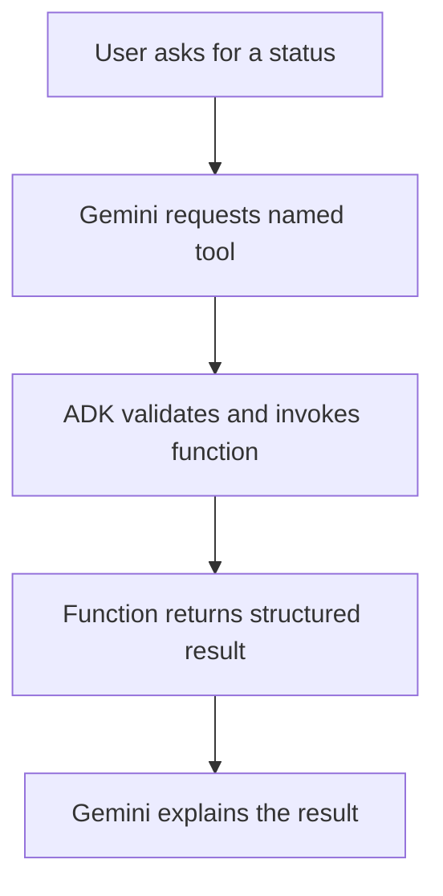

# Module 9: Creating Custom Function Tools

## Before you begin: what this module teaches

**ADK concept: Python function tools and explicit input/output contracts.**

def declares a function; parameters receive values; type hints describe expected types; a docstring explains purpose and usage; return supplies the result. ADK can adapt supported functions from the tools list. Type hints help describe the interface but do not replace business validation. A dictionary makes named fields explicit; its presence does not certify the values.

**Where you would use this in real work.**

The bank already has a function that reads a record. To let an agent request it, the engineer must describe the arguments clearly and return a result that distinguishes success, missing data and failure.

**Connection to Gemini Enterprise Agent Platform and Google Cloud.**

Keep the tool implementation in trusted application code and use official clients for its Google dependencies. Gemini proposes business arguments; verified user identity and credentials must come from trusted context. The railway analogy below teaches the call pattern, not access to an actual railway service.

**By the end, you should be able to:**

- Explain each line of one function signature and return dictionary.
- Validate IDs and represent not_found separately from unavailable.
- Inspect the model-visible schema and actual runtime arguments.

### Review this lesson through three perspectives

- **Python/ADK beginner:** Predict the returned dictionary before running the function.
- **Experienced engineer:** Test direct calls as well as calls through ADK so validation cannot depend only on prompting.
- **Bank FDE:** Ask which operation is read-only, which changes a record and who may perform it.

Use the [guided lab](./lab.md) to observe the mechanism, then compare with the [solution](./lab-solution.md). The banking scenario above explains how to transfer the concept; a lab using a railway, weather or shopping fixture does not implement a live bank integration.

## Theory

### Unlocking Unlimited Capabilities

While built-in tools like `google_search` are powerful, the true potential of your agent is realized when you give it custom capabilities tailored to your specific needs. This is done by creating **Custom Function Tools**.

A custom function tool is, at its core, a regular Python function that you write and then make available to your agent. This allows you to connect your agent to virtually anything you can program: a proprietary database, a third-party API, a complex business logic algorithm, or even another AI model.

---

### The Core Mental Model: Who Actually Runs the Code?

#### The #1 Misconception Every Beginner Has
When students first learn about Agent Tools, they almost always ask:
> *"Does Gemini execute my Python code inside Google's cloud servers?"*

**NO! Never.** The Large Language Model (LLM) is simply a giant neural network predicting words and tokens. It has no CPU, no access to your hard drive, no direct database connections, and cannot execute Python code.

#### The Analogy: The Wedding Planner (*Event Manager*) & The Specialist Halwai (*Caterer*)

Imagine an Indian family planning a big wedding. They hire a smart **Wedding Planner (The LLM / Agent)** to coordinate the event:

```text
┌────────────────────────────────────────────────────────────────────────┐
│                   THE WEDDING FUNCTION-CALLING ANALOGY                 │
├────────────────────────────────────────────────────────────────────────┤
│ 1. The Host (User): "Can we get 500 plates of Paneer Butter Masala     │
│    and calculate the bill with 18% GST?"                               │
│                                                                        │
│ 2. The Wedding Planner (Gemini LLM): Does NOT cook the paneer!         │
│    The planner inspects their rate card (Tool Schema), writes down a   │
│    formal order slip (JSON Function Call):                             │
│    -> Tool: prepare_catering_order                                     │
│    -> Args: {"dish": "Paneer Butter Masala", "plates": 500}            │
│                                                                        │
│ 3. The Kitchen Halwai (Your Local Python Function):                    │
│    The Halwai receives the slip, lights the stove, cooks the food,     │
│    and hands back a receipt (JSON Function Response):                  │
│    -> {"status": "ready", "base_cost": 50000, "gst": 9000}             │
│                                                                        │
│ 4. The Wedding Planner (Gemini LLM):                                   │
│    Reads the receipt and politely speaks to the host:                  │
│    "Sir, 500 plates of Paneer Butter Masala are confirmed. The base    │
│    cost is ₹50,000 + 18% GST (₹9,000), totaling ₹59,000."              │
└────────────────────────────────────────────────────────────────────────┘
```

**Key Takeaways for Students & Consultants:**
* **Gemini's Role:** Acts like the Wedding Planner — understands human conversation, figures out *which* specialist tool is needed, extracts the correct arguments from messy language, and translates raw data into a polite answer.
* **Python's Role:** Acts like the Kitchen Halwai — executes the actual business logic, queries the SQL database, or calls the IRCTC API on your own secure server.

---

### How it Works: From Python to Agent Tool

When you add one of your Python functions to an agent's `tools` list, the ADK framework performs a clever transformation behind the scenes. It inspects your function's **signature**
—its name, parameters, type hints, and docstring—and automatically generates a detailed description, or **schema**.

This schema is what's provided to the Large Language Model. The LLM doesn't see your Python code. It only sees this schema, which tells it:
1.  The tool's name (from your function name).
2.  What the tool does (from your function's docstring).
3.  What parameters it needs (from your function's arguments).
4.  What data type each parameter should be (from your type hints).

Based on this information, the LLM can intelligently decide when to use your function and what arguments to pass to it.

#### The 4-Step Tool Execution Conveyor Belt

Here is the exact technical roundtrip that executes across the network:



### The Anatomy of a Well-Defined Tool Function

For the LLM to use your tool correctly and reliably, it's crucial to define your Python function in a structured way.

#### 1. **Descriptive Function Name**
The name should clearly indicate the action the function performs.
*   **Good:** `get_weather`, `calculate_loan_payment`, `lookup_order_status`
*   **Bad:** `process_data`, `run_logic`, `my_function`

#### 2. **Clear Parameters with Type Hints**
Each argument your function takes must have a **type hint**. This is non-negotiable, as it tells the LLM what kind of data to provide.

```python
# The LLM knows 'city' must be a string and 'is_forecast' must be a boolean.
def get_weather(city: str, is_forecast: bool): ...
```

#### 3. **The All-Important Docstring**
The docstring is the **most critical part**. It serves as the tool's description for the LLM. A good docstring should explain:
*   **Purpose:** What does the tool do?
*   **Usage:** *When* should the agent use this tool? Provide context.
*   **Parameters:** Describe what each parameter represents.


```python
def get_weather(city: str, is_forecast: bool):
    """
    Fetches the current weather or a 3-day forecast for a specific city.

    Use this tool when a user asks about the weather.

    Args:
        city: The name of the city (e.g., "San Francisco").
        is_forecast: Set to True for a 3-day forecast, False for current conditions.
    """
    ...
```

#### 4. Structured Return Value
In ADK 2.0, a tool function can return a **dictionary** or, ideally, a **Pydantic model**. The LLM will receive this structured data and use its contents to formulate the final response.

```python
from pydantic import BaseModel


class WeatherReport(BaseModel):
    status: str
    temperature: float
    conditions: str


def get_weather(city: str) -> WeatherReport:
    """Fetches the current weather."""
    # ... logic ...
    return WeatherReport(status="success", temperature=22.0, conditions="Sunny")
```

#### 5. Make expected outcomes and execution failures distinguishable

A missing record is an expected business outcome: return a bounded result such as `{"status": "not_found"}`. A temporary service outage is a different outcome. Decide whether the caller should receive an explicit unavailable result or a typed exception handled by the configured runtime policy.

Do not catch every exception and report success. Conversely, raising an exception is not always a fatal process crash: an invocation can fail, or a configured supported retry/error hook may handle it. Preserve framework interruption signals needed for confirmation/resume. Only retry operations that are safe to repeat, using a bounded policy. Modules 18, 26 and 38 explain these boundaries.

### Advanced: The `ToolContext`

Sometimes your tool needs to know more than just its arguments. It might need to read from the session state, access customer identification, or pass authentication tokens to downstream APIs.

In ADK 2.0, you can add a `tool_context: ToolContext` argument to your function. The ADK framework automatically injects the context at runtime without requiring the LLM to pass it:

```python
from google.adk.tools import ToolContext


def my_advanced_tool(query: str, tool_context: ToolContext):
    # 1. Access active session state
    user_name = tool_context.session.state.get("user_name", "Valued Customer")

    # 2. Update session state for future turns
    tool_context.session.state["last_queried_service"] = "customer_support"

    # 3. Access user ID and session metadata
    session_id = tool_context.session.id
```

> [!TIP]
> **Enterprise Security Insight: Preventing Prompt Leaks**
> Never force the LLM to pass sensitive credentials (like JWT Bearer tokens, API secrets, or internal tenant IDs) as function arguments. The LLM might leak them into chat logs or hallucinate them! Instead, store the user's authentication token inside `tool_context.session.state` during authentication, and have your Python tool read it directly via `tool_context`. The LLM never sees the token.

---

### Production Example: Indian Railways PNR Inquiry Tool

Here is a complete, production-grade custom tool demonstrating all 5 anatomy principles (Pydantic schema, type hints, comprehensive docstring, defensive error handling, and `ToolContext`):

```python
# File: tools/railway_tools.py
from typing import Optional
from google.adk.tools import ToolContext
from pydantic import BaseModel, Field


# 1. Define strong, validated Pydantic schemas for the return type
class PnrStatusReport(BaseModel):
    pnr: str
    status: str = Field(
        description="Booking status: CNF (Confirmed), RAC, or WL (Waitlist)"
    )
    train_name: str
    coach: Optional[str] = None
    berth: Optional[int] = None
    berth_type: Optional[str] = None
    passenger_name: Optional[str] = None


# 2. Write the tool with explicit type hints and a comprehensive docstring
def check_pnr_status(pnr_number: str, tool_context: ToolContext) -> dict:
    """
    Checks the live reservation status for a given 10-digit Indian Railways PNR number.

    Use this tool whenever a passenger asks about their train booking, berth allocation,
    waitlist status, or confirmation details. Do not fabricate or guess PNR results.

    Args:
        pnr_number: The 10-digit numeric PNR string (e.g., '4521890234').
        tool_context: Internal ADK context to inspect the active session and user credentials.

    Returns:
        A dictionary containing the confirmation status, coach, and berth details,
        or an error message if the PNR format is invalid.
    """
    # Principle 5: Defensive Input Validation
    clean_pnr = pnr_number.strip()
    if not clean_pnr.isdigit() or len(clean_pnr) != 10:
        return {
            "error": "Invalid PNR format. A valid Indian Railways PNR must contain exactly 10 numeric digits."
        }

    # Principle 4: Access session state securely via tool_context
    user_name = tool_context.session.state.get("user_name", "Passenger")

    # In production, this would call the IRCTC / CRIS backend API.
    # Here we return a clean, structured dictionary:
    return {
        "pnr": clean_pnr,
        "train_name": "Rajdhani Express (12952)",
        "status": "CNF",
        "coach": "B3",
        "berth": 24,
        "berth_type": "Side Lower",
        "passenger_name": user_name,
    }
```


### Registering Tools with Your Agent Node

In ADK 2.0, registering your custom functions as tools is incredibly simple. You just import your functions and pass them directly into the **`Agent`** node's `tools` list. The ADK automatically wraps them.


```python
# In agent.py
from google.adk import Agent
from .tools.calculator import add, subtract  # Import your functions

root_agent = Agent(
    # ... other params
    tools=[
        add,  # The ADK automatically converts this Python function
        subtract,  # into an LLM-compatible Tool!
    ]
)
```

In the lab for this module, you will put all these principles into practice by building a set of calculator functions and integrating them into a new "Calculator" agent.

---

### The Enterprise FDE Consultant's Tool Checklist

When you are consulting for enterprise clients who want to attach 10, 20, or 50+ custom internal tools to an agent fleet, use this 4-point architectural design checklist:

1. **The Single Responsibility Rule:**
   Each tool must do exactly one thing well (e.g., `lookup_invoice` vs `cancel_invoice`). Never create a monolithic `do_everything_in_database` tool. When tools have narrow, well-defined responsibilities, the LLM makes significantly fewer routing and argument errors.

2. **Defensive Error Encapsulation:**
   Never let a database timeout, missing record, or network glitch raise an uncaught Python exception. Always catch errors and return `{"success": False, "error": "User ID not found. Ask user to verify their account or mobile number."}`. This allows Gemini to stay alive and converse with the user instead of dropping the session.

3. **Idempotency & State Mutation:**
   * **Read-Only Tools:** Safe to execute multiple times without side effects (e.g., `check_pnr_status`, `get_account_balance`, `search_catalog`).
   * **Mutating Tools:** Perform actions that change business state or move money (e.g., `cancel_ticket`, `transfer_funds`, `delete_record`). In Module 10, you will learn how to attach Human-in-the-Loop confirmations to protect mutating tools.

4. **Context Injection vs. Prompt Leaks:**
   Never force the LLM to pass internal secrets (like API keys, JWT bearer tokens, or tenant IDs) as tool arguments in prompt text. Inject them securely via `ToolContext` inside Python where the LLM cannot see, leak, or hallucinate them.

---

### Key Takeaways
- **Custom Function Tools** connect your agent node to any Python capability.
- **Auto-Schema:** ADK 2.0 generates the tool schema from your function's signature and docstring.
- **Type Safety:** Use type hints and Pydantic return models for robust tool execution.
- **Context Awareness:** Use `ToolContext` for advanced interaction with the ADK runtime.
- **Workflow Ready:** Tools are nodes in your graph, allowing for modular and testable designs.

## Enterprise Lens: Turning business logic into trustworthy agent tools

This is the module where the agent becomes connected to actual business operations. The important question is not only “can the model call a Python function?” but also “is the function a safe and useful part of the enterprise workflow?”

Read the companion guide for the production-oriented view:

- [Module 09 Enterprise Playbook](./enterprise-playbook.md)
- [Enterprise ADK Playbook Index](../enterprise-adk-roadmap.md)

This keeps the custom-tool lesson aligned with the broader ADK operating model: clarify the business requirement, design a precise tool contract, validate behavior, and deploy with guardrails.

## Official ADK / Google references

Use the official Google and ADK documentation as the current source of truth for tool contracts, schema generation, and function-calling behavior:

- ADK docs home: https://google.github.io/adk-docs/
- ADK tools documentation: https://google.github.io/adk-docs/tools/
- ADK agent and runtime docs: https://google.github.io/adk-docs/agents/
- Gemini API docs: https://ai.google.dev/gemini-api/docs
- Vertex AI docs: https://cloud.google.com/vertex-ai/generative-ai/docs

These references should be reviewed whenever the framework updates the function-tool contract or the model/tool calling model changes.

## Limitations: Mixing Tool Types

As you start building more complex agents, it's important to be aware of a current limitation regarding tool usage.

### One Built-in Tool Per Agent

A single agent generally supports using **only one type of tool at a time**.

Specifically, you cannot mix a **Built-in Tool** (like `google_search`) with **Custom Function Tools** within the same agent definition — this isn't an arbitrary ADK restriction, it's the underlying Gemini API itself rejecting the request:

```python
# This is NOT supported -- it constructs fine in Python, but the first real
# model call fails with:
#   400 INVALID_ARGUMENT: Multiple tools are supported only when they are
#   all search tools.
root_agent = Agent(
    name="MixedToolAgent",
    model="gemini-2.5-flash",
    tools=[google_search, custom_function],
)
```

### The Workaround: Multi-Agent Systems

So, how do you build a system that can search the web *and* use your custom calculator?

The solution is to use **separate agents**, each with its own single tool type, coordinated together:
1.  A "Search Specialist" agent with only the `google_search` tool.
2.  A "Calculator Specialist" agent with only your custom function tools.
3.  Either a coordinating agent, or your own Python code, that calls each one in turn and combines their results.

You'll learn exactly how to build these multi-agent architectures in **Module 15**. Module 12 revisits this same constraint hands-on, once you've seen `google_search` and the other built-in tools in more depth.

## Continue the course story

Previous: [Module 08](../module08-intro-to-tools/README.md) · Next: [Module 10](../module10-advanced-function-tools/README.md) · [See how the concepts build](../learning-journey.md)

Before continuing, explain one input, one ADK execution boundary and one failure outcome from this module. Use the next chapter to add a new customer requirement, not merely another component.

<!-- © 2026 Inder Chauhan (https://github.com/inderanz/google-adk-training). All rights reserved. Ref: IC-ADK-module09-intro-custom-function-tools-README -->
---


## Official References

- Google ADK docs (latest): https://google.github.io/adk-docs/
- Gemini API (multimodal): https://ai.google.dev/gemini-api/docs
- Google GenAI Python SDK reference: https://googleapis.github.io/python-genai/
- Vertex AI generative guidance: https://cloud.google.com/vertex-ai/generative-ai
- Cloud Vision and OCR: https://cloud.google.com/vision

