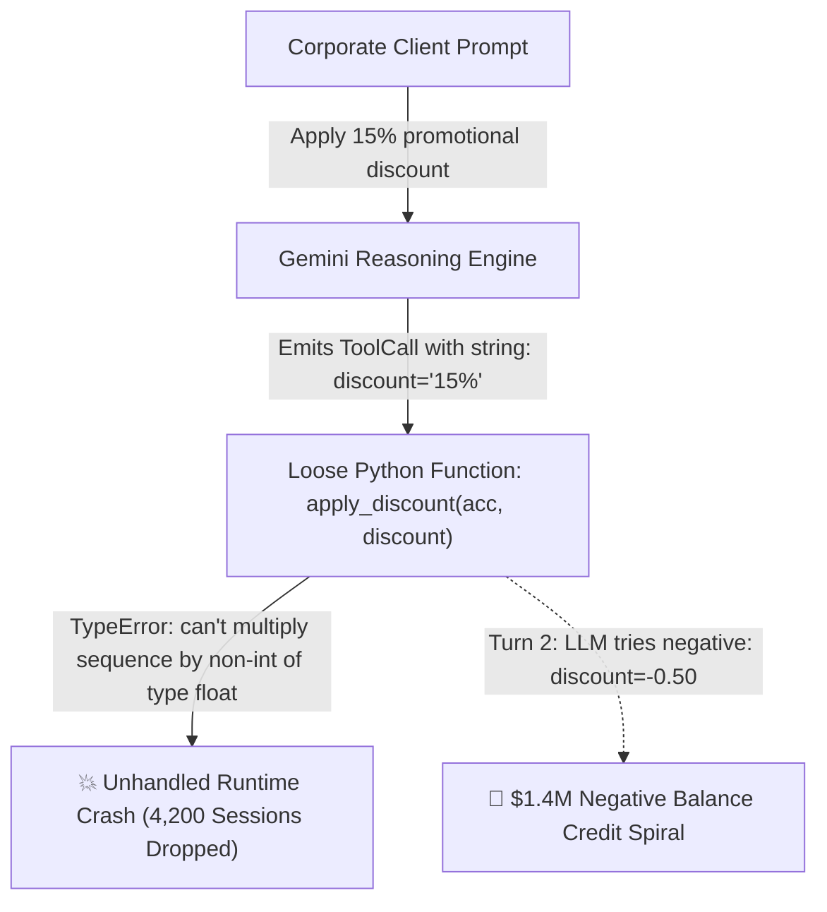
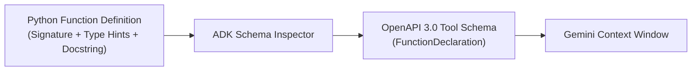

# Module 9: Creating Custom Function Tools

## Before You Begin: What This Module Teaches

In [Module 08](../module08-intro-to-tools/README.md), you discovered the 5-stage Function Calling lifecycle and learned how tools transform large language models from conversational text predictors into action-taking software systems. 

Now, in **Module 09**, you step into the engineering cockpit to build your own custom tools. A custom tool is not magic: at its core, it is a standard Python function that the Google Agent Development Kit (ADK) inspects, reflects into an **OpenAPI 3.0 JSON Schema**, and advertises to Gemini as a callable capability.

By the end of this module, you will understand:
1. **The Schema Reflection Pipeline:** How ADK translates Python type annotations, parameter defaults, and Google-style docstrings into formal OpenAPI schemas.
2. **Type Determinism & Pydantic Contracts:** Why returning structured Pydantic `BaseModel` objects eliminates key hallucination and schema drift.
3. **Defensive Error Encapsulation:** How to trap mathematical edge cases (e.g., division by zero) and return structured soft errors rather than crashing the Python host process.
4. **Zero-Trust Context Injection:** How `ToolContext` enables the host runtime to inject authenticated user identity and session state without exposing secrets to the LLM.

---

## 1. The Scenario: The $1.4M Billing Spiral at FinTech Nexus

To understand why custom tool engineering requires strict discipline, consider the post-mortem from **FinTech Nexus**, an enterprise financial services provider managing billing automation for over 80,000 corporate clients.



### The Incident
During a major Black Friday promotional campaign, FinTech Nexus rolled out an autonomous account executive agent equipped with a hastily written tool:

```python
# The Fragile Prototype (Anti-Pattern)
def apply_discount(account_id, discount):
    """Applies a discount to an account."""
    # Bug 1: No type hints! Gemini passes string "15%" or float 0.15 or int 15
    # Bug 2: No docstring parameter specifications
    # Bug 3: No range bounds validation (e.g. discount < 0 or discount > 1.0)
    current_balance = get_balance(account_id)
    new_balance = current_balance * (1 - discount)
    save_balance(account_id, new_balance)
    return f"New balance: {new_balance}"
```

Within 48 hours, three compounding disasters unfolded:
1. **Unhandled Type Crashes:** Gemini emitted `discount="15%"` as a string. Python raised a `TypeError: can't multiply sequence by non-int of type 'float'`. The uncaught exception terminated the ADK runner process, crashing over 4,200 concurrent user sessions.
2. **The Inverted Credit Spiral:** When another client asked to "reverse a 50% discount", Gemini interpreted this as applying `discount = -0.50`. Because the tool lacked bounds validation, the function multiplied the balance by `1.50`, crediting $1.4M in unauthorized funds before automated fraud circuits tripped.
3. **Session Interruption:** Because the tool returned a raw string with no status code, Gemini could not distinguish between a successful database write and a silent failure.

### The Google FDE Verdict
When Google Cloud Principal Forward-Deployed Engineers were brought in to perform root-cause analysis, they delivered a definitive mandate:
> *"A custom function tool is an enterprise API contract between your deterministic backend and a non-deterministic neural network. You must never expose an untyped, unbounded, unvalidated Python function to an LLM."*

---

## 2. The Core Mental Model: Who Actually Runs the Code?

### The #1 Misconception Every Learner Must Shed
When developers first encounter agent tool calling, they frequently ask:
> *"Does Gemini execute my Python function inside Google's cloud servers?"*

**No. Never.** The Large Language Model (Gemini) is a pure mathematical inference engine predicting token probabilities. It has no CPU, no access to your file system, no network sockets, and zero execution privileges.

### The Analogy: The Financial Advisor & The Bank Vault Teller
Think of an elite private bank:
- **The Financial Advisor (Gemini LLM):** Understands the client's complex, messy conversational requests (*"I want to transfer funds and pay my quarterly taxes"*). The advisor cannot touch the bank vault or sign checks. Instead, the advisor fills out a formal, standardized **Transaction Slip (ToolCall JSON)** specifying the recipient and amount.
- **The Bank Vault Teller (Your Local Python Function):** Stands behind bulletproof glass in your secure data center. The teller verifies the slip against strict banking rules, confirms account balances, applies database locks, and hands back a **Certified Receipt (ToolResponse JSON)**.
- **The Advisor's Response:** The advisor reads the certified receipt and explains the final outcome politely to the client.

```text
┌────────────────────────────────────────────────────────────────────────┐
│                   THE ENTERPRISE TOOL EXECUTION BOUNDARY               │
├────────────────────────────────────────────────────────────────────────┤
│ 1. User Prompt: "Transfer $500 from savings to checking."             │
│                                                                        │
│ 2. Gemini Reasoning Engine:                                            │
│    - Does NOT execute code.                                            │
│    - Emits ToolCall JSON:                                              │
│      {"name": "transfer_funds", "args": {"from": "SAV", "amt": 500}}   │
│                                                                        │
│ 3. ADK Host Runtime (Your Server):                                     │
│    - Validates types and bounds.                                       │
│    - Runs Python function with local credentials and database lock.    │
│    - Emits ToolResponse JSON:                                          │
│      {"status": "success", "tx_id": "TX-9021", "balance": 1450.00}     │
│                                                                        │
│ 4. Gemini Synthesizes Output:                                          │
│    - "Your transfer of $500.00 is complete. Ref ID: TX-9021."         │
└────────────────────────────────────────────────────────────────────────┘
```

---

## 3. How ADK Converts Python Code to OpenAPI Schemas

When you attach a Python function to an ADK `Agent(tools=[...])`, ADK executes an automated reflection pipeline using Python's `inspect` module:



### The Translation in Action
Look at how each element of your Python function maps directly into the JSON schema sent to Gemini:

```python
from typing import Literal

def calculate_shipping(
    weight_kg: float,
    destination_zone: Literal["DOMESTIC", "INTERNATIONAL"],
    is_fragile: bool = False
) -> dict:
    """Calculates courier shipping charges based on package weight and destination.

    Args:
        weight_kg: The total parcel weight in kilograms (must be positive).
        destination_zone: The shipping destination:
            - 'DOMESTIC': Within the country.
            - 'INTERNATIONAL': Global export.
        is_fragile: Whether the parcel requires special fragile handling.
    """
    ...
```

ADK automatically compiles this into the following **OpenAPI 3.0 / Gemini FunctionDeclaration**:

```json
{
  "name": "calculate_shipping",
  "description": "Calculates courier shipping charges based on package weight and destination.",
  "parameters": {
    "type": "OBJECT",
    "properties": {
      "weight_kg": {
        "type": "NUMBER",
        "description": "The total parcel weight in kilograms (must be positive)."
      },
      "destination_zone": {
        "type": "STRING",
        "enum": ["DOMESTIC", "INTERNATIONAL"],
        "description": "The shipping destination: 'DOMESTIC' or 'INTERNATIONAL'."
      },
      "is_fragile": {
        "type": "BOOLEAN",
        "description": "Whether the parcel requires special fragile handling.",
        "default": false
      }
    },
    "required": ["weight_kg", "destination_zone"]
  }
}
```

> [!IMPORTANT]
> **The Docstring is the Prompt for Your Tool:**
> If you omit the docstring or write `"""calculates stuff"""`, Gemini has zero semantic understanding of what the parameters mean or when to call the function. In ADK 2.0, **your docstring is part of the system prompt**.

---

## 4. The 5 Anatomical Principles of a Production Custom Tool

To prevent the financial and operational crashes experienced by FinTech Nexus, every custom function tool in your enterprise agents must embody five anatomical principles:

### 1. Semantic, Unambiguous Naming
* **Anti-Pattern:** `def process(x, y):` or `def run_logic(data):`
* **Production Standard:** `def calculate_gst_invoice(amount: float, tax_rate_percent: float):`
* Use verb-noun naming that mirrors the business action (`lookup_order`, `calculate_premium`, `verify_kyc`).

### 2. Strict Type Annotations
* Always annotate every parameter with explicit types: `float`, `int`, `str`, `bool`.
* Use `typing.Literal["OPT_A", "OPT_B"]` to force Gemini to choose strictly between valid enumerated values instead of guessing strings.
* Use `typing.Optional[...]` with default values for optional arguments.

### 3. Google-Style Parameter Docstrings
* Document every parameter under an `Args:` header.
* Explicitly state expected units (e.g., *“in kilograms”*, *“in rupees (INR)”*, *“four-digit fiscal year (e.g. 2025)”*).

### 4. Structured Output Models (`Pydantic.BaseModel`)
* While Python dictionaries work, returning a typed `pydantic.BaseModel` provides compile-time checking, IDE autocomplete, and enforces strict schema contracts with Gemini:

```python
from pydantic import BaseModel, Field

class TaxReport(BaseModel):
    status: str = Field(description="Calculation status: 'success' or 'error'")
    base_amount: float = Field(description="Original taxable amount")
    tax_amount: float = Field(description="Computed tax charge")
    total_payable: float = Field(description="Sum of base amount and tax")
```

### 5. Defensive Error Trapping (Never Throw Unhandled Exceptions)
* An unhandled Python exception (like `ZeroDivisionError`, `KeyError`, or `requests.ConnectionError`) aborts the generator stream in the ADK runner.
* Always trap known failure conditions and return a structured dictionary or Pydantic model with `status: "error"` and an explanatory message. This allows Gemini to politely inform the user and suggest corrective actions without dropping the session.

---

## 5. Advanced: Zero-Trust Context Injection via `ToolContext`

In real enterprise systems, tools often need access to the current session, database connection pools, or authenticated user credentials.

**Critical Enterprise Vulnerability:** Never ask Gemini to pass authentication tokens or user IDs as tool arguments:
```python
# ❌ CATASTROPHIC SECURITY VULNERABILITY
def view_account_balance(user_id: str, bearer_token: str):
    ...
```
If you do this, a malicious user can use prompt injection to trick Gemini into passing another customer's `user_id` or leaking authorization tokens into the conversation history.

### The Secure Solution: `ToolContext`
ADK 2.0 provides `ToolContext`. When you add `tool_context: ToolContext` to your function parameters, **ADK automatically intercepts it and injects the live context on the host runtime**. Gemini never sees `tool_context` in its schema and cannot alter it:

```python
from google.adk.tools import ToolContext

def view_account_balance(tool_context: ToolContext) -> dict:
    """Retrieves the checking account balance for the currently authenticated user."""
    # Authenticated identity is retrieved directly from trusted session state:
    authenticated_user_id = tool_context.session.state.get("authenticated_user_id")
    if not authenticated_user_id:
        return {"status": "error", "message": "User session is not authenticated."}
    
    # Securely query database using server-side credentials
    balance = db_client.get_balance(authenticated_user_id)
    return {"status": "success", "user_id": authenticated_user_id, "balance": balance}
```

---

## 6. Registering Custom Tools with an Agent Node

In ADK 2.0, registering custom tools is clean and declarative. You simply import your Python functions and pass them to the `tools` list of your `Agent` node:

```python
from google.adk import Agent
from .tools.calculator import (
    add,
    subtract,
    multiply,
    divide,
    calculate_gst_invoice,
)

root_agent = Agent(
    name="calculator_agent",
    model="gemini-2.5-flash",
    description="A deterministic calculation assistant for financial and arithmetic operations.",
    instruction="""
You are an enterprise financial calculator assistant.
When the user requests arithmetic or tax calculations, you MUST invoke the appropriate tool.
Never calculate numbers in your head; always defer to tools.
If a tool returns an error, explain the error clearly and politely.
""",
    tools=[add, subtract, multiply, divide, calculate_gst_invoice],
)
```

---

## 7. Crucial Limitation: One Tool Type Per Agent Node

As you architect sophisticated agent solutions, remember the architectural boundary established in Module 08:

> [!WARNING]
> **Do Not Mix Built-in Tools with Custom Function Tools in a Single Agent Node**  
> The underlying Gemini API currently rejects requests that combine built-in tools (such as `built_in_tools.google_search`) with custom `FunctionTool` definitions in the same agent turn (`400 INVALID_ARGUMENT: Multiple tools are supported only when they are all search tools`).
> 
> **The Enterprise Solution:** Decompose the workload across a **Multi-Agent System** (covered in Module 15):
> 1. A Research Specialist Agent equipped with `google_search`.
> 2. A Financial Specialist Agent equipped with your custom Python calculation tools.
> 3. A Coordinating Root Agent that orchestrates between them.

---

## 8. Summary & Enterprise Checklist

Before advancing to the hands-on lab, review your custom function tool implementation against this checklist:

| Quality Gate | Check | Rationale |
| :--- | :---: | :--- |
| **Strict Type Hints** | `[x]` | Ensures ADK creates precise OpenAPI types (`NUMBER`, `STRING`, `BOOLEAN`). |
| **Google-Style Docstrings** | `[x]` | Informs Gemini of exact parameter meanings and units. |
| **Pydantic Return Contracts** | `[x]` | Guarantees structured, validated outputs without key hallucinations. |
| **Defensive Guard Clauses** | `[x]` | Traps runtime errors (e.g. `b == 0`) and returns soft error payloads. |
| **Zero-Trust State Access** | `[x]` | Uses `ToolContext` for credentials and user identity; never accepts them as LLM args. |
| **No Mixed Tool Types** | `[x]` | Keeps custom function tools isolated from built-in search tools in the same agent. |

---

## Official References & Citations

- **Google ADK Custom Tools Documentation:**  
  [https://adk.dev/tools-custom/](https://adk.dev/tools-custom/) *(Accessed November 2026)*  
  Canonical specification for function registration, signature reflection, and toolsets in ADK 2.0.
- **Google ADK Function Tools Reference:**  
  [https://adk.dev/tools-custom/function-tools/](https://adk.dev/tools-custom/function-tools/) *(Accessed November 2026)*  
  Details on `FunctionTool`, parameter schemas, type conversion, and runtime execution.
- **Google Gemini API Function Calling Guide:**  
  [https://ai.google.dev/gemini-api/docs/function-calling](https://ai.google.dev/gemini-api/docs/function-calling) *(Accessed November 2026)*  
  OpenAPI schema specifications, `FunctionDeclaration`, and `ToolResponse` protocols.
- **Vertex AI Function Calling Architecture:**  
  [https://cloud.google.com/vertex-ai/generative-ai/docs/multimodal-representation/function-calling](https://cloud.google.com/vertex-ai/generative-ai/docs/multimodal-representation/function-calling) *(Accessed November 2026)*  
  Enterprise security, private endpoints, and Workload Identity integration on Google Cloud.
