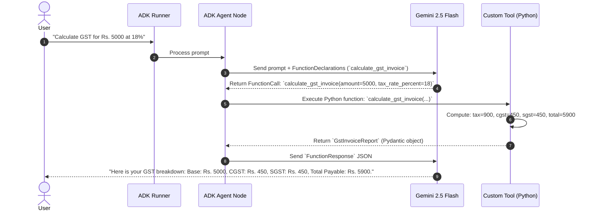

# Lab 9 Solution: Building an Enterprise "Calculator" Agent

## Overview & Goal

This document provides the full, production-ready implementation of `calculator_agent` using Google Agent Development Kit (ADK) 2.0.

Beyond providing raw code, this solution guide acts as an **FDE Engineering Playbook**. It breaks down how a **Google Forward-Deployed Engineer (FDE)** analyzes plain English requirements for financial and arithmetic calculations, translates them into technical design choices, and builds custom function tools using Pydantic models and defensive error handling.

---

### 💡 FDE & Instructor Hint: Steering AI Assistants (Antigravity)

When guiding developers or using AI coding assistants like **Antigravity** during enterprise agent development, use this **Master ADK 2.0 Steering Prompt** to ensure generated code strictly follows Google's official architectural standards:

> **Master Antigravity Steering Prompt Template:**
> *"You are an expert Google ADK 2.0 Forward-Deployed Engineer. Write custom Python tools for ADK 2.0 following strict standards:*
> 1. *Use typed Python functions with comprehensive Google-style docstrings for parameters.*
> 2. *Define tool return types using typed Pydantic models (`BaseModel`). Do NOT return plain dictionaries or raw strings.*
> 3. *Attach tools as Python function handles in the `tools=[add_numbers, calculate_gst]` list of `Agent(...)`.*
> 4. *Use `from google.adk import Agent`.*
> 5. *Use model `gemini-2.5-flash` with explicit tool usage instructions.*
> 6. *Access LLM response content via `.content` (NEVER legacy `.candidates`)."*

---

## 🏛️ Part 1: The FDE Architectural Mental Model

### From Plain English Requirements to ADK 2.0 Code

When an enterprise client asks for a financial or billing AI assistant, they want guaranteed mathematical precision. Large Language Models (LLMs) are probabilistic text prediction engines—they frequently hallucinate math or round numbers incorrectly.

As a Google FDE, your job is to enforce **Deterministic Execution** by delegating all arithmetic and tax calculations to Python code via ADK Function Tools.

Here is the exact Requirements-to-Code Matrix for this lab:

| # | Business Requirement | FDE Engineering Risk / Challenge | ADK 2.0 Solution Pattern | Code Implementation |
|---|---|---|---|---|
| **1** | *"Perform accurate arithmetic (addition, subtraction, multiplication, division)."* | **LLM Math Hallucination:** LLMs fail at multi-digit or floating-point arithmetic. | **Deterministic Tool Delegation:** Offload arithmetic to Python operators (`+`, `-`, `*`, `/`). | `return MathResult(status="success", result=a + b)` |
| **2** | *"Prevent system crashes if a user asks to divide by zero."* | **Unhandled Exceptions:** Division by zero (`10 / 0`) crashes Python runtimes if unhandled. | **Defensive Error Trapping:** Catch division by zero and return an explicit `status="error"` payload. | `if b == 0: return MathResult(status="error", message=...)` |
| **3** | *"Calculate itemized Indian GST tax invoices (CGST, SGST, Total GST, Total Payable)."* | **Tax Slab Ambiguity:** LLMs confuse CGST/SGST breakdown or apply wrong tax percentages. | **Encapsulated Financial Tool:** Write a specialized Python function that computes CGST (50%) and SGST (50%) deterministically. | `total_tax = amount * (tax_rate / 100)`<br/>`cgst = sgst = total_tax / 2` |
| **4** | *"Ensure tool output is type-safe and automatically structured for Gemini."* | **Schema Drift & Misspelled Keys:** Dict returns lack validation and generate vague schemas. | **Pydantic `BaseModel` Output Contracts:** Inherit from `BaseModel` and define `Field(description=...)`. | `class GstInvoiceReport(BaseModel): ...` |

---

## ⚙️ Part 2: Step-by-Step Implementation Guide

### Step 1: Initialize Project Directory & Environment

```bash
# 1. Create a new ADK 2.0 agent project using UV
uv run adk create calculator_agent

# 2. Navigate into the created agent folder
cd calculator_agent
```

Configure authentication in `.env`:
```env
GOOGLE_API_KEY=your_actual_gemini_api_key_here
```

---

### Step 2: Write Custom Tool Functions (`tools/calculator.py`)

Create `tools/calculator.py`. Read the extensive inline comments to understand how Pydantic return models, Google-style docstrings, and defensive logic work under the hood.

```python
"""
Enterprise Calculator Tools Module (ADK 2.0)

This module implements deterministic arithmetic and billing tools.
It demonstrates:
1. Pydantic BaseModel return types for structured Gemini schema generation.
2. Defensive error handling to prevent runtime crashes.
3. Google-style docstring annotations parsed by ADK into FunctionDeclarations.
"""

from pydantic import BaseModel, Field

# ============================================================================
# SECTION 1: PYDANTIC OUTPUT RESPONSE MODELS (THE CONTRACT WITH GEMINI)
# ============================================================================
# Why Pydantic?
# Returning a Pydantic BaseModel automatically builds OpenAPI/JSON schemas for Gemini.
# This guarantees that Gemini receives structured, validated data and never hallucinates key names.


class MathResult(BaseModel):
    """Structured response model for basic arithmetic operations."""

    status: str = Field(
        description="Execution status: 'success' or 'error'."
    )
    result: float | None = Field(
        default=None,
        description="The computed mathematical floating-point result."
    )
    message: str | None = Field(
        default=None,
        description="Detailed explanatory error message if the computation failed."
    )


class GstInvoiceReport(BaseModel):
    """Structured financial report model for Indian Goods and Services Tax (GST)."""

    status: str = Field(
        default="success",
        description="Execution status of calculation."
    )
    base_amount: float = Field(
        description="Original pre-tax amount in currency (INR)."
    )
    tax_rate_percent: float = Field(
        description="Applicable GST tax slab percentage (e.g. 5%, 12%, 18%, 28%)."
    )
    cgst: float = Field(
        description="Central GST component (equal to half of total GST)."
    )
    sgst: float = Field(
        description="State GST component (equal to half of total GST)."
    )
    total_gst: float = Field(
        description="Total calculated GST tax amount (CGST + SGST)."
    )
    total_payable: float = Field(
        description="Final invoice total payable by customer (base_amount + total_gst)."
    )


# ============================================================================
# SECTION 2: ARITHMETIC & BILLING TOOL IMPLEMENTATIONS
# ============================================================================

def add(a: float, b: float) -> MathResult:
    """Adds two floating-point numbers together.

    Teaching Note on ADK Tool Mechanics:
    - Type annotations (`a: float, b: float`) inform ADK of argument data types.
    - Docstring descriptions under `Args:` are translated directly into Gemini's JSON schema!

    Args:
        a: The first number (addend).
        b: The second number (addend).
    """
    # Deterministic execution via Python operator
    return MathResult(status="success", result=a + b)


def subtract(a: float, b: float) -> MathResult:
    """Subtracts the second number from the first number.

    Args:
        a: The initial starting number (minuend).
        b: The number to subtract (subtrahend).
    """
    return MathResult(status="success", result=a - b)


def multiply(a: float, b: float) -> MathResult:
    """Multiplies two numbers together.

    Args:
        a: The first factor.
        b: The second factor.
    """
    return MathResult(status="success", result=a * b)


def divide(a: float, b: float) -> MathResult:
    """Divides the first number by the second number with defensive zero checks.

    Teaching Note on Defensive Error Handling:
    - Never let Python raise unhandled exceptions like `ZeroDivisionError` inside a tool!
    - Return `status="error"` with a clear message so Gemini can explain the error politely.

    Args:
        a: The numerator (dividend).
        b: The denominator (divisor).
    """
    # 1. Guard Clause for Zero Division
    if b == 0:
        return MathResult(
            status="error",
            message="Division by zero is mathematically undefined. Denominator must be non-zero.",
        )

    # 2. Perform safe division
    return MathResult(status="success", result=a / b)


def calculate_gst_invoice(
    amount: float, tax_rate_percent: float = 18.0
) -> GstInvoiceReport:
    """Calculates an itemized GST invoice including CGST, SGST, and the total payable amount.

    Teaching Note on Financial Calculations:
    - In Indian GST rules, Intra-state transactions divide total GST equally into CGST (Central) and SGST (State).
    - Always use `round()` for currency calculations to prevent trailing floating-point inaccuracies.

    Args:
        amount: The base pre-tax amount in rupees (INR).
        tax_rate_percent: The GST tax slab percentage (defaults to 18.0%).
    """
    # 1. Calculate total GST tax
    total_tax = round(amount * (tax_rate_percent / 100.0), 2)

    # 2. Split into CGST and SGST (50% each)
    half_tax = round(total_tax / 2.0, 2)

    # 3. Calculate total payable
    total_due = round(amount + total_tax, 2)

    # 4. Return structured itemized report
    return GstInvoiceReport(
        base_amount=amount,
        tax_rate_percent=tax_rate_percent,
        cgst=half_tax,
        sgst=half_tax,
        total_gst=total_tax,
        total_payable=total_due,
    )
```

---

### Step 3: Register Agent Node (`agent.py`)

Open `agent.py`. Read the inline comments explaining how `Agent` binds the LLM model, prompt instructions, and custom Python functions into an active agent node.

```python
"""
Calculator Agent Configuration Node (ADK 2.0)

This module binds Gemini 2.5 Flash with the custom arithmetic and billing tools defined in tools/calculator.py.
"""

from google.adk import Agent
from .tools.calculator import (
    add,
    subtract,
    multiply,
    divide,
    calculate_gst_invoice,
)

# Root agent export required by ADK CLI
root_agent = Agent(
    name="calculator_agent",
    model="gemini-2.5-flash",
    description="A deterministic calculation assistant for arithmetic and itemized GST billing.",
    # Singular 'instruction' parameter (ADK 2.0 standard)
    instruction="""
You are a helpful and precise calculator assistant.

Tool Steering Rules:
1. When the user asks for arithmetic or math, you MUST call the corresponding tool (`add`, `subtract`, `multiply`, `divide`).
2. When the user asks for GST, tax, or billing calculations, you MUST call `calculate_gst_invoice`.
3. If a tool returns an error (such as division by zero), explain the issue politely to the user.
4. If the user asks general questions outside of math and billing, politely inform them of your specialized scope.

Always present final numerical results clearly and professionally.
""",
    # Pass Python function handles directly. ADK inspects signatures and builds FunctionDeclarations.
    tools=[add, subtract, multiply, divide, calculate_gst_invoice],
)
```

---

## 🔬 Part 3: Deep Dive — Under the Hood of ADK 2.0 Tool Execution

Here is the sequence diagram showing how ADK 2.0 intercepts Gemini's tool calls, executes Python code deterministically, and formats responses:



---

## 🧪 Part 4: Verification & Testing Playbook

### 1. Headless CLI Interactive Test

Run the agent in your terminal:
```bash
uv run adk run .
```

#### Test Scenarios & Expected Behavior

1. **Addition Test:**
   ```text
   User: What is 42.5 + 118.3?
   Agent: The sum of 42.5 and 118.3 is 160.8.
   ```

2. **Defensive Error Handling Test:**
   ```text
   User: What is 10 divided by 0?
   Agent: Division by zero is mathematically undefined. Please provide a non-zero denominator.
   ```

3. **Enterprise GST Calculation Test:**
   ```text
   User: Calculate the GST invoice for an item costing Rs. 5000 with 18% GST.
   Agent: Here is your itemized GST breakdown:
   - Base Amount: Rs. 5,000.00
   - GST Rate: 18%
   - CGST (Central Tax): Rs. 450.00
   - SGST (State Tax): Rs. 450.00
   - Total GST: Rs. 900.00
   - Total Payable Amount: Rs. 5,900.00
   ```

---

### 2. Visual Trace Inspection (Dev UI)

Launch the ADK Web UI:
```bash
uv run adk web .
```

Open `http://localhost:8000` in your browser. Re-run the GST query and inspect the **Trace Tab**:
- Observe the `FunctionCall` event generated by Gemini.
- Inspect the `FunctionResponse` event carrying the exact Pydantic JSON payload.

---

## ❓ Self-Reflection & Interview Prep

1. **What happens if you remove docstrings from custom tool functions?**
   * *Answer:* ADK still registers the function name and type hints, but the `description` field sent to Gemini is empty. Without docstrings, Gemini must guess what the function does based solely on its name, leading to missing calls or bad parameters. **In ADK 2.0, the function docstring is the prompt for your Python tool!**

2. **Why catch zero-division in Python code rather than letting it throw an exception?**
   * *Answer:* An unhandled `ZeroDivisionError` crashes the Python runtime or breaks the ADK runner execution stream. Returning `MathResult(status="error", message="...")` allows Gemini to receive a structured error response and explain the issue politely to the user without crashing.

3. **Why use Pydantic `BaseModel` over plain Python dictionaries?**
   * *Answer:*

     | Feature | Plain Python `dict` | Pydantic `BaseModel` |
     | :--- | :---: | :---: |
     | Type Safety & Casting | ❌ None | ✅ Automatic |
     | Gemini JSON Schema Generation | ❌ Vague (`object`) | ✅ Rich & Detailed |
     | Misspelled Key Detection | ❌ Silent Bug | ✅ Immediate Error |
     | Downstream Audit/DB Compliance | ❌ Risky | ✅ Guaranteed |
     | IDE Autocomplete | ❌ No | ✅ Full Support |

---

## 📚 Official References

- **Google ADK Documentation:** https://google.github.io/adk-docs/
- **Google GenAI SDK Reference:** https://googleapis.github.io/python-genai/
- **Pydantic Data Validation:** https://docs.pydantic.dev/latest/

<!-- © 2026 Inder Chauhan (https://github.com/inderanz/google-adk-training). All rights reserved. Ref: IC-ADK-module09-intro-custom-function-tools-lab-solution -->
