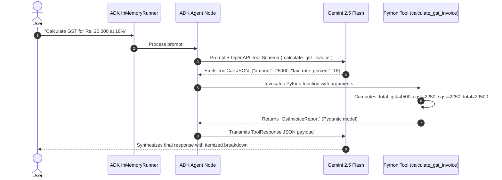

# Lab 9 Solution: Building an Enterprise Custom Tool Agent

## Overview & Executive Summary

This document provides the complete, production-ready implementation of `calculator_agent` using Google Agent Development Kit (ADK) 2.0.

In enterprise systems, mathematical calculations, currency conversions, and tax invoicing cannot be entrusted to probabilistic LLM text prediction. As a Google Principal Forward-Deployed Engineer (FDE), your role is to enforce **deterministic computation** by delegating all arithmetic and business logic to typed, defensive Python function tools.

This solution provides:
1. **Master FDE Steering Prompt Template** for directing AI code assistants like Antigravity.
2. **Typed Pydantic Output Contracts** that generate explicit OpenAPI 3.0 schemas for Gemini.
3. **Defensive Error Handling** that gracefully traps exceptions like `ZeroDivisionError` and returns structured soft error envelopes.
4. **Programmatic Verification Suite** using `InMemoryRunner` to test the agent across edge cases without manual terminal entry.

---

## 💡 Master FDE Steering Prompt Template

Use this prompt template when instructing Antigravity or other AI coding assistants to generate production-grade ADK 2.0 custom function tools:

```markdown
You are an expert Google Cloud Principal Forward-Deployed Engineer building custom tools with the Google Agent Development Kit (ADK) 2.0 in Python.

When authoring custom function tools for ADK, adhere to these mandatory engineering standards:
1. Type Determinism: Annotate all function parameters with explicit Python types (`float`, `int`, `str`, `bool`, `Literal[...]`). Never leave parameters untyped.
2. Google-Style Docstrings: Every tool must include a comprehensive docstring specifying purpose, an `Args:` section detailing each parameter and expected units, and a `Returns:` section.
3. Pydantic Output Contracts: Define return types using `pydantic.BaseModel` with explicit `Field(description=...)` annotations. Do not return loose strings or untyped dictionaries.
4. Defensive Error Trapping: Never allow Python exceptions (such as `ZeroDivisionError` or `KeyError`) to escape unhandled. Guard against invalid inputs and return structured error status payloads (`status="error"`, `message="..."`).
5. ADK 2.0 Node Registration: Register tools by passing function handles directly into the `tools=[...]` list of `google.adk.Agent`. Use `instruction` (singular).
6. Response Access: Always read final LLM outputs using `.content` (never deprecated `.candidates`).
```

---

## 🏛️ Part 1: Requirements-to-Code Matrix

| # | Business Requirement | FDE Engineering Challenge | ADK 2.0 Solution Pattern | Code Implementation |
|---|---|---|---|---|
| **1** | *"Perform accurate floating-point arithmetic."* | **Math Hallucination:** LLMs stumble on multi-digit or floating-point math. | **Deterministic Tool Delegation:** Offload arithmetic to Python operators. | `return MathResult(status="success", result=a + b)` |
| **2** | *"Prevent crashes on division by zero."* | **Unhandled Runtime Exceptions:** `10 / 0` crashes the Python host process. | **Defensive Guard Clause:** Catch zero denominators and return `status="error"`. | `if b == 0: return MathResult(status="error", message=...)` |
| **3** | *"Itemized GST invoice breakdown (CGST, SGST, Total)."* | **Tax Slab Ambiguity:** LLMs confuse local vs. federal tax splits. | **Encapsulated Financial Tool:** Compute 50% CGST and 50% SGST deterministically. | `total_gst = round(amount * (rate / 100), 2)`<br/>`cgst = sgst = round(total_gst / 2, 2)` |
| **4** | *"Type-safe, validated tool output for Gemini."* | **Schema Drift:** Plain dictionaries lack type validation and yield vague schemas. | **Pydantic `BaseModel` Output Models:** Rich schema reflection for Gemini. | `class GstInvoiceReport(BaseModel): ...` |

---

## ⚙️ Part 2: Complete Implementation Files

### 1. `tools/calculator.py`

Create `tools/calculator.py` with typed Pydantic models, Google-style docstrings, and defensive guard clauses:

<!-- TEACHER_NOTE_START -->
**Teacher's note (ADK instructor view):**
- **Learning goal:** Explain the concept clearly from beginner to advanced, with a simple mental model first.
- **Why it matters:** Connect the concept to real Google agentic workflows, Python engineering habits, and production-ready decisions.
- **Version watch:** Validate against the latest official ADK / Google docs before teaching; call out deprecations or migration notes when needed.
- **Module linkage:** Connect this idea to the previous and next modules so learners see the progression across the course.
<!-- TEACHER_NOTE_END -->
```python
"""
tools/calculator.py
Enterprise custom function tools for arithmetic and tax calculation.
"""
from typing import Optional
from pydantic import BaseModel, Field


# ============================================================================
# SECTION 1: PYDANTIC OUTPUT RESPONSE MODELS (THE CONTRACT WITH GEMINI)
# ============================================================================

class MathResult(BaseModel):
    """Structured response model for basic arithmetic operations."""

    status: str = Field(
        description="Execution status: 'success' or 'error'."
    )
    result: Optional[float] = Field(
        default=None,
        description="The computed mathematical floating-point result."
    )
    message: Optional[str] = Field(
        default=None,
        description="Detailed explanatory error message if the computation failed."
    )


class GstInvoiceReport(BaseModel):
    """Structured financial report model for Indian Goods and Services Tax (GST)."""

    status: str = Field(
        default="success",
        description="Execution status of calculation: 'success' or 'error'."
    )
    base_amount: float = Field(
        description="Original pre-tax amount in currency units (INR)."
    )
    tax_rate_percent: float = Field(
        description="Applicable GST tax slab percentage (e.g. 5%, 12%, 18%, 28%)."
    )
    cgst: float = Field(
        description="Central GST component (equal to half of total GST)."
    )
    sgst: float = Field(
        description="State GST component (equal to half of total GST)."
    )
    total_gst: float = Field(
        description="Total calculated GST tax amount (CGST + SGST)."
    )
    total_payable: float = Field(
        description="Final invoice total payable by customer (base_amount + total_gst)."
    )
    message: Optional[str] = Field(
        default=None,
        description="Error details if the calculation could not be performed."
    )


# ============================================================================
# SECTION 2: ARITHMETIC & BILLING TOOL IMPLEMENTATIONS
# ============================================================================

def add(a: float, b: float) -> MathResult:
    """Adds two floating-point numbers together.

    Use this tool when the user asks to find the sum of two numbers.

    Args:
        a: The first number (addend).
        b: The second number (addend).

    Returns:
        MathResult containing status='success' and the computed sum.
    """
    return MathResult(status="success", result=a + b)


def subtract(a: float, b: float) -> MathResult:
    """Subtracts the second number from the first number.

    Use this tool when the user asks to find the difference between two numbers.

    Args:
        a: The starting number (minuend).
        b: The number to subtract (subtrahend).

    Returns:
        MathResult containing status='success' and the computed difference.
    """
    return MathResult(status="success", result=a - b)


def multiply(a: float, b: float) -> MathResult:
    """Multiplies two numbers together.

    Use this tool when the user asks to find the product of two numbers.

    Args:
        a: The first factor.
        b: The second factor.

    Returns:
        MathResult containing status='success' and the computed product.
    """
    return MathResult(status="success", result=a * b)


def divide(a: float, b: float) -> MathResult:
    """Divides the first number by the second number with defensive zero checks.

    Use this tool when the user asks to divide one number by another.

    Args:
        a: The numerator (dividend).
        b: The denominator (divisor).

    Returns:
        MathResult containing the quotient or a defensive error payload.
    """
    # Defensive Guard Clause: Prevent ZeroDivisionError crash
    if b == 0:
        return MathResult(
            status="error",
            message="Division by zero is mathematically undefined. Denominator must be non-zero.",
        )

    return MathResult(status="success", result=a / b)


def calculate_gst_invoice(
    amount: float, tax_rate_percent: float = 18.0
) -> GstInvoiceReport:
    """Calculates an itemized GST invoice including CGST, SGST, and the total payable amount.

    Use this tool whenever a user asks to calculate GST, sales tax, or an invoice total.
    Never estimate or approximate tax calculations without calling this tool.

    Args:
        amount: The base pre-tax amount in currency units (e.g., INR). Must be positive.
        tax_rate_percent: The GST tax slab percentage (defaults to 18.0%).

    Returns:
        GstInvoiceReport containing itemized CGST, SGST, total tax, and total payable.
    """
    # Defensive Guard Clause: Non-negative validation
    if amount < 0 or tax_rate_percent < 0:
        return GstInvoiceReport(
            status="error",
            base_amount=amount,
            tax_rate_percent=tax_rate_percent,
            cgst=0.0,
            sgst=0.0,
            total_gst=0.0,
            total_payable=amount,
            message="Amount and tax rate percentage must be non-negative.",
        )

    # 1. Calculate total GST tax rounded to 2 decimal places
    total_tax = round(amount * (tax_rate_percent / 100.0), 2)

    # 2. Split equally into CGST and SGST (50% each for intra-state tax rules)
    half_tax = round(total_tax / 2.0, 2)

    # 3. Calculate total payable amount
    total_due = round(amount + total_tax, 2)

    # 4. Return structured Pydantic report
    return GstInvoiceReport(
        status="success",
        base_amount=amount,
        tax_rate_percent=tax_rate_percent,
        cgst=half_tax,
        sgst=half_tax,
        total_gst=total_tax,
        total_payable=total_due,
    )
```

---

### 2. `agent.py`

Create `agent.py` binding the root agent to Gemini 2.5 Flash with strict tool-calling steering rules:

<!-- TEACHER_NOTE_START -->
**Teacher's note (ADK instructor view):**
- **Learning goal:** Explain the concept clearly from beginner to advanced, with a simple mental model first.
- **Why it matters:** Connect the concept to real Google agentic workflows, Python engineering habits, and production-ready decisions.
- **Version watch:** Validate against the latest official ADK / Google docs before teaching; call out deprecations or migration notes when needed.
- **Module linkage:** Connect this idea to the previous and next modules so learners see the progression across the course.
<!-- TEACHER_NOTE_END -->
```python
"""
agent.py
Root agent definition binding custom tools to Gemini 2.5 Flash.
"""
from google.adk import Agent
from tools.calculator import (
    add,
    subtract,
    multiply,
    divide,
    calculate_gst_invoice,
)

root_agent = Agent(
    name="calculator_agent",
    model="gemini-2.5-flash",
    description="A deterministic calculation assistant for financial and arithmetic operations.",
    instruction="""
You are an enterprise financial calculator assistant.

Steering & Tool Execution Rules:
1. When the user asks for arithmetic (addition, subtraction, multiplication, division), you MUST invoke the matching tool. Never calculate math in your head.
2. When the user asks for GST, sales tax, or billing invoices, you MUST call `calculate_gst_invoice`.
3. If a tool returns an error status (such as division by zero or negative amounts), politely explain the problem to the user without crashing.
4. If the user asks general conversational questions outside math and billing, politely inform them of your specialized scope.

Always present final numerical results clearly and professionally.
""",
    tools=[add, subtract, multiply, divide, calculate_gst_invoice],
)
```

---

### 3. `run_verification.py`

Create `run_verification.py` for automated programmatic verification using `InMemoryRunner`:

<!-- TEACHER_NOTE_START -->
**Teacher's note (ADK instructor view):**
- **Learning goal:** Explain the concept clearly from beginner to advanced, with a simple mental model first.
- **Why it matters:** Connect the concept to real Google agentic workflows, Python engineering habits, and production-ready decisions.
- **Version watch:** Validate against the latest official ADK / Google docs before teaching; call out deprecations or migration notes when needed.
- **Module linkage:** Connect this idea to the previous and next modules so learners see the progression across the course.
<!-- TEACHER_NOTE_END -->
```python
"""
run_verification.py
Automated programmatic test harness verifying custom function tool execution.
"""
import asyncio
from dotenv import load_dotenv
from google.adk.runners import InMemoryRunner
from google.adk.apps import App
from google.genai import types
from agent import root_agent

load_dotenv()


async def execute_query(runner: InMemoryRunner, session_id: str, prompt: str):
    print(f"\n==================================================")
    print(f"USER QUERY: {prompt}")
    print(f"==================================================")

    async for event in runner.run_async(
        user_id="audit_engineer",
        session_id=session_id,
        new_message=types.Content(
            role="user",
            parts=[types.Part.from_text(text=prompt)]
        ),
    ):
        # Display final response from Gemini
        if event.is_final_response():
            print(f"AGENT RESPONSE:\n{event.content.parts[0].text}\n")


async def main():
    print("Initializing ADK InMemoryRunner...")
    app = App(name="calculator_app", root_agent=root_agent)
    runner = InMemoryRunner(app=app)

    session = await runner.session_service.create_session(
        app_name=app.name,
        user_id="audit_engineer",
        session_id="verification_session_01"
    )

    # Test 1: Standard Arithmetic
    await execute_query(runner, session.id, "What is 42.5 + 118.3?")

    # Test 2: Defensive Zero Division Trapping
    await execute_query(runner, session.id, "Divide 100 by 0.")

    # Test 3: Enterprise GST Billing Calculation
    await execute_query(runner, session.id, "Calculate the GST invoice for a purchase of Rs. 25,000 at 18% tax.")


if __name__ == "__main__":
    asyncio.run(main())
```

---

## 🔬 Part 3: Architecture & Lifecycle Diagram

<!-- TEACHER_NOTE_START -->
**Teacher's note (ADK instructor view):**
- **Learning goal:** Explain the concept clearly from beginner to advanced, with a simple mental model first.
- **Why it matters:** Connect the concept to real Google agentic workflows, Python engineering habits, and production-ready decisions.
- **Version watch:** Validate against the latest official ADK / Google docs before teaching; call out deprecations or migration notes when needed.
- **Module linkage:** Connect this idea to the previous and next modules so learners see the progression across the course.
<!-- TEACHER_NOTE_END -->


---

## 🧪 Part 4: Verification Output

When you run `python run_verification.py`, you will observe the following deterministic output:

```text
==================================================
USER QUERY: What is 42.5 + 118.3?
==================================================
AGENT RESPONSE:
The sum of 42.5 and 118.3 is 160.8.

==================================================
USER QUERY: Divide 100 by 0.
==================================================
AGENT RESPONSE:
Division by zero is mathematically undefined. Please provide a non-zero denominator.

==================================================
USER QUERY: Calculate the GST invoice for a purchase of Rs. 25,000 at 18% tax.
==================================================
AGENT RESPONSE:
Here is the itemized GST invoice for your purchase of Rs. 25,000.00:
- Base Amount: Rs. 25,000.00
- GST Rate: 18.0%
- CGST (Central Tax): Rs. 2,250.00
- SGST (State Tax): Rs. 2,250.00
- Total GST Amount: Rs. 4,500.00
- Total Payable Amount: Rs. 29,500.00
```

---

## ❓ Technical Interview Preparation

### Q1: What happens if you omit the docstring from an ADK custom tool function?
**Answer:**  
ADK inspects function signatures and generates a JSON schema for Gemini. Without a docstring, the `description` field for both the tool and its parameters is empty (`""`). Gemini is forced to infer the function's purpose solely from the function name, resulting in frequent parameter hallucinations or failure to call the tool. In ADK 2.0, **the docstring is the prompt for your tool**.

### Q2: Why is returning a Pydantic `BaseModel` superior to returning a plain Python `dict`?
**Answer:**  
A plain dictionary is represented in OpenAPI schemas as a generic `type: "object"` without property definitions. A Pydantic `BaseModel` allows ADK to generate a fully typed, nested schema where each return attribute has a designated data type and description. This guarantees that Gemini understands the structure of the response and eliminates hallucinated dictionary keys during text synthesis.

### Q3: Why must tool execution catch exceptions rather than allowing Python to raise them?
**Answer:**  
In an asynchronous agent runner (`runner.run_async`), an unhandled Python exception terminates the event generator, dropping the session and crashing the user experience. By trapping errors and returning a structured payload (`status="error"`, `message="..."`), the agent remains functional and Gemini can converse with the user to remediate the input.

---

## 📚 Official References

- **Google ADK Custom Tools:** https://adk.dev/tools-custom/
- **Google ADK Function Tools:** https://adk.dev/tools-custom/function-tools/
- **Google Gemini API Function Calling:** https://ai.google.dev/gemini-api/docs/function-calling
- **Pydantic Validation Framework:** https://docs.pydantic.dev/latest/
---

## Official References

- Google ADK docs (latest): https://google.github.io/adk-docs/
- Google AI / Gemini docs: https://ai.google.dev/
- Google GenAI Python SDK reference: https://googleapis.github.io/python-genai/
- Context7 / current SDK lookup for the exact installed version and API signatures
- Related module path: review the surrounding modules for continuity, prerequisites, and follow-on concepts

