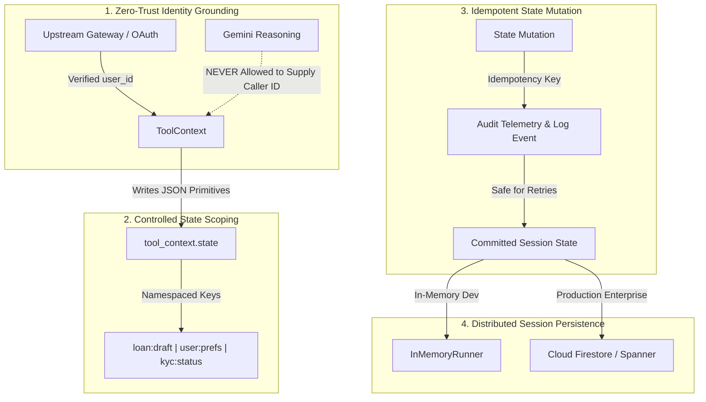

# Module 10 Enterprise Playbook: Stateful Tools and Memory as an Operating Layer

In this module, the agent transitions from a one-shot prompt responder into a **continuous operational assistant**. While Module 09 established custom function tools as deterministic capabilities, Module 10 introduces the operating layer that governs enterprise context: **how to maintain state across turns, isolate customer identity, and apply historical context safely to future decisions**.

For a Google Principal Forward-Deployed Engineer (FDE), tool-enabled state is not a novelty; it is a critical system architecture with direct consequences for compliance, security, and financial accuracy.

---

## 1. The FDE Perspective: The Meridian Asset Management Lesson

Recall the crisis at **Meridian Asset Management** detailed in [Module 10 README](./README.md): a wealth advisory assistant relied on conversational prompt history for customer risk profiles and accepted model-supplied user IDs, resulting in an unauthorized \$6.2M high-risk allocation breach during volatile market conditions.

When executive leadership asked how a sophisticated LLM could drift so severely, the FDE assessment was clear:
> *"Conversational prompt history is probabilistic, malleable, and subject to attention decay and prompt injection. It is not an enterprise system-of-record. In production, stateful facts—customer identity, compliance tier, draft applications, and preference settings—must be managed deterministically in server-side `ToolContext`."*

---

## 2. The 4 Non-Negotiable Tenets of Stateful Tool Engineering



### Tenet 1: Zero-Trust Identity Grounding
The LLM is an untrusted reasoning component in an enterprise security boundary.
- **The Core Rule:** A tool must **never** accept `user_id`, `account_number`, or `security_clearance` as a model-supplied argument.
- **The Execution Model:** Identity is established at the transport gateway (Google Cloud Identity-Aware Proxy, Cloudflare Access, or Apigee) and injected into `tool_context.user_id`. The tool accesses this verified identity on the host server, preventing conversational prompt injection from spoofing customer accounts.

### Tenet 2: Controlled State Scoping & Serialization Hygiene
`tool_context.state` is a persistent dictionary across turns within a session.
- **Strictly JSON Primitives:** Store only primitives: `dict`, `list`, `str`, `int`, `float`, `bool`. Never store un-pickleable objects, open database handles, sockets, or thread locks in `tool_context.state`.
- **Namespaced Keys:** Avoid flat, ambiguous keys like `"data"` or `"temp"`. Use namespaced keys: `"banking:loan_draft"`, `"user:preferences"`, `"risk:tier"`.

### Tenet 3: Idempotent State Mutation & Audit Logging
Stateful tools frequently execute over unstable network connections or experience client retries:
- **Idempotency:** Re-executing a stateful tool with the same arguments must not corrupt state or trigger duplicate billing drafts.
- **Audit Trails:** Every state mutation (updating an address, selecting an investment allocation, modifying a draft) must emit structured audit logs containing the `session_id`, `user_id`, key modified, and before/after values to Google Cloud Logging.

### Tenet 4: Ephemeral Session State vs. Durable Systems of Record
Developers often confuse conversational session state with permanent database persistence:
- **`tool_context.state`** is ephemeral and scoped to the active session. It is designed for multi-turn draft accumulation, intermediate calculations, and UI caching.
- **Durable Enterprise Systems of Record:** Booked loans, completed wire transfers, and verified legal contracts must be committed to transactional databases (Cloud SQL, Spanner, or Firestore as covered in Module 13.5). Never rely on `tool_context.state` as your sole permanent database.

---

## 3. Production Architecture Blueprint: Enterprise Stateful Tool

Here is the reference architectural blueprint for implementing stateful, audited banking tools in Google ADK:

```python
"""
production_stateful_tool.py
Enterprise-grade ADK stateful tool with audit logging, zero-trust identity, and defensive bounds.
"""
from typing import Dict, Any, Optional
import time
import logging
from pydantic import BaseModel, Field
from google.adk.tools import ToolContext

logger = logging.getLogger("enterprise.banking.stateful")


class LoanDraftResponse(BaseModel):
    """Structured Pydantic response for loan draft accumulation."""
    status: str = Field(description="'in_progress', 'ready_for_submission', or 'error'")
    user_id: str = Field(description="Server-authenticated caller ID")
    captured_fields: Dict[str, Any] = Field(description="Currently accumulated draft values")
    missing_fields: list[str] = Field(description="Mandatory fields still missing")
    error_message: Optional[str] = Field(default=None, description="Validation failure details")


def accumulate_loan_draft_enterprise(
    field_name: str,
    field_value: str,
    tool_context: ToolContext
) -> LoanDraftResponse:
    """Accumulates verified fields for an active personal loan application draft.

    Use this tool turn-by-turn as the client provides loan application details.

    Args:
        field_name: The loan parameter ('annual_income', 'loan_amount', 'tenure_months').
        field_value: The value provided by the client.

    Returns:
        LoanDraftResponse containing updated draft state and missing requirements.
    """
    start_time = time.time()
    
    # 1. Zero-Trust Identity Verification
    verified_user = tool_context.user_id
    if not verified_user:
        logger.error("Unauthenticated invocation attempted on loan draft tool.")
        return LoanDraftResponse(
            status="error",
            user_id="UNKNOWN",
            captured_fields={},
            missing_fields=[],
            error_message="Unauthorized: caller session lacks verified user identity."
        )

    clean_field = field_name.strip().lower()
    clean_val = field_value.strip()

    # 2. Field Whitelisting & Input Guard Clauses
    allowed_fields = {"annual_income", "loan_amount", "tenure_months"}
    if clean_field not in allowed_fields:
        return LoanDraftResponse(
            status="error",
            user_id=verified_user,
            captured_fields={},
            missing_fields=list(allowed_fields),
            error_message=f"Field '{field_name}' is not recognized. Allowed: {list(allowed_fields)}."
        )

    # 3. Read & Mutate Namespaced Session State
    state_key = f"loan_draft:{verified_user}"
    draft = tool_context.state.get(state_key, {})
    draft[clean_field] = clean_val
    tool_context.state[state_key] = draft

    # 4. Evaluate Missing Fields
    missing = [f for f in allowed_fields if f not in draft]
    progress_status = "ready_for_submission" if not missing else "in_progress"

    duration_ms = (time.time() - start_time) * 1000
    logger.info(
        "User %s updated draft field '%s'. Status: %s (Duration: %.2fms)",
        verified_user, clean_field, progress_status, duration_ms
    )

    return LoanDraftResponse(
        status=progress_status,
        user_id=verified_user,
        captured_fields=draft,
        missing_fields=missing
    )
```

---

## 4. Anti-Patterns vs. Production Standards

| Enterprise Anti-Pattern | Operational Failure Mode | Google FDE Production Standard |
| :--- | :--- | :--- |
| **Prompt-Based State Tracking** | Conversational drift and attention truncation cause the agent to forget or alter customer risk tiers. | Store multi-turn facts exclusively in **`tool_context.state`**. |
| **Model-Supplied Identity** | Accepting `user_id` as an LLM argument invites prompt-injection account takeover. | Read identity strictly from **`tool_context.user_id`** authenticated by upstream gateways. |
| **Mentioning ToolContext in Docstrings** | Writing `"tool_context: internal state"` in docstrings confuses Gemini and triggers hallucinated arguments. | **Strip all references** to `tool_context` from docstrings; ADK handles injection transparently. |
| **Complex Object Serialization** | Storing database connections or threading locks in state crashes the session serializer. | Enforce **JSON-serializable primitives** (`dict`, `list`, `str`, `int`, `float`, `bool`) only. |
| **Unbounded State Growth** | Storing megabytes of raw files in session state causes latency and token exhaustion. | Offload binary files using **`tool_context.save_artifact()`**. |

---

## 5. Enterprise Stateful Tool Readiness Gate

Before approving any stateful tool for staging or production, verify all 7 gates:

- [ ] **Context Stripping:** Function declares `tool_context: ToolContext` with zero mention in docstrings.
- [ ] **Zero-Trust Identity:** Identity is sourced strictly from `tool_context.user_id`; never accepted as an LLM argument.
- [ ] **Serialization Guarantee:** All values written to `tool_context.state` are strictly JSON-serializable primitives.
- [ ] **Namespaced Keys:** State keys use domain prefixes (e.g., `loan:draft`, `user:preferences`) to prevent cross-tool collisions.
- [ ] **Draft Accumulation Logic:** Multi-step forms clearly report captured fields and missing fields to guide user conversation.
- [ ] **Binary Offloading:** Generated PDFs, images, and tabular exports are saved via `tool_context.save_artifact()`.
- [ ] **Audit Telemetry:** State mutations emit structured log events with user ID, session ID, and duration to Google Cloud Logging.

---

## 6. Official References & Citations

- **Google ADK Custom Tools & ToolContext Reference:**  
  [https://adk.dev/tools-custom/](https://adk.dev/tools-custom/) *(Accessed November 2026)*  
  Canonical specification for `ToolContext`, dependency injection, and tool execution boundaries.
- **Google ADK Sessions & State Architecture:**  
  [https://adk.dev/sessions/](https://adk.dev/sessions/) *(Accessed November 2026)*  
  Deep dive on session services, state scopes, and memory retention across turns.
- **Gemini API Function Calling Documentation:**  
  [https://ai.google.dev/gemini-api/docs/function-calling](https://ai.google.dev/gemini-api/docs/function-calling) *(Accessed November 2026)*  
  Core specification for OpenAPI parameter extraction and tool schema generation.
- **Vertex AI Generative AI Enterprise Architecture:**  
  [https://cloud.google.com/vertex-ai/generative-ai/docs/multimodal-representation/function-calling](https://cloud.google.com/vertex-ai/generative-ai/docs/multimodal-representation/function-calling) *(Accessed November 2026)*  
  Enterprise SLA, Workload Identity Federation, and private VPC deployment on Google Cloud.
