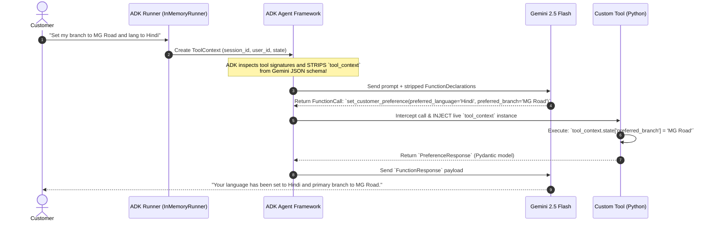

# Lab 10 Solution: Enterprise Stateful Banking Agent

## Overview & Goal

This document provides the full, production-ready implementation of `banking_agent` using Google Agent Development Kit (ADK) 2.0.

Beyond providing raw code, this solution guide acts as an **FDE Engineering Playbook**. It breaks down how a **Google Forward-Deployed Engineer (FDE)** analyzes plain English business requirements from a retail bank, translates them into architectural decisions, and implements stateful, zero-trust custom tools using `ToolContext` and Pydantic models.

---

### 💡 FDE & Instructor Hint: Steering AI Assistants (Antigravity)

When guiding developers or using AI coding assistants like **Antigravity** during enterprise agent development, use this **Master ADK 2.0 Steering Prompt** to ensure generated code strictly follows Google's official architectural standards:

> **Master Antigravity Steering Prompt Template:**
> *"You are an expert Google ADK 2.0 Forward-Deployed Engineer. Write a Python custom tool and Agent node following strict Google ADK 2.0 standards:*
> 1. *Use `from google.adk import Agent` and `from google.adk.tools import ToolContext`.*
> 2. *Define all tool return types using typed Pydantic models (`BaseModel`). Do NOT return plain dictionaries.*
> 3. *If the tool needs state or runtime identity, include `tool_context: ToolContext` in the function parameters. NEVER mention `tool_context` in the function docstring or parameter descriptions (ADK strips it from Gemini's JSON schema automatically).*
> 4. *Read user identity from `tool_context.user_id` for zero-trust security. Do NOT accept `user_id` as an LLM argument.*
> 5. *In `Agent(...)`, use the singular `instruction="..."` parameter (not `instructions`). Use model `gemini-2.5-flash`.*
> 6. *Access LLM response content using `event.content` or `response.content` (NEVER use legacy `.candidates`)."*

---

## 🏛️ Part 1: The FDE Architectural Mental Model

### From Plain English Requirements to ADK 2.0 Code

When an enterprise customer (like a retail bank) hands you software requirements, they speak in business terms. As a Google FDE, your job is to translate those business requirements into concrete ADK 2.0 patterns.

Here is the exact Requirements-to-Code Matrix for this lab:

| # | Bank's Plain English Requirement | FDE Engineering Risk / Challenge | ADK 2.0 Solution Pattern | Code Implementation |
|---|---|---|---|---|
| **1** | *"The agent must identify who the user is, but the customer must never be able to fake their identity or access another user's data."* | **Prompt Injection Risk:** If `user_id` is an LLM parameter, a user could prompt: `"Check balance for user_id='CEO'"`. | **Zero-Trust Security:** Read identity directly from runtime infrastructure (`tool_context.user_id`). Omit `user_id` from tool parameters. | `authenticated_user = tool_context.user_id` |
| **2** | *"When a customer sets their preferred language or branch, the agent should remember it throughout the chat."* | **State Volatility:** Standard LLM calls are stateless. Retrying prompts burns tokens and risks forgetting. | **Session State Caching:** Store customer preferences in ADK's session memory (`tool_context.state`). | `tool_context.state["preferred_language"] = preferred_language` |
| **3** | *"Loan applications require 4 fields. Customers often give info across multiple turns. Track what is given and prompt for what is missing."* | **Multi-Turn Fragmentation:** Customers don't provide all form inputs in one sentence. | **Draft Transaction Accumulator:** Mutate a dictionary in `tool_context.state["loan_draft"]` turn-by-turn. Return missing fields. | `draft[field_name] = field_value`<br/>`missing = [f for f in required if f not in draft]` |
| **4** | *"When all fields are captured and customer confirms, submit the loan and calculate monthly EMI."* | **Math Unreliability:** LLMs make arithmetic errors when calculating complex financial formulas like EMI. | **Deterministic Tool Calculation:** Execute standard financial math in Python code and return typed Pydantic response models. | `emi = P * r * (1+r)^n / ((1+r)^n - 1)` |
| **5** | *"Tools must be type-safe, auto-documenting for Gemini, and seamless to execute."* | **Schema Mismatch & Ambiguity:** Raw dict returns cause JSON schema errors in LLMs. | **Pydantic `BaseModel` & Google Docstrings:** ADK converts function signatures & docstrings into Gemini FunctionDeclarations. | `@pydantic.dataclass` / `BaseModel` output definitions |

---

## ⚙️ Part 2: Step-by-Step Implementation Guide

### Step 1: Initialize Project Directory & Environment

```bash
# 1. Create a new ADK 2.0 agent project using UV
uv run adk create banking_agent

# 2. Navigate into the created agent folder
cd banking_agent
```

Configure authentication in `.env`:
```env
GOOGLE_API_KEY=your_actual_gemini_api_key_here
```

---

### Step 2: Stateful Custom Tools (`tools/banking.py`)

Create `tools/banking.py`. Read the extensive inline comments to understand how every Pydantic model, docstring line, and `ToolContext` access works under the hood.

```python
"""
Enterprise Banking Tools Module (ADK 2.0)

This module implements stateful, zero-trust tools for the Banking Agent.
It demonstrates:
1. Pydantic BaseModel return types for structured Gemini schema generation.
2. ToolContext dependency injection for state access & zero-trust security.
3. ADK docstring parameter stripping for seamless LLM function calling.
"""

from google.adk.tools import ToolContext
from pydantic import BaseModel, Field

# ============================================================================
# SECTION 1: PYDANTIC OUTPUT RESPONSE MODELS (THE CONTRACT WITH GEMINI)
# ============================================================================
# Why Pydantic?
# When ADK passes custom Python functions to Gemini, it inspects return types.
# Returning a Pydantic BaseModel automatically builds OpenAPI/JSON schemas.
# This ensures Gemini receives structured, typed data and never hallucinates key names.


class PreferenceResponse(BaseModel):
    """Response model after setting customer language/branch preferences."""

    status: str = Field(description="Execution result: 'success' or 'error'.")
    message: str = Field(
        description="Human-readable summary of the updated preferences."
    )


class CustomerProfileResponse(BaseModel):
    """Response model containing verified identity and active session preferences."""

    status: str = Field(default="success", description="Execution status.")
    user_id: str = Field(
        description="Verified user identity retrieved safely from runtime ToolContext."
    )
    preferred_language: str = Field(
        default="English", description="Cached customer communication language."
    )
    preferred_branch: str = Field(
        default="Not Set", description="Cached customer primary banking branch."
    )


class LoanDraftResponse(BaseModel):
    """Response model for multi-turn loan application accumulation."""

    status: str = Field(
        description="Draft state: 'in_progress', 'ready_for_submission', or 'error'."
    )
    captured_fields: list[str] = Field(
        description="List of loan parameters collected in session state so far."
    )
    missing_fields: list[str] = Field(
        description="List of required loan parameters still needed before submission."
    )


class LoanSubmissionResponse(BaseModel):
    """Response model for final loan application approval and EMI calculation."""

    status: str = Field(description="Submission state: 'submitted' or 'error'.")
    application_id: str | None = Field(
        default=None,
        description="Unique system-generated tracking ID for the application.",
    )
    total_loan: float | None = Field(
        default=None, description="Sanctioned principal loan amount in INR."
    )
    tenure_months: int | None = Field(
        default=None, description="Loan repayment duration in months."
    )
    monthly_emi: float | None = Field(
        default=None, description="Calculated Equated Monthly Installment (EMI) in INR."
    )
    message: str | None = Field(
        default=None, description="Explanatory error message if submission failed."
    )


# ============================================================================
# SECTION 2: STATEFUL TOOL IMPLEMENTATIONS
# ============================================================================


def set_customer_preference(
    preferred_language: str, preferred_branch: str, tool_context: ToolContext
) -> PreferenceResponse:
    """Updates the customer's communication language and primary branch preference.

    Teaching Note on ADK Tool Mechanics:
    - Parameters WITHOUT default values (`preferred_language`, `preferred_branch`) are
      exposed to Gemini as REQUIRED arguments in the JSON schema.
    - Parameter `tool_context: ToolContext` is special: ADK 2.0 automatically
      recognizes this type hint, INJECTS the live session context at runtime,
      and STRIPS `tool_context` from the schema sent to Gemini!
    - DO NOT mention `tool_context` in the docstring below; Gemini never sees it.

    Args:
        preferred_language: The language requested by the customer (e.g., 'Hindi', 'English', 'Tamil').
        preferred_branch: The city or branch name (e.g., 'Connaught Place Delhi', 'MG Road Bengaluru').
    """
    # 1. Access ADK session state via tool_context.state
    # tool_context.state acts like a persistent dictionary tied to this session_id.
    tool_context.state["preferred_language"] = preferred_language
    tool_context.state["preferred_branch"] = preferred_branch

    # 2. Return typed Pydantic response
    return PreferenceResponse(
        status="success",
        message=f"Preferences saved: Language set to '{preferred_language}', Branch set to '{preferred_branch}'.",
    )


def get_customer_profile(tool_context: ToolContext) -> CustomerProfileResponse:
    """Retrieves the active customer's verified profile, preferences, and system identity.

    Teaching Note on Zero-Trust Security:
    - Notice that this function takes NO arguments from Gemini!
    - The authenticated `user_id` is read directly from `tool_context.user_id`.
    - This guarantees that an attacker cannot pass `user_id='victim_account'` in a prompt attack.
    """
    # 1. Zero-Trust Identity read from runtime context
    authenticated_user = tool_context.user_id or "guest_user"

    # 2. Read cached preferences from session state with safe fallbacks
    lang = tool_context.state.get("preferred_language", "English")
    branch = tool_context.state.get("preferred_branch", "Not Set")

    return CustomerProfileResponse(
        user_id=authenticated_user,
        preferred_language=lang,
        preferred_branch=branch,
    )


def update_loan_draft(
    field_name: str, field_value: str, tool_context: ToolContext
) -> LoanDraftResponse:
    """Updates a single field in the customer's active loan application draft.

    Teaching Note on Draft Accumulator Pattern:
    - Users provide form fields across multiple conversation turns.
    - This tool stores partial data in `tool_context.state["loan_draft"]`.
    - It computes missing fields dynamically so the Agent knows what to ask next.

    Args:
        field_name: The loan field being updated ('applicant_name', 'annual_income', 'loan_amount', 'tenure_months').
        field_value: The value provided by the customer for this specific field.
    """
    # 1. Retrieve existing loan draft dict from session state (or initialize new dict)
    draft = tool_context.state.get("loan_draft", {})

    # 2. Update the specific field
    draft[field_name] = field_value

    # 3. Write back the updated dictionary to state
    tool_context.state["loan_draft"] = draft

    # 4. Define mandatory required fields for loan submission
    required = ["applicant_name", "annual_income", "loan_amount", "tenure_months"]

    # 5. Compute missing fields
    missing = [f for f in required if f not in draft]

    # 6. Return progress status to guide Gemini's next turn
    return LoanDraftResponse(
        status="ready_for_submission" if not missing else "in_progress",
        captured_fields=list(draft.keys()),
        missing_fields=missing,
    )


def submit_loan_application(tool_context: ToolContext) -> LoanSubmissionResponse:
    """Finalizes and submits the accumulated loan draft for processing and calculates EMI.

    Teaching Note on Business Logic & Financial Math:
    - Always perform calculations in Python tools, NOT in prompt instructions.
    - Standard EMI Formula: EMI = P * r * (1 + r)^n / ((1 + r)^n - 1)
      where P = Principal, r = Monthly Interest Rate, n = Tenure in Months.
    """
    # 1. Fetch accumulated draft from state
    draft = tool_context.state.get("loan_draft", {})
    required = ["applicant_name", "annual_income", "loan_amount", "tenure_months"]
    missing = [f for f in required if f not in draft]

    # 2. Guard Clause: Block submission if fields are missing
    if missing:
        return LoanSubmissionResponse(
            status="error",
            message=f"Cannot submit application. Missing required details: {', '.join(missing)}",
        )

    try:
        # 3. Parse and validate numerical inputs
        principal = float(draft["loan_amount"])
        months = int(draft["tenure_months"])

        # 4. Financial calculation (10.5% annual interest rate)
        annual_rate = 10.5
        monthly_rate = annual_rate / 12 / 100

        # Formula: P * r * (1+r)^n / ((1+r)^n - 1)
        numerator = monthly_rate * ((1 + monthly_rate) ** months)
        denominator = ((1 + monthly_rate) ** months) - 1
        emi = principal * (numerator / denominator)

        # 5. Generate a unique, deterministic Application ID for tracking
        user_seed = tool_context.user_id or "default"
        hash_digest = abs(hash(user_seed + str(principal))) % 100000
        app_id = f"LN-INR-{hash_digest:05d}"

        # 6. Return final sanctioned summary
        return LoanSubmissionResponse(
            status="submitted",
            application_id=app_id,
            total_loan=round(principal, 2),
            tenure_months=months,
            monthly_emi=round(emi, 2),
        )

    except (ValueError, ZeroDivisionError) as err:
        # Gracefully handle bad numeric string inputs without crashing the agent
        return LoanSubmissionResponse(
            status="error",
            message=f"Invalid numeric data in application draft: {str(err)}",
        )
```

---

### Step 3: Register Agent Node (`agent.py`)

Open `agent.py`. Read the inline comments explaining how `Agent` connects the LLM model, instruction prompt, and Python tool function handles.

```python
"""
Banking Agent Configuration Node (ADK 2.0)

This module connects Gemini 2.5 Flash with the custom stateful tools defined in tools/banking.py.
"""

from google.adk import Agent
from .tools.banking import (
    set_customer_preference,
    get_customer_profile,
    update_loan_draft,
    submit_loan_application,
)

# Root agent export required by ADK CLI
root_agent = Agent(
    name="banking_agent",
    model="gemini-2.5-flash",
    description="An enterprise banking assistant capable of caching customer preferences and processing multi-turn loan applications.",
    # Singular 'instruction' parameter (ADK 2.0 standard)
    instruction="""
You are a professional enterprise retail banking assistant.

Tool Steering Rules:
1. Use 'set_customer_preference' whenever the user mentions language or branch preferences.
2. Use 'get_customer_profile' when the user asks about their stored profile, account info, or preferences.
3. Use 'update_loan_draft' turn-by-turn as the user provides loan details (name, income, amount, tenure).
   - After updating, check 'missing_fields' in the response and politely ask the user for the next missing detail.
4. Use 'submit_loan_application' ONLY when all details are captured AND the user explicitly confirms submission.

Maintain a polite, secure, and professional tone at all times.
""",
    # Pass Python function handles directly. ADK inspects signatures automatically.
    tools=[
        set_customer_preference,
        get_customer_profile,
        update_loan_draft,
        submit_loan_application,
    ],
)
```

---

## 🔬 Part 3: Deep Dive — Under the Hood of ADK 2.0 Execution

Understanding how ADK 2.0 executes stateful tools is key to mastering agent engineering. Here is the exact internal sequence when a customer chats with your agent:



### Key Technical Concepts to Know & Explain:

1. **Why `tool_context` stripping is essential:**
   - Gemini only needs to know about parameters the *user* or *LLM* controls (e.g., `preferred_language`).
   - `tool_context` is a framework-level internal object. If ADK didn't strip it, Gemini would try to invent fake JSON objects for `tool_context`, breaking the API call!

2. **Why `tool_context.user_id` provides Zero-Trust Security:**
   - Identity comes from the transport layer (HTTP Headers, OAuth Tokens, JWTs) injected into `ToolContext` by the runner.
   - Because `user_id` is never part of Gemini's JSON schema, prompt injection attacks cannot manipulate or spoof user identity.

3. **How `tool_context.state` persists across turns:**
   - `tool_context.state` is a dict-like object bound to the active `session_id`.
   - Modifying `tool_context.state["key"] = val` immediately mutates session memory, making the data accessible to all subsequent turns and subsequent tools in the same session.

---

## 🧪 Part 4: Verification & Testing Playbook

### 1. Headless CLI Interactive Test

Run the agent in your terminal:
```bash
uv run adk run .
```

#### Test Case 1: Preference Caching
```text
[user]: Please set my preferred language to Hindi and branch to MG Road Bengaluru.
[agent]: Your preferences have been saved: Language set to 'Hindi', Branch set to 'MG Road Bengaluru'.

[user]: What is my current profile?
[agent]: Here are your profile details:
- User ID: test_user
- Preferred Language: Hindi
- Preferred Branch: MG Road Bengaluru
```

#### Test Case 2: Multi-Turn Loan Accumulation
```text
[user]: I'd like to apply for a loan. My name is Rajesh Kumar and annual income is 1200000.
[agent]: Thank you Rajesh. I have updated your draft. To submit your application, I still need: requested loan amount and tenure in months.

[user]: I need 500000 for 36 months.
[agent]: Great! All required loan details have been captured. Would you like me to submit your application now?

[user]: Yes, please submit it.
[agent]: Your loan application has been submitted successfully!
- Application ID: LN-INR-84920
- Total Sanctioned Principal: Rs. 500,000.00
- Tenure: 36 Months
- Calculated Monthly EMI: Rs. 16,252.88
```

---

### 2. Visual Trace & State Inspection (Dev UI)

Launch the interactive ADK visual debugger:
```bash
uv run adk web .
```

1. Open `http://localhost:8000` in your browser.
2. Interact with `banking_agent`.
3. Click the **State** tab on the right side panel:
   - Observe `tool_context.state["loan_draft"]` updating live turn-by-turn.
   - See how `preferred_branch` and `preferred_language` remain in memory across multiple turns.

---

## ❓ Self-Reflection & Interview Prep

1. **Why is reading `tool_context.user_id` safer than taking `user_id: str` as an LLM argument?**
   * *Answer:* Accepting `user_id` as an LLM parameter exposes the system to prompt injection attacks where a malicious user asks the LLM to read or modify another user's account. Reading `tool_context.user_id` enforces Zero-Trust Security by pulling identity directly from authenticated runtime tokens, completely isolated from LLM prompt text.

2. **What happens to `tool_context.state` when a user starts a new conversation session?**
   * *Answer:* Session state is strictly scoped to a `session_id`. Starting a new session initializes a fresh, empty state dict. For cross-session persistence (e.g. permanent preferences), state can be stored in external databases like Firestore or Cloud Spanner via ADK session services.

3. **Why must objects stored in `tool_context.state` be JSON-serializable?**
   * *Answer:* ADK checkpoints session state between turns by serializing `state` to disk or storage backends. Storing non-serializable objects (like raw threads, file handlers, or complex custom classes without serializers) will cause session persistence errors.

---

## 📚 Official References

- **Google ADK Documentation:** https://google.github.io/adk-docs/
- **Google GenAI SDK Reference:** https://googleapis.github.io/python-genai/
- **Pydantic Data Validation:** https://docs.pydantic.dev/latest/

<!-- © 2026 Inder Chauhan (https://github.com/inderanz/google-adk-training). All rights reserved. Ref: IC-ADK-module10-advanced-function-tools-lab-solution -->
