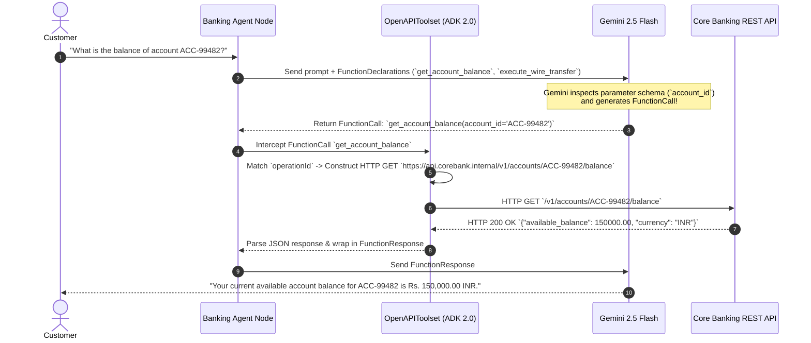

# Module 11: Enterprise Integration with OpenAPI 3.0 Tools

## 🏛️ Executive Overview

In modern enterprise architectures (especially in **Retail, Commercial & Investment Banking**), core business logic resides behind thousands of battle-tested REST APIs—Core Banking Engines, Account Inquiry Gateways, Wire Transfer Switchboards, and Fraud Analytics Services.

When integrating Generative AI into enterprise banking systems, writing hand-crafted Python `requests` wrappers for 500+ endpoints creates massive technical debt, security vulnerabilities, and brittle code.

As a **Google Forward-Deployed Engineer (FDE)**, your primary goal is **Zero-Adapter Integration**: converting authoritative OpenAPI 3.0 (Swagger) specifications directly into typed, executable Gemini `FunctionDeclaration` tools using **`OpenAPIToolset`** in ADK 2.0.

---

## 📋 Requirements-to-Code Matrix (Core Banking Architecture)

| # | Enterprise Banking Requirement | Technical Risk / Challenge | ADK 2.0 Solution Pattern | Implementation Mechanism |
|---|---|---|---|---|
| **1** | *"Query customer account balance from Core Banking API (`GET /v1/accounts/{account_id}/balance`)."* | **Manual Adapter Debt:** Writing custom Python `requests` wrappers for every endpoint creates brittle code. | **OpenAPI Auto-Synthesis:** ADK ingests the OpenAPI spec and synthesizes `get_account_balance` tool. | `OpenAPIToolset(spec_str=json.dumps(spec))` |
| **2** | *"Execute intra-bank wire transfers (`POST /v1/transfers`)."* | **Schema Mismatch:** LLMs passing invalid payload parameters causes HTTP 422 errors. | **JSON Schema Guardrails:** ADK maps OpenAPI `requestBody` schema into Gemini's `FunctionDeclaration`. | `operationId: execute_wire_transfer` |
| **3** | *"Protect OAuth2 Bearer Tokens & API Keys from leaking into LLM prompts."* | **Credential Leakage:** Passing API tokens in LLM prompt text exposes credentials to loggers/models. | **Header Injection via Transport Layer:** Pass authentication headers directly at the HTTP transport layer. | `headers={"Authorization": f"Bearer {token}"}` |
| **4** | *"Filter sensitive endpoints (e.g. restrict `/v1/admin/delete_account`)."* | **Privilege Escalation:** LLMs attempting to call dangerous administrative endpoints. | **Spec Subsetting & Whitelisting:** Strip un-approved paths from the OpenAPI spec before passing to `OpenAPIToolset`. | Spec dict filtering in Python |

---

## 🎓 Part 1: Progressive Learning Path (Basic to Advanced)

### Level 1: Understanding OpenAPI 3.0 Specification Anatomy

An OpenAPI 3.0 specification is a machine-readable JSON or YAML document describing RESTful HTTP endpoints. Key fields parsed by ADK 2.0 include:

* **`openapi`**: The specification version (e.g. `"3.0.0"`).
* **`info`**: API title, version, and description.
* **`servers`**: Base target URLs (`https://api.corebank.internal/v1`).
* **`paths`**: Endpoint routes (e.g., `/accounts/{account_id}/balance`, `/transfers`).
* **`operationId`**: **THE MOST CRITICAL FIELD**. ADK uses `operationId` as the unique tool name exposed to Gemini (e.g. `operationId: "get_account_balance"`).
* **`parameters`**: Path and query parameters, including data types and required flags.
* **`requestBody`**: JSON payload schema for `POST`/`PUT` requests.
* **`responses`**: Expected HTTP status codes (e.g. `200 OK`, `400 Bad Request`).

---

### Level 2: Synthesizing Tools with `OpenAPIToolset`

In ADK 2.0, `OpenAPIToolset` ingests OpenAPI specs directly without writing boilerplate wrapper functions:

```python
import json
from google.adk.tools.openapi_tool import OpenAPIToolset

# 1. Parse JSON spec string or load from file/URL
toolset = OpenAPIToolset(spec_str=json.dumps(OPENAPI_SPEC_DICT), spec_str_type="json")

# 2. Attach toolset directly to Agent tools list
agent = Agent(name="banking_agent", tools=[toolset])
```

---

### Level 3: Zero-Trust Security & Authentication Headers

In enterprise banking, endpoints require strict authentication (OAuth2 Bearer Tokens, Mutual TLS, API Keys).

> [!CAUTION]
> **Zero-Trust Security Rule:** NEVER pass API keys, OAuth tokens, or JWTs in prompt instructions or function parameters! Doing so exposes credentials to telemetry logs and model context windows.

Security headers should be injected at the HTTP transport layer or handled by authenticated gateway proxies so credentials remain completely hidden from LLM prompt text.

---

### Level 4: Enterprise Guardrails & Defensive API Tooling

* **Spec Whitelisting:** When dealing with 1,000+ endpoint specs, filter the dictionary to expose ONLY business-approved operations to Gemini, reducing prompt token bloat and preventing accidental invocation of administrative endpoints.
* **Defensive Error Handling:** Handle HTTP 401 (Unauthorized), 403 (Forbidden), 404 (Not Found), and 422 (Validation Error) gracefully so the agent explains API issues politely without crashing the execution loop.

---

## ⚙️ Part 2: Hands-on Enterprise Banking Solution Code

Below is the complete, production-grade Python solution demonstrating a Banking Agent connected to a Core Banking OpenAPI 3.0 specification:

```python
"""
Enterprise Banking Agent with OpenAPI 3.0 Toolset (ADK 2.0)

This module demonstrates zero-adapter integration with a Core Banking REST API
by dynamically ingesting an OpenAPI 3.0 specification using `OpenAPIToolset`.
"""

import json
from google.adk import Agent
from google.adk.tools.openapi_tool import OpenAPIToolset

# ============================================================================
# SECTION 1: CORE BANKING OPENAPI 3.0 SPECIFICATION DEFINITION
# In production, this spec is loaded from an API Gateway URL or a local spec file.
# ============================================================================
CORE_BANKING_OPENAPI_SPEC = {
    "openapi": "3.0.0",
    "info": {
        "title": "Core Banking REST API Gateway",
        "version": "1.0.0",
        "description": "Enterprise microservice gateway for account balance inquiries and wire transfers.",
    },
    "servers": [
        {
            "url": "https://api.corebank.internal/v1",
            "description": "Production Core Banking Gateway",
        }
    ],
    "paths": {
        "/accounts/{account_id}/balance": {
            "get": {
                "operationId": "get_account_balance",
                "summary": "Retrieve real-time ledger balance for a customer account.",
                "parameters": [
                    {
                        "name": "account_id",
                        "in": "path",
                        "required": True,
                        "description": "The unique 10-digit customer account identifier.",
                        "schema": {"type": "string"},
                    }
                ],
                "responses": {
                    "200": {
                        "description": "Account balance retrieved successfully.",
                        "content": {
                            "application/json": {
                                "schema": {
                                    "type": "object",
                                    "properties": {
                                        "account_id": {"type": "string"},
                                        "currency": {"type": "string"},
                                        "available_balance": {"type": "number"},
                                        "ledger_balance": {"type": "number"},
                                    },
                                    "required": [
                                        "account_id",
                                        "currency",
                                        "available_balance",
                                    ],
                                }
                            }
                        },
                    }
                },
            }
        },
        "/transfers": {
            "post": {
                "operationId": "execute_wire_transfer",
                "summary": "Initiate an intra-bank funds transfer between two accounts.",
                "requestBody": {
                    "required": True,
                    "content": {
                        "application/json": {
                            "schema": {
                                "type": "object",
                                "properties": {
                                    "source_account": {
                                        "type": "string",
                                        "description": "Originating account ID.",
                                    },
                                    "destination_account": {
                                        "type": "string",
                                        "description": "Recipient account ID.",
                                    },
                                    "amount": {
                                        "type": "number",
                                        "description": "Transfer amount in INR/USD.",
                                    },
                                    "remarks": {
                                        "type": "string",
                                        "description": "Payment reference note.",
                                    },
                                },
                                "required": [
                                    "source_account",
                                    "destination_account",
                                    "amount",
                                ],
                            }
                        }
                    },
                },
                "responses": {
                    "200": {
                        "description": "Transfer executed successfully.",
                        "content": {
                            "application/json": {
                                "schema": {
                                    "type": "object",
                                    "properties": {
                                        "transaction_id": {"type": "string"},
                                        "status": {"type": "string"},
                                        "timestamp": {"type": "string"},
                                    },
                                    "required": ["transaction_id", "status"],
                                }
                            }
                        },
                    }
                },
            }
        },
    },
}

# ============================================================================
# SECTION 2: OPENAPI TOOLSET SYNTHESIS
# ============================================================================
# Convert the OpenAPI dictionary into a JSON string and pass to OpenAPIToolset.
# ADK automatically parses path parameters, request bodies, and operationIds.
banking_toolset = OpenAPIToolset(
    spec_str=json.dumps(CORE_BANKING_OPENAPI_SPEC), spec_str_type="json"
)

# ============================================================================
# SECTION 3: AGENT REGISTRATION
# ============================================================================
# Pass `banking_toolset` directly into the `tools=[...]` list.
root_agent = Agent(
    name="core_banking_agent",
    model="gemini-2.5-flash",
    description="An enterprise banking assistant connected to Core Banking REST APIs via OpenAPI 3.0.",
    instruction="""
You are an enterprise Core Banking Assistant.
Your primary role is to help authorized customers query account balances and execute transfers.

Tool Usage Guidance:
1. Use `get_account_balance` when a user asks for their balance or account status.
2. Use `execute_wire_transfer` when a user requests a fund transfer to another account.
3. State all transaction IDs and balance figures clearly and professionally.
""",
    tools=[banking_toolset],
)
```

---

## 🔬 Part 3: Under the Hood — How ADK Executes OpenAPI Specs

Here is the exact runtime sequence when Gemini invokes an OpenAPI tool generated by `OpenAPIToolset`:



---

## ❓ Self-Reflection & Enterprise Interview Prep

1. **Why is `operationId` mandatory in OpenAPI specs when used with ADK 2.0?**
   * *Answer:* ADK's `OpenAPIToolset` uses `operationId` as the unique tool name exposed to Gemini in FunctionDeclarations. If an operation lacks an `operationId`, ADK cannot assign a deterministic name to the generated tool, leading to schema registration failures.

2. **How do you pass OAuth2 Bearer Tokens or API keys securely without putting them in the prompt?**
   * *Answer:* Credentials must be injected at the HTTP transport layer (via HTTP Client headers or custom session proxies), completely isolated from the LLM prompt. Passing tokens in prompt text exposes them to logging services, telemetry, and potential prompt leakage.

3. **How does `OpenAPIToolset` handle complex nested JSON request bodies for POST endpoints?**
   * *Answer:* `OpenAPIToolset` reads the JSON Schema inside `requestBody.content['application/json'].schema`, converting nested object structures into typed Gemini parameter definitions so the model supplies properly formatted JSON payloads.

---

## 📚 Official References

- **Google ADK Tools Documentation:** https://google.github.io/adk-docs/tools/
- **OpenAPI 3.0 Specification:** https://spec.openapis.org/oas/v3.0.3
- **Google GenAI Python SDK:** https://googleapis.github.io/python-genai/

<!-- © 2026 Inder Chauhan (https://github.com/inderanz/google-adk-training). All rights reserved. Ref: IC-ADK-module11-openapi-tools-README -->
