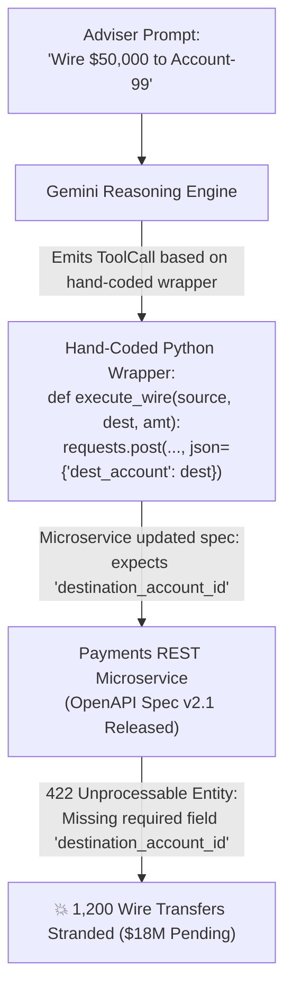
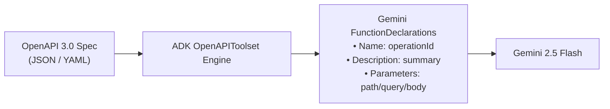
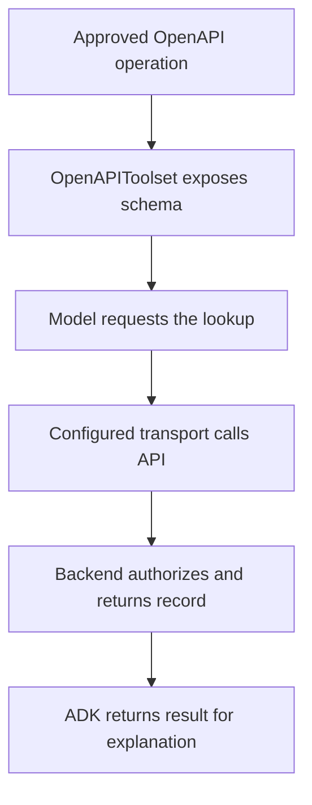

# Module 11: Enterprise Integration with OpenAPI 3.0 Tools

## Before you begin: what this module teaches
## Before You Begin: What This Module Teaches

**ADK concept: OpenAPI tool generation and API ownership.**
In [Module 09](../module09-intro-custom-function-tools/README.md) and [Module 10](../module10-advanced-function-tools/README.md), you learned how to write individual custom Python tools and maintain stateful context using `ToolContext`.

An OpenAPI document describes paths, operations, parameters, responses and security schemes. An operationId identifies an operation in that contract. OpenAPIToolset adapts supported operations into agent tools; it does not implement the remote API or grant access to it. A specification is like a records desk's request form: the desk still validates and authorizes the actual request.
However, in large enterprise architectures—such as commercial banking, telecommunications, insurance, and healthcare—core business systems rarely expose raw Python functions. Instead, business capabilities reside behind hundreds or thousands of battle-tested microservices governed by formal **OpenAPI 3.0 (Swagger)** contracts.

**Where you would use this in real work.**
Writing bespoke Python `requests` wrappers for 500+ endpoints creates severe technical debt, schema drift, and security vulnerabilities.

The bank owns an approved case API with a documented read operation. Meera's assistant should reuse that contract instead of inventing another way to query the same record.
In Google Agent Development Kit (ADK) 2.0, the enterprise solution is **Zero-Adapter OpenAPI Synthesis** powered by **`OpenAPIToolset`**.

**Connection to Gemini Enterprise Agent Platform and Google Cloud.**
By the end of this module, you will understand:
1. **Zero-Adapter Synthesis:** How ADK dynamically ingests OpenAPI 3.0 JSON/YAML specifications and auto-generates executable Gemini `FunctionDeclaration` tools.
2. **The Primacy of `operationId`:** Why `operationId` is the single most critical attribute in an enterprise OpenAPI specification.
3. **Transport-Layer Security:** How to inject OAuth2 Bearer tokens and API keys at the HTTP transport layer without leaking credentials into model prompts.
4. **Spec Subsetting & Whitelisting:** How to filter massive enterprise API specs down to only the approved, least-privilege operations visible to Gemini.
5. **Hermetic In-Memory Testing:** How Google FDEs use `httpx.MockTransport` via `httpx_client_factory` to test private intranet hostnames (`.internal`) locally without network or VPN dependencies.

ADK provides the toolset. The bank's API service, optionally governed through Apigee, enforces business access and request constraints. Review the generated tool schema and expose only the approved operations, rather than offering an entire administrative API to the model.
---

**By the end, you should be able to:**
## 1. The Scenario: The Breaking API Drift Disaster at GlobalCore Bank

- Map a single OpenAPI operation into its generated tool arguments.
- Separate schema generation from remote authentication and authorization.
- Handle denied, missing and unavailable results without inventing success.
To understand why hand-crafted API wrappers fail in enterprise production, consider the post-mortem from **GlobalCore Bank**, an international commercial institution processing over \$40B in daily transactions.

### Review this lesson through three perspectives


- **Python/ADK beginner:** Identify path parameters, request body and response fields.
- **Experienced engineer:** Test the generated schema and unsupported spec features against the actual endpoint.
- **Bank FDE:** Ask which API/version is approved and which operations must never be exposed.
### The Incident
GlobalCore deployed an autonomous wealth management copilot to help portfolio advisers execute customer transactions. To connect the agent to the bank's core payments gateway, the engineering team wrote custom Python wrappers using `requests`:

Use the [guided lab](./lab.md) to observe the mechanism, then compare with the [solution](./lab-solution.md). The banking scenario above explains how to transfer the concept; a lab using a railway, weather or shopping fixture does not implement a live bank integration.
```python
# The Fragile Hand-Coded Wrapper (Anti-Pattern)
def execute_wire_transfer(source_account: str, dest_account: str, amount: float):
    """Sends a wire transfer via the core banking API."""
    payload = {
        "source_account": source_account,
        "dest_account": dest_account,  # Fragile assumption!
        "amount": amount
    }
    response = requests.post("https://api.globalcore.internal/v1/transfers", json=payload)
    return response.json()
```

## 🏛️ Executive Overview
Over a weekend, the Core Payments engineering team deployed an internal security patch:
1. They updated the field name from `dest_account` to `destination_account_id` to comply with ISO 20022 messaging standards.
2. They added a required header: `X-Idempotency-Key`.
3. They published the updated **OpenAPI 3.0 specification** to the enterprise developer portal.

In modern enterprise architectures (especially in **Retail, Commercial & Investment Banking**), core business logic resides behind thousands of battle-tested REST APIs—Core Banking Engines, Account Inquiry Gateways, Wire Transfer Switchboards, and Fraud Analytics Services.
On Monday morning, the hand-coded agent wrappers silently broke. Because the Python wrapper was not synchronized with the authoritative OpenAPI specification:
- Every transfer request sent by the agent failed with `HTTP 422 Unprocessable Entity`.
- Over 1,200 commercial transactions were stranded midway, freezing \$18M in customer capital.
- The advisory desk was overwhelmed with angry calls, triggering emergency incident triage and regulatory reporting audits.

When integrating Generative AI into enterprise banking systems, writing hand-crafted Python `requests` wrappers for 500+ endpoints creates massive technical debt, security vulnerabilities, and brittle code.
### The Google FDE Verdict
Google Cloud Principal Forward-Deployed Engineers were summoned to conduct the root-cause analysis:
> *"Writing bespoke Python HTTP wrappers for enterprise REST APIs creates brittle impedance mismatch. The OpenAPI specification is the single source of truth for the enterprise. In ADK 2.0, you must never write manual HTTP glue code; you must synthesize tools directly from authoritative OpenAPI contracts using `OpenAPIToolset`."*

As a **Google Forward-Deployed Engineer (FDE)**, your primary goal is **Zero-Adapter Integration**: converting authoritative OpenAPI 3.0 (Swagger) specifications directly into typed, executable Gemini `FunctionDeclaration` tools using **`OpenAPIToolset`** in ADK 2.0.

---

## 📋 Requirements-to-Code Matrix (Core Banking Architecture)
## 2. The Core Mental Model: Manual Translator vs. Direct Protocol Terminal

| # | Enterprise Banking Requirement | Technical Risk / Challenge | ADK 2.0 Solution Pattern | Implementation Mechanism |
|---|---|---|---|---|
| **1** | *"Query customer account balance from Core Banking API (`GET /v1/accounts/{account_id}/balance`)."* | **Manual Adapter Debt:** Writing custom Python `requests` wrappers for every endpoint creates brittle code. | **OpenAPI Auto-Synthesis:** ADK ingests the OpenAPI spec and synthesizes `get_account_balance` tool. | `OpenAPIToolset(spec_str=json.dumps(spec))` |
| **2** | *"Execute intra-bank wire transfers (`POST /v1/transfers`)."* | **Schema Mismatch:** LLMs passing invalid payload parameters causes HTTP 422 errors. | **JSON Schema Guardrails:** ADK maps OpenAPI `requestBody` schema into Gemini's `FunctionDeclaration`. | `operationId: execute_wire_transfer` |
| **3** | *"Protect OAuth2 Bearer Tokens & API Keys from leaking into LLM prompts."* | **Credential Leakage:** Passing API tokens in LLM prompt text exposes credentials to loggers/models. | **Header Injection via Transport Layer:** Pass authentication headers directly at the HTTP transport layer. | `headers={"Authorization": f"Bearer {token}"}` |
| **4** | *"Filter sensitive endpoints (e.g. restrict `/v1/admin/delete_account`)."* | **Privilege Escalation:** LLMs attempting to call dangerous administrative endpoints. | **Spec Subsetting & Whitelisting:** Strip un-approved paths from the OpenAPI spec before passing to `OpenAPIToolset`. | Spec dict filtering in Python |
Compare the two architectural approaches to enterprise API integration:

```text
┌─────────────────────────────────────────────────────────────────────────────┐
│                 MANUAL ADAPTER vs. ZERO-ADAPTER OPENAPI                     │
├─────────────────────────────────────────────────────────────────────────────┤
│                                                                             │
│  [ Approach A: The Manual Python Wrapper (Fragile Anti-Pattern) ]           │
│  Developer writes:                                                          │
│  • Hand-crafted Python function with custom type hints.                     │
│  • Manual requests.post() call with hardcoded JSON dictionary keys.         │
│  • Custom error handling & response parsing.                                │
│  RESULT: High maintenance debt; breaks whenever the upstream API evolves.   │
│                                                                             │
│  [ Approach B: Zero-Adapter OpenAPI Synthesis (ADK 2.0 Standard) ]         │
│  Developer provides:                                                        │
│  • Authoritative OpenAPI 3.0 specification (JSON or YAML).                  │
│  • ADK OpenAPIToolset auto-inspects endpoints, parameters, and bodies.     │
│  • Automatically emits typed Gemini FunctionDeclarations.                   │
│  RESULT: Zero glue code; tools automatically track upstream API changes.    │
│                                                                             │
└─────────────────────────────────────────────────────────────────────────────┘
```

---

## 🎓 Part 1: Progressive Learning Path (Basic to Advanced)
## 3. Deep Architecture: How `OpenAPIToolset` Operates in ADK 2.0

### Level 1: Understanding OpenAPI 3.0 Specification Anatomy
When you instantiate `OpenAPIToolset`, ADK parses the OpenAPI 3.0 document and constructs tool definitions dynamically:

An OpenAPI 3.0 specification is a machine-readable JSON or YAML document describing RESTful HTTP endpoints. Key fields parsed by ADK 2.0 include:


* **`openapi`**: The specification version (e.g. `"3.0.0"`).
* **`info`**: API title, version, and description.
* **`servers`**: Base target URLs (`https://api.corebank.internal/v1`).
* **`paths`**: Endpoint routes (e.g., `/accounts/{account_id}/balance`, `/transfers`).
* **`operationId`**: **THE MOST CRITICAL FIELD**. ADK uses `operationId` as the unique tool name exposed to Gemini (e.g. `operationId: "get_account_balance"`).
* **`parameters`**: Path and query parameters, including data types and required flags.
* **`requestBody`**: JSON payload schema for `POST`/`PUT` requests.
* **`responses`**: Expected HTTP status codes (e.g. `200 OK`, `400 Bad Request`).
### The Translation Pipeline

| OpenAPI 3.0 Construct | Generated Gemini Tool Element | Engineering Significance |
| :--- | :--- | :--- |
| **`operationId`** | **Tool Function Name** | **Mandatory.** Dictates the exact function name Gemini invokes (e.g., `get_account_balance`). |
| **`summary` / `description`** | **Tool Description** | Provides the semantic prompt guiding Gemini on *when* to invoke the endpoint. |
| **`parameters` (`in: path`)** | **Required Argument** | Converted into a named parameter (e.g. `account_id: str`). |
| **`parameters` (`in: query`)** | **Optional/Query Arg** | Converted into keyword arguments with default values. |
| **`requestBody` (`application/json`)** | **Nested Object Schema** | Converted into a structured JSON parameter schema for `POST`/`PUT` endpoints. |

---

### Level 2: Synthesizing Tools with `OpenAPIToolset`
## 4. The 4 Production Pillars of Enterprise OpenAPI Tooling

In ADK 2.0, `OpenAPIToolset` ingests OpenAPI specs directly without writing boilerplate wrapper functions:
### Pillar 1: The Absolute Primacy of `operationId`
In typical web REST development, developers often omit `operationId` because web browsers rely strictly on HTTP paths (`GET /accounts/123`).
In ADK 2.0, **`operationId` is non-negotiable**:
- `OpenAPIToolset` uses `operationId` as the unique tool name exposed to Gemini.
- If `operationId` is missing, ADK either generates an unreadable synthetic name (e.g., `get_v1_accounts_account_id_balance`) or fails to bind the tool reliably.
- **Production Rule:** Always ensure every path operation in your spec defines a clean, snake_case `operationId` (`get_account_balance`, `execute_wire_transfer`).

### Pillar 2: Transport-Layer Security & Header Injection
In enterprise systems, internal APIs require authentication:
- OAuth2 Bearer Tokens (`Authorization: Bearer <JWT>`)
- Mutual TLS (mTLS) client certificates
- Enterprise API keys (`X-API-Key: ...`)

> [!CAUTION]
> **Zero-Trust Security Violation:**
> NEVER pass authentication tokens, passwords, or API keys as parameters in Gemini prompts or function arguments! Doing so exposes credentials in telemetry logs, prompt caches, and user-facing transcripts.

**The Solution:** Inject headers at the HTTP transport layer using `httpx_client_factory`. The model never sees the credentials; they are attached automatically during outbound dispatch:

```python
import json
import httpx
from google.adk.tools.openapi_tool import OpenAPIToolset

# 1. Parse JSON spec string or load from file/URL
toolset = OpenAPIToolset(spec_str=json.dumps(OPENAPI_SPEC_DICT), spec_str_type="json")
# Inject authenticated headers at the transport layer:
def custom_client_factory():
    return httpx.AsyncClient(
        headers={"Authorization": f"Bearer {SECURE_VAULT_TOKEN}"},
        timeout=10.0
    )

# 2. Attach toolset directly to Agent tools list
agent = Agent(name="banking_agent", tools=[toolset])
toolset = OpenAPIToolset(
    spec_str=spec_json,
    spec_str_type="json",
    httpx_client_factory=custom_client_factory
)
```

---
### Pillar 3: Spec Subsetting & Endpoint Whitelisting
Large enterprise systems often have monolithic OpenAPI specifications covering 500+ endpoints. Exposing all 500 endpoints to Gemini causes:
1. **Context Window Exhaustion:** Tool schemas consume thousands of prompt tokens.
2. **Tool Routing Confusion:** Gemini hallucinates or routes requests to incorrect endpoints.
3. **Privilege Escalation:** The agent might invoke dangerous administrative routes (e.g. `DELETE /accounts/{id}`).

### Level 3: Zero-Trust Security & Authentication Headers
**Production Rule:** Filter the OpenAPI specification dictionary before instantiating `OpenAPIToolset`. Strip un-approved paths and expose only the specific operations required for the agent's business role:

In enterprise banking, endpoints require strict authentication (OAuth2 Bearer Tokens, Mutual TLS, API Keys).
```python
# Whitelist only approved business operations:
ALLOWED_OPERATIONS = {"get_account_balance", "execute_wire_transfer"}

> [!CAUTION]
> **Zero-Trust Security Rule:** NEVER pass API keys, OAuth tokens, or JWTs in prompt instructions or function parameters! Doing so exposes credentials to telemetry logs and model context windows.
filtered_spec = filter_openapi_spec(RAW_SPEC, ALLOWED_OPERATIONS)
toolset = OpenAPIToolset(spec_str=json.dumps(filtered_spec), spec_str_type="json")
```

Security headers should be injected at the HTTP transport layer or handled by authenticated gateway proxies so credentials remain completely hidden from LLM prompt text.
### Pillar 4: Hermetic In-Memory Testing (`[Errno 8]` DNS Defense)
When building enterprise agents, target URLs frequently point to private corporate intranets:
`https://api.apexbank.internal/v1`

---
When developers test locally, their operating system throws an immediate DNS resolution error:
```text
ConnectError: [Errno 8] nodename nor servname provided, or not known
```
Because the developer's laptop is not on the corporate VPN, macOS/Linux DNS cannot resolve `.internal` hostnames.

### Level 4: Enterprise Guardrails & Defensive API Tooling
**The Google FDE Solution:** Use `httpx.MockTransport` via `httpx_client_factory`. This intercepts outbound HTTP requests **entirely in memory inside the Python process**, simulating realistic 200 OK or 422 responses with zero network calls, zero DNS lookups, and zero risk to production data:

* **Spec Whitelisting:** When dealing with 1,000+ endpoint specs, filter the dictionary to expose ONLY business-approved operations to Gemini, reducing prompt token bloat and preventing accidental invocation of administrative endpoints.
* **Defensive Error Handling:** Handle HTTP 401 (Unauthorized), 403 (Forbidden), 404 (Not Found), and 422 (Validation Error) gracefully so the agent explains API issues politely without crashing the execution loop.
```python
import httpx

def mock_banking_handler(request: httpx.Request) -> httpx.Response:
    if request.url.path.endswith("/balance"):
        return httpx.Response(200, json={"balance": 15420.50, "currency": "USD"})
    elif request.url.path.endswith("/transfers"):
        return httpx.Response(201, json={"tx_id": "TX-9021", "status": "COMPLETED"})
    return httpx.Response(404, json={"error": "Not Found"})

# Intercept all outbound HTTP calls in memory:
mock_client_factory = lambda: httpx.AsyncClient(
    transport=httpx.MockTransport(mock_banking_handler)
)

toolset = OpenAPIToolset(
    spec_str=spec_json,
    spec_str_type="json",
    httpx_client_factory=mock_client_factory
)
```

---

## ⚙️ Part 2: Hands-on Enterprise Banking Solution Code
## 5. Complete Reference Architecture: Enterprise Banking Agent

Below is the complete, production-grade Python solution demonstrating a Banking Agent connected to a Core Banking OpenAPI 3.0 specification:
Here is the production-grade implementation of an enterprise Core Banking Agent using `OpenAPIToolset` and `httpx.MockTransport`:

```python
"""
Enterprise Banking Agent with OpenAPI 3.0 Toolset (ADK 2.0)

This module demonstrates zero-adapter integration with a Core Banking REST API
by dynamically ingesting an OpenAPI 3.0 specification using `OpenAPIToolset`.
core_banking_openapi_agent.py
Enterprise Core Banking Agent using ADK 2.0 OpenAPIToolset with in-memory transport mocking.
"""

import json
import httpx
from google.adk import Agent
from google.adk.tools.openapi_tool import OpenAPIToolset

# ============================================================================
# SECTION 1: CORE BANKING OPENAPI 3.0 SPECIFICATION DEFINITION
# In production, this spec is loaded from an API Gateway URL or a local spec file.
# ============================================================================
CORE_BANKING_OPENAPI_SPEC = {
# 1. Authoritative OpenAPI 3.0 Specification
CORE_BANKING_SPEC = {
    "openapi": "3.0.0",
    "info": {
        "title": "Core Banking REST API Gateway",
        "title": "Apex Core Banking REST Gateway",
        "version": "1.0.0",
        "description": "Enterprise microservice gateway for account balance inquiries and wire transfers.",
        "description": "Enterprise API for balance inquiries and funds transfers.",
    },
    "servers": [
        {
            "url": "https://api.corebank.internal/v1",
            "description": "Production Core Banking Gateway",
        }
    ],
    "servers": [{"url": "https://api.apexbank.internal/v1"}],
    "paths": {
        "/accounts/{account_id}/balance": {
            "get": {
                "operationId": "get_account_balance",
                "summary": "Retrieve real-time ledger balance for a customer account.",
                "summary": "Retrieve the current ledger balance for an account.",
                "parameters": [
                    {
                        "name": "account_id",
                        "in": "path",
                        "required": True,
                        "description": "The unique 10-digit customer account identifier.",
                        "schema": {"type": "string"},
                        "description": "The unique customer account ID (e.g. 'ACC-88392')."
                    }
                ],
                "responses": {
                    "200": {
                        "description": "Account balance retrieved successfully.",
                        "description": "Balance retrieved successfully.",
                        "content": {
                            "application/json": {
                                "schema": {
                                    "type": "object",
                                    "properties": {
                                        "account_id": {"type": "string"},
                                        "currency": {"type": "string"},
                                        "available_balance": {"type": "number"},
                                        "ledger_balance": {"type": "number"},
                                    },
                                    "required": [
                                        "account_id",
                                        "currency",
                                        "available_balance",
                                    ],
                                        "currency": {"type": "string"}
                                    }
                                }
                            }
                        },
                        }
                    }
                },
                }
            }
        },
        "/transfers": {
            "post": {
                "operationId": "execute_wire_transfer",
                "summary": "Initiate an intra-bank funds transfer between two accounts.",
                "summary": "Execute an intra-bank funds transfer between accounts.",
                "requestBody": {
                    "required": True,
                    "content": {
                        "application/json": {
                            "schema": {
                                "type": "object",
                                "properties": {
                                    "source_account": {
                                        "type": "string",
                                        "description": "Originating account ID.",
                                    },
                                    "destination_account": {
                                        "type": "string",
                                        "description": "Recipient account ID.",
                                    },
                                    "amount": {
                                        "type": "number",
                                        "description": "Transfer amount in INR/USD.",
                                    },
                                    "remarks": {
                                        "type": "string",
                                        "description": "Payment reference note.",
                                    },
                                    "source_account": {"type": "string"},
                                    "destination_account": {"type": "string"},
                                    "amount": {"type": "number"},
                                    "currency": {"type": "string"}
                                },
                                "required": [
                                    "source_account",
                                    "destination_account",
                                    "amount",
                                ],
                                "required": ["source_account", "destination_account", "amount", "currency"]
                            }
                        }
                    },
                    }
                },
                "responses": {
                    "200": {
                    "201": {
                        "description": "Transfer executed successfully.",
                        "content": {
                            "application/json": {
                                "schema": {
                                    "type": "object",
                                    "properties": {
                                        "transaction_id": {"type": "string"},
                                        "status": {"type": "string"},
                                        "timestamp": {"type": "string"},
                                    },
                                    "required": ["transaction_id", "status"],
                                        "status": {"type": "string"}
                                    }
                                }
                            }
                        },
                        }
                    }
                },
                }
            }
        },
    },
        }
    }
}

# ============================================================================
# SECTION 2: OPENAPI TOOLSET SYNTHESIS
# ============================================================================
# Convert the OpenAPI dictionary into a JSON string and pass to OpenAPIToolset.
# ADK automatically parses path parameters, request bodies, and operationIds.
# 2. Hermetic In-Memory Mock Transport (Handles private intranet DNS safely)
def mock_banking_handler(request: httpx.Request) -> httpx.Response:
    if "/balance" in request.url.path:
        return httpx.Response(200, json={
            "account_id": "ACC-88392",
            "available_balance": 24500.75,
            "currency": "USD"
        })
    elif "/transfers" in request.url.path:
        payload = json.loads(request.content)
        return httpx.Response(201, json={
            "transaction_id": "TX-WIRE-99201",
            "status": "SETTLED",
            "amount_transferred": payload.get("amount")
        })
    return httpx.Response(404, json={"error": "Not Found"})

# 3. Instantiate OpenAPIToolset with Transport Mock
banking_toolset = OpenAPIToolset(
    spec_str=json.dumps(CORE_BANKING_OPENAPI_SPEC), spec_str_type="json"
    spec_str=json.dumps(CORE_BANKING_SPEC),
    spec_str_type="json",
    httpx_client_factory=lambda: httpx.AsyncClient(
        transport=httpx.MockTransport(mock_banking_handler)
    )
)

# ============================================================================
# SECTION 3: AGENT REGISTRATION
# ============================================================================
# Pass `banking_toolset` directly into the `tools=[...]` list.
# 4. Bind Toolset to Root Agent
root_agent = Agent(
    name="core_banking_agent",
    model="gemini-2.5-flash",
    description="An enterprise banking assistant connected to Core Banking REST APIs via OpenAPI 3.0.",
    description="Enterprise banking agent connected to Core Banking REST APIs via OpenAPI 3.0.",
    instruction="""
You are an enterprise Core Banking Assistant.
Your primary role is to help authorized customers query account balances and execute transfers.

Tool Usage Guidance:
1. Use `get_account_balance` when a user asks for their balance or account status.
2. Use `execute_wire_transfer` when a user requests a fund transfer to another account.
3. State all transaction IDs and balance figures clearly and professionally.
When the user asks for their account balance, invoke `get_account_balance`.
When the user asks to transfer funds, invoke `execute_wire_transfer`.
Always confirm transaction IDs and dollar figures clearly.
""",
    tools=[banking_toolset],
)
```

---

## 🔬 Part 3: Under the Hood — How ADK Executes OpenAPI Specs
## 6. Summary & Enterprise Checklist

Here is the exact runtime sequence when Gemini invokes an OpenAPI tool generated by `OpenAPIToolset`:
Before approving any OpenAPI-integrated agent for staging or production, verify all 6 gates:


- [ ] **`operationId` Defined:** Every path operation in the OpenAPI document has an explicit, readable `operationId`.
- [ ] **Transport-Layer Security:** API keys and Bearer tokens are injected via `httpx_client_factory`, never in prompt text.
- [ ] **Spec Subsetting:** Monolithic specs are filtered to expose only approved business endpoints, preventing privilege escalation.
- [ ] **Hermetic Testing:** Local testing uses `httpx.MockTransport` to prevent DNS crashes against private intranet domains.
- [ ] **Schema Validation:** All request body schemas define explicit types (`string`, `number`, `boolean`) and `required` arrays.
- [ ] **Resilient Error Responses:** The mock or live API returns structured JSON error payloads for 4xx/5xx responses rather than dropping connections.

---

## ❓ Self-Reflection & Enterprise Interview Prep
## Official References & Citations

1. **Why is `operationId` mandatory in OpenAPI specs when used with ADK 2.0?**
   * *Answer:* ADK's `OpenAPIToolset` uses `operationId` as the unique tool name exposed to Gemini in FunctionDeclarations. If an operation lacks an `operationId`, ADK cannot assign a deterministic name to the generated tool, leading to schema registration failures.

2. **How do you pass OAuth2 Bearer Tokens or API keys securely without putting them in the prompt?**
   * *Answer:* Credentials must be injected at the HTTP transport layer (via HTTP Client headers or custom session proxies), completely isolated from the LLM prompt. Passing tokens in prompt text exposes them to logging services, telemetry, and potential prompt leakage.

3. **How does `OpenAPIToolset` handle complex nested JSON request bodies for POST endpoints?**
   * *Answer:* `OpenAPIToolset` reads the JSON Schema inside `requestBody.content['application/json'].schema`, converting nested object structures into typed Gemini parameter definitions so the model supplies properly formatted JSON payloads.

---

## 📚 Official References

- **Google ADK Tools Documentation:** https://google.github.io/adk-docs/tools/
- **OpenAPI 3.0 Specification:** https://spec.openapis.org/oas/v3.0.3
- **Google GenAI Python SDK:** https://googleapis.github.io/python-genai/

## Continue the course story

Previous: [Module 10](../module10-advanced-function-tools/README.md) · Next: [Module 11.5](../module11_5-enterprise-credit-underwriting/README.md) · [See how the concepts build](../learning-journey.md)

Before continuing, explain one input, one ADK execution boundary and one failure outcome from this module. Use the next chapter to add a new customer requirement, not merely another component.

<!-- © 2026 Inder Chauhan (https://github.com/inderanz/google-adk-training). All rights reserved. Ref: IC-ADK-module11-openapi-tools-README -->
- **Google ADK OpenAPI Tools Reference:**
  [https://adk.dev/tools-custom/openapi-tools/](https://adk.dev/tools-custom/openapi-tools/) *(Accessed November 2026)*
  Canonical specification for `OpenAPIToolset`, schema ingestion, and HTTP client customization.
- **OpenAPI 3.0.3 Specification Standard:**
  [https://spec.openapis.org/oas/v3.0.3](https://spec.openapis.org/oas/v3.0.3) *(Accessed November 2026)*
  Authoritative specification for OpenAPI paths, operations, parameters, and requestBody schemas.
- **Google Gemini API Function Calling:**
  [https://ai.google.dev/gemini-api/docs/function-calling](https://ai.google.dev/gemini-api/docs/function-calling) *(Accessed November 2026)*
  Core specification for OpenAPI parameter extraction and tool schema generation.
- **HTTPX Client & MockTransport Documentation:**
  [https://www.python-httpx.org/advanced/transports/](https://www.python-httpx.org/advanced/transports/) *(Accessed November 2026)*
  Standard for in-memory HTTP mocking and transport-layer header injection in Python.
