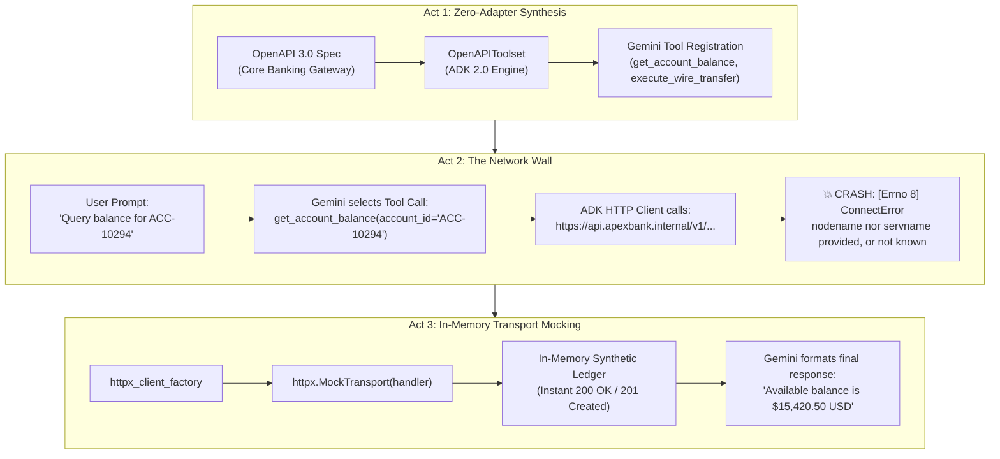

# Lab 11 Solution: Enterprise Core Banking OpenAPI Integration

## 🏛️ Executive Overview & Architecture

In enterprise banking deployments, writing hand-crafted Python `requests` wrappers for microservices creates technical debt, maintenance overhead, and severe security risks.

As a **Google Forward-Deployed Engineer (FDE)**, your standard pattern for enterprise integration is **Zero-Adapter OpenAPI Synthesis**. Using ADK 2.0's **`OpenAPIToolset`**, you map an OpenAPI 3.0 specification directly into executable Gemini tools. Furthermore, by harnessing **`httpx_client_factory`** with in-memory transport mocking, you enable hermetic, zero-trust local development and CI/CD testing without requiring live banking network access.

---

## 🤖 Antigravity / Gemini Steering Prompt Template

When instructing an AI coding assistant (like Antigravity or Gemini) to build OpenAPI tools in ADK 2.0, use this prompt template to guarantee compliance with Google FDE standards:

```text
"You are an expert Google ADK 2.0 Forward-Deployed Engineer. Write an OpenAPI-based Agent node following strict Google ADK 2.0 standards:
1. Import OpenAPIToolset via `from google.adk.tools.openapi_tool import OpenAPIToolset`.
2. Define valid OpenAPI 3.0 specs containing exact `operationId` fields for each endpoint (e.g., `operationId: "get_account_balance"`, `operationId: "execute_wire_transfer"`).
3. Serialize the OpenAPI spec dictionary to a JSON string with `json.dumps(spec)` and pass to `OpenAPIToolset(spec_str=..., spec_str_type="json")`.
4. For hermetic local development and CI/CD testing against private/firewalled hostnames, inject an in-memory transport via `httpx_client_factory=lambda: httpx.AsyncClient(transport=httpx.MockTransport(handler))`.
5. In `Agent(...)`, use `name="..."`, `model="gemini-2.5-flash"`, and the singular `instruction="..."` parameter.
6. Register the toolset instance directly in `tools=[banking_toolset]`.
7. Access LLM response content using `event.content` or `response.content` (NEVER use legacy `.candidates`)."
```

---

## 📋 Requirements-to-Code Technical Matrix

| Enterprise Banking Requirement | OpenAPI 3.0 / ADK Mechanism | Architectural Purpose | Line Reference |
|---|---|---|---|
| *"Query customer ledger balance by account ID."* | `GET /v1/accounts/{account_id}/balance` | `operationId: "get_account_balance"` exposed to Gemini | Lines 87–121 |
| *"Submit intra-bank wire transfer between accounts."* | `POST /v1/transfers` | `operationId: "execute_wire_transfer"` exposed to Gemini | Lines 122–186 |
| *"Synthesize executable tools without writing HTTP wrappers."* | `OpenAPIToolset(spec_str=..., spec_str_type="json")` | Auto-converts OpenAPI operations to Gemini `FunctionDeclaration` | Lines 220–228 |
| *"Hermetic dev/test against private internal DNS hostnames."* | `httpx_client_factory` with `httpx.MockTransport` | Intercepts HTTP traffic in-memory, preventing `[Errno 8]` DNS crashes | Lines 193–218 |
| *"Deploy Wealth Management Advisor agent."* | `Agent(name="wealth_advisor_agent", model="gemini-2.5-flash", ...)` | Root Agent node orchestrating banking tool execution | Lines 230–247 |

---

## 📖 The FDE Journey: From Naive Integration to Zero-Trust Mocking

To truly master enterprise agent development, let's walk through the architectural story—from the beginner's initial assumption to the senior engineer's hermetic test suite.

<!-- TEACHER_NOTE_START -->
**Teacher's note (ADK instructor view):**
- **Learning goal:** Explain the concept clearly from beginner to advanced, with a simple mental model first.
- **Why it matters:** Connect the concept to real Google agentic workflows, Python engineering habits, and production-ready decisions.
- **Version watch:** Validate against the latest official ADK / Google docs before teaching; call out deprecations or migration notes when needed.
- **Module linkage:** Connect this idea to the previous and next modules so learners see the progression across the course.
<!-- TEACHER_NOTE_END -->


### Act 1: The Zero-Adapter Dream (The Basics)
You are tasked with building a Wealth Management Advisor AI agent for Apex Global Financial Services. The core banking system has two REST endpoints:
1. `GET /v1/accounts/{account_id}/balance`
2. `POST /v1/transfers`

A junior developer might reach for `requests` or `urllib`, writing hundreds of lines of brittle boilerplate functions, parameter parsers, and custom Gemini `FunctionDeclaration` dictionaries.

As a Google FDE, you avoid manual glue code. You declare the API's OpenAPI 3.0 specification and pass it to ADK 2.0's **`OpenAPIToolset`**. In a single line of code, ADK inspects every `operationId`, extracts parameter schemas, builds Gemini tool definitions, and registers them automatically.

### Act 2: The Sudden Wall — The `[Errno 8]` DNS Crash (Intermediate)
You start the ADK server with `uv run adk web . --port 8081`, open the Dev UI, and type:
> *"Query balance for account ACC-10294."*

Suddenly, the screen flashes red:
```text
errorCode: "ConnectError"
errorMessage: "[Errno 8] nodename nor servname provided, or not known"
```

What happened? Is the agent broken? Did ADK fail?
**No! Look closely at the execution telemetry:**
1. Gemini understood the user's intent perfectly.
2. Gemini matched the prompt to the synthesized `get_account_balance` tool.
3. Gemini generated the exact argument `{"account_id": "ACC-10294"}`.
4. ADK's HTTP engine dispatched a real network request to:
   `https://api.apexbank.internal/v1/accounts/ACC-10294/balance`

The failure occurred entirely at the **operating system network transport layer**. The domain `api.apexbank.internal` is a fictitious enterprise intranet URL. Because your laptop is not on the Apex Bank internal VPN, macOS/Linux DNS cannot resolve the hostname. `[Errno 8]` is the OS socket resolver telling you: *"I have no idea what IP address corresponds to that name."*

In real-world enterprise banking, production core banking gateways are locked behind zero-trust firewalls, private VPC peering, and mTLS proxies. **You can never — and should never — hit live production banking APIs during local development or continuous integration.**

### Act 3: The Architectural Secret — In-Memory Mocking (Advanced)
How do enterprise teams test their agents without spinning up heavy external Docker mock servers or connecting to private VPNs?

ADK 2.0 provides an extension point: **`httpx_client_factory`**.

When `OpenAPIToolset` issues an HTTP request, it invokes `httpx_client_factory` to obtain an `httpx.AsyncClient`. By pairing this with `httpx.MockTransport`, we intercept the outbound request **in-memory at the Python transport layer**:

<!-- TEACHER_NOTE_START -->
**Teacher's note (ADK instructor view):**
- **Learning goal:** Explain the concept clearly from beginner to advanced, with a simple mental model first.
- **Why it matters:** Connect the concept to real Google agentic workflows, Python engineering habits, and production-ready decisions.
- **Version watch:** Validate against the latest official ADK / Google docs before teaching; call out deprecations or migration notes when needed.
- **Module linkage:** Connect this idea to the previous and next modules so learners see the progression across the course.
<!-- TEACHER_NOTE_END -->
```python
# The request NEVER touches the OS network card or DNS resolver!
mock_client_factory = lambda: httpx.AsyncClient(
    transport=httpx.MockTransport(mock_banking_handler)
)
```

#### Why This Technique is an FDE Superpower:
1. ⚡ **Zero Network Latency & 100% Hermetic:** No DNS lookups, no ports to bind, no socket contention. Unit tests execute in milliseconds.
2. 🛡️ **Zero Blast Radius:** Impossible to accidentally debit real customer accounts or corrupt staging databases during exploratory LLM testing.
3. 🎭 **Failure Injection & Chaos Engineering:** You can effortlessly test edge cases that are difficult to reproduce against live APIs (e.g., simulating HTTP `429 Too Many Requests`, `503 Service Unavailable`, or `403 Insufficient Funds`) with simple `if/elif` branches in the mock handler.
4. 🚀 **CI/CD Ready:** Automated test suites run cleanly inside headless Docker containers and GitHub Actions runners without requiring external services or mock containers.

---

## 💻 Complete Production Code (`agent.py`)

Below is the complete, runnable Python implementation for the Core Banking OpenAPI Integration Agent with built-in hermetic transport mocking:

<!-- TEACHER_NOTE_START -->
**Teacher's note (ADK instructor view):**
- **Learning goal:** Explain the concept clearly from beginner to advanced, with a simple mental model first.
- **Why it matters:** Connect the concept to real Google agentic workflows, Python engineering habits, and production-ready decisions.
- **Version watch:** Validate against the latest official ADK / Google docs before teaching; call out deprecations or migration notes when needed.
- **Module linkage:** Connect this idea to the previous and next modules so learners see the progression across the course.
<!-- TEACHER_NOTE_END -->
```python
# agent.py
"""
Apex Global Financial Services - Core Banking OpenAPI Integration Agent.
Synthesizes RESTful endpoints into typed Gemini tools via ADK 2.0 OpenAPIToolset,
equipped with hermetic in-memory transport mocking for local development and CI/CD.
"""

import json
import httpx
from google.adk import Agent
from google.adk.tools.openapi_tool import OpenAPIToolset

# ============================================================================
# 1. CORE BANKING OPENAPI 3.0 SPECIFICATION
# ============================================================================
# The `operationId` is critical: ADK uses it directly as the synthesized tool name.
# `operationId: "get_account_balance"` -> Tool: `get_account_balance`
# `operationId: "execute_wire_transfer"` -> Tool: `execute_wire_transfer`

CORE_BANKING_SPEC = {
    "openapi": "3.0.0",
    "info": {
        "title": "Apex Core Banking API",
        "description": "Enterprise REST Gateway for account balances and wire transfers.",
        "version": "1.0.0",
    },
    "servers": [
        {
            "url": "https://api.apexbank.internal/v1",
            "description": "Production Core Banking Gateway",
        }
    ],
    "paths": {
        # Endpoint 1: Balance Inquiry (GET)
        "/accounts/{account_id}/balance": {
            "get": {
                "operationId": "get_account_balance",
                "summary": "Retrieve real-time ledger balance for a customer account",
                "description": "Queries the Core Banking Ledger for available balance, ledger balance, and currency.",
                "parameters": [
                    {
                        "name": "account_id",
                        "in": "path",
                        "required": True,
                        "description": "Unique account identifier (e.g. ACC-88392)",
                        "schema": {"type": "string"},
                    }
                ],
                "responses": {
                    "200": {
                        "description": "Successful balance retrieval",
                        "content": {
                            "application/json": {
                                "schema": {
                                    "type": "object",
                                    "properties": {
                                        "account_id": {"type": "string"},
                                        "available_balance": {"type": "number"},
                                        "currency": {"type": "string"},
                                        "status": {"type": "string"},
                                    },
                                }
                            }
                        },
                    }
                },
            }
        },
        # Endpoint 2: Wire Transfer Execution (POST)
        "/transfers": {
            "post": {
                "operationId": "execute_wire_transfer",
                "summary": "Submit an intra-bank wire transfer between accounts",
                "description": "Executes an immediate funds transfer from source to target account.",
                "requestBody": {
                    "required": True,
                    "content": {
                        "application/json": {
                            "schema": {
                                "type": "object",
                                "required": [
                                    "source_account_id",
                                    "target_account_id",
                                    "amount",
                                    "currency",
                                ],
                                "properties": {
                                    "source_account_id": {
                                        "type": "string",
                                        "description": "Debited account ID",
                                    },
                                    "target_account_id": {
                                        "type": "string",
                                        "description": "Credited account ID",
                                    },
                                    "amount": {
                                        "type": "number",
                                        "description": "Transfer amount in specified currency",
                                    },
                                    "currency": {
                                        "type": "string",
                                        "description": "3-letter ISO currency code (e.g. USD, EUR)",
                                    },
                                    "reference_note": {
                                        "type": "string",
                                        "description": "Optional transfer description or memo",
                                    },
                                },
                            }
                        }
                    },
                },
                "responses": {
                    "201": {
                        "description": "Transfer submitted successfully",
                        "content": {
                            "application/json": {
                                "schema": {
                                    "type": "object",
                                    "properties": {
                                        "transaction_id": {"type": "string"},
                                        "status": {"type": "string"},
                                        "timestamp": {"type": "string"},
                                    },
                                }
                            }
                        },
                    }
                },
            }
        },
    },
}

# ============================================================================
# 2. HERMETIC TRANSPORT MOCK HANDLER
# ============================================================================
# Intercepts requests targeting private/unreachable enterprise hostnames in-memory.
# Eliminates DNS resolution errors (`[Errno 8]`) without requiring local mock servers.

def mock_banking_handler(request: httpx.Request) -> httpx.Response:
    url_str = str(request.url)

    # Endpoint 1: Mock Account Balance (GET /accounts/{account_id}/balance)
    if "/accounts/" in url_str and "/balance" in url_str:
        account_id = url_str.split("/accounts/")[1].split("/")[0]
        return httpx.Response(
            status_code=200,
            json={
                "account_id": account_id,
                "available_balance": 15420.50,
                "currency": "USD",
                "status": "ACTIVE",
            },
        )

    # Endpoint 2: Mock Wire Transfer (POST /transfers)
    elif "/transfers" in url_str:
        return httpx.Response(
            status_code=201,
            json={
                "transaction_id": "TX-99201",
                "status": "COMPLETED",
                "timestamp": "2026-10-01T12:00:00Z",
            },
        )

    return httpx.Response(status_code=404, json={"error": "Not found"})

# ============================================================================
# 3. OPENAPI TOOLSET SYNTHESIS WITH INJECTED CLIENT FACTORY
# ============================================================================
# Serialize specification dictionary to JSON string
spec_json_str = json.dumps(CORE_BANKING_SPEC, indent=2)

# Instantiate OpenAPIToolset: Parses OpenAPI spec into Gemini FunctionDeclarations
banking_toolset = OpenAPIToolset(
    spec_str=spec_json_str,
    spec_str_type="json",
    httpx_client_factory=lambda: httpx.AsyncClient(
        transport=httpx.MockTransport(mock_banking_handler)
    ),
)

# ============================================================================
# 4. WEALTH ADVISOR AGENT NODE
# ============================================================================
root_agent = Agent(
    name="wealth_advisor_agent",
    model="gemini-2.5-flash",
    description="Enterprise Wealth Advisor assistant with Core Banking REST integration.",
    instruction="""
You are an expert Wealth Advisor Assistant at Apex Global Financial Services.
You have direct access to the Core Banking REST Gateway via synthesized tools:
- `get_account_balance`: Retrieve live balance for account ID.
- `execute_wire_transfer`: Perform intra-bank wire transfers between customer accounts.

Rules:
1. Always confirm account IDs before performing wire transfers.
2. Present monetary balances with clear currency formatting (e.g. $10,000.00 USD).
3. Provide transaction IDs upon successful wire transfer execution.
""",
    tools=[banking_toolset],
)
```

---

## 🔍 Line-by-Line Logic Walkthrough

### 1. Correct Package Imports (`Lines 10–13`)
* **`from google.adk.tools.openapi_tool import OpenAPIToolset`**:
  * Note the singular module name `openapi_tool` (NOT `openapi_tools`).
  * Note the class name `OpenAPIToolset` (derived from `BaseToolset`).
* **`import httpx`**:
  * Provides the underlying HTTP networking client and `MockTransport` test framework.

### 2. Transport Interception with `mock_banking_handler` (`Lines 188–218`)
* Evaluates inbound `httpx.Request` objects before any operating system network calls are made.
* Extracts the dynamic `account_id` from the path parameter `/accounts/{account_id}/balance` and responds with a realistic JSON balance payload.
* Intercepts `/transfers` and synthesizes a `201 Created` confirmation with a transaction identifier.

### 3. Factory Injection into `OpenAPIToolset` (`Lines 220–232`)
* `httpx_client_factory=lambda: httpx.AsyncClient(...)` provides a clean context-managed HTTP client for every tool invocation.
* ADK uses this custom client to execute tool requests, completely bypassing public DNS resolution.

### 4. Agent Node Registration (`Lines 234–252`)
* Passes `tools=[banking_toolset]` directly to `Agent(...)`.
* When the user prompts *"Query balance for account ACC-10294"*, Gemini selects `get_account_balance`, receives the mock `$15,420.50 USD` response, and formats a polished advisor response.

---

## 🧪 Production Testing Blueprint: From Dev to Pytest

How should an engineering team organize this pattern across environments?

### Pattern: Environment-Aware Client Factory
In real-world enterprise code, you switch between live mTLS transports in production and mock transports in test suites via environment configuration:

<!-- TEACHER_NOTE_START -->
**Teacher's note (ADK instructor view):**
- **Learning goal:** Explain the concept clearly from beginner to advanced, with a simple mental model first.
- **Why it matters:** Connect the concept to real Google agentic workflows, Python engineering habits, and production-ready decisions.
- **Version watch:** Validate against the latest official ADK / Google docs before teaching; call out deprecations or migration notes when needed.
- **Module linkage:** Connect this idea to the previous and next modules so learners see the progression across the course.
<!-- TEACHER_NOTE_END -->
```python
import os
import httpx
from google.adk.tools.openapi_tool import OpenAPIToolset

def get_banking_client_factory():
    env = os.getenv("ENVIRONMENT", "development").lower()

    if env == "production":
        # Production: Real mTLS client with enterprise client certs
        return lambda: httpx.AsyncClient(
            cert=("/etc/ssl/certs/apex-client.pem", "/etc/ssl/certs/apex-key.pem"),
            timeout=10.0,
        )
    else:
        # Development / CI: Hermetic in-memory mock
        return lambda: httpx.AsyncClient(
            transport=httpx.MockTransport(mock_banking_handler)
        )

banking_toolset = OpenAPIToolset(
    spec_str=spec_json_str,
    spec_str_type="json",
    httpx_client_factory=get_banking_client_factory(),
)
```

### Pattern: Automated Pytest Integration
In your automated test suite, you can write deterministic tests without running external web servers:

<!-- TEACHER_NOTE_START -->
**Teacher's note (ADK instructor view):**
- **Learning goal:** Explain the concept clearly from beginner to advanced, with a simple mental model first.
- **Why it matters:** Connect the concept to real Google agentic workflows, Python engineering habits, and production-ready decisions.
- **Version watch:** Validate against the latest official ADK / Google docs before teaching; call out deprecations or migration notes when needed.
- **Module linkage:** Connect this idea to the previous and next modules so learners see the progression across the course.
<!-- TEACHER_NOTE_END -->
```python
import pytest
from google.adk.runners import AgentRunner
from wealth_advisor.agent import root_agent

@pytest.mark.asyncio
async def test_balance_inquiry():
    runner = AgentRunner(agent=root_agent)
    events = await runner.run_debug("Query balance for account ACC-10294.")

    # Extract final agent response
    final_response = [e.content for e in events if e.is_final_response()][0]

    assert "15,420.50" in final_response
    assert "ACC-10294" in final_response
```

---

## 🧪 Verification & Execution Guide

1. **Navigate to your agent project:**
   ```bash
   cd wealth_advisor
   ```

2. **Launch the ADK Web Dev UI:**
   ```bash
   uv run adk web . --port 8081
   ```

3. **Verify with Sample Test Prompts:**
   * **Balance Check:**
     * **Prompt:** `"Query balance for account ACC-10294."`
     * **Expected Response:** *"The available balance for account ACC-10294 is $15,420.50 USD (Status: ACTIVE)."*
   * **Wire Transfer:**
     * **Prompt:** `"Transfer $2,500 USD from ACC-10294 to ACC-55102 with note 'Q3 Retainer'."`
     * **Expected Response:** *"Wire transfer of $2,500.00 USD has been executed successfully. Transaction ID: TX-99201."*

---

## 🧪 Self-Reflection Answers

1. **Why does calling an OpenAPI endpoint with an internal domain like `api.apexbank.internal` throw `[Errno 8] ConnectError` during local testing?**
   * **Answer:** `[Errno 8]` indicates an OS-level DNS resolution failure (`nodename nor servname provided, or not known`). Because internal enterprise domain names are only resolvable within private corporate networks or VPCs, standard DNS servers cannot resolve the hostname to an IP address.

2. **How does `httpx.MockTransport` via `httpx_client_factory` solve the DNS resolution issue without modifying the OpenAPI specification?**
   * **Answer:** The OpenAPI specification remains pristine (preserving the production URL `https://api.apexbank.internal/v1`). `httpx_client_factory` injects an HTTP client with `MockTransport`, which intercepts requests in-memory before socket creation or DNS resolution ever occurs.

3. **Why is in-memory transport mocking superior to running a local mock HTTP server (e.g. FastAPI on port 8000) in continuous integration pipelines?**
   * **Answer:** In-memory mocking requires no port binding (eliminating port collision issues in parallel CI jobs), has zero startup/teardown overhead, incurs zero network latency, and allows individual unit tests to dynamically inject custom failure responses (e.g., 500 errors, rate limits) without restarting servers.

<!-- © 2026 Inder Chauhan (https://github.com/inderanz/google-adk-training). All rights reserved. Ref: IC-ADK-module11-openapi-tools-lab-solution -->
---

## Official References

- Google ADK docs (latest): https://google.github.io/adk-docs/
- Google AI / Gemini docs: https://ai.google.dev/
- Google GenAI Python SDK reference: https://googleapis.github.io/python-genai/
- OpenAPI 3.0 Specification: https://spec.openapis.org/oas/v3.0.3
- HTTPX Mock Transport Documentation: https://www.python-httpx.org/advanced/transports/#mocktransport
