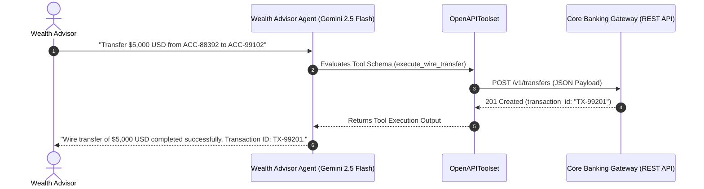

# Lab 11 Solution: Enterprise Core Banking OpenAPI Integration

## 🏛️ Executive Overview & Architecture

In enterprise banking deployments, writing hand-crafted Python `requests` wrappers for existing REST APIs creates technical debt, maintenance overhead, and security risks.

As a **Google Forward-Deployed Engineer (FDE)**, your standard pattern for enterprise integration is **Zero-Adapter OpenAPI Synthesis**. Using ADK 2.0's **`OpenAPIToolset`**, you map an OpenAPI 3.0 specification directly into executable Gemini tools.

---

## 🤖 Antigravity / Gemini Steering Prompt Template

When instructing an AI coding assistant (like Antigravity) to build OpenAPI tools in ADK 2.0, use this prompt template to guarantee compliance with Google FDE standards:

```text
"You are an expert Google ADK 2.0 Forward-Deployed Engineer. Write an OpenAPI-based Agent node following strict Google ADK 2.0 standards:
1. Import OpenAPIToolset via `from google.adk.tools.openapi_tool import OpenAPIToolset`.
2. Define valid OpenAPI 3.0 specs containing exact `operationId` fields for each endpoint (e.g., `operationId: "get_account_balance"`, `operationId: "execute_wire_transfer"`).
3. Serialize the OpenAPI spec dictionary to a JSON string with `json.dumps(spec)` and pass to `OpenAPIToolset(spec_str=..., spec_str_type="json")`.
4. In `Agent(...)`, use `name="..."`, `model="gemini-2.5-flash"`, and the singular `instruction="..."` parameter.
5. Register the toolset instance directly in `tools=[banking_toolset]`.
6. Access LLM response content using `event.content` or `response.content` (NEVER use legacy `.candidates`)."
```

---

## 📋 Requirements-to-Code Technical Matrix

| Enterprise Banking Requirement | OpenAPI 3.0 Mapping | ADK 2.0 Mechanism | Line Reference |
|---|---|---|---|
| *"Query customer ledger balance by account ID."* | `GET /v1/accounts/{account_id}/balance` | `operationId: "get_account_balance"` | Lines 45–66 |
| *"Submit intra-bank wire transfer between accounts."* | `POST /v1/transfers` | `operationId: "execute_wire_transfer"` | Lines 67–110 |
| *"Synthesize executable tools without writing HTTP wrappers."* | `OpenAPIToolset(spec_str=..., spec_str_type="json")` | Auto-converts OpenAPI operations to Gemini `FunctionDeclaration` | Lines 116–123 |
| *"Deploy Wealth Management Advisor agent."* | `Agent(name="wealth_advisor_agent", model="gemini-2.5-flash", ...)` | Root Agent node execution | Lines 129–143 |

---

## 💻 Complete Production Code (`agent.py`)

Below is the complete, runnable Python implementation for the Core Banking OpenAPI Integration Agent:

<!-- TEACHER_NOTE_START -->
**Teacher's note (ADK instructor view):**
- **Learning goal:** Demonstrate how `OpenAPIToolset` ingests OpenAPI 3.0 specs and synthesizes executable tools for Gemini.
- **Why it matters:** Eliminates manual adapter code for enterprise microservices while enforcing typed JSON schemas.
- **Version watch:** Grounded against ADK 2.0 (`google.adk.tools.openapi_tool.OpenAPIToolset`).
<!-- TEACHER_NOTE_END -->

```python
# agent.py
"""
Apex Global Financial Services - Core Banking OpenAPI Integration Agent.
Synthesizes RESTful endpoints into typed Gemini tools via ADK 2.0 OpenAPIToolset.
"""

import json
from google.adk import Agent
from google.adk.tools.openapi_tool import OpenAPIToolset

# ============================================================================
# 1. CORE BANKING OPENAPI 3.0 SPECIFICATION
# ============================================================================
# The `operationId` is critical: ADK uses it directly as the synthesized tool name.
# `operationId: "get_account_balance"` -> Tool: `get_account_balance`
# `operationId: "execute_wire_transfer"` -> Tool: `execute_wire_transfer`

CORE_BANKING_SPEC = {
    "openapi": "3.0.0",
    "info": {
        "title": "Apex Core Banking API",
        "description": "Enterprise REST Gateway for account balances and wire transfers.",
        "version": "1.0.0",
    },
    "servers": [
        {
            "url": "https://api.apexbank.internal/v1",
            "description": "Production Core Banking Gateway",
        }
    ],
    "paths": {
        # Endpoint 1: Balance Inquiry (GET)
        "/accounts/{account_id}/balance": {
            "get": {
                "operationId": "get_account_balance",
                "summary": "Retrieve real-time ledger balance for a customer account",
                "description": "Queries the Core Banking Ledger for available balance, ledger balance, and currency.",
                "parameters": [
                    {
                        "name": "account_id",
                        "in": "path",
                        "required": True,
                        "description": "Unique account identifier (e.g. ACC-88392)",
                        "schema": {"type": "string"},
                    }
                ],
                "responses": {
                    "200": {
                        "description": "Successful balance retrieval",
                        "content": {
                            "application/json": {
                                "schema": {
                                    "type": "object",
                                    "properties": {
                                        "account_id": {"type": "string"},
                                        "available_balance": {"type": "number"},
                                        "currency": {"type": "string"},
                                        "status": {"type": "string"},
                                    },
                                }
                            }
                        },
                    }
                },
            }
        },
        # Endpoint 2: Wire Transfer Execution (POST)
        "/transfers": {
            "post": {
                "operationId": "execute_wire_transfer",
                "summary": "Submit an intra-bank wire transfer between accounts",
                "description": "Executes an immediate funds transfer from source to target account.",
                "requestBody": {
                    "required": True,
                    "content": {
                        "application/json": {
                            "schema": {
                                "type": "object",
                                "required": [
                                    "source_account_id",
                                    "target_account_id",
                                    "amount",
                                    "currency",
                                ],
                                "properties": {
                                    "source_account_id": {
                                        "type": "string",
                                        "description": "Debited account ID",
                                    },
                                    "target_account_id": {
                                        "type": "string",
                                        "description": "Credited account ID",
                                    },
                                    "amount": {
                                        "type": "number",
                                        "description": "Transfer amount in specified currency",
                                    },
                                    "currency": {
                                        "type": "string",
                                        "description": "3-letter ISO currency code (e.g. USD, EUR)",
                                    },
                                    "reference_note": {
                                        "type": "string",
                                        "description": "Optional transfer description or memo",
                                    },
                                },
                            }
                        }
                    },
                },
                "responses": {
                    "201": {
                        "description": "Transfer submitted successfully",
                        "content": {
                            "application/json": {
                                "schema": {
                                    "type": "object",
                                    "properties": {
                                        "transaction_id": {"type": "string"},
                                        "status": {"type": "string"},
                                        "timestamp": {"type": "string"},
                                    },
                                }
                            }
                        },
                    }
                },
            }
        },
    },
}

# ============================================================================
# 2. OPENAPI TOOLSET SYNTHESIS
# ============================================================================
# Serialize specification dictionary to JSON string
spec_json_str = json.dumps(CORE_BANKING_SPEC)

# Instantiate OpenAPIToolset: Parses OpenAPI spec into Gemini FunctionDeclarations
banking_toolset = OpenAPIToolset(spec_str=spec_json_str, spec_str_type="json")

# ============================================================================
# 3. WEALTH ADVISOR AGENT NODE
# ============================================================================
root_agent = Agent(
    name="wealth_advisor_agent",
    model="gemini-2.5-flash",
    description="Enterprise Wealth Advisor assistant with Core Banking REST integration.",
    instruction="""
You are an expert Wealth Advisor Assistant at Apex Global Financial Services.
You have direct access to the Core Banking REST Gateway via synthesized tools:
- `get_account_balance`: Retrieve live balance for account ID.
- `execute_wire_transfer`: Perform intra-bank wire transfers between customer accounts.

Rules:
1. Always confirm account IDs before performing wire transfers.
2. Present monetary balances with clear currency formatting (e.g. $10,000.00 USD).
3. Provide transaction IDs upon successful wire transfer execution.
""",
    tools=[banking_toolset],
)
```

---

## 🔍 Line-by-Line Logic Walkthrough

### 1. Spec Serialization & Tool Synthesis (`Lines 116–123`)
* `json.dumps(CORE_BANKING_SPEC)` converts our Python dictionary specification into a valid JSON string.
* `OpenAPIToolset(spec_str=spec_json_str, spec_str_type="json")` inspects every path in the OpenAPI document:
  * Extracts `/accounts/{account_id}/balance` -> `get` -> `operationId: "get_account_balance"`.
  * Extracts `/transfers` -> `post` -> `operationId: "execute_wire_transfer"`.
  * Generates native `FunctionDeclaration` objects for Gemini, complete with JSON schema validation for parameter types (`string`, `number`).

### 2. Agent Node Registration (`Lines 129–143`)
* We pass `tools=[banking_toolset]` directly to `Agent(...)`.
* When a user asks *"What is the balance of account ACC-88392?"*, Gemini reads the `get_account_balance` tool declaration generated by `OpenAPIToolset`, formulates a tool call with `account_id="ACC-88392"`, and ADK executes the corresponding REST request automatically.

---

## 📐 Enterprise Architecture Flow



---

## 🧪 Verification & Execution Guide

1. **Navigate to your agent project:**
   ```bash
   cd wealth_advisor
   ```

2. **Execute via ADK CLI:**
   ```bash
   uv run adk run .
   ```

3. **Sample Test Prompts:**
   * **Balance Check:** `"Query balance for account ACC-10294."`
   * **Wire Transfer:** `"Transfer $2,500 USD from ACC-10294 to ACC-55102 with note 'Q3 Retainer'."`

---

## 🧪 Self-Reflection Answers

1. **Why is `operationId` the most critical field in an OpenAPI path definition when using `OpenAPIToolset`?**
   * **Answer:** ADK 2.0 uses `operationId` as the unique tool name exposed to Gemini's tool registry. If `operationId` is missing or duplicated, ADK cannot generate a distinct `FunctionDeclaration`, leading to tool registration errors or invalid invocation signatures.

2. **How does `OpenAPIToolset` prevent schema mismatch errors during POST requests compared to manual dictionary parsing?**
   * **Answer:** `OpenAPIToolset` parses the OpenAPI `requestBody` JSON schema (data types, required properties, enums) and embeds it directly into Gemini's tool declaration. Gemini is enforced to generate structured tool calls adhering to the schema, avoiding malformed payloads.

3. **In enterprise banking, why should authentication headers (e.g. OAuth Bearer tokens) be handled at the HTTP transport layer rather than included as arguments in LLM prompts?**
   * **Answer:** Including raw OAuth tokens or API keys in LLM prompts or tool arguments exposes secrets to model context windows, prompt logs, and telemetry. Injecting auth tokens via transport headers or proxy gateways keeps credentials entirely isolated from LLM visibility, upholding Zero-Trust security.

<!-- © 2026 Inder Chauhan (https://github.com/inderanz/google-adk-training). All rights reserved. Ref: IC-ADK-module11-openapi-tools-lab-solution -->
---

## Official References

- Google ADK docs (latest): https://google.github.io/adk-docs/
- Google AI / Gemini docs: https://ai.google.dev/
- Google GenAI Python SDK reference: https://googleapis.github.io/python-genai/
- OpenAPI 3.0 Specification: https://spec.openapis.org/oas/v3.0.3
