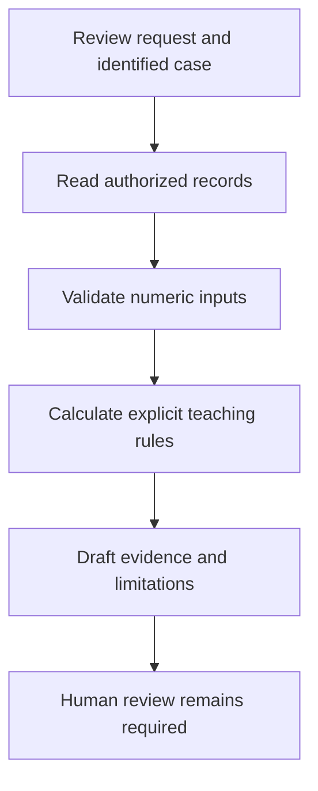

# Module 11.5: Enterprise Credit Underwriting & Commercial Loan Triage

## Before you begin: what this module teaches

**ADK concept: an end-to-end API integration contract for a banking review.**

A functional requirement describes what the user should receive. A non-functional requirement states properties such as latency, access restrictions and recovery. A contract defines request fields, response fields and failures. Normalization translates legacy data into an agreed shape; it must preserve meaning and expose missing information rather than silently manufacture it.

**Where you would use this in real work.**

A relationship manager wants a commercial review prepared from existing records. The engineering task is to identify the required facts, their owners and the next human review step—not to let a model invent lending policy.

**Connection to Gemini Enterprise Agent Platform and Google Cloud.**

ADK orchestrates the language/tool interaction; approved APIs and Google-hosted integration services own data access. An underwriting-themed lab is not a validated credit-decision model or regulatory approval. Carry forward the exact source/version and human responsibility for consequential decisions.

**By the end, you should be able to:**

- Translate one business sentence into input, operation, rule and acceptance evidence.
- Separate required data collection from optional explanatory reasoning.
- Document missing-source and ambiguous-request outcomes.

### Review this lesson through three perspectives

- **Python/ADK beginner:** Explain one requirement row before reading the full solution.
- **Experienced engineer:** Challenge the normalizer with missing fields, conflicting versions and duplicate requests.
- **Bank FDE:** Confirm rule ownership, monetary units, permitted decisions and review responsibilities with the bank.

Use the [guided lab](./lab.md) to observe the mechanism, then compare with the [solution](./lab-solution.md). The banking scenario above explains how to transfer the concept; a lab using a railway, weather or shopping fixture does not implement a live bank integration.

## 🏛️ Enterprise Engagement: Commercial Credit Underwriting & Risk Triage Agent

* **Client:** Sovereign Horizon Bank (Tier-1 Commercial & Corporate Bank)
* **Client Executive Persona:** Victoria Sterling, Managing Director & Head of Commercial Lending Operations & Credit Risk
* **Google Engagement Team:** Principal Forward-Deployed Engineer (FDE) Team, Google Cloud & ADK
* **Project Codename:** *Project Aegis Underwrite*

---

## 🎙️ Executive Briefing from the Client (Victoria Sterling)

> *"Welcome, Google team. Let me be blunt: we don't need another generic FAQ bot or a balance-check chatbot. Our mobile app and core banking portal already do balance checks in 50 milliseconds with traditional SQL.
>
> Our bleeding neck is in **Middle-Market Commercial Loan Origination (\$5M to \$50M credit facilities)**.
>
> Right now, when a commercial customer applies for a multi-million-dollar expansion loan, our credit analysts spend **9 to 14 business days** manually pulling data from three disconnected legacy systems, calculating financial health metrics across PDF financial statements, checking internal credit policy covenants, and drafting a 15-page **Credit Memorandum** for the Credit Committee.
>
> We invested in Google Cloud and Gemini. We want an **Autonomous Credit Underwriting Triage Agent** powered by Google ADK 2.0 that cuts this initial assessment down from **14 days to 30 minutes**, while maintaining strict Fed/OCC regulatory compliance and zero hallucinations."*

---

### 🚨 The Operational Disaster: The $42M Default Spiral at Sovereign Horizon Bank

On November 14, Sovereign Horizon Bank issued a **$42,000,000 multi-draw syndicated term loan** to a nationwide freight and logistics holding company.

Ninety days later, the borrower defaulted on their first scheduled quarterly interest payment. The ensuing internal audit revealed a catastrophic breakdown at the intersection of manual spreadsheet workflows and generative AI prototyping:

1. **The Arithmetic Hallucination in the Credit Memo:**
   The junior credit analyst had relied on an ungrounded LLM prototype to summarize the borrower's 180-page 10-K filing. When asked to compute the borrower's **Debt Service Coverage Ratio (DSCR)**, the LLM hallucinated a healthy DSCR of **`1.48x`** (comfortably above the bank's covenant floor of `1.25x`). In reality, the model had failed to account for operating lease liabilities mandated under ASC 842 and divided unadjusted Net Operating Income by principal-only debt service. The true DSCR was **`1.02x`**—a critical deficit that should have triggered an immediate decline.
2. **The Leaked Core Banking Token:**
   To allow the prototype to query borrower balance limits, the development team had hardcoded an internal core ledger service account token inside the model's system prompt instructions. When a contractor queried the agent, the raw bearer token was regurgitated in model output logs, breaching bank data boundary controls.
3. **The Regulatory Enforcement Action (Fed SR 11-7):**
   The Federal Reserve and OCC placed Sovereign Horizon Bank under a formal Supervisory Consent Order for failure to establish model risk validation boundaries under **Fed SR 11-7**. The bank was barred from expanding its commercial lending portfolio until all algorithmic credit triage systems were placed under strict, deterministic mathematical validation, zero-trust transport identity injection, and mandatory human-in-the-loop (HITL) dual control.

> *"This is why we brought Google in,"* says Victoria Sterling. *"We cannot afford another arithmetic hallucination or an unverified token in a prompt. Math must be deterministic in Python; core banking endpoints must be synthesized zero-adapter from OpenAPI; and credit committee assessments must be auditable down to the byte."*

---

## 🚫 Why Traditional Code & Basic LLM Prompting Failed

* **Why Pure Deterministic Code Failed:**
  Financial statements (audited P&L, balance sheets, notes to financial statements) arrive in disparate formats, scanned PDFs, and messy unstructured tables. Rigid rules engines break when a borrower formats their EBITDA or lease liabilities differently.
* **Why Raw LLM Prompting Failed:**
  A bare Gemini prompt hallucinates ratios, leaks borrower PII into logs, cannot verify credit limits against our Core Banking Ledger in real time, and fails Federal Model Risk Management (Fed SR 11-7) auditability standards.
* **Why Agentic AI (ADK 2.0) is the Only Fit:**
  We need an agent that can dynamically plan, extract qualitative risk signals from borrower filings, invoke typed financial calculation tools deterministically, query our Core Banking OpenAPI Gateway, evaluate internal credit policy rules, and generate an auditable Credit Memo.

---

## 📋 Business & Technical Requirements Specification

### Functional Requirements (FR)

* **FR-1: Automated Financial Metric Extraction & Analysis:**
  Ingest commercial borrower application data (Revenue, Net Income, Total Debt, Operating Cash Flow, Current Assets/Liabilities) and compute core solvency metrics:
  - **DSCR (Debt Service Coverage Ratio):** Must exceed bank covenant threshold (&ge; 1.25x).
  - **Debt-to-EBITDA Ratio:** Must not exceed 3.5x.
  - **Current Ratio:** Must exceed 1.2x.

* **FR-2: Real-Time Core Banking Ledger Cross-Examination (OpenAPI 3.0):**
  Synthesize our RESTful Core Banking Gateway via `OpenAPIToolset` to:
  - Check existing outstanding credit exposure (`GET /v1/borrowers/{tax_id}/exposure`).
  - Retrieve internal risk rating and KYC verification status (`GET /v1/borrowers/{tax_id}/risk-profile`).

* **FR-3: Covenant Policy & Negative Signal Evaluation:**
  Evaluate if the borrower is in a restricted industry (e.g., speculative crypto trading, high-risk weapons) and verify whether the loan request exceeds our single-borrower exposure limit (\$50,000,000).

* **FR-4: Structured Credit Memorandum Synthesis:**
  Generate a formalized, typed **Credit Committee Preliminary Assessment** (Borrower Overview, Financial Health Score, Covenant Compliance Status, Recommended Action: `APPROVE_FOR_COMMITTEE`, `CONDITIONAL_REVIEW`, or `DECLINE`, and Justification Rationale).

* **FR-5: Human-in-the-Loop (HITL) Checkpoint:**
  High-risk borrowers or borderline DSCRs (1.15x &ndash; 1.25x) must be flagged with explicit covenant conditions requiring Senior Credit Officer sign-off.

---

### Non-Functional Requirements (NFR)

* **NFR-1 (Zero-Trust Security & Identity):**
  No API keys, OAuth tokens, or employee IDs hardcoded in prompts. Customer tax IDs and loan officer identity must be resolved securely via session context (`tool_context.user_id`).
* **NFR-2 (Deterministic Math & Zero Hallucinations):**
  Financial ratio calculations MUST NOT be computed inside the LLM's head. They must be executed via **Typed Pydantic Custom Tools** in Python.
* **NFR-3 (Auditability & Explainability - Fed SR 11-7):**
  Every decision and tool invocation must emit structured event telemetry compatible with Google Cloud Trace and BigQuery Agent Analytics.
* **NFR-4 (Enterprise API Synthesis):**
  Core Banking endpoints must be ingested via ADK 2.0 `OpenAPIToolset`—zero manual HTTP wrappers.
* **NFR-5 (Response Latency):**
  Full end-to-end multi-step underwriting triage cycle must complete in $< 15$ seconds.

---

## 📝 FDE Discovery Questionnaire (For Victoria & Bank IT)

As a Google Principal FDE, before we write a single line of code, we present these 6 critical discovery questions to the bank:

1. **OpenAPI Gateway Spec:** *"Do you have the OpenAPI 3.0 spec (JSON/YAML) for your Core Banking Exposure & Risk Gateway ready with unique `operationId`s?"*
2. **Authentication Flow:** *"How does your API Gateway validate calls? (e.g. Mutual TLS, OAuth2 Bearer Token in HTTP Authorization headers, or VPC Service Controls)?"*
3. **Credit Risk Formulas:** *"Are DSCR and Debt-to-EBITDA computed on trailing twelve months (TTM) or historical 3-year averages?"*
4. **Data Privacy (PII/GLBA):** *"Are borrower tax IDs (EINs) masked in model prompt logs, or do we need Cloud DLP (Data Loss Prevention) tokenization?"*
5. **State & Persistence:** *"Do we need credit memo drafts persisted across analyst sessions in Google Cloud Firestore?"*
6. **Model Target:** *"Are we deploying on Vertex AI with `gemini-2.5-flash` in your dedicated GCP VPC region (e.g. `us-central1` or `us-east4`)?"*

---

## 🚀 How We Proceed

Now, putting on our **Google Principal FDE** hat:

1. **Establish Architecture via Authoritative Skills:**
   We leverage the newly created **`adk-enterprise-fde-workflow`** and **`adk-skill`** to guide project structuring, spec grounding, and zero-trust parameter validation.
2. **Translate Requirements into Technical Decisions:**
   Map Victoria's plain English requirements into a formal **Requirements-to-Code Matrix**:
   - Mathematical calculations $\rightarrow$ Typed Pydantic Custom Tools (`tools/financial_math.py`).
   - Core Banking queries $\rightarrow$ Zero-Adapter OpenAPI 3.0 synthesis (`OpenAPIToolset`).
   - Governance & Memorandum generation $\rightarrow$ Root Agent Node (`Agent` with `gemini-2.5-flash`).
3. **Build the Production-Grade Codebase:**
   Implement the complete agent with full test verification in the accompanying Challenge Lab and Lab Solution.

---

## 📋 Requirements-to-Code Technical Matrix

| Requirement ID | Plain English Requirement | Technical Risk / Challenge | ADK 2.0 Solution Pattern | Code Artifact Reference |
|---|---|---|---|---|
| **FR-1 & NFR-2** | Calculate DSCR, Debt-to-EBITDA, and Current Ratio deterministically. | **LLM Math Hallucinations:** Large models make arithmetic errors on decimal division. | **Typed Pydantic Custom Tools:** Compute ratios in Python; return validated `BaseModel`. | `tools/financial_math.py` |
| **FR-2 & NFR-4** | Query borrower existing exposure and risk profile from Core Banking Gateway. | **Adapter Maintenance Debt:** Hand-writing HTTP client wrappers creates brittle code. | **Zero-Adapter OpenAPI Synthesis:** Ingest spec directly via `OpenAPIToolset`. | `openapi/core_bank_spec.py` |
| **FR-3 & FR-5** | Verify debt covenants and flag borderline cases (1.15x &ndash; 1.25x) for HITL. | **Policy Oversights:** Lending to restricted industries or breaching single-borrower caps. | **Policy Evaluation Engine:** Custom evaluation tool returning compliance status. | `evaluate_covenant_policy` |
| **FR-4 & NFR-3** | Synthesize structured Credit Committee Memorandum with traceable lineage. | **Unstructured Prose:** Vague committee summaries delaying credit sign-off. | **Structured Output Synthesis:** Model generates formal memo with action recommendations. | `Agent(instruction="...")` |
| **NFR-1** | Protect customer tax IDs and loan officer identity with Zero-Trust security. | **Prompt Credential Leak:** Hardcoding IDs in prompts leaks identity into telemetry. | **Session Context Injection:** Inject identity via `tool_context.user_id`. | `tool_context: ToolContext` |

## 🏛️ Production OpenAPI Spec Engineering & The Legacy Hybrid Architecture

In real enterprise banking environments, you encounter two distinct OpenAPI realities:
1. **Modern Green-Field Systems:** High-quality OpenAPI 3.0 specs stored in centralized schema registries, properly versioned, with clean `operationId`s and complete JSON schemas.
2. **Legacy Brown-Field Core Ledgers:** Monolithic, sprawling, or non-standard OpenAPI specs (or Swagger 2.0 exports). These legacy specs often:
   - **Omit `operationId`**: Leaving Gemini unable to identify tool function names or defaulting to opaque autogenerated symbols.
   - **Contain Hundreds of Unwhitelisted Internal Routes**: Exposing database dumps, administrative endpoints (`/admin/purge-cache`), or debug tools directly into Gemini's context window, overflowing context limits and creating security risks.
   - **Lack Proper Parameter Schemas or Descriptions**: Confusing the LLM's function caller with unconstrained strings.

---

### 🛡️ The FDE OpenAPI Compatibility Checklist (For ADK 2.0 & Gemini)

Before ingesting any OpenAPI specification into `OpenAPIToolset`, a Google Principal FDE audits it against the **FDE OpenAPI Compatibility Checklist**:

| Audit Criterion | Enterprise Risk if Missing | ADK 2.0 & Gemini Requirement | Remediation Pattern |
|---|---|---|---|
| **Explicit `operationId`** | Gemini cannot generate meaningful tool calls or crashes on anonymous endpoints. | Every operation (`get`, `post`, etc.) MUST have a unique, snake_case or camelCase `operationId` (e.g. `get_borrower_exposure`). | Auto-derive from `method + path` during pre-processing if absent. |
| **Strict Route Whitelisting (Subsetting)** | Sprawling 500-endpoint specs bloat token usage, degrade reasoning latency, and expose sensitive administrative tools. | Only expose endpoints strictly required for the agent's domain scope (Principle of Least Privilege). | Filter the spec's `paths` dictionary using regex patterns (e.g. `^/v1/borrowers/`). |
| **Detailed Field Descriptions** | Gemini guesses the semantics of opaque financial acronyms (e.g. `dscr`, `noi`, `ebitda`). | Every property in parameter and response schemas must have clear, business-grounded `description` tags. | Augment schemas with enterprise glossary descriptions in the spec. |
| **Typed Schemas & Explicit `required`** | LLM generates `null` or wrong types, causing runtime HTTP 400 Bad Request errors. | Define explicit schema types (`string`, `number`, `boolean`, `integer`) and declare required path/query parameters with `required: true`. | Validate and backfill `schema: {"type": ...}` and `required: true` for path variables. |
| **External Spec Decoupling** | Hardcoding JSON strings in Python files makes specs unmaintainable and breaks CI/CD schema sync. | Keep specs in standalone `.json` or `.yaml` files in the repository; load dynamically via `Path.read_text()`. | Decouple spec files (`openapi/core_banking_openapi.json`) from Python code. |

---

### 🔄 The Legacy Normalizer Pattern (`openapi/normalizer.py`)

To handle legacy enterprise APIs without requiring months of backend refactoring from the bank's core IT team, Google FDEs deploy an **In-Memory Spec Normalizer**.

```python
# openapi/normalizer.py
import json
from pathlib import Path
import re
from typing import Any, Dict, List, Optional


def normalize_legacy_spec(
    raw_spec: Dict[str, Any],
    allowed_path_patterns: Optional[List[str]] = None,
) -> Dict[str, Any]:
    """Transforms legacy or non-standard OpenAPI specs into ADK 2.0-compliant schemas:

    1. Subsets paths by regex to enforce the Principle of Least Privilege.
    2. Synthesizes missing operationIds using HTTP method and URI tokens.
    3. Normalizes parameter declarations to ensure deterministic tool
    execution.
    """
    cleaned_spec = {
        "openapi": raw_spec.get("openapi", "3.0.0"),
        "info": raw_spec.get(
            "info",
            {
                "title": "Normalized Banking API",
                "version": "1.0.0",
                "description": "Auto-normalized specification for ADK 2.0 OpenAPIToolset ingestion.",
            },
        ),
        "servers": raw_spec.get(
            "servers", [{"url": "https://api.sovereignbank.internal/v1"}]
        ),
        "paths": {},
    }

    raw_paths = raw_spec.get("paths", {})

    for path_str, path_item in raw_paths.items():
        # Step 1: Whitelist filtering
        if allowed_path_patterns:
            if not any(re.search(pat, path_str) for pat in allowed_path_patterns):
                continue

        cleaned_path_item = {}
        for method, operation in path_item.items():
            if method.lower() not in [
                "get",
                "post",
                "put",
                "delete",
                "patch",
                "options",
                "head",
            ]:
                continue

            op_copy = dict(operation)

            # Step 2: Auto-synthesize missing operationId
            if not op_copy.get("operationId"):
                clean_path = re.sub(r"[{}]", "", path_str).strip("/")
                parts = [p for p in clean_path.split("/") if p and p != "v1"]
                generated_id = f"{method.lower()}_{'_'.join(parts)}"
                op_copy["operationId"] = generated_id

            # Step 3: Ensure path parameters have required: True
            if "parameters" in op_copy:
                for param in op_copy["parameters"]:
                    if param.get("in") == "path":
                        param["required"] = True

            cleaned_path_item[method] = op_copy

        if cleaned_path_item:
            cleaned_spec["paths"][path_str] = cleaned_path_item

    return cleaned_spec


def load_and_normalize_spec(
    spec_path: str, allowed_path_patterns: Optional[List[str]] = None
) -> str:
    """Reads a spec file from disk, normalizes it, and returns a JSON string for OpenAPIToolset."""
    content = Path(spec_path).read_text(encoding="utf-8")
    raw_spec = json.loads(content)
    normalized = normalize_legacy_spec(
        raw_spec, allowed_path_patterns=allowed_path_patterns
    )
    return json.dumps(normalized, indent=2)
```

---

## 🔬 Architecture Flow Diagram



---

## 📚 Official References

- Google ADK docs (latest): https://google.github.io/adk-docs/
- Google AI / Gemini docs: https://ai.google.dev/
- Google GenAI Python SDK reference: https://googleapis.github.io/python-genai/
- OpenAPI 3.0 Specification: https://spec.openapis.org/oas/v3.0.3
- Federal Reserve SR 11-7 (Model Risk Management): https://www.federalreserve.gov/supervisionreg/srletters/sr1107.htm
## Continue the course story

Previous: [Module 11](../module11-openapi-tools/README.md) · Next: [Module 11.6](../module11_6-enterprise-apigee-gateway-auth/README.md) · [See how the concepts build](../learning-journey.md)

Before continuing, explain one input, one ADK execution boundary and one failure outcome from this module. Use the next chapter to add a new customer requirement, not merely another component.
