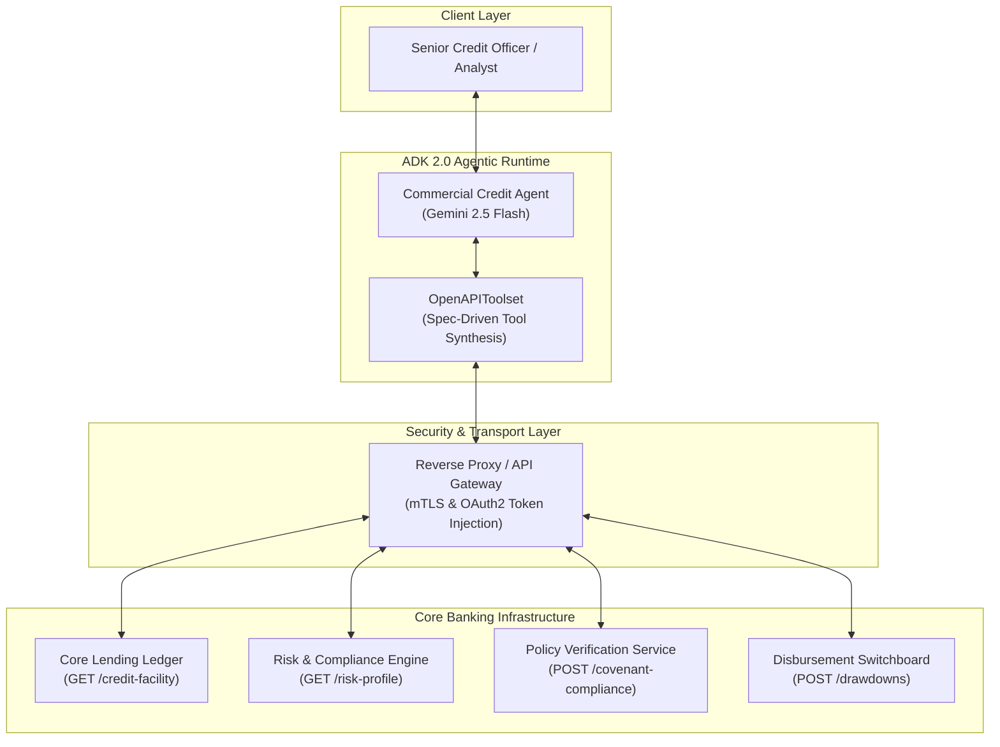
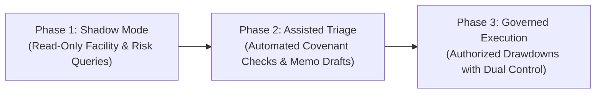
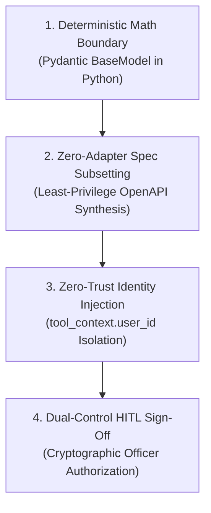

# Module 11.5 Enterprise Playbook: Commercial Credit Underwriting & Risk Triage

## 🏛️ Executive Summary

This playbook defines the enterprise architecture and implementation blueprint for **Project Aegis Underwrite** at **Sovereign Horizon Bank**. It articulates how Google Forward-Deployed Engineers (FDEs) leverage Google ADK 2.0 to transform a 14-day manual commercial loan origination bottleneck into a compliant, sub-30-minute automated underwriting triage workflow.

---

## 🎯 The Business Challenge & Economic Drivers

Middle-market commercial credit facilities ($5M to $50M) are the growth engine of commercial banking. However, operational friction severely impairs profitability:

* **14-Day Origination Latency:** Sifting through credit histories, verifying collateral, checking covenants, and drafting Credit Memorandums takes up to 2 weeks per deal.
* **Cost per Underwrite:** High manual analyst labor costs (~$4,500 per credit review).
* **Opportunity Cost:** High-value corporate borrowers migrate to agile fintech lenders when loan decisions are delayed.
* **Compliance Exposure:** Manual errors in debt covenant verification lead to regulatory penalties under OCC and Fed oversight.

---

## 👥 Stakeholder Alignment & Personas

| Stakeholder Persona | Core Priority | Success Metric |
|---|---|---|
| **Victoria Sterling** *Head of Commercial Lending Operations* | Accelerate deal velocity and loan throughput. | Reduce initial triage time from 14 days to $< 30$ minutes. |
| **Marcus Vance** *Chief Risk Officer (CRO)* | Zero unauthorized overdraws and strict covenant enforcement. | 100% adherence to credit policies and Fed SR 11-7 standards. |
| **Elena Rostova** *Chief Information Security Officer (CISO)* | Protect borrower PII and prevent API token leakage. | Zero credentials in prompts; zero unauthorized core ledger mutations. |
| **David Chen** *Head of Core Banking IT* | Avoid building custom brittle API wrappers for internal microservices. | Zero-adapter OpenAPI 3.0 synthesis using existing API gateway specs. |

---

## 🏗️ Technical Architecture & The FDE Standard

### Key Architectural Pillars:

1. **Zero-Adapter OpenAPI Synthesis (`OpenAPIToolset`):**
   The bank’s existing OpenAPI 3.0 specification is ingested directly. No manual Python HTTP code or maintenance-heavy wrappers are deployed.
2. **Zero-Trust Transport Isolation:**
   OAuth2 tokens, client certificates, and API secrets are injected exclusively by the reverse proxy/transport layer. The agent's LLM context never sees or handles authentication secrets.
3. **Deterministic Governance & Schema Enforcement:**
   Loan drawdown requests require strict parameters (`borrower_tax_id`, `facility_id`, `amount`, `currency`, `target_account_id`, `authorization_code`). The OpenAPI JSON schema prevents Gemini from executing incomplete or malformed requests.

---

## 🛡️ Regulatory & Compliance Safeguards (Fed SR 11-7)

Under Federal Reserve Supervisory Letter SR 11-7 (Guidance on Model Risk Management):
* **No Unbounded Actions:** The agent cannot execute arbitrary SQL queries or un-specified REST routes. All actions are bounded by the OpenAPI specification.
* **Audit Lineage:** Every conversation turn and tool execution emits OpenTelemetry traces to Google Cloud Trace and BigQuery Agent Analytics.
* **Human-in-the-Loop Sign-off:** High-value drawdowns and borderline covenant breaches require mandatory Senior Credit Officer authorization before fund disbursement.

---

## 🚀 Phased Production Rollout Plan

1. **Phase 1: Shadow Mode (Weeks 1–4):**
   Deploy agent in read-only mode (`get_borrower_credit_facility` and `get_borrower_risk_profile`). Analysts use the agent to gather data while comparing outputs against legacy manual searches.
2. **Phase 2: Assisted Triage (Weeks 5–8):**
   Enable `verify_covenant_compliance`. The agent generates draft Credit Memorandums with covenant validation scores for human officer review.
3. **Phase 3: Governed Execution (Weeks 9+):**
   Enable `request_loan_drawdown` with dual-control authorization codes and real-time ledger updates on Google Cloud Run.

---

## 🏛️ The 4 Tenets of Production Credit Underwriting Agents

### Tenet 1: The Deterministic Math Boundary (Zero LLM Arithmetic)
Large language models must never perform division, rounding, or covenant ratio calculations. All financial metrics—including Debt Service Coverage Ratio (DSCR), Debt-to-EBITDA leverage, and Current Ratio—must be executed in typed Python tools returning validated Pydantic `BaseModel` schemas.

### Tenet 2: Zero-Adapter Spec Subsetting (Least Privilege)
Never expose an entire enterprise core banking API (500+ endpoints) to the agent's context window. Always use an in-memory spec normalizer to filter routes with regex whitelisting, auto-generate explicit `operationId` symbols, and enforce required path parameters.

### Tenet 3: Zero-Trust Transport Identity Injection
Never accept employee IDs, customer tax IDs, or OAuth bearer tokens from the model's function-calling arguments. The model cannot be trusted with identity assertions. Always resolve caller identity from the cryptographically verified session context (`tool_context.user_id`) at the HTTP transport layer.

### Tenet 4: Dual-Control HITL Sign-Off
Consequential banking actions (loan drawdowns, collateral releases, credit line increases) must never execute autonomously. High-stakes mutations require two distinct human identities: an initiating credit analyst and an independent Senior Credit Officer providing a one-time cryptographic authorization code before funds disburse.

---

## ⚠️ Enterprise Anti-Pattern Comparison Matrix

| Architectural Dimension | ❌ High-Risk Anti-Pattern | ✅ Google FDE Production Standard | Consequence of Failure |
|---|---|---|---|
| **Financial Calculations** | Asking Gemini in prompts: *"Calculate DSCR = NOI / Debt Service"* | Deterministic Python custom tools returning Pydantic `DscrResult` | Model hallucination causes multimillion-dollar under-hedged defaults. |
| **API Ingestion** | Writing 1,000 lines of custom `requests` or `urllib` client wrappers | Zero-adapter `OpenAPIToolset` ingestion from versioned `.json` specs | Massive tech debt; wrapper crashes upon backend API upgrades. |
| **Spec Whitelisting** | Dumping monolithic Swagger specs into `OpenAPIToolset` | In-memory normalizer filtering strictly permitted banking endpoints | Token context exhaustion; model invokes sensitive `/admin` endpoints. |
| **Caller Identity** | Tool signature accepting `user_id: str` or `tax_id: str` from model | Identity resolved strictly from `tool_context.user_id` | Prompt injection allows attackers to forge officer credentials. |
| **Disbursement Execution** | Agent autonomously calls `POST /drawdowns` based on model decision | Mandatory dual-control HITL checkpoint with Senior Officer sign-off | Unregulated capital flight and Fed SR 11-7 supervisory sanctions. |

---

## 🔗 Related Course Curriculum

* [Module 10 Enterprise Playbook](../module10-advanced-function-tools/enterprise-playbook.md) — Custom Pydantic tools and stateful session memory.
* [Module 11 Theory](../module11-openapi-tools/README.md) — Foundations of OpenAPI 3.0 tools with ADK 2.0.
* [Module 11.6 Theory](../module11_6-enterprise-apigee-gateway-auth/README.md) — Secure bank API access with Apigee gateway authentication.
* [Enterprise ADK Roadmap](../enterprise-adk-roadmap.md) — The complete master roadmap for Google ADK enterprise architecture.

---

## 📚 Official References

- Google ADK Documentation (latest): https://google.github.io/adk-docs/
- Google ADK Custom Tools: https://adk.dev/tools-custom/
- Google ADK OpenAPI Toolset: https://adk.dev/tools-custom/openapi-tools/
- OpenAPI 3.0 Specification: https://spec.openapis.org/oas/v3.0.3
- Federal Reserve SR 11-7 (Model Risk Management): https://www.federalreserve.gov/supervisionreg/srletters/sr1107.htm
