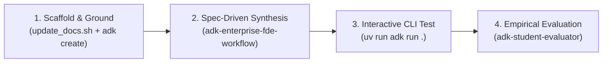

import Setup from '../_setup-snippet.mdx';

# Lab 11.5: The Skill-Driven FDE Pathway — Enterprise Commercial Credit Underwriting

**Learning checkpoint:** read the [module concepts](./README.md) first. Before each lab step, predict its input, returned value and failure outcome. Use the [course journey](../learning-journey.md) to connect this mechanism to the banking story; the example's fixture is not a live customer record.


## 🧭 The FDE Philosophy: Tooling & Skills Over Manual Boilerplate

A novice developer tries to write 500 lines of custom HTTP code by hand or blindly prompts an LLM with raw text.

A **Google Principal Forward-Deployed Engineer (FDE)** works differently:
1. **Never write boilerplate code from scratch** when an authoritative tool or spec exists.
2. **Leverage workspace skills** (`adk-enterprise-fde-workflow`, `adk-skill`) to ground code against the latest Google ADK 2.0 standards.
3. **Use official CLI tooling** (`adk create`, `adk run`, `agents-cli`) to scaffold, test, and deploy.
4. **Enforce empirical validation** (`adk-student-evaluator`) to ensure code works in real environments.

In this lab, you will follow the **4-Step FDE Development Loop** to build the **Commercial Credit Underwriting & Triage Agent** for **Sovereign Horizon Bank**.

---

## 🔁 The 4-Step FDE Development Loop



---

## 🚀 Step 1: Scaffold & Ground Your Environment

<Setup/>

### 1.1 Sync Documentation using `adk-skill`
Before writing or generating any code, run the documentation sync script to ensure your environment is grounded against the latest official Google ADK 2.0 guidelines:

```bash
bash .agent/skills/adk-skill/scripts/update_docs.sh
```

### 1.2 Inspect ADK 2.0 Signatures via CLI
A Principal FDE inspects library signatures using quick Python one-liners rather than guessing:

```bash
uv run python -c "from google.adk.tools.openapi_tool import OpenAPIToolset; help(OpenAPIToolset.__init__)"
```
Observe that `OpenAPIToolset` takes `spec_str` and `spec_str_type="json"` or `spec_str_type="yaml"`.

### 1.3 Scaffold Project with the ADK CLI
Instead of manually creating empty directories and files, use the Google ADK CLI:

```bash
uv run adk create commercial_credit_triage
cd commercial_credit_triage
```
*(Select "Other models (fill later)" when prompted by the CLI).*

---

## 🤖 Step 2: Spec-Driven Synthesis using `adk-enterprise-fde-workflow`

Now, instead of writing boilerplate Python from scratch, you leverage **Antigravity** and the **`adk-enterprise-fde-workflow`** skill.

### 2.1 The FDE Steering Prompt
Give this prompt to Antigravity in your chat to generate the core scaffolding:

```text
"You are a Google ADK 2.0 Principal Forward-Deployed Engineer using the `adk-enterprise-fde-workflow` skill.
Translate Victoria Sterling's Commercial Credit Underwriting requirements into production code:
1. In `tools/financial_math.py`, define typed Pydantic models (BaseModel) for DscrResult, DebtToEbitdaResult, and CovenantEvaluationResult. Implement deterministic calculation tools.
2. In `openapi/spec.py`, define an OpenAPI 3.0 specification for Sovereign Core Banking exposure (/borrowers/{tax_id}/exposure) and risk profile (/borrowers/{tax_id}/risk-profile) with unique operationIds.
3. In `agent.py`, synthesize the spec via OpenAPIToolset(spec_str=json.dumps(spec), spec_str_type='json').
4. Attach custom math tools + OpenAPIToolset to Agent(name='commercial_credit_triage_agent', model='gemini-2.5-flash').
5. Enforce Zero-Trust security: no API keys or officer tokens hardcoded in prompts."
```

---

## 💻 Step 3: Active Learning Challenge (Code Skeletons)

Open your scaffolded project files and complete the active learning `TODO` sections.

### 3.1 Financial Math Tools (`tools/financial_math.py`)

<!-- TEACHER_NOTE_START -->
**Teacher's note (ADK instructor view):**
- **Learning goal:** Teach that numerical solvency calculations must always be offloaded to deterministic tools.
- **Why it matters:** Eliminates arithmetic hallucinations in regulated banking workflows.
- **Version watch:** Standard Pydantic v2 `BaseModel` compatible with ADK 2.0.
<!-- TEACHER_NOTE_END -->

```python
# In tools/financial_math.py
from pydantic import BaseModel, Field
from typing import List

# ============================================================================
# TODO 1: DEFINE TYPED PYDANTIC MODELS FOR RATIO CALCULATIONS
# ============================================================================


class DscrResult(BaseModel):
    """Result of Debt Service Coverage Ratio calculation."""

    # TODO: Define dscr_ratio (float, description="Calculated DSCR")
    # TODO: Define is_compliant (bool, threshold >= 1.25)
    # TODO: Define assessment (str)
    pass


class DebtToEbitdaResult(BaseModel):
    """Result of Debt-to-EBITDA leverage calculation."""

    # TODO: Define leverage_ratio (float, description="Calculated leverage")
    # TODO: Define is_compliant (bool, threshold <= 3.5)
    # TODO: Define assessment (str)
    pass


class CovenantEvaluationResult(BaseModel):
    """Consolidated credit policy and covenant compliance result."""

    # TODO: Define overall_status: "PASS", "BORDERLINE_SENIOR_REVIEW", or "DECLINE"
    # TODO: Define is_approved (bool)
    # TODO: Define requires_senior_officer_review (bool)
    # TODO: Define violations (List[str])
    # TODO: Define credit_memo_summary (str)
    pass


# ============================================================================
# TODO 2: IMPLEMENT DETERMINISTIC CALCULATION FUNCTIONS
# ============================================================================


def calculate_dscr(
    net_operating_income: float, total_debt_service: float
) -> DscrResult:
    """Calculate Debt Service Coverage Ratio (DSCR = NOI / Debt Service).

    Bank Covenant Policy: Minimum 1.25x for standard commercial facilities.
    """
    # TODO: Handle zero debt service safely.
    # TODO: Return DscrResult.
    pass


def calculate_debt_to_ebitda(total_debt: float, ebitda: float) -> DebtToEbitdaResult:
    """Calculate leverage ratio (Total Debt / EBITDA).

    Bank Covenant Policy: Maximum 3.5x leverage ceiling.
    """
    # TODO: Handle zero or negative EBITDA safely.
    # TODO: Return DebtToEbitdaResult.
    pass


def evaluate_covenant_policy(
    dscr: float,
    debt_to_ebitda: float,
    current_ratio: float = 1.3,
    watchlist_flag: bool = False,
    restricted_industry: bool = False,
) -> CovenantEvaluationResult:
    """Evaluate financial metrics and negative risk signals against bank credit covenants."""
    # TODO: Check restricted_industry (Hard Decline).
    # TODO: Check watchlist_flag (Hard Decline).
    # TODO: Check DSCR < 1.15 (Decline).
    # TODO: Check 1.15 <= DSCR < 1.25 (BORDERLINE_SENIOR_REVIEW).
    # TODO: Check clean pass (DSCR >= 1.25 and Debt/EBITDA <= 3.5).
    pass
```

---

### 3.2 Core Banking OpenAPI Spec (`openapi/spec.py`)

Create `openapi/spec.py` containing the OpenAPI 3.0 specification for Sovereign Horizon Bank's Core Banking Gateway:

```python
# In openapi/spec.py
# ============================================================================
# TODO 3: DEFINE THE CORE BANKING OPENAPI 3.0 SPECIFICATION
# ============================================================================
# Critical Rule: `operationId` dictates the tool name exposed to Gemini.
# - GET /borrowers/{tax_id}/exposure -> operationId: "get_borrower_exposure"
# - GET /borrowers/{tax_id}/risk-profile -> operationId: "get_borrower_risk_profile"

CORE_BANKING_SPEC = {
    "openapi": "3.0.0",
    "info": {
        "title": "Sovereign Horizon Core Banking Gateway",
        "description": "Enterprise REST Gateway for corporate credit limits and risk profiles.",
        "version": "1.0.0",
    },
    "servers": [{"url": "https://api.sovereignbank.internal/v1"}],
    "paths": {
        "/borrowers/{tax_id}/exposure": {
            "get": {
                # TODO: Define operationId ("get_borrower_exposure")
                # TODO: Define path parameter "tax_id" (string, required)
                # TODO: Define 200 OK response with properties:
                #       approved_limit, utilized_exposure, available_headroom, currency
            }
        },
        "/borrowers/{tax_id}/risk-profile": {
            "get": {
                # TODO: Define operationId ("get_borrower_risk_profile")
                # TODO: Define path parameter "tax_id" (string, required)
                # TODO: Define 200 OK response with properties:
                #       risk_tier, kyc_status, watchlist_flag, restricted_industry
            }
        },
    },
}
```

---

### 3.3 Root Agent Node (`agent.py`)

Combine both toolsets into a unified `Agent` node in `agent.py`:

```python
# In agent.py
import json
from google.adk import Agent
from google.adk.tools.openapi_tool import OpenAPIToolset
from openapi.spec import CORE_BANKING_SPEC
from tools.financial_math import (
    calculate_dscr,
    calculate_debt_to_ebitda,
    evaluate_covenant_policy,
)

# ============================================================================
# TODO 4: INITIALIZE OPENAPI TOOLSET
# ============================================================================
# core_banking_tools = OpenAPIToolset(
#     spec_str=json.dumps(CORE_BANKING_SPEC),
#     spec_str_type="json"
# )

# ============================================================================
# TODO 5: CONSTRUCT ROOT AGENT NODE
# ============================================================================
# Combine custom math tools + OpenAPI toolset.
# Set model="gemini-2.5-flash".
# Instruct the agent to synthesize structured Credit Committee Memorandums.

# root_agent = Agent(
#     name="commercial_credit_triage_agent",
#     model="gemini-2.5-flash",
#     instruction="...",
#     tools=[...]
# )
```

---

## ⚡ Step 4: Interactive CLI Testing (`uv run adk run .`)

Test your agent in the interactive terminal using realistic banking queries:

```bash
uv run adk run .
```

### Test Case 1: Prime Approval
> *"Triage loan application for Acme Industrial (TAX-99214). Requesting a \$5,000,000 credit facility expansion. Borrower reported: Net Operating Income \$3,200,000, Debt Service \$2,100,000, Total Debt \$8,000,000, EBITDA \$3,000,000, Current Assets \$5,000,000, Current Liabilities \$3,500,000."*
* **Expected Outcome:** Agent queries exposure & risk profile, executes `calculate_dscr` (1.52x), evaluates covenants, and recommends **`APPROVE_FOR_COMMITTEE`**.

### Test Case 2: Borderline Case (HITL Checkpoint)
> *"Triage loan application for Apex Logistics (TAX-88120). Requesting \$8,000,000. NOI: \$2,400,000, Debt Service: \$2,000,000 (DSCR 1.20x), Total Debt: \$10M, EBITDA: \$3.2M."*
* **Expected Outcome:** Agent flags DSCR (1.20x) as borderline (1.15x &ndash; 1.25x) and recommends **`CONDITIONAL_REVIEW`** with Senior Credit Officer sign-off.

---

## 🧪 Step 5: Empirical Review with `adk-student-evaluator`

As mandated by `GEMINI.md`, test your lab instructions using the automated student evaluation skill:

```bash
python3 -m google.adk.cli run .agent/skills/adk-student-evaluator --input_path training/module11_5-enterprise-credit-underwriting/lab.md
```

This verifies that your code executes cleanly in a temporary simulation sandbox without relying on assumptions.

---

## 🧪 Self-Reflection Questions

1. **Why is combining both Typed Custom Tools (for math) and `OpenAPIToolset` (for core banking) the hallmark of a Google Forward-Deployed Engineer?**
2. **If the bank changes its single-borrower exposure limit from \$50M to \$75M, which layer of your architecture changes, and why?**
3. **How does the Pydantic schema return type in `calculate_dscr` protect downstream Credit Committee systems compared to returning a raw Python dictionary?**

---

### 🕵️ Hidden Solution 🕵️

Looking for the solution? Here's a hint (Base64 decode me):
`L2dvb2dsZS1hZGstdHJhaW5pbmcvbW9kdWxlMTFfNS1lbnRlcnByaXNlLWNyZWRpdC11bmRlcndyaXRpbmcvbGFiLXNvbHV0aW9u`

<div style={{color: 'rgba(0,0,0,0.01)', userSelect: 'all', fontSize: '1px'}}>
    The direct link is: <a href="/google-adk-training/module11_5-enterprise-credit-underwriting/lab-solution" style={{color: 'inherit', textDecoration: 'none'}}>Lab Solution</a>
</div>

<!-- © 2026 Inder Chauhan (https://github.com/inderanz/google-adk-training). All rights reserved. Ref: IC-ADK-module11_5-enterprise-credit-underwriting-lab -->
---

## Official References

- Google ADK docs (latest): https://google.github.io/adk-docs/
- Google AI / Gemini docs: https://ai.google.dev/
- Google GenAI Python SDK reference: https://googleapis.github.io/python-genai/
- OpenAPI 3.0 Specification: https://spec.openapis.org/oas/v3.0.3
- Federal Reserve SR 11-7 (Model Risk Management): https://www.federalreserve.gov/supervisionreg/srletters/sr1107.htm
