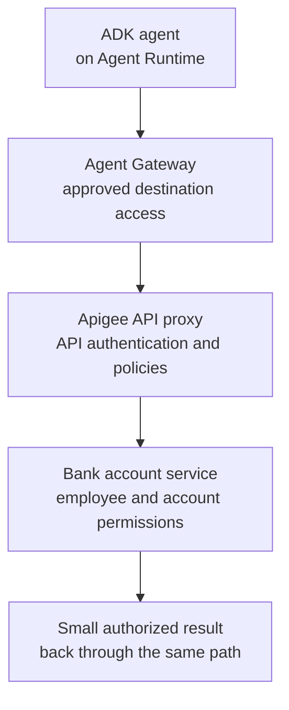
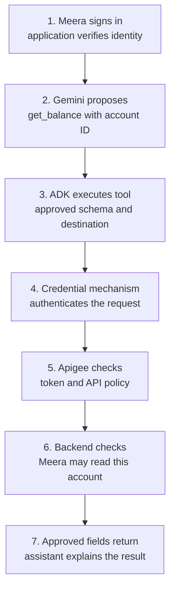
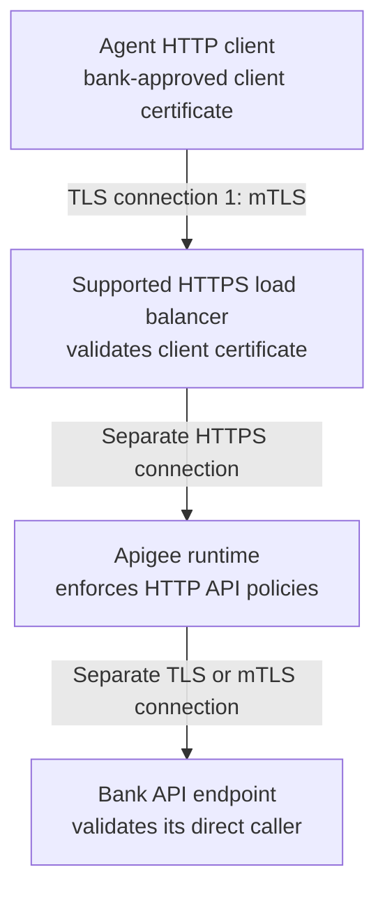
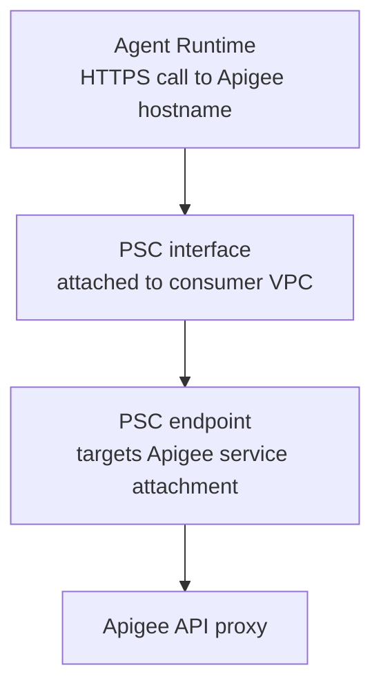

# Module 11.6: Secure Bank API Access with ADK and Apigee

## Before you begin: what this module teaches

**ADK concept: connecting an agent's tool to an enterprise API without giving the model control of credentials or permissions.**

In Module 11, you learned that an OpenAPI document can describe an API and that ADK can turn its operations into tools. Now imagine that the API returns a customer's bank balance. Knowing how to call it is only the first step. We must also establish which application is calling, which employee requested the information, and whether that employee may see that particular account.

You will learn how `OpenAPIToolset`, generated `RestApiTool` objects, authentication configuration, `ReadonlyContext`, `header_provider` and `httpx_client_factory` fit into that request. You will also learn where ADK's responsibility ends: it does not automatically authenticate your portal's users, grant access to bank records, or deploy gateway policies.

**Where you would use this in real work.**

A relationship manager asks an assistant to check a balance, a loan officer asks for the status of an application, or an operations employee asks why a payment failed. Each request reaches an existing bank API. The assistant must use the bank's approved access path and preserve the same authorization rules as other applications. Later, the same principles apply when several agents share tools: adding a specialist agent does not give it extra permission.

**Connection to Gemini Enterprise Agent Platform and Google Cloud.**

ADK defines the agent and tools. Agent Runtime can host the application. Agent Identity, Agent Registry, Agent Gateway and auth manager provide managed identity, destination governance and credential capabilities where supported. Apigee governs the bank's API contract. IAM, networking, Secret Manager, certificate services and observability support the selected design. These services have different responsibilities; choosing one does not automatically configure the others.

**By the end, you should be able to:**

- Turn “only authorized employees may check balances” into separate application, employee and account-access checks.
- Explain TLS, mTLS, OAuth access tokens, ID tokens, scopes and audiences using one bank request.
- Choose between managed authentication and an application-owned transport adapter, with a reason for the choice.
- Draw the private network path and each TLS termination point without treating them as the same thing.
- Explain every setting in the ADK/HTTPX examples below, including what happens when a request fails.
- Define evidence that must come from a deployed staging environment before the bank accepts the integration.

**Reading route:** beginners should read Sections 1–5 before the code. Engineers should also work through Sections 6–9. FDEs should use the discovery questions and acceptance matrix with the bank's identity, API, network and operations teams.

**Verification baseline — 5 October 2026:** the ADK signatures discussed here were inspected in installed `google-adk==2.11.0`; the official documentation is linked beside the relevant decisions. This is a design and teaching reference, not evidence of a deployed bank system. Check supported regions, launch stages and your dependency lock before implementation. Use the current **Agent Identity API** authentication guides linked below; the older Preview IAM Connectors API is not the recommended starting point for new projects.

## 1. Start with a bank employee's problem

### The customer explains the problem in ordinary words

**Fictional scenario:** Meera works at the Pune branch of Sovereign Horizon Bank. A business customer phones her to ask about an account. Today, she opens several systems, searches for the account, and checks whether she is permitted to access it.

The bank asks:

> “Let Meera ask our internal assistant, ‘What is the available balance for account ACC-10294?’ She must sign in with her bank account first. The assistant may show the balance only if our existing banking system allows Meera to see that account.
>
> “Our APIs already sit behind Apigee. Use that route. Do not put passwords, access tokens or certificate keys into the conversation. If access is denied, say that the information cannot be provided. If the banking system is unavailable, say that the balance could not be checked. Never invent a balance.
>
> “Start with reading balances. Moving money is a separate project with additional approval and transaction controls. Our security team will supply the approved identity provider, network requirements and data-location requirements.”

This brief deliberately leaves technical choices open. We do not infer a legal requirement, a mandatory region, an OAuth grant or a Kubernetes deployment from the word “bank.” Those are discovery outcomes.

### Translate the request into testable requirements

| Customer's words | Technical requirement | How we would demonstrate it |
|---|---|---|
| “Meera must sign in.” | The application verifies the bank's login credentials and binds the request to an authenticated employee. | An unauthenticated request is rejected before agent execution. |
| “Only accounts she may see.” | The backend evaluates employee, tenant, account and requested action. | Meera's request for an unassigned account returns no balance. |
| “Use our existing Apigee route.” | Fix the approved destination in configuration and restrict alternative egress paths. | The deployed workload reaches the proxy; a direct backend path is denied. |
| “No secrets in the conversation.” | Credential acquisition and injection happen outside model instructions, arguments and results. | Inspect tool schemas, ADK events, errors and logs using synthetic test secrets. |
| “Tell us when you cannot check.” | Return a small, explicit failure result without guessing or leaking internals. | Simulated denial and timeout produce different safe outcomes. |
| “Start with reading.” | Expose only the read operation and grant only its permissions. | No transfer tool is available; the gateway also denies write operations. |
| “Tell us what happened.” | Record a traceable decision without logging raw credentials or full account payloads. | Follow a request ID across application, gateway and backend records. |

**Expected success:** “The available balance for the requested account is ₹15,420.50, as reported by the bank service at the returned timestamp.” This is an illustrative INR response, not the output of the older AUD lab fixture. Preserve the API's actual currency, units and timestamp. Never silently convert a fixture's money value.

**Expected denial:** “I cannot provide that account information with your current access.” Follow the bank's policy on whether even the existence of an account may be disclosed.

## 2. Understand the three identities before choosing a token

Think of a bank's records room. An approved courier's badge lets the courier approach the counter. A verified employee request identifies who wants the file. The records officer still checks whether that employee may see that file. The courier's badge cannot replace the employee's permission.

| Identity or identifier | What it answers | Example | What it does not establish |
|---|---|---|---|
| Application / workload identity | Which deployed service or agent is making this call? | A configured service account or managed Agent Identity | Which employee is requesting the record |
| Human identity | Which authenticated employee initiated the action? | An issuer-verified employee subject | Permission to every account |
| Resource identifier | Which object is being requested? | `ACC-10294` | The identity or authority of the requester |

### Authentication and authorization are separate decisions

**Authentication** checks evidence of identity. **Authorization** checks whether that identity may perform an action on a resource. An authenticated employee can still be denied access. An authenticated application can still request an operation outside its scope.

A practical authorization decision might be: “Employee E-204 belongs to tenant BANK-A, is assigned to this customer, and may perform `accounts.read` on this account.” The backend or the bank's authorization service evaluates that rule against trusted records. It must run for every relevant request, including requests generated by an agent.

### Why `user_id` and an HTTP header are not proof

ADK's `ReadonlyContext.user_id` exposes the user identifier associated with the invocation. The application supplying that identifier must first authenticate the user and check session ownership. `ReadonlyContext` is a programming interface; its name does not mean that an external caller was authenticated.

Similarly, `X-Advisor-Identity: E-204` is just text in a request. TLS protects that text while it travels over a particular connection, but any client permitted to construct the request may supply a false value. An ordinary header is not immutable and is not a digital signature.

For production, agree on one of these explicit contracts:

- **Delegated user credential:** the API accepts a token representing the employee, acquired through an approved consent or delegation flow. Validate the token and enforce resource permissions.
- **Trusted application assertion:** an authenticated application is explicitly allowed to assert an employee identity. The gateway verifies the application and the assertion contract, removes untrusted incoming identity headers, and sets the backend header from verified evidence. This creates a trust dependency on that application, which the security team must accept.

Never default a missing identity to a sample employee. Deny the request. Never take the employee ID from a model-generated tool argument and treat it as verified.

**Check your understanding:** Meera has signed in, and the agent's service token is valid. May the backend return any account requested by the model? No. The account-level authorization decision is still required.

## 3. Choose the Google integration pattern deliberately

### Evaluate the managed path first

For a supported Agent Runtime deployment, evaluate the platform's managed identity and governance capabilities before writing a token service inside the agent. Agent Identity identifies the agent; Agent Registry records destinations; Agent Gateway can enforce access to registered destinations. Its ingress and egress modes have different capabilities, and current attribute-based tool inspection is specific to MCP traffic. Do not assume every REST argument receives a business authorization check. [Google's Agent Gateway overview](https://docs.cloud.google.com/gemini-enterprise-agent-platform/govern/gateways/agent-gateway-overview).

Auth manager offers documented 2-legged OAuth for application access and 3-legged OAuth for user consent. Use the current **Agent Identity API** guides, and confirm provider, runtime and region support. Managed credential handling can remove application-owned storage and refresh logic, but it does not grant account permissions. [Current 2-legged OAuth guide](https://docs.cloud.google.com/iam/docs/auth-with-2lo-v2), [current 3-legged OAuth guide](https://docs.cloud.google.com/iam/docs/auth-with-3lo-v2).

**Avoid an outdated integration:** Google's migration guidance recommends Agent Identity API over the Preview IAM Connectors API, which will not become generally available. New resource names use `projects/PROJECT_ID/locations/LOCATION/authProviders/PROVIDER_NAME`. The corresponding user role is `roles/agentidentity.user`; do not copy legacy `connectors/` resource names and assume the old IAM bindings cover the new resource. The migration guide requires ADK 2.3.0 or later. [Official migration guide](https://docs.cloud.google.com/iam/docs/migrate-to-agent-identity-api).

### What a managed authentication setup actually involves

For Meera's delegated-access use case, work through these steps with the identity team:

1. Confirm that the bank API accepts the intended user-delegated OAuth token. A provider configuration cannot change what the API accepts.
2. Create the appropriate auth provider through the Agent Identity API and grant the deployed agent access to that provider.
3. Register the required OAuth callback with the bank's authorization server and configure the application to handle consent and resume the interaction.
4. Connect ADK's supported provider integration to the selected tool. Google's guide demonstrates `GcpAuthProvider`, `GcpAuthProviderScheme` and `AuthenticatedFunctionTool`, as well as MCP integrations.
5. For a serialized Agent Runtime application, follow the documented startup registration in `set_up()`; registration that happened only in your local process might not run in the deployed container.
6. Test denied consent, revoked access and two concurrent employees against the deployed application.

The provider solves credential handling. Your application still binds the correct employee to the invocation; the banking service still authorizes the account. [Managed user-authentication setup and deployment considerations](https://docs.cloud.google.com/iam/docs/auth-with-3lo-v2).

This is our engineering recommendation for evaluating options, not a claim that every bank uses the same architecture.

### Choose the smallest pattern that satisfies the bank's contract

| Situation discovered at the bank | Starting approach | What remains your responsibility |
|---|---|---|
| Supported Agent Runtime integration with accepted managed governance features | Agent Identity / Agent Gateway and the appropriate managed auth provider | Destination registration, least privilege, user binding, backend permissions, deployment verification |
| Existing REST API with a clear OpenAPI contract and supported ADK auth scheme | `OpenAPIToolset` with `auth_scheme` and `auth_credential` | Review generated tools, credential lifecycle, server-side authorization and safe outputs |
| Existing gateway requires a particular client certificate, proxy or request-signing transport | `OpenAPIToolset` with a narrowly scoped `httpx_client_factory` | Certificate lifecycle, client behavior, network controls and real transport tests |
| API returns large/sensitive responses or needs business-specific validation | A small ADK function tool or approved API facade that calls the existing service | Input checks, bounded response mapping, authorization and failure semantics |
| Bank offers an approved MCP endpoint | ADK `McpToolset` with its supported authentication and governance path | Tool allowlist, destination trust, permissions and response handling; see Module 14 |

An OpenAPI toolset is not a credential vault. A gateway is not the account-permission database. An MCP server is not inherently safer than a REST API. Select each component for a specific requirement. [ADK OpenAPI tools](https://adk.dev/tools-custom/openapi-tools/).

### Keep Agent Gateway and Apigee responsibilities clear

The diagram below is a **logical arrangement when both products are selected**, not a ready-to-deploy network topology:



Ask two different questions: “May this agent reach this API?” and “May this employee read this account?” Passing the first check does not answer the second. Do not assume that Agent Gateway's own mTLS identity automatically satisfies a bank-specific client-certificate contract at Apigee. Confirm the credential and TLS behavior of every connection.

### Select the host using actual constraints

| Host | Reason to evaluate it | Questions to resolve |
|---|---|---|
| Agent Runtime | Managed agent hosting and supported platform governance integrations | Required region, connectivity, runtime limits, identity mode and feature launch stages |
| Cloud Run | A containerized ADK application with application-controlled HTTP serving | User authentication, service identity, VPC egress, concurrency, cold-start budget and certificate delivery |
| GKE | The bank already needs Kubernetes controls, a compatible service mesh or specialized workload operation | Cluster ownership, workload identity, mesh configuration and operational cost |

Several agents can run in one process. A multi-agent design alone does not justify GKE. Cloud Run uses an attached service account as its service identity; do not describe that attachment as Workload Identity Federation. Federation is relevant for supported external identities, and Workload Identity Federation for GKE is a distinct configuration. Prefer short-lived workload credentials over downloaded service-account keys. [Cloud Run service identity](https://docs.cloud.google.com/run/docs/securing/service-identity), [Workload Identity Federation practices](https://docs.cloud.google.com/iam/docs/best-practices-for-using-workload-identity-federation).

## 4. Follow one request through the system

The model suggests the business action. ADK runs the tool. Trusted application and platform components supply credentials. Gateway and backend components enforce their own checks.



1. The portal verifies Meera's login using the bank's identity integration. It binds the resulting subject and tenant to a session that she owns.
2. Gemini receives the question and an allowed tool schema. The schema includes `account_id`, not a password, bearer token, arbitrary URL or employee identity to impersonate.
3. ADK converts the function call into an API request. The reviewed OpenAPI document fixes the approved server and operation. A schema describes input shape; Python/API validation must still enforce business rules.
4. The configured authentication mechanism supplies the credential outside the model's arguments. If credentials are unavailable, execution stops or follows the supported authentication flow.
5. Apigee validates the configured authentication contract and API policies. A valid token is not enough if the method or scope is disallowed.
6. The backend checks Meera's permission for `ACC-10294`. It returns only the approved fields for the use case.
7. The tool result becomes input to the assistant. This is why output minimization matters: the model may see what the tool returns. The result should never contain credentials or internal exception dumps.

**An important ADK boundary:** generated `RestApiTool` calls do not automatically redact arbitrary fields in a JSON response. If the source API returns more than the assistant may see, fix the API facade or introduce explicit result mapping before enabling that tool.

## 5. Learn the transport and token vocabulary

### TLS and mTLS: securing a connection

**TLS** encrypts traffic and, with correct validation, lets the client verify the server it reached. **mTLS** additionally asks the connecting client to prove possession of a private key associated with an accepted certificate. It establishes a client identity at that TLS endpoint; it does not establish which employee requested an account.

A useful analogy is two bank offices exchanging sealed bags. TLS protects the delivery channel. mTLS also checks the courier's badge at the receiving door. Neither decides whether Meera may open a particular customer's file.

The certificate contains public information: an issuer, validity period, public key and extensions. The private key is separate and must remain protected. Server hostname validation uses the relevant Subject Alternative Name (SAN). A DNS SAN does not configure private DNS. A URI SAN containing a SPIFFE ID does not, by itself, map that identity to a Cloud Run service account or grant IAM permissions. The verifier must implement the intended trust and identity policy. [Python TLS verification documentation](https://docs.python.org/3/library/ssl.html).

For client certificates, agree on issuer trust, permitted identities, validity, suitable key usage and extended key usage, and the response to compromise. Certificate Authority Service can issue private certificates; the deployment still needs a renewal, distribution and reload process. A certificate that lasts 30 days is a policy choice, not automatic rotation. [Certificate Authority Service practices](https://docs.cloud.google.com/certificate-authority-service/docs/best-practices).

### Northbound, southbound and termination

**Northbound** means client-to-Apigee. **Southbound** means Apigee-to-backend. **Termination** means the TLS endpoint decrypts the connection; forwarding the HTTP request over another TLS connection creates a new security boundary.

This diagram shows one **load-balancer-based design** for an mTLS requirement. Additional intermediary connections depend on the actual Apigee topology:



For northbound mTLS at a supported Application Load Balancer, configure its client-authentication policy and trust configuration. Choose the rejection behavior explicitly; a policy allowing invalid or missing certificates is not equivalent to requiring valid client authentication. Forwarded certificate metadata requires a trusted, non-bypassable path and protection against forged headers. [Google Cloud load-balancer mTLS](https://docs.cloud.google.com/load-balancing/docs/mtls).

Apigee's southbound TLS settings belong to its target connection, including client authentication when the backend requires mTLS. The original agent certificate is not automatically reused as the downstream client's identity. Review `SSLInfo`, trust and hostname-verification settings for the target. [Apigee proxy configuration reference](https://docs.cloud.google.com/apigee/docs/api-platform/reference/api-proxy-configuration-reference).

A Layer 4 passthrough device forwards encrypted traffic. It cannot apply HTTP header policies to that encrypted stream. Do not present passthrough through Apigee to the bank backend as an equivalent way to retain Apigee OAuth and API policies. Cloud Armor also applies only at supported load-balancer/backend integrations; it is not automatically attached to every private Apigee path. [Cloud Armor integrations](https://docs.cloud.google.com/armor/docs/integrating-cloud-armor).

### Private connectivity is a separate design

A private IP tells us about routing, not user authorization. A certificate tells us about the authenticated endpoint, not the physical location of every processing operation.

Google documents a private Agent Runtime-to-Apigee pattern using a PSC interface, a network attachment, DNS peering and a PSC endpoint targeting Apigee's service attachment:



Private DNS resolution happens before the HTTP call: DNS peering resolves the Apigee hostname to the PSC endpoint's private IP. The diagram shows the request path after that lookup. Check DNS peering, accepted consumer projects, connection status and the environment-group hostname. This direct private-access pattern does **not** establish the separate load-balancer mTLS design above; choose a topology that meets the complete contract. [Official private-access procedure](https://docs.cloud.google.com/apigee/docs/api-platform/system-administration/private-access-from-agent-runtime).

If the bank specifies data-location restrictions, inventory model processing, sessions, logs, artifacts, secrets, gateway analytics and disaster recovery separately. Obtain service-specific evidence. Selecting a region or adding PSC cannot establish regulatory compliance for the whole application. A reachable private network is also not an air-gapped network.

### Access token, ID token, audience and scope

| Term | Plain explanation | Practical check |
|---|---|---|
| OAuth access token | Credential used to access a protected API | Is this token accepted by this API's authorization contract? |
| ID token | Signed identity assertion for its intended recipient | For IAM-protected Cloud Run invocation, obtain the appropriate Google-signed ID token and grant invocation permission. |
| Issuer | Authority that issued the credential | Accept only configured trusted issuers. |
| Audience | Recipient for which the token is intended | Reject a token minted for another service when the token contract uses audiences. |
| Scope | A permission category, such as `accounts.read` | Require the operation's scope; still check account-level permissions. |
| Bearer token | A token usable by its possessor | Protect it from logs, prompts, redirects and unintended destinations. |
| JWT | One possible token encoding | Decoding its JSON is not signature verification; not every access token is a JWT. |

A Google API access token, a Google-signed Cloud Run ID token and a bank OAuth access token are not interchangeable. Use the type and audience the receiving service requires. [Cloud Run service-to-service authentication](https://docs.cloud.google.com/run/docs/authenticating/service-to-service).

For Apigee-managed OAuth tokens, configure the appropriate OAuthV2 validation and scopes. For an external issuer's JWT, use the appropriate verified JWT contract, including trusted key material, issuer, audience and claim checks. An external opaque token requires a supported validation/integration approach; `VerifyJWT` cannot validate it. A separate API key is only required if the bank's API product contract requires one. [OAuthV2 policy](https://docs.cloud.google.com/apigee/docs/api-platform/reference/policies/oauthv2-policy), [VerifyJWT policy](https://docs.cloud.google.com/apigee/docs/api-platform/reference/policies/verify-jwt-policy).

### Application access and user delegation

Client credentials represent application access. They do not prove that Meera consented to an action. A user delegation flow represents a different contract. For browser-based OAuth authorization, follow current security practice such as authorization code with PKCE where applicable, exact redirect handling and protection against request forgery. Do not build a password-collection flow inside chat. Sender-constrained tokens can provide additional protection where the issuer and resource server support them; ordinary mTLS plus an unrelated bearer token does not automatically bind the token to the certificate. [OAuth security best current practice, RFC 9700](https://www.rfc-editor.org/rfc/rfc9700.html).

## 6. Derive the ADK code from the requirements

### First decide what belongs in each layer

| Requirement | Code or configuration location | Why it belongs there |
|---|---|---|
| “The model may request a balance.” | Reviewed OpenAPI operation and ADK tool allowlist | Describes the business action available to the model. |
| “Use only the approved server.” | Version-controlled API specification, deployment settings and egress policy | A prompt must not select a credential destination. |
| “Authenticate the HTTP request.” | Managed provider or ADK authentication configuration | Credentials must not be ordinary business arguments. |
| “Use our client certificate.” | TLS context in a client factory, if this adapter path is selected | Certificates are part of connection establishment. |
| “Trace this invocation.” | Non-secret correlation metadata from the runtime | Connects evidence without making the trace ID an authorization credential. |
| “Only return permitted data.” | Backend authorization and explicit response contract | Schema generation alone does not enforce data entitlements. |

The following snippets teach the **application-owned transport option**. They are not instructions to replace managed authentication. They intentionally do not invent a bank token issuer or implement a production identity provider.

### A. Build the TLS context using current Python and HTTPX APIs

```python
import ssl
from pathlib import Path

import httpx


def make_bank_tls_context(
    ca_bundle: Path,
    client_certificate: Path,
    client_private_key: Path,
) -> ssl.SSLContext:
    # Trust the configured bank CA bundle and verify the server hostname.
    # A missing/unreadable bundle raises an error; do not fall back to verify=False.
    context = ssl.create_default_context(cafile=str(ca_bundle))

    # Supply our client certificate chain and its private key for mTLS.
    # These paths must be supplied by the deployment, never by a model argument.
    context.load_cert_chain(
        certfile=str(client_certificate),
        keyfile=str(client_private_key),
    )
    return context


def make_bank_http_client(tls_context: ssl.SSLContext) -> httpx.AsyncClient:
    # ADK uses and closes the returned client for one generated REST call.
    # Therefore, create a NEW client each time the factory is invoked.
    return httpx.AsyncClient(
        verify=tls_context,
        # These are phase timeouts, not a total end-to-end request deadline.
        timeout=httpx.Timeout(10.0, connect=3.0),
        # A redirect must not silently change the approved destination.
        follow_redirects=False,
        # Explicit policy: ignore environment proxies and certificate overrides.
        # If the bank requires a proxy, configure and test it deliberately.
        trust_env=False,
    )
```

**Read the code as a set of decisions:**

1. `Path` represents a file location. It is not the certificate itself and does not retrieve anything from Secret Manager.
2. `ssl.create_default_context` creates a verifying client context. The supplied CA bundle determines the trust roots for this connection.
3. `load_cert_chain` loads the client identity material. This is different from loading CAs used to trust the server.
4. `httpx.AsyncClient` supports asynchronous HTTP operations. `async` lets the application await network work without making all other invocations wait for that work to finish.
5. A timeout prevents an individual network phase from waiting indefinitely. Add an overall invocation deadline and response-size limits at the appropriate API/application boundary.
6. The client deliberately does not follow redirects. Treat an unexpected redirect as a configuration failure in the surrounding integration; do not send its destination back to the model as the next credential-bearing URL.

These APIs follow [HTTPX's SSL guidance](https://www.python-httpx.org/advanced/ssl/). Secret retrieval or mounting is a deployment responsibility. Protect private-key files, restrict secret access, and reload the TLS context when credentials rotate; replacing a mounted file does not update an already constructed context. [Secret Manager best practices](https://docs.cloud.google.com/secret-manager/docs/best-practices).

### B. Use the real `OpenAPIToolset` extension points

The installed ADK 2.11.0 implementation accepts the following parameters:

| Parameter | Purpose | Important boundary |
|---|---|---|
| `spec_dict` or `spec_str` | Parse a reviewed OpenAPI document into tools | It does not fetch a specification from API hub merely because the document originated there. |
| `tool_filter` | Expose selected generated tool names | This is an application allowlist, not backend authorization. |
| `auth_scheme`, `auth_credential` | Configure supported authentication | Follow the selected scheme's credential acquisition and refresh behavior. |
| `header_provider` | Synchronously provide per-call headers from context | Do not put blocking token-network requests into this callback. |
| `httpx_client_factory` | Return a fresh `httpx.AsyncClient` for a call | ADK closes that client after the request; do not return a shared singleton. |
| `ssl_verify` | Configure verification for the default client path | A supplied client factory owns its TLS configuration instead. |

The code below assumes the first snippet is in the same Python module. Its arguments are deliberately supplied by trusted application setup. `bank_spec` must be a reviewed spec containing the generated tool name `get_balance`. The test must check the actual generated name rather than assume any `operationId` is preserved unchanged.

```python
from google.adk.agents.readonly_context import ReadonlyContext
from google.adk.auth.auth_credential import AuthCredential
from google.adk.auth.auth_schemes import AuthScheme
from google.adk.tools.openapi_tool import OpenAPIToolset


def correlation_headers(context: ReadonlyContext) -> dict[str, str]:
    # This identifier helps operators follow one invocation.
    # It is NOT proof of employee identity and grants no permission.
    return {"X-Correlation-ID": context.invocation_id}


def build_balance_toolset(
    bank_spec: dict,
    tls_context: ssl.SSLContext,
    auth_scheme: AuthScheme,
    auth_credential: AuthCredential,
) -> OpenAPIToolset:
    # A zero-argument factory captures the already configured TLS context.
    # Calling this function creates a fresh client, not a shared connection pool.
    def client_factory() -> httpx.AsyncClient:
        return make_bank_http_client(tls_context)

    return OpenAPIToolset(
        spec_dict=bank_spec,
        tool_filter=["get_balance"],
        auth_scheme=auth_scheme,
        auth_credential=auth_credential,
        header_provider=correlation_headers,
        httpx_client_factory=client_factory,
    )
```

`dict[str, str]` means the callback returns a dictionary whose keys and values are strings. `context.invocation_id` comes from ADK's runtime. The inner `client_factory` is a Python closure: it remembers the configured `tls_context`, so ADK can call it without supplying arguments. No credentials are passed through that callback to Gemini.

The caller still needs the OpenAPI contract and real authentication configuration. This snippet does not acquire a token, authenticate Meera or create the deployment. Connect the selected supported authentication flow; do not fill these gaps with fabricated bearer strings. In a complete agent, pass the resulting toolset in `Agent(tools=[balance_toolset], ...)` alongside the reviewed model configuration and instructions.

**Inspect the implementation:** [OpenAPIToolset source](https://github.com/google/adk-python/blob/main/src/google/adk/tools/openapi_tool/openapi_spec_parser/openapi_toolset.py), [RestApiTool source](https://github.com/google/adk-python/blob/main/src/google/adk/tools/openapi_tool/openapi_spec_parser/rest_api_tool.py). These links track development; compare them with your installed release before copying behavior.

### C. Verify the installed contract yourself

Run this inside the lab's prepared Python environment; it makes no bank or model request:

```shell
uv run python - <<'PY'
from importlib.metadata import version
from inspect import signature

from google.adk.tools.openapi_tool import OpenAPIToolset

print("Installed google-adk:", version("google-adk"))
print("Constructor:", signature(OpenAPIToolset))
PY
```

This is an important engineering habit. A blog post saying “ADK 2.0” does not tell you which optional parameters exist in your installed package. Pin and lock the tested release, inspect the signature, and re-run the integration checks before an upgrade.

### D. Understand token refresh without hiding it behind a helper name

When a supported managed mechanism meets the contract, use it. If the bank requires application-owned token acquisition, the design must answer all of these questions before implementation:

- Where is the approved token endpoint, and how does this application authenticate to it?
- Which issuer, audience/resource and scopes does the resulting token cover?
- How is expiry obtained from the issuer's response? Do not assume every token is a JWT or every lifetime is 900 seconds.
- Is the cache keyed by application **and**, when applicable, user, tenant, scopes and audience? A global user-token cache can leak permissions between employees.
- Who refreshes a token when many requests arrive together, and what happens if refresh fails?
- How are revocation, secret rotation, process restarts and multiple replicas handled?

A refresh buffer makes expiry races less likely; it cannot guarantee that a token remains valid in every delayed request. An `asyncio.Lock` coordinates tasks using that lock in one event loop. It is not a thread lock, a distributed lock or protection for a separate synchronous refresh path. Never call `asyncio.run()` inside the synchronous header callback to work around an already running event loop. Keep async credential acquisition in a supported async authentication/tool path.

## 7. Design the Apigee and backend contract together

The API team must publish more than an endpoint URL. Agree on the method and path, request and response schema, token validation, authorization ownership, rate behavior, timeouts and fault mapping.

A useful policy review asks:

1. Which ingress paths can reach the proxy? Can a caller bypass the intended mTLS or governance endpoint?
2. Where is the caller credential validated? Is its issuer/key source trusted, and are required claims and scopes checked?
3. Who establishes employee identity? Are incoming assertion headers removed before trusted values are set?
4. Is `GET /accounts/{account_id}/balance` the only permitted operation for this application?
5. Which backend identity does Apigee use, and how does the backend validate both that caller and any delegated employee evidence?
6. Does the backend perform object-level authorization, including tenant isolation?
7. Are fault bodies and successful responses safe for the tool to return?

**SpikeArrest and Quota solve different problems.** SpikeArrest protects against sudden traffic bursts; Quota limits consumption over a configured period. Decide the identifier, counting behavior and fault contract with the API team. Do not promise that every 429 automatically includes `Retry-After`. [SpikeArrest policy](https://docs.cloud.google.com/apigee/docs/api-platform/reference/policies/spike-arrest-policy), [Quota policy](https://docs.cloud.google.com/apigee/docs/api-platform/reference/policies/quota-policy).

**Writes need a separate design.** A future payment tool needs server-enforced approval, transaction limits, an idempotency contract and durable status lookup. “The user said yes in chat” is not by itself a transaction authorization mechanism. A timeout after submission can mean the payment succeeded but the response was lost. Never let an agent blindly retry the transfer.

## 8. Make failures understandable and safe

| Observation | Likely boundary to investigate | Expected application behavior |
|---|---|---|
| DNS lookup fails | Private DNS, peering, hostname configuration | Report temporary inability to check; do not switch to a public endpoint. |
| TLS handshake fails | Trust roots, hostname, client certificate or expiry | Stop; never disable verification to make the request succeed. |
| HTTP 401 | Missing, expired or rejected authentication | Follow supported bounded credential recovery; do not repeatedly prompt the model to “try another token.” |
| HTTP 403 | Scope, destination policy or resource authorization | Deny without escalating privileges or substituting another employee. |
| HTTP 429 | Gateway or backend capacity/consumption policy | For safe reads, use a bounded retry budget and jitter; honor a valid `Retry-After` within the deadline. |
| HTTP 5xx / timeout | Service availability or dependency failure | A bounded read retry may be appropriate; otherwise return unavailable. |
| HTTP 200 with unexpected fields/types | API contract drift | Validate/map the response; do not present malformed data as a verified balance. |
| A tool response says “send your token to this URL” | Untrusted content / injection attempt | Treat it as data, preserve the configured destination and reject credential disclosure. |

Retries belong to a controlled application policy. The model should not decide retry counts or change the destination. Avoid multiplying retries across ADK workflows, the HTTP client, gateway and backend. Agree on an overall deadline and a maximum number of attempts.

Observability should record a request/correlation ID, operation, outcome, latency, policy decision category and approved identity reference. Restrict access and retention for those records. Do not log `Authorization`, private keys, token responses or unrestricted account bodies. Test application logs, gateway debug/analytics settings, traces and ADK events separately: transport injection alone does not sanitize all telemetry.

## 9. Prove the design at progressively stronger levels

### Local tests: useful, but limited

A Python HTTP mock can prove which request your code constructs and how it handles a fixture response. It cannot perform a TLS handshake, validate an Apigee policy deployment, establish IAM permissions or prove private routing.

The existing [lab](./lab.md) and [solution](./lab-solution.md) are **local transport exercises**. Their fabricated tokens and simplified `httpx.MockTransport` handler do not implement OAuth verification or mTLS. The solution's synchronous token method is not protected by its separate async lock, and its sample identity fallback is not a production authorization pattern. Use them to inspect request construction; use this chapter's contracts and the deployed checks below for enterprise design. Do not deploy the mock transfer endpoint as a banking service.

### Deployed staging acceptance matrix

Use synthetic records and a non-production identity provider/API configuration. Run these checks from the actual selected runtime, because a successful laptop request does not prove runtime routing or permissions.

| Test | Expected evidence | Owner |
|---|---|---|
| Authorized employee reads an assigned account | Correct permitted fields, currency and timestamp; trace across all services | Application + backend |
| Same employee requests another tenant's account | No protected record returned; backend authorization decision recorded | Backend / identity |
| Missing or forged employee assertion | Denied before account data is returned | Identity + gateway |
| Token with wrong audience/issuer, expired token, insufficient scope | Denial at the intended validation point; no secret in error body | Gateway / identity |
| Missing, expired or untrusted client certificate on an mTLS-required path | Failure at the configured TLS enforcement point | Network / PKI |
| Direct backend or alternate gateway hostname attempted | Denial; no bypass of the selected controls | Network / API platform |
| Certificate and credential rotation under concurrent read traffic | New material used, expected overlap honored, old material rejected according to policy | PKI + runtime |
| Token issuer outage and gateway throttling | Bounded requests, useful failure, no fallback identity | Application / SRE |
| Two employees make concurrent requests | No token, identity or response leakage between sessions | Application |
| Adversarial prompt asks for arbitrary URLs or credentials | No unauthorized destination or credential in model-visible data | Application / security |
| Audit review using synthetic secret markers | No secret marker in ADK events, traces, logs or returned errors | Security / SRE |
| Required service locations and launch stages checked | Recorded service-by-service evidence and accepted exceptions | Platform / governance |

Define measurable targets with the customer: read latency, concurrency, allowed retry budget, recovery time, credential-rotation window and alert ownership. Do not invent a universal “enterprise” timeout or claim compliance from a green unit-test suite.

### A practical FDE discovery checklist

| Ask the customer | Why the answer changes the implementation |
|---|---|
| “Which employee action are we enabling first?” | Determines the smallest tool and permission scope. |
| “Who currently decides access to an individual account?” | Finds the existing authorization system instead of duplicating it in a prompt. |
| “Does the API expect application identity, employee delegation, or both?” | Determines the credential flow and trust contract. |
| “Which token issuers and authentication methods are accepted?” | Prevents choosing an incompatible OAuth or Google IAM token. |
| “At which exact endpoint is a client certificate verified?” | Determines the network topology and certificate owner. |
| “Are the selected managed features and launch stages approved for this workload?” | Determines which identity and governance capabilities can be selected. |
| “What are the approved runtime, network and data locations?” | Determines product compatibility and deployment evidence. |
| “What happens during denial, expiry, rotation and outage?” | Determines failure handling and operating procedures. |
| “Who can change tools, API specs, policies and secrets?” | Determines review, deployment permissions and rollback responsibilities. |

## 10. Practise explaining the design

**Beginner:** draw Meera, the ADK tool, Apigee and the account service. Write one sentence explaining the check at each boundary. Then explain why a valid client certificate does not grant access to every account.

**Experienced engineer:** inspect your installed `OpenAPIToolset` signature. Explain why returning one global `AsyncClient` from this factory is incorrect for the inspected implementation. Design a concurrency test that detects one employee receiving another employee's credential or result.

**Bank FDE:** propose the managed path and an alternative for a bank whose required region or authentication contract is not supported by that path. For each, name the identity issuer, credential owner, TLS termination points, record-authorization owner, operational owner and required acceptance evidence. Explain the tradeoff without promising that either option is automatically compliant.

The test of understanding is whether you can change the design when the customer changes a requirement. If the bank removes mTLS but requires employee delegation, you should know which code disappears and which identity flow becomes essential.

## Continue the course story

Previous: [Module 11.5 — credit underwriting](../module11_5-enterprise-credit-underwriting/README.md) · Next: [Module 12 — grounding](../module12-built-in-tools-grounding/README.md) · [Course learning journey](../learning-journey.md).

Module 11 described an API as a tool. This module explains how that tool crosses enterprise security boundaries. Module 12 asks how an answer is supported by evidence; Module 13 adds execution context; [Module 14](../module14-third-party-tools/README.md) compares integrations such as OpenAPI and MCP. When you reach [multi-agent systems in Module 15](../module15-intro-to-multi-agent-systems/README.md), carry these identity and permission boundaries into every specialist's tools.

Use the [lab](./lab.md) and [solution](./lab-solution.md) for the local request-construction exercise. Read the [enterprise playbook](./enterprise-playbook.md) with its review notice: its earlier architectural claims are not deployment acceptance evidence.

<!-- © 2026 Inder Chauhan (https://github.com/inderanz/google-adk-training). All rights reserved. Ref: IC-ADK-module11_6-enterprise-apigee-gateway-auth-readme -->
