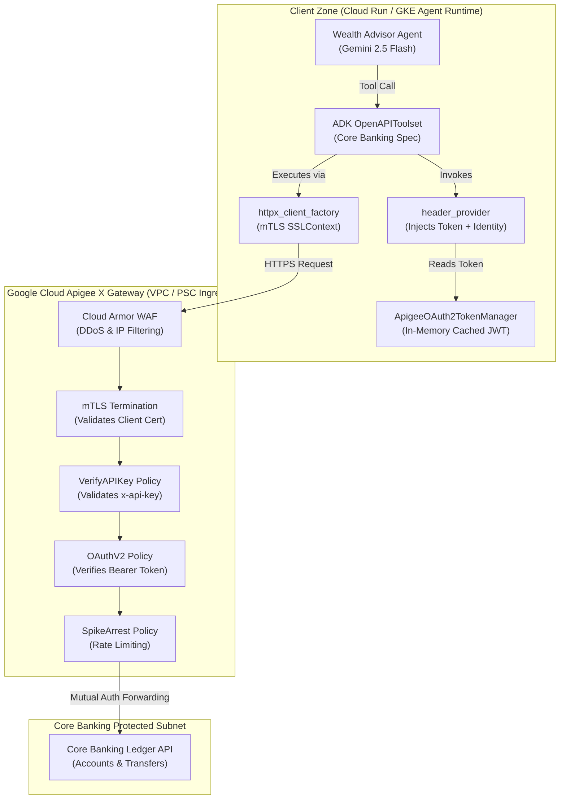

# Enterprise Playbook: Apigee X Banking Gateway Integration & Zero-Trust Architecture

> **Review notice — 5 October 2026:** the ADRs below record the earlier exercise design, not accepted customer decisions or verified Google recommendations. Use the revised [module architecture and acceptance criteria](./README.md) as the current reference. Transport-level credentials do not eliminate prompt injection or establish regulatory compliance; an identity header is not immutable; an async lock is not thread-safe; a refresh buffer cannot prevent every expiry race. Fixed token lifetimes, performance percentages, region choices and regulatory conclusions below are not demonstrated production results. Reassess these ADRs against the customer's actual identity, network, product launch-stage and authorization requirements.

## 🏛️ Executive Summary & Context

This Enterprise Playbook defines the technical specifications, architectural decisions, and integration standards for connecting Google ADK 2.0 agents to enterprise banking microservices mediated by **Google Cloud Apigee X**.

In financial services, AI agents must adhere to the same zero-trust security postures as high-throughput payment gateways, automated clearing houses (ACH), and core accounting ledgers. This document provides the blueprint for translating stringent bank security policies into robust, auditable Python code.

---

## 📐 Architecture Decision Records (ADRs)

### ADR-01: Decoupling LLM Reasoning from Credential Management
* **Status:** Accepted (Mandatory Enterprise Standard)
* **Context:**
  Traditional REST client integrations often allow application logic or end-user prompts to pass authorization headers. In an LLM-driven architecture, models generate arguments dynamically and prompt histories are captured in telemetry, vector stores, and evaluation datasets.
* **Decision:**
  Enforce strict **Control Plane vs. Data Plane separation**:
  * **Control Plane (Gemini LLM):** Only sees pure business parameters (e.g. `account_id`, `amount`, `currency`). Under no circumstances is the LLM informed of API keys, bearer tokens, or client secrets.
  * **Data Plane (HTTP Transport):** Injects authentication tokens, mTLS certificates, and identity headers at the network client level via ADK's `header_provider` and `httpx_client_factory`.
* **Consequences:**
  * ✅ Eliminates OWASP LLM01 (Prompt Injection credential exfiltration).
  * ✅ Complies with PCI-DSS Req 3.4 (Zero sensitive credential persistence in application logs).
  * ⚠️ Requires configuring a dynamic token manager inside the Python application runtime.

---

### ADR-02: Asynchronous In-Memory OAuth2 Token Caching with Skew Buffer
* **Status:** Accepted
* **Context:**
  Apigee X issues OAuth2 access tokens via the `/oauth/v2/token` endpoint with a 15-minute (900 second) time-to-live (TTL). Requesting a new token on every agent tool execution introduces 200–500ms of unnecessary latency and can trigger Apigee Spike Arrest rate limits.
* **Decision:**
  Implement a thread-safe, asynchronous in-memory `ApigeeOAuth2TokenManager` that:
  1. Caches the active access token in memory with an expiration timestamp.
  2. Implements a **proactive skew margin** of 60 seconds (refreshing when `time_remaining < 60s`).
  3. Uses an `asyncio.Lock()` to prevent the "thundering herd" problem when concurrent tool calls attempt to refresh simultaneously.
* **Consequences:**
  * ✅ Reduces API tool execution latency by >90% for subsequent calls.
  * ✅ Completely prevents in-flight token expiration races during complex multi-step agent workflows.

---

### ADR-03: Mutual TLS (mTLS) Northbound Transport Security
* **Status:** Accepted
* **Context:**
  Apex Bank enforces Mutual TLS on all internal API gateway endpoints. Callers without an approved X.509 client certificate are rejected at the TCP/TLS handshake before reaching the HTTP parsing engine.
* **Decision:**
  In production, `httpx_client_factory` constructs an `httpx.AsyncClient` backed by an `ssl.SSLContext` configured with:
  * Client Certificate and Private Key (loaded securely from Google Cloud Secret Manager or mounted Kubernetes secrets).
  * Bank Private Root CA Certificate truststore.
* **Consequences:**
  * ✅ Guarantees that only cryptographically verified agent instances running in approved VPCs can connect.
  * ⚠️ In local non-VPN development, calls fail with connection errors unless routed through an emulator.

---

### ADR-04: Immutable Caller Identity Propagation (`X-Advisor-Identity`)
* **Status:** Accepted
* **Context:**
  Under Federal Reserve SR 11-7 and OCC guidelines, all ledger queries and transfer submissions must establish strict non-repudiation and auditability. The bank must know which licensed financial advisor authorized the action.
  Under **APRA Prudential Standard CPS 234 (Information Security)** and Australian Financial Services License (AFSL) regulations, all ledger queries and transfer submissions must establish strict non-repudiation and auditability. The bank must know which licensed financial advisor authorized the action.
* **Decision:**
  The financial advisor's identity is resolved from the authenticated ADK session (`tool_context.user_id` or session metadata). The `header_provider` injects this identity directly into the HTTP header `X-Advisor-Identity`.
* **Consequences:**
  * ✅ The LLM cannot spoof, omit, or modify the advisor ID.
  * ✅ Apigee X logs the exact caller ID alongside the transaction ID for compliance auditing.

---

### ADR-05: Dual-Mode Transport Strategy (Live vs. Hermetic Emulator)
* **Status:** Accepted
* **Context:**
  Engineers developing agents or running automated CI/CD unit tests rarely have direct network connectivity to live private banking VPCs.
* **Decision:**
  Support a dual-mode transport factory:
  * **Production Mode (`ENVIRONMENT=production`):** Issues live HTTPS requests with mTLS client certificates and real Apigee OAuth2 tokens.
  * **Development & Test Mode (`ENVIRONMENT=development`):** Injects `httpx.MockTransport` emulating Apigee X proxy policies (validating OAuth2 Bearer tokens, API keys, and `X-Advisor-Identity` headers in-memory).
* **Consequences:**
  * ✅ 100% hermetic CI/CD execution without external network dependencies.
  * ✅ Allows developers to test full security validation paths locally on laptops.

---

## 📋 Requirements-to-Specification Mapping Matrix

| Banking Requirement | Threat / Risk | Apigee X Gateway Policy | ADK 2.0 / Python Construct |
|---|---|---|---|
| **Zero Prompt Credential Leakage** | Attackers extracting tokens via prompt injection | OAuthV2 (VerifyAccessToken) | `header_provider` injecting `Authorization: Bearer <token>` at transport |
| **Client Authentication & Whitelisting** | Unauthorized rogue workloads calling banking ledger | Mutual TLS Termination (Client Cert Validation) | `httpx_client_factory` configuring `ssl.SSLContext(certfile, keyfile)` |
| **API Product Entitlement** | Unregistered applications calling restricted endpoints | VerifyAPIKey Policy (`x-api-key`) | Static header injection via `header_provider` |
| **Non-Repudiation Audit Trail** | Anonymous ledger queries without user attribution | AssignMessage Policy (`request.header.X-Advisor-Identity`) | Dynamic extraction from ADK session (`tool_context.user_id`) |
| **Short-Lived Token Lifecycles** | Replay attacks using stale bearer tokens | OAuthV2 (GenerateAccessToken with 900s TTL) | `ApigeeOAuth2TokenManager` with async locking & 60s skew refresh |
| **Spike Arrest & Quotas** | Agent loops causing DDoS on core banking systems | SpikeArrest (30 rps) + Quota (10k/hr) | `httpx.AsyncClient` with exponential backoff on HTTP 429 |

---

## 🏛️ Apigee X Gateway Architecture Diagram

<!-- TEACHER_NOTE_START -->
**Teacher's note (ADK instructor view):**
- **Learning goal:** Explain the concept clearly from beginner to advanced, with a simple mental model first.
- **Why it matters:** Connect the concept to real Google agentic workflows, Python engineering habits, and production-ready decisions.
- **Version watch:** Validate against the latest official ADK / Google docs before teaching; call out deprecations or migration notes when needed.
- **Module linkage:** Connect this idea to the previous and next modules so learners see the progression across the course.
<!-- TEACHER_NOTE_END -->


---

## 📄 OpenAPI 3.0 Specification: Apigee X Secured Gateway

Below is the authoritative OpenAPI 3.0 specification bundle representing the Apigee X secured endpoints, decorated with `securitySchemes` for OAuth2 and API Key:

<!-- TEACHER_NOTE_START -->
**Teacher's note (ADK instructor view):**
- **Learning goal:** Explain the concept clearly from beginner to advanced, with a simple mental model first.
- **Why it matters:** Connect the concept to real Google agentic workflows, Python engineering habits, and production-ready decisions.
- **Version watch:** Validate against the latest official ADK / Google docs before teaching; call out deprecations or migration notes when needed.
- **Module linkage:** Connect this idea to the previous and next modules so learners see the progression across the course.
<!-- TEACHER_NOTE_END -->
```json
{
  "openapi": "3.0.3",
  "info": {
    "title": "Apex Bank Apigee X Enterprise Gateway",
    "description": "Secure Northbound Gateway for Apex Core Banking, enforcing mTLS, OAuth2, and API Key authorization.",
    "version": "1.0.0"
  },
  "servers": [
    {
      "url": "https://gateway.apexbank.internal/v1",
      "description": "Apigee X Production Ingress (PSC Peered)"
      "url": "https://gateway.syd.apexbank.com.au/v1",
      "description": "Apigee X Production Ingress (PSC Peered, australia-southeast1)"
    }
  ],
  "security": [
    {
      "OAuth2": ["banking:accounts:read", "banking:transfers:write"],
      "ApiKeyAuth": []
    }
  ],
  "paths": {
    "/accounts/{account_id}/balance": {
      "get": {
        "operationId": "get_account_balance",
        "summary": "Retrieve customer ledger balance",
        "description": "Queries real-time balance through Apigee X gateway with verified OAuth2 bearer token.",
        "parameters": [
          {
            "name": "account_id",
            "in": "path",
            "required": true,
            "description": "Unique account identifier (e.g. ACC-10294)",
            "schema": { "type": "string" }
          }
        ],
        "responses": {
          "200": {
            "description": "Balance retrieved successfully",
            "content": {
              "application/json": {
                "schema": {
                  "type": "object",
                  "properties": {
                    "account_id": { "type": "string" },
                    "available_balance": { "type": "number" },
                    "currency": { "type": "string" },
                    "status": { "type": "string" }
                  }
                }
              }
            }
          },
          "401": { "description": "Invalid or expired OAuth2 Bearer token" },
          "403": { "description": "Invalid API Key or unauthorized scope" }
        }
      }
    },
    "/transfers": {
      "post": {
        "operationId": "execute_wire_transfer",
        "summary": "Submit intra-bank wire transfer",
        "description": "Executes immediate wire transfer across accounts under zero-trust advisor identity.",
        "requestBody": {
          "required": true,
          "content": {
            "application/json": {
              "schema": {
                "type": "object",
                "required": ["source_account_id", "target_account_id", "amount", "currency"],
                "properties": {
                  "source_account_id": { "type": "string" },
                  "target_account_id": { "type": "string" },
                  "amount": { "type": "number" },
                  "currency": { "type": "string" },
                  "reference_note": { "type": "string" }
                }
              }
            }
          }
        },
        "responses": {
          "201": {
            "description": "Transfer executed successfully",
            "content": {
              "application/json": {
                "schema": {
                  "type": "object",
                  "properties": {
                    "transaction_id": { "type": "string" },
                    "status": { "type": "string" },
                    "timestamp": { "type": "string" }
                  }
                }
              }
            }
          },
          "400": { "description": "Missing X-Advisor-Identity header" },
          "401": { "description": "Unauthorized OAuth2 token" }
        }
      }
    }
  },
  "components": {
    "securitySchemes": {
      "OAuth2": {
        "type": "oauth2",
        "description": "Apigee X OAuth2 Client Credentials Grant",
        "flows": {
          "clientCredentials": {
            "tokenUrl": "https://gateway.apexbank.internal/oauth/v2/token",
            "tokenUrl": "https://gateway.syd.apexbank.com.au/oauth/v2/token",
            "scopes": {
              "banking:accounts:read": "Read access to customer account balances",
              "banking:transfers:write": "Write access to execute wire transfers"
            }
          }
        }
      },
      "ApiKeyAuth": {
        "type": "apiKey",
        "in": "header",
        "name": "x-api-key",
        "description": "Apigee X Verified API Product Key"
      }
    }
  }
}
```

---

## 🐍 Python Architecture: Component Specifications

### 1. `ApigeeOAuth2TokenManager`
<!-- TEACHER_NOTE_START -->
**Teacher's note (ADK instructor view):**
- **Learning goal:** Explain the concept clearly from beginner to advanced, with a simple mental model first.
- **Why it matters:** Connect the concept to real Google agentic workflows, Python engineering habits, and production-ready decisions.
- **Version watch:** Validate against the latest official ADK / Google docs before teaching; call out deprecations or migration notes when needed.
- **Module linkage:** Connect this idea to the previous and next modules so learners see the progression across the course.
<!-- TEACHER_NOTE_END -->
```python
class ApigeeOAuth2TokenManager:
    """Thread-safe, asynchronous in-memory OAuth2 token manager.
    """Thread-safe in-memory OAuth2 token manager.

    Responsibilities:
    - Maintains an in-memory cached JWT.
    - Caches access token alongside an absolute expiration timestamp.
    - Uses an asyncio.Lock() to prevent race conditions during token refresh.
    - Uses an asyncio.Lock() or threading lock to prevent stampedes during token refresh.
    - Automatically requests a fresh token when TTL < 60 seconds.
    - Provides get_valid_token_sync() for synchronous integration with ADK RestApiTool.
    """
    async def get_valid_token(self) -> str:
        """Returns a valid OAuth2 Bearer token, refreshing if necessary."""

    def get_valid_token_sync(self) -> str:
        """Synchronous accessor for ADK header_provider invocation."""
```

### 2. `ApigeeClientFactory`
<!-- TEACHER_NOTE_START -->
**Teacher's note (ADK instructor view):**
- **Learning goal:** Explain the concept clearly from beginner to advanced, with a simple mental model first.
- **Why it matters:** Connect the concept to real Google agentic workflows, Python engineering habits, and production-ready decisions.
- **Version watch:** Validate against the latest official ADK / Google docs before teaching; call out deprecations or migration notes when needed.
- **Module linkage:** Connect this idea to the previous and next modules so learners see the progression across the course.
<!-- TEACHER_NOTE_END -->
```python
class ApigeeClientFactory:
    """Configures the underlying httpx.AsyncClient for ADK tool execution.

    Responsibilities:
    - Configures mutual TLS (mTLS) with client certificates and truststore CA.
    - Enforces timeout budgets (10s connect, 30s read).
    - Supports mock transport injection for local testing and CI/CD.
    """
    def __call__(self) -> httpx.AsyncClient:
        """Returns a configured AsyncClient."""
```

### 3. `header_provider`
<!-- TEACHER_NOTE_START -->
**Teacher's note (ADK instructor view):**
- **Learning goal:** Explain the concept clearly from beginner to advanced, with a simple mental model first.
- **Why it matters:** Connect the concept to real Google agentic workflows, Python engineering habits, and production-ready decisions.
- **Version watch:** Validate against the latest official ADK / Google docs before teaching; call out deprecations or migration notes when needed.
- **Module linkage:** Connect this idea to the previous and next modules so learners see the progression across the course.
<!-- TEACHER_NOTE_END -->
```python
async def apigee_header_provider(readonly_context: ReadonlyContext) -> Dict[str, str]:
    """ADK 2.0 runtime header provider.
def apigee_header_provider(tool_context: Optional[ReadonlyContext] = None) -> Dict[str, str]:
    """ADK 2.0 runtime synchronous header provider.

    Responsibilities:
    - Dynamically obtains the current OAuth2 token from ApigeeOAuth2TokenManager.
    - Injects 'Authorization: Bearer <token>'.
    - Injects 'x-api-key: <api_key>'.
    - Injects 'X-Advisor-Identity: <user_id>' from caller session context.
    """
```

---

## 🧭 Navigation

* Continue to the **[Challenge Lab](./lab.md)** to implement this architecture with active learning skeletons.
* Review the **[Lab Solution](./lab-solution.md)** for complete production code, test suites, and steering prompts.

<!-- © 2026 Inder Chauhan (https://github.com/inderanz/google-adk-training). All rights reserved. Ref: IC-ADK-module11_6-enterprise-apigee-gateway-auth-playbook -->
---

## Official References

- Google ADK docs (latest): https://google.github.io/adk-docs/
- Google AI / Gemini docs: https://ai.google.dev/
- Google GenAI Python SDK reference: https://googleapis.github.io/python-genai/
- Context7 / current SDK lookup for the exact installed version and API signatures
- Related module path: review the surrounding modules for continuity, prerequisites, and follow-on concepts

