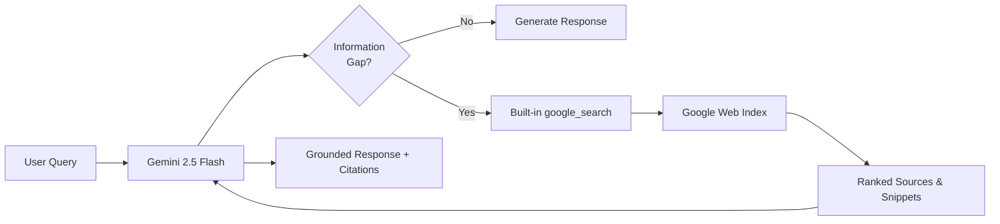
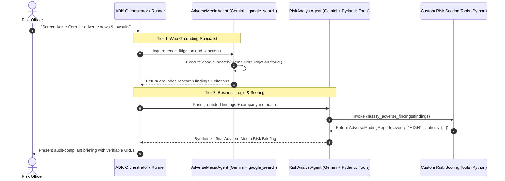

# Module 12: Built-in Tools and Enterprise Grounding

## 🧭 Executive Overview & The Grounding Imperative

In production AI applications, a large language model's greatest operational vulnerability is its **static knowledge cutoff**. Left ungrounded, an LLM generates responses based exclusively on weights frozen during pre-training. When an enterprise analyst asks about real-time market developments, a corporate borrower's recent lawsuits, breaking regulatory changes, or current inventory pricing, an ungrounded model will either plead ignorance or, worse, **confidently hallucinate plausible fiction**.

**Grounding** is the architectural practice of connecting an LLM to external, verifiable sources of truth before synthesizing a response.

In this module, you will learn the complete theory of **Google ADK 2.0 Built-in Tools and Enterprise Grounding**, progressing systematically from foundational mental models to advanced multi-agent composition and regulatory-grade citation lineage.

---

## 📚 Level 1: Mental Model & Fundamentals (Beginner)

### What is Grounding?
Grounding transforms an LLM from a closed-box next-token predictor into an **open-world intelligence system**. When grounding is active, the model:
1. Analyzes the user's prompt to detect factual information gaps.
2. Formulates targeted search queries autonomously.
3. Ingests retrieved authoritative facts into its working context.
4. Generates a response strictly rooted in those verified sources, accompanied by structured citation metadata.



### Built-in Tools vs. Custom Code
Prior to modern agentic frameworks, developers wrote complex Python scripts using web scraping libraries (`BeautifulSoup`, `Playwright`, `Selenium`) or custom search engine API wrappers.

In Google ADK 2.0, **built-in tools** eliminate this operational burden:

| Feature | Legacy Custom Scraping / Search Wrappers | ADK 2.0 Built-in Tools (`google_search`) |
|---|---|---|
| **Execution Environment** | Client-side Python runtime or container. | **Server-side** inside Google's managed model infrastructure. |
| **Maintenance & Fragility** | High: HTML layout shifts, captcha blockers, and bot bans. | **Zero:** Maintained and scaled natively by Google. |
| **Decision Autonomy** | Hardcoded logic determines when to trigger search. | **Autonomous:** Model decides *if* and *when* search is needed based on query semantics. |
| **Token Efficiency** | Poor: Raw HTML dumps bloat the LLM context window. | **Optimal:** Pre-ranked, clean snippets and citation metadata are injected directly. |

### Minimal Grounded Agent
Implementing web grounding in ADK 2.0 requires only importing `google_search` and passing it to the `Agent`:

```python
from google.adk import Agent
from google.adk.tools import google_search

# Minimal Web-Grounded Agent
grounded_agent = Agent(
    name="market_intelligence_agent",
    model="gemini-2.5-flash",
    instruction="Search the web to provide timely, factual answers to user inquiries.",
    tools=[google_search],
)
```

> [!IMPORTANT]
> Built-in tools are supported on **Gemini 2.0 and newer models** (`gemini-2.5-flash`, `gemini-2.5-pro`). Older models or deprecated model strings will raise configuration errors.

---

## ⚙️ Level 2: Under the Hood & The Coexistence Constraint (Intermediate)

### How `google_search` Executes
When an agent equipped with `google_search` receives a prompt:
1. **Dynamic Tool Calling:** The model evaluates whether the user's request requires facts beyond its knowledge cutoff or domain certainty.
2. **Internal Query Generation:** The model generates one or more search queries optimized for Google's index (e.g., `"Acme Corp environmental EPA fines 2026"`).
3. **Retrieval & Ingestion:** Google Search executes the queries, ranks the results, and passes structured snippets back to Gemini.
4. **Attribution & Metadata:** Gemini produces the final prose along with **Grounding Metadata**, which includes:
   - `web_search_queries`: The exact queries executed by the model.
   - `grounding_chunks`: Text segments extracted from retrieved web pages.
   - `grounding_supports`: Granular mappings connecting specific response sentences to source URIs.

---

### ⚠️ The Coexistence Constraint: `400 INVALID_ARGUMENT`

A common mistake made by developers is attempting to place `google_search` and custom Python functions inside the same agent's `tools` list:

```python
# ❌ THIS WILL FAIL AT RUNTIME!
from google.adk import Agent
from google.adk.tools import google_search


def query_internal_database(client_id: str) -> dict:
    """Look up internal customer records."""
    return {"client_id": client_id, "status": "active"}


broken_agent = Agent(
    name="hybrid_agent",
    model="gemini-2.5-flash",
    instruction="Search the web and check internal database.",
    tools=[google_search, query_internal_database],  # ❌ PROHIBITED!
)
```

While the Python interpreter will construct this `Agent` object without error, **the first model execution will fail immediately**:

```text
400 INVALID_ARGUMENT: Multiple tools are supported only when they are all search tools.
```

#### Why Does This Constraint Exist?
This is a fundamental architecture boundary in the **underlying Gemini API** (not a limitation of the ADK framework). Google Search grounding uses a specialized server-side execution pipeline that is separate from the client-side function-calling protocol. The Gemini API engine does not currently support combining both tool execution channels within a single model generation turn.

---

## 🏛️ Level 3: Advanced Architecture — Sequential Multi-Agent Composition

To combine the live power of `google_search` with enterprise custom business logic (e.g., Pydantic calculators, internal database queries, or compliance policy engines), Google Forward-Deployed Engineers use **Sequential Multi-Agent Composition**.

### The Two-Tier Agent Architecture
Instead of forcing one agent to juggle incompatible tool types, we decouple the workflow into two specialized agent nodes:

1. **Tier 1: Grounding Specialist (`SearchSpecialist`):**
   - Configured with `tools=[google_search]`.
   - Dedicated exclusively to finding current, factual web evidence.
2. **Tier 2: Business Logic & Compliance Analyst (`RiskAnalyst`):**
   - Configured with **Typed Pydantic Custom Tools** (e.g., `evaluate_adverse_risk`, `extract_sanction_citations`).
   - Ingests the findings from Tier 1, validates data structures, applies internal policy rules, and formats auditable reports.



### Typed Inter-Agent Data Contracts
In enterprise production, data passed between agents must never be unstructured free-form text. We enforce **Typed Pydantic Schemas** to govern the transition:

```python
from typing import List
from pydantic import BaseModel, Field


class AdverseFinding(BaseModel):
    """Structured risk signal extracted from grounded search results."""

    headline: str = Field(description="Summary of adverse event or lawsuit")
    source_domain: str = Field(
        description="Verifiable publisher domain from grounding metadata"
    )
    risk_category: str = Field(
        description="LITIGATION, FRAUD, SANCTIONS, REGULATORY, or ESG"
    )
    severity: str = Field(description="CRITICAL, ELEVATED, or LOW")


class AdverseMediaReport(BaseModel):
    """Consolidated due diligence assessment for Credit Committee."""

    company_name: str
    overall_risk_level: str
    findings: List[AdverseFinding]
    is_eligible_for_lending: bool
    compliance_officer_review_required: bool
```

---

## 🌐 Level 4: The Three Enterprise Grounding Modalities

Depending on the customer's data topology, a Google FDE selects from **three distinct grounding modalities**:

| Grounding Modality | Google Service / Tool | Data Source | Primary Enterprise Use Cases | Environment Availability |
|---|---|---|---|---|
| **1. Public Web Grounding** | `google_search` | Real-time global web index | Adverse media screening, competitor tracking, market news, breaking regulatory alerts. | Gemini Developer API & Vertex AI |
| **2. Geospatial Grounding** | `google_maps_grounding` | Google Maps Platform database | Physical branch verification, collateral site audits, logistics routing, territory analysis. | **Vertex AI Only** |
| **3. Private Enterprise Grounding** | Vertex AI Search / Datastores | Private company repositories (PDFs, Confluence, BigQuery, Cloud Storage) | Internal policy manuals, proprietary underwriting guidelines, HR benefit handbooks, customer contracts. | **Vertex AI Only** |

### Comparison: Public Grounding vs. Private Enterprise RAG
* **Use `google_search`** when the question requires facts that exist in the public domain (e.g., *"Did the SEC file charges against Company X yesterday?"*).
* **Use Vertex AI Search (Datastores)** when the question requires proprietary enterprise knowledge not accessible to public search engines (e.g., *"What is our bank's internal single-borrower exposure limit for commercial real estate?"*).
* **Combine both** in multi-agent workflows to synthesize external market intelligence with internal policy documents.

---

## 🛡️ Level 5: Regulatory Compliance & Citation Lineage (Fed SR 11-7)

Under **Federal Reserve Supervisory Letter SR 11-7 (Model Risk Management)** and OCC compliance rules, financial institutions cannot base credit or underwriting decisions on ungrounded or opaque AI generations.

### The Auditability Requirement
Every automated finding must possess a **defensible lineage**:
1. **Source Attribution:** The AI must cite the originating domain (e.g., `sec.gov`, `reuters.com`, `federalreserve.gov`).
2. **Verifiable Linkage:** The exact article URL must be preserved so compliance officers can verify the claim in one click.
3. **Temporal Validity:** Search findings must record the timestamp of the retrieval turn to prove when the adverse check was conducted.

By deploying `google_search` within a sequential multi-agent pipeline, enterprises achieve both **autonomous research capabilities** and **uncompromising regulatory auditability**.

---

## 📚 Official References

- Google ADK Grounding Documentation: https://google.github.io/adk-docs/tools/
- Google GenAI Grounding Guide: https://ai.google.dev/gemini-api/docs/google-search
- Vertex AI Search & Grounding: https://cloud.google.com/vertex-ai/generative-ai/docs/grounding/overview
- Federal Reserve SR 11-7 (Model Risk Management): https://www.federalreserve.gov/supervisionreg/srletters/sr1107.htm
- Google GenAI Python SDK: https://googleapis.github.io/python-genai/
