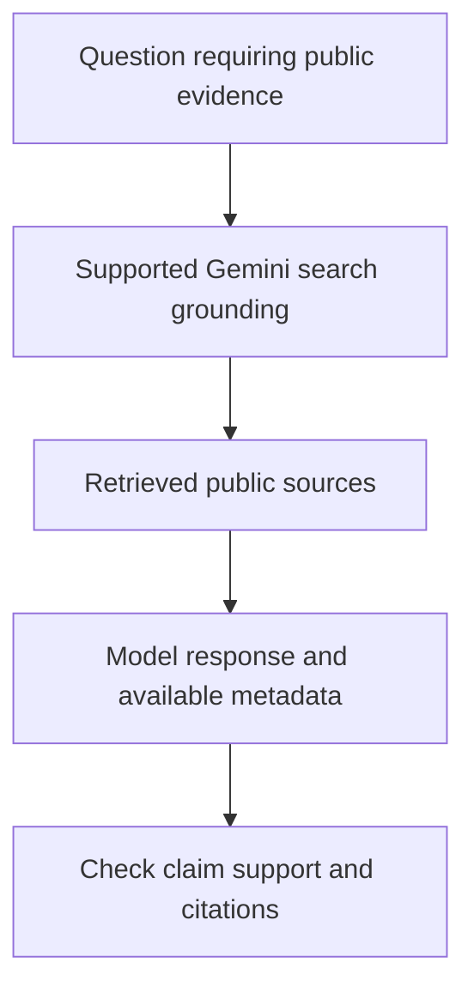

# Module 12: Built-in Tools and Enterprise Grounding

## Before you begin: what this module teaches

**ADK concept: grounding, source metadata and evidence-backed answers.**

Grounding supplies external evidence for a response. A citation points to a source or supporting segment; it is not proof that every sentence is correct. Public web grounding, retrieval over approved private content and a transactional case lookup serve different needs. Freshness, source authority and user access must be evaluated for the actual question.

**Where you would use this in real work.**

Meera asks for current public background about a company and then asks whether the bank received its documents. The first may fit public search; the second requires a private authorized case lookup. Calling both “search” hides a crucial data-ownership distinction.

**Connection to Gemini Enterprise Agent Platform and Google Cloud.**

Use the supported Gemini/ADK grounding capability for the chosen source. Google Search grounding is not an authorization path into bank records. Tool coexistence and metadata vary by model/API configuration; verify supported combinations rather than assuming every built-in tool mixes with every custom function.

**By the end, you should be able to:**

- Choose the correct evidence source for two different analyst questions.
- Inspect available grounding metadata without assuming every turn contains it.
- Identify unsupported claims despite the presence of citations.

### Review this lesson through three perspectives

- **Python/ADK beginner:** Follow a cited claim back to its source.
- **Experienced engineer:** Evaluate missing, stale and contradictory evidence and tool-combination compatibility.
- **Bank FDE:** Ask what makes a source approved and how an analyst should see uncertainty.

Use the [guided lab](./lab.md) to observe the mechanism, then compare with the [solution](./lab-solution.md). The banking scenario above explains how to transfer the concept; a lab using a railway, weather or shopping fixture does not implement a live bank integration.

## 🧭 Executive Overview & The Grounding Imperative

In production AI applications, a large language model's greatest operational vulnerability is its **static knowledge cutoff**. Left ungrounded, an LLM generates responses based exclusively on weights frozen during pre-training. When an enterprise analyst asks about real-time market developments, a corporate borrower's recent lawsuits, breaking regulatory changes, or current inventory pricing, an ungrounded model will either plead ignorance or, worse, **confidently hallucinate plausible fiction**.

**Grounding** is the architectural practice of connecting an LLM to external, verifiable sources of truth before synthesizing a response.

In this module, you will learn the complete theory of **Google ADK 2.0 Built-in Tools and Enterprise Grounding**, progressing systematically from foundational mental models to advanced multi-agent composition and regulatory-grade citation lineage.

---

### 🚨 The Operational Disaster: The $18M Phantom Lawsuit Panic at Apex Capital

During a high-stakes \$65,000,000 mezzanine debt syndication for **Apex Semiconductor Solutions**, a senior investment associate queried an internal, ungrounded LLM research assistant:
> *"Are there any active federal trade secrets or patent infringement disputes against Apex Semiconductor Solutions?"*

Because the ungrounded model had a frozen knowledge cutoff and confused Apex Semiconductor with an unrelated, defunct Delaware shell entity named *Apex Micro LLC*, the model confidently answered:
> *"Yes. On January 12, 2026, the Department of Justice and FTC unsealed an indictment against Apex Semiconductor for cross-border IP theft and trade secret espionage in the Eastern District of Texas."*

The resulting fallout was catastrophic:
1. **Emergency Syndication Halt:** The lead underwriter immediately froze the \$65M credit syndicate 48 hours prior to transaction closing, triggering a \$1,200,000 broken-deal penalty clause.
2. **$850,000 in Emergency Legal Audit Fees:** Apex hired white-collar defense attorneys to search federal PACER court dockets and DOJ press archives across 94 federal judicial districts.
3. **The Discovery of the Phantom Docket:** After 4 days of frantic litigation audits, the attorneys confirmed that **zero federal dockets existed**. The LLM had hallucinated the indictment, combining keywords from a 2019 patent lawsuit with a 2024 DOJ press release from a completely different industry.

> *"If that assistant had been grounded in Google Search with verifiable grounding metadata,"* the Managing Partner noted during the post-mortem, *"the model would have executed targeted live search queries, retrieved primary source `justice.gov` and `courtlistener.com` dockets, and returned zero-finding confirmation backed by primary URLs rather than hallucinating an indictment from thin air."*

---

## 📚 Level 1: Mental Model & Fundamentals (Beginner)

### What is Grounding?
Grounding transforms an LLM from a closed-box next-token predictor into an **open-world intelligence system**. When grounding is active, the model:
1. Analyzes the user's prompt to detect factual information gaps.
2. Formulates targeted search queries autonomously.
3. Ingests retrieved authoritative facts into its working context.
4. Generates a response strictly rooted in those verified sources, accompanied by structured citation metadata.

<!-- TEACHER_NOTE_START -->
**Teacher's note (ADK instructor view):**
- **Learning goal:** Explain the concept clearly from beginner to advanced, with a simple mental model first.
- **Why it matters:** Connect the concept to real Google agentic workflows, Python engineering habits, and production-ready decisions.
- **Version watch:** Validate against the latest official ADK / Google docs before teaching; call out deprecations or migration notes when needed.
- **Module linkage:** Connect this idea to the previous and next modules so learners see the progression across the course.
<!-- TEACHER_NOTE_END -->


### Built-in Tools vs. Custom Code
Prior to modern agentic frameworks, developers wrote complex Python scripts using web scraping libraries (`BeautifulSoup`, `Playwright`, `Selenium`) or custom search engine API wrappers.

In Google ADK 2.0, **built-in tools** eliminate this operational burden:

| Feature | Legacy Custom Scraping / Search Wrappers | ADK 2.0 Built-in Tools (`google_search`) |
|---|---|---|
| **Execution Environment** | Client-side Python runtime or container. | **Server-side** inside Google's managed model infrastructure. |
| **Maintenance & Fragility** | High: HTML layout shifts, captcha blockers, and bot bans. | **Zero:** Maintained and scaled natively by Google. |
| **Decision Autonomy** | Hardcoded logic determines when to trigger search. | **Autonomous:** Model decides *if* and *when* search is needed based on query semantics. |
| **Token Efficiency** | Poor: Raw HTML dumps bloat the LLM context window. | **Optimal:** Pre-ranked, clean snippets and citation metadata are injected directly. |

### Minimal Grounded Agent
Implementing web grounding in ADK 2.0 requires only importing `google_search` and passing it to the `Agent`:

<!-- TEACHER_NOTE_START -->
**Teacher's note (ADK instructor view):**
- **Learning goal:** Explain the concept clearly from beginner to advanced, with a simple mental model first.
- **Why it matters:** Connect the concept to real Google agentic workflows, Python engineering habits, and production-ready decisions.
- **Version watch:** Validate against the latest official ADK / Google docs before teaching; call out deprecations or migration notes when needed.
- **Module linkage:** Connect this idea to the previous and next modules so learners see the progression across the course.
<!-- TEACHER_NOTE_END -->
```python
from google.adk.agents import Agent
from google.adk.tools import google_search

# Minimal Web-Grounded Agent
grounded_agent = Agent(
    name="market_intelligence_agent",
    model="gemini-2.5-flash",
    instruction="Search the web to provide timely, factual answers to user inquiries.",
    tools=[google_search],
)
```

> [!IMPORTANT]
> Built-in tools are supported on **Gemini 2.0 and newer models** (`gemini-2.5-flash`, `gemini-2.5-pro`). Older models or deprecated model strings will raise configuration errors.

---

## ⚙️ Level 2: Under the Hood & The Coexistence Constraint (Intermediate)

### How `google_search` Executes
When an agent equipped with `google_search` receives a prompt:
1. **Dynamic Tool Calling:** The model evaluates whether the user's request requires facts beyond its knowledge cutoff or domain certainty.
2. **Internal Query Generation:** The model generates one or more search queries optimized for Google's index (e.g., `"Acme Corp environmental EPA fines 2026"`).
3. **Retrieval & Ingestion:** Google Search executes the queries, ranks the results, and passes structured snippets back to Gemini.
4. **Attribution & Metadata:** Gemini produces the final prose along with **Grounding Metadata**, which includes:
   - `web_search_queries`: The exact queries executed by the model.
   - `grounding_chunks`: Text segments extracted from retrieved web pages.
   - `grounding_supports`: Granular mappings connecting specific response sentences to source URIs.

---

### ⚠️ The Coexistence Constraint: `400 INVALID_ARGUMENT`

A common mistake made by developers is attempting to place `google_search` and custom Python functions inside the same agent's `tools` list:

<!-- TEACHER_NOTE_START -->
**Teacher's note (ADK instructor view):**
- **Learning goal:** Explain the concept clearly from beginner to advanced, with a simple mental model first.
- **Why it matters:** Connect the concept to real Google agentic workflows, Python engineering habits, and production-ready decisions.
- **Version watch:** Validate against the latest official ADK / Google docs before teaching; call out deprecations or migration notes when needed.
- **Module linkage:** Connect this idea to the previous and next modules so learners see the progression across the course.
<!-- TEACHER_NOTE_END -->
```python
# ❌ THIS WILL FAIL AT RUNTIME!
from google.adk.agents import Agent
from google.adk.tools import google_search


def query_internal_database(client_id: str) -> dict:
    """Look up internal customer records."""
    return {"client_id": client_id, "status": "active"}


broken_agent = Agent(
    name="hybrid_agent",
    model="gemini-2.5-flash",
    instruction="Search the web and check internal database.",
    tools=[google_search, query_internal_database],  # ❌ PROHIBITED!
)
```

While the Python interpreter will construct this `Agent` object without error, **the first model execution will fail immediately**:

```text
400 INVALID_ARGUMENT: Multiple tools are supported only when they are all search tools.
```

#### Why Does This Constraint Exist?
This is a fundamental architecture boundary in the **underlying Gemini API** (not a limitation of the ADK framework). Google Search grounding uses a specialized server-side execution pipeline that is separate from the client-side function-calling protocol. The Gemini API engine does not currently support combining both tool execution channels within a single model generation turn.

---

## 🔍 Level 3: Grounding Metadata Deep-Dive & Citation Lineage (ADK 2.0)

### What is Grounding Metadata? (The Mental Model)

In an ordinary ungrounded LLM interaction, the model returns a single block of text. You have to take the model's word for it, with zero proof of where the facts came from.

When an ADK 2.0 agent is grounded with `google_search`, the model acts like an **investigative researcher presenting a formal dossier**:
1. **The Briefing Text (`event.content`):** The synthesized, human-readable answer.
2. **The Evidence Packet (`event.grounding_metadata`):** The complete forensic audit trail containing the search queries the AI formulated, the web pages it visited, and the exact links connecting each sentence to its source.

```text
ADK 2.0 Response Event (Final Response)
├── event.content (What the human reads)
│   └── "Acme Industrial Corp settled an EPA civil penalty in Ohio in 2025..."
│
└── event.grounding_metadata (The receipts / verifiable evidence)
    ├── web_search_queries (The AI's search strategy)
    │   └── ["Acme Industrial Corp EPA penalty Ohio 2025", "Acme litigation dockets"]
    ├── grounding_chunks (The authoritative web documents retrieved)
    │   ├── Chunk 0: title="EPA Region 5 Enforcement Docket", uri="https://epa.gov/..."
    │   └── Chunk 1: title="Reuters Legal News", uri="https://reuters.com/..."
    └── grounding_supports (Sentence-level proof & confidence)
        └── Sentence 1 ("Acme settled...") ──maps to──> Chunk 0 (Confidence: 0.95)
```

---

### Anatomy of `types.GroundingMetadata`

In ADK 2.0, when you execute an agent programmatically using **`InMemoryRunner`** (from Module 6), the final `Event` contains `event.grounding_metadata` with three critical attributes:

| Attribute | Python Type | What It Represents | Why Enterprises Need It |
|---|---|---|---|
| **`web_search_queries`** | `list[str]` | The exact search queries Gemini formulated dynamically. | **Search Observability:** Proves *what* the AI searched for and whether it asked the right questions. |
| **`grounding_chunks`** | `list[GroundingChunk]` | Web pages retrieved from Google's index. Contains `chunk.web.title`, `chunk.web.uri`, and `chunk.web.domain`. | **Verifiable Lineage:** Provides clickable, primary-source URLs required by auditors (Fed SR 11-7). |
| **`grounding_supports`** | `list[GroundingSupport]` | Mappings connecting specific sentences in `event.content` to indices in `grounding_chunks`. | **Citation Accuracy:** Powers UI footnote numbers (`[1]`, `[2]`) and allows verifying individual claims. |

---

### Why Enterprises Must Extract Metadata Programmatically

Why not just let the model output text and ignore the metadata?

1. **Building Rich User Interfaces:**
   Modern applications display **search chips** (*"Searched: Acme Corp EPA penalties"*) and **clickable source cards** at the bottom of the response, just like Gemini and Google Search. This is only possible if your application parses `event.grounding_metadata`.
2. **Regulatory Audit Logging (Fed SR 11-7 & APRA CPS 234):**
   In commercial banking, an AI summary stating *"Borrower has no lawsuits"* cannot be stored without proof. Compliance systems must persist the exact query strings and source URLs alongside the credit decision.
3. **Automated Hallucination Detection:**
   By comparing `event.content` against `grounding_supports`, downstream validation logic can verify whether a high-stakes claim is backed by high-confidence source chunks before presenting it to an executive.

---

### Step-by-Step: How to Extract Grounding Metadata in Code

Building directly on **Module 6 (`InMemoryRunner`)**, here is the 4-step mental model for extracting metadata:

#### Step 1: Wait for the Final Response Event
During streaming execution (`runner.run_async()`), intermediate token events are emitted. The complete grounding envelope is attached to the **final turn event** where `event.is_final_response()` is `True`.

#### Step 2: Guard Against Non-Search Turns
If a user submits a conversational prompt (e.g., *"Hello"* or *"Thank you"*), Gemini answers directly from internal knowledge without querying Google Search. In those turns, `event.grounding_metadata` is `None`. Always check `if event.grounding_metadata:` before accessing child attributes.

#### Step 3: Extract the Queries & Sources
Iterate over `grounding_chunks` to extract `chunk.web.title` and `chunk.web.uri`.

---

### Complete Programmatic Extraction Example

Here is the complete, pedagogical Python implementation:

<!-- TEACHER_NOTE_START -->
**Teacher's note (ADK instructor view):**
- **Learning goal:** Explain the concept clearly from beginner to advanced, with a simple mental model first.
- **Why it matters:** Connect the concept to real Google agentic workflows, Python engineering habits, and production-ready decisions.
- **Version watch:** Validate against the latest official ADK / Google docs before teaching; call out deprecations or migration notes when needed.
- **Module linkage:** Connect this idea to the previous and next modules so learners see the progression across the course.
<!-- TEACHER_NOTE_END -->
```python
"""Module 12 Concept: Programmatic Grounding Metadata Extraction.

Demonstrates how to run a grounded agent and extract citation lineage.
"""

import asyncio
from google.adk.agents import Agent
from google.adk.runners import InMemoryRunner
from google.adk.tools import google_search
from google.genai import types

# 1. Define the Grounded Agent
research_agent = Agent(
    name="market_researcher",
    model="gemini-2.5-flash",
    instruction=(
        "You are a research analyst. Use google_search to investigate the entity"
        " and summarize key regulatory or market developments."
    ),
    tools=[google_search],
)


# 2. Execute and Extract Lineage
async def run_grounded_research(topic: str):
    app_name = "grounding_demo_app"
    runner = InMemoryRunner(agent=research_agent, app_name=app_name)

    # Create session (Module 6 review)
    await runner.session_service.create_session(
        app_name=app_name,
        user_id="analyst_01",
        session_id="session_market_check",
    )

    print(f"🔍 Submitting query: '{topic}'...")

    # Stream events from the agent
    async for event in runner.run_async(
        user_id="analyst_01",
        session_id="session_market_check",
        new_message=types.Content(
            role="user",
            parts=[types.Part.from_text(text=topic)],
        ),
    ):
        # We only inspect the final response event
        if event.is_final_response():
            # A. Extract the final text response
            final_text = ""
            if event.content and event.content.parts:
                final_text = "".join(p.text for p in event.content.parts if p.text)

            print("\n" + "=" * 50)
            print("📝 AGENT RESPONSE:")
            print("=" * 50)
            print(final_text)

            # B. Inspect Grounding Metadata
            print("\n" + "=" * 50)
            print("🔎 GROUNDING EVIDENCE PACKET:")
            print("=" * 50)

            if event.grounding_metadata:
                # Extract search queries formulated by Gemini
                queries = event.grounding_metadata.web_search_queries or []
                print(f"Executed Search Queries ({len(queries)}):")
                for q in queries:
                    print(f"  • {q}")

                # Extract web chunks (sources & URLs)
                chunks = event.grounding_metadata.grounding_chunks or []
                print(f"\nRetrieved Web Sources ({len(chunks)}):")
                for chunk in chunks:
                    if chunk.web and chunk.web.uri:
                        print(f"  • [{chunk.web.title}]({chunk.web.uri})")
            else:
                print("No search was triggered (answered directly from memory).")


if __name__ == "__main__":
    asyncio.run(
        run_grounded_research(
            "What were the major FAA regulatory actions regarding Boeing in 2026?"
        )
    )
```

### Expected Output

When this script runs, notice how cleanly the **human answer** and the **evidence packet** are separated:

```text
🔍 Submitting query: 'What were the major FAA regulatory actions regarding Boeing in 2026?'...

==================================================
📝 AGENT RESPONSE:
==================================================
In 2026, the Federal Aviation Administration (FAA) expanded its oversight of Boeing's manufacturing processes, capping 737 MAX production rates pending quality audits and mandating updated safety management protocols...

==================================================
🔎 GROUNDING EVIDENCE PACKET:
==================================================
Executed Search Queries (2):
  • FAA regulatory actions Boeing 2026 production cap
  • Boeing safety oversight directives FAA 2026

Retrieved Web Sources (2):
  • [FAA Press Release: Boeing Production Oversight Update](https://faa.gov/newsroom/boeing-oversight-2026)
  • [Reuters: FAA Maintains Oversight Capping 737 Output](https://reuters.com/business/aerospace-defense/...)
```

---

## 🌐 Level 4: The Three Enterprise Grounding Modalities

Depending on the customer's data topology, a Google FDE selects from **three distinct grounding modalities**:

| Grounding Modality | Google Service / Tool | Data Source | Primary Enterprise Use Cases | Environment Availability |
|---|---|---|---|---|
| **1. Public Web Grounding** | `google_search` | Real-time global web index | Adverse media screening, competitor tracking, market news, breaking regulatory alerts. | Gemini Developer API & Vertex AI |
| **2. Geospatial Grounding** | `google_maps_grounding` | Google Maps Platform database | Physical branch verification, collateral site audits, logistics routing, territory analysis. | **Vertex AI Only** |
| **3. Private Enterprise Grounding** | Vertex AI Search / Datastores | Private company repositories (PDFs, Confluence, BigQuery, Cloud Storage) | Internal policy manuals, proprietary underwriting guidelines, HR benefit handbooks, customer contracts. | **Vertex AI Only** |

### Comparison: Public Grounding vs. Private Enterprise RAG
* **Use `google_search`** when the question requires facts that exist in the public domain (e.g., *"Did the SEC file charges against Company X yesterday?"*).
* **Use Vertex AI Search (Datastores)** when the question requires proprietary enterprise knowledge not accessible to public search engines (e.g., *"What is our bank's internal single-borrower exposure limit for commercial real estate?"*).
* **Combine both** in multi-agent workflows to synthesize external market intelligence with internal policy documents.

---

## 🛡️ Level 5: Regulatory Compliance & Citation Lineage (Fed SR 11-7)

Under **Federal Reserve Supervisory Letter SR 11-7 (Model Risk Management)** and OCC compliance rules, financial institutions cannot base credit or underwriting decisions on ungrounded or opaque AI generations.

### The Auditability Requirement
Every automated finding must possess a **defensible lineage**:
1. **Source Attribution:** The AI must cite the originating domain (e.g., `sec.gov`, `reuters.com`, `federalreserve.gov`).
2. **Verifiable Linkage:** The exact article URL must be preserved so compliance officers can verify the claim in one click.
3. **Temporal Validity:** Search findings must record the timestamp of the retrieval turn to prove when the adverse check was conducted.

By deploying `google_search` and capturing structured grounding metadata, enterprises achieve both **autonomous research capabilities** and **uncompromising regulatory auditability**.

---

## 📚 Official References

- Google ADK Grounding Documentation: https://google.github.io/adk-docs/tools/
- Google GenAI Grounding Guide: https://ai.google.dev/gemini-api/docs/google-search
- Vertex AI Search & Grounding: https://cloud.google.com/vertex-ai/generative-ai/docs/grounding/overview
- Federal Reserve SR 11-7 (Model Risk Management): https://www.federalreserve.gov/supervisionreg/srletters/sr1107.htm
- Google GenAI Python SDK: https://googleapis.github.io/python-genai/
## Continue the course story

Previous: [Module 11.6](../module11_6-enterprise-apigee-gateway-auth/README.md) · Next: [Module 13](../module13-tool-context/README.md) · [See how the concepts build](../learning-journey.md)

Before continuing, explain one input, one ADK execution boundary and one failure outcome from this module. Use the next chapter to add a new customer requirement, not merely another component.
---

## Official References

- Google ADK docs (latest): https://google.github.io/adk-docs/
- Google AI / Gemini docs: https://ai.google.dev/
- Google GenAI Python SDK reference: https://googleapis.github.io/python-genai/
- Context7 / current SDK lookup for the exact installed version and API signatures
- Related module path: review the surrounding modules for continuity, prerequisites, and follow-on concepts

