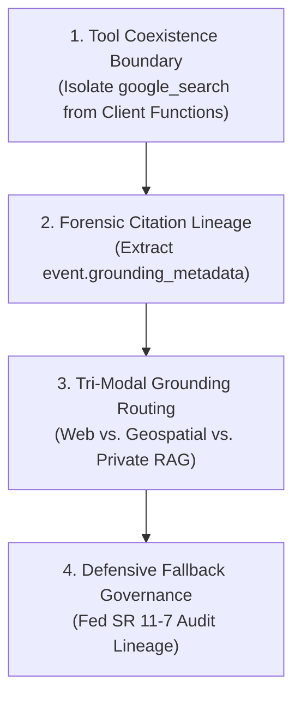

# Module 12 Enterprise Playbook: Grounding, Search, and Reputation-Aware AI

This module is where the agent starts to become more trustworthy in the real world. It no longer depends only on embedded model knowledge or local tool logic. It can ground itself in current external information, which is essential for enterprise use cases involving live facts, rapidly changing events, regulations, news, or operational data.

For a forward-deployed engineer, this is a very important shift. The customer concern is no longer just “can the agent talk?” It becomes: “can the agent answer using recent, relevant, and defensible facts?”

## The forward-deployed engineer lens

Customers often ask questions like:

- “Can this agent check the latest product information and current market details?”
- “Can it answer questions using up-to-date public information?”
- “Can it check current events and summarize them for our team?”
- “We need a grounded answer, not a generic one based on older training data.”

This is the moment when grounding becomes a core business requirement rather than a technical nice-to-have.

## Business translation

Grounding means using external sources to inform the answer. In enterprise settings, that usually means:

- web search for current facts
- internal knowledge retrieval for company-owned documents
- structured retrieval for curated business data
- fact verification before making recommendations

The important business question is not whether the model can “search.” It is whether the answer can be tied to reliable evidence, current context, and defensible reasoning.

## Core ADK concept

Built-in tools like `google_search` allow the model to use external data while generating a response. This is a practical implementation of grounded AI.

The key idea is simple but powerful:

- the model does not rely only on its static training memory
- the model can retrieve fresh or relevant information when it needs facts
- the answer is more likely to reflect reality if grounded in current sources

This is especially important for customer support, market analysis, trend awareness, and research-driven operations.

## Enterprise pattern

### Pattern 1: Current-state knowledge assistant
Use grounding when a user asks about current facts, news, policies, or external market conditions.

Examples:

- current pricing information
- recent vendor announcements
- public company or regulatory updates
- current event summaries

### Pattern 2: Fact-checking and risk reduction
Grounding is often used to reduce the chance of hallucination when the response must be based on real-world information.

This is a valuable pattern when the user expects high confidence or the output may influence business decisions.

### Pattern 3: Search-plus-process pipeline
Because built-in tools and custom tools cannot usually coexist in the same agent, the production pattern is to separate them intentionally:

1. search-only agent retrieves the external facts,
2. second agent or workflow applies internal business logic or custom processing,
3. combined result is used to produce the final answer.

This is a practical design pattern for enterprise systems where both public knowledge and internal workflows matter.

## Why grounding matters in production

Grounding is a big reliability upgrade, but it also introduces important operational concerns:

- source quality matters
- search results must be interpreted carefully
- the model should not overtrust weak or noisy sources
- enterprise knowledge may need retrieval from internal sources instead of public web sources
- grounded answers still need human review in sensitive or high-impact contexts

This is exactly where forward-deployed engineering becomes important: not just automating search, but designing a trustworthy fact-gathering workflow.

## Best practices for real customer work

### 1. Distinguish facts from recommendations
Grounding is best when the answer requires factual support. Recommendations still need business rules, risk analysis, and human review.

### 2. Pair grounding with business logic
A strong system often uses a grounded agent plus a tailored internal workflow agent. This preserves the benefits of external data without losing enterprise constraints.

### 3. Keep tool scope disciplined
Do not add every possible tool to the agent. Grounding is useful when it supports the task, not as a universal default.

### 4. Be careful with high-risk conclusions
For legal, financial, compliance, or health-related questions, the grounded answer should still be reviewed by a human or governed by a policy layer.

## Common enterprise anti-patterns

### Anti-pattern 1: treating grounded answers as automatically correct
Search can retrieve relevant content, but relevance is not the same as truth or suitability.

### Anti-pattern 2: mixing built-in search tools with custom tools in one agent
This is not just a convenience issue; the underlying Gemini API restriction makes this pattern unreliable. Use sequential composition instead.

### Anti-pattern 3: relying only on web search for enterprise knowledge
Many enterprise decisions depend on internal documents, policies, procedures, and business systems. Public search is only one part of a broader knowledge strategy.

### Anti-pattern 4: ignoring source quality and retrieval quality
A grounded answer is only as strong as the retrieval layer feeding it.

---

## 🏛️ The 4 Tenets of Production Grounding Architecture

<!-- TEACHER_NOTE_START -->
**Teacher's note (ADK instructor view):**
- **Learning goal:** Explain the concept clearly from beginner to advanced, with a simple mental model first.
- **Why it matters:** Connect the concept to real Google agentic workflows, Python engineering habits, and production-ready decisions.
- **Version watch:** Validate against the latest official ADK / Google docs before teaching; call out deprecations or migration notes when needed.
- **Module linkage:** Connect this idea to the previous and next modules so learners see the progression across the course.
<!-- TEACHER_NOTE_END -->

### Tenet 1: The Tool Coexistence Boundary (Isolate Search from Function Calling)
The underlying Gemini API treats Google Search grounding as a managed server-side execution pipeline distinct from the client-side function-calling protocol. Placing `google_search` and custom Python functions inside the same `Agent.tools` list triggers an immediate `400 INVALID_ARGUMENT` runtime error. In enterprise workflows, always decouple search into a dedicated specialist agent and compose via sequential multi-agent pipelines (Module 15).

### Tenet 2: Forensic Citation Lineage (Capture Metadata at the Source)
A plain text response is legally indefensible in regulated industries. Production applications must extract `event.grounding_metadata` programmatically via `InMemoryRunner`, capturing:
1. `web_search_queries`: Proves what queries the model formulated.
2. `grounding_chunks`: Clickable primary-source URLs (`chunk.web.uri`) and page titles.
3. `grounding_supports`: Sentence-level attribution linking specific paragraphs to retrieved source indices.

### Tenet 3: Tri-Modal Grounding Routing (Select the Right Knowledge Layer)
Enterprises must route questions to the correct grounding modality rather than treating all external lookups as generic web searches:
- **Public Web Grounding (`google_search`):** For adverse news, litigation dockets, and competitor moves.
- **Geospatial Grounding (`google_maps_grounding`):** For branch verification and logistics routing.
- **Private Enterprise Grounding (Vertex AI Search Datastores):** For proprietary underwriting manuals, loan agreements, and customer PII.

### Tenet 4: Defensive Fallback Governance (Fed SR 11-7 Compliance)
Never allow an agent to hallucinate facts when a search query yields zero results or when conversational turns bypass search (`event.grounding_metadata is None`). The application must enforce defensive fallback schemas, confirming whether a clean background check is a verified finding or a retrieval failure.

---

## ⚠️ Enterprise Anti-Pattern Comparison Matrix

| Architectural Dimension | ❌ High-Risk Anti-Pattern | ✅ Google FDE Production Standard | Consequence of Failure |
|---|---|---|---|
| **Tool Registration** | `tools=[google_search, query_database]` in a single agent | Dedicated search agent composed sequentially with data agents | Immediate `400 INVALID_ARGUMENT` runtime crash. |
| **Citation Handling** | Displaying raw text and discarding `event.grounding_metadata` | Parsing metadata into typed Pydantic models (`GroundedAuditReport`) | Inability to prove provenance under Fed SR 11-7 regulatory audit. |
| **Search Verification** | Trusting the model's self-generated URLs in generated prose | Extracting verified `chunk.web.uri` from Google Search metadata | Hallucinated dead-link URLs presented to executives. |
| **Private Data Queries** | Using `google_search` to query internal bank policies or borrower PII | Using Vertex AI Search Datastores with IAM access controls | Data leak into public search engine pipelines; zero hits on private docs. |
| **Conversational Guarding** | Assuming `event.grounding_metadata` is always populated | Defensive `if event.grounding_metadata:` checks before access | `AttributeError: 'NoneType' object has no attribute 'web_search_queries'` crash on greeting turns. |

---

## Grounding as a design asset

The real value of this module is not simply that the model can search the web. The value is that the model can operate in context with real-world information and can make a better decision when the answer depends on current external facts.

This is an important building block in the move from “nice demo assistant” to “business-relevant AI system.”

## Related modules

- [Module 09 Enterprise Playbook](../module09-intro-custom-function-tools/enterprise-playbook.md)
- [Module 10 Enterprise Playbook](../module10-advanced-function-tools/enterprise-playbook.md)
- [Module 11 Enterprise Playbook](../module11-openapi-tools/enterprise-playbook.md)
- [Module 15 Intro to Multi-Agent Systems](../module15-intro-to-multi-agent-systems/README.md)
- [Module 24 Evaluation](../module24-evaluation/README.md)

## Recommended next move in the learning path

Once the agent can ground its answers in current public knowledge and structured enterprise systems, the natural next step is to move into more complex orchestrated systems: persistent memory, multi-agent coordination, and advanced workflows.

## Final enterprise takeaway

Module 12 teaches a vital production principle: grounding is not just a feature; it is a trust mechanism.

When an agent can retrieve the right facts and combine them with internal workflows, it becomes much more dependable in real customer environments. That is exactly the foundation for enterprise-ready ADK systems.

## Official ADK / Google references

- ADK docs home: https://google.github.io/adk-docs/
- ADK tools documentation: https://google.github.io/adk-docs/tools/
- Gemini API docs: https://ai.google.dev/gemini-api/docs
- Google Search grounding docs: https://ai.google.dev/gemini-api/docs/google-search
- Vertex AI docs: https://cloud.google.com/vertex-ai/generative-ai/docs

These official references should be treated as the current grounding and tooling source of truth whenever the model capability or tool behavior changes.

---

## Related roadmap

- [Enterprise ADK Playbook Index](../enterprise-adk-roadmap.md)
- [Module 12 README](./README.md)
---

## Official References

- Google ADK docs (latest): https://google.github.io/adk-docs/
- Google AI / Gemini docs: https://ai.google.dev/
- Google GenAI Python SDK reference: https://googleapis.github.io/python-genai/
- Context7 / current SDK lookup for the exact installed version and API signatures
- Related module path: review the surrounding modules for continuity, prerequisites, and follow-on concepts

