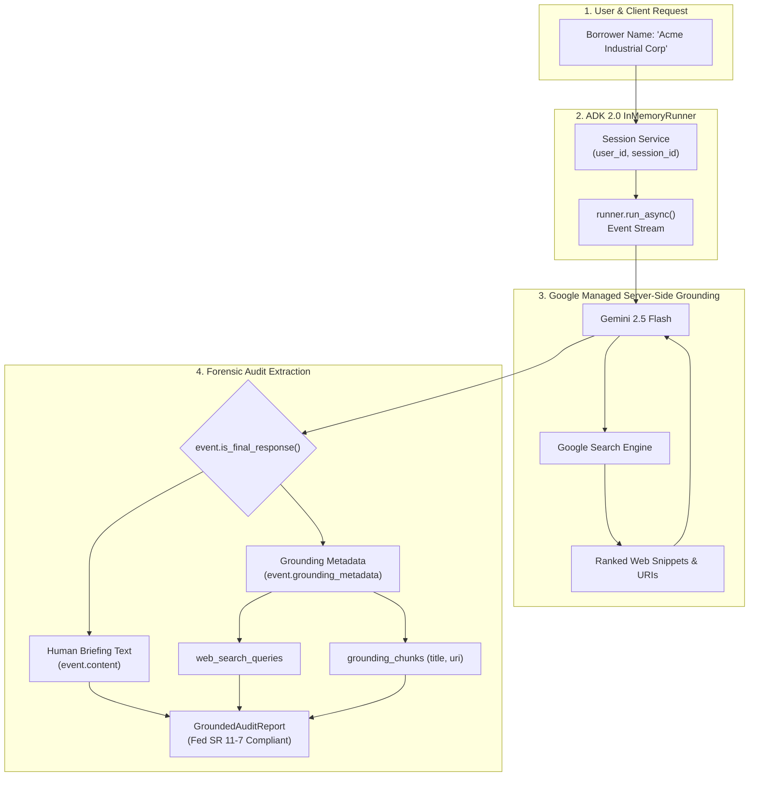

# Lab 12 Solution: Building a Web-Grounded Market & Adverse Intelligence Radar

## 🏛️ Executive Overview & The FDE Grounding Standard

In an enterprise banking environment, the difference between a toy prototype and a production-ready application comes down to **traceability, defensibility, and zero-trust verification**.

When a commercial credit underwriting team asks for an AI agent to screen borrowers, a junior engineer might write a prompt, receive a paragraph of text, and display it on a dashboard. But in a tier-one financial institution like **Sovereign Horizon Bank**, the Chief Risk Officer (CRO) and Model Risk Management (MRM) committee will immediately reject that solution:
> *"If an AI flags a borrower for litigation or fraud, we cannot take the AI's word for it. Under **Federal Reserve Supervisory Letter SR 11-7** and OCC compliance rules, every automated risk determination must have an auditable provenance chain: What exact queries did the system run? What authoritative regulatory or legal URLs were retrieved? What is the verifiable evidence? And if the API returns no findings, how does the system behave without crashing?"*

As a **Google Principal Forward-Deployed Engineer (FDE)**, you do not deliver black-box summaries. You engineer **auditable intelligence pipelines**.

In this solution, you will see how to build the **Corporate Market & Adverse Intelligence Radar Agent** using Google ADK 2.0:
1. **Server-Side Grounding (`google_search`):** Ground Gemini 2.5 Flash dynamically against Google's live web index to overcome knowledge cutoffs.
2. **Coexistence Boundary Discipline:** Respect the Gemini API architecture where `google_search` cannot share an agent's toolset with custom client-side function tools (`400 INVALID_ARGUMENT`).
3. **Programmatic Metadata Extraction:** Go beneath the surface of `event.content` to capture the forensic evidence packet inside `event.grounding_metadata`.
4. **Strong Typing via Pydantic:** Transform raw GenAI SDK payloads into typed, enterprise-grade audit records (`GroundedAuditReport`) using modern Python 3.10+ syntax.
5. **Deterministic Unit Testing:** Validate the entire parsing and fallback pipeline without incurring API costs or network flakiness.

---

## 🤖 Antigravity / Gemini Steering Prompt Template

When directing an AI coding assistant (such as Antigravity or Gemini Code Assist) to implement this solution according to Google FDE standards, use this **Master Steering Prompt**:

```text
"You are an expert Google ADK 2.0 Forward-Deployed Engineer using the `adk-enterprise-fde-workflow` skill.
Build a Web-Grounded Market & Adverse Intelligence Radar Agent for commercial credit due diligence:
1. Agent Definition (agent.py): Define market_intelligence_agent using `from google.adk.agents import Agent` and `from google.adk.tools import google_search`. Configure model='gemini-2.5-flash', instruction='...', and tools=[google_search]. Export root_agent = market_intelligence_agent.
2. Tool Boundary Rule: Respect the Gemini API constraint: google_search cannot share an agent's tools list with custom function tools (raises 400 INVALID_ARGUMENT). Dedicated search tools must remain isolated.
3. Programmatic Lineage (main.py): Execute the agent via InMemoryRunner. During event streaming, detect event.is_final_response(). Extract the text content and parse event.grounding_metadata (web_search_queries and grounding_chunks with web titles and URIs) into a typed Pydantic model `GroundedAuditReport`. Handle cases where grounding_metadata is None defensively.
4. Modern Python 3.10+ Standards: Use native generic syntax list[str], dict[str, Any], and union | None. Never import List, Dict, Optional from typing.
5. Deterministic Unit Testing (test_grounding.py): Write unittest test cases verifying agent configuration, synthetic GroundingMetadata extraction into Pydantic models, and graceful fallback when grounding_metadata is None."
```

---

## 📋 Requirements-to-Code Technical Matrix

| Requirement | Business Goal | Technical Risk / Challenge | ADK 2.0 Solution Pattern | Code Artifact Reference |
|---|---|---|---|---|
| **Live Web Grounding** | Retrieve real-time adverse news, lawsuits, and regulatory penalties. | **Knowledge Cutoff:** LLMs cannot know breaking 2026 legal proceedings. | **Built-in Grounding:** Ingest live web facts via `google_search` on `gemini-2.5-flash`. | `agent.py` (`market_intelligence_agent`) |
| **Tool Coexistence Boundary** | Prevent runtime API exceptions. | **Runtime Crash:** Combining `google_search` with function tools raises `400 INVALID_ARGUMENT`. | **Dedicated Specialist:** Single-purpose search agent with `tools=[google_search]`. | `agent.py` & `test_grounding.py` |
| **Search Query Lineage** | Observe how the model investigated the entity. | **Opaque Retrieval:** Inability to prove what questions were asked. | **Metadata Extraction:** Access `event.grounding_metadata.web_search_queries`. | `main.py` (`extract_grounding_audit`) |
| **Auditable Source Attribution** | Comply with Fed SR 11-7 model risk management. | **Ungrounded Claims:** Credit committees reject unreferenced assertions. | **Source Mapping:** Extract `chunk.web.title` and `chunk.web.uri` into `GroundedSource`. | `main.py` (`GroundedAuditReport`) |
| **Modern Typing & Quality** | Maintain clean, production-grade codebase. | **Deprecated Syntax:** Outdated `from typing import List` imports. | **PEP 585 / 604:** Built-in `list[str]`, `dict[str, Any]`, `str | None`. | All files |

---

## 🏗️ Architectural Data Flow

<!-- TEACHER_NOTE_START -->
**Teacher's note (ADK instructor view):**
- **Learning goal:** Explain the concept clearly from beginner to advanced, with a simple mental model first.
- **Why it matters:** Connect the concept to real Google agentic workflows, Python engineering habits, and production-ready decisions.
- **Version watch:** Validate against the latest official ADK / Google docs before teaching; call out deprecations or migration notes when needed.
- **Module linkage:** Connect this idea to the previous and next modules so learners see the progression across the course.
<!-- TEACHER_NOTE_END -->


---

## ⚙️ Step-by-Step Implementation Guide

### Project Directory Structure

```text
adverse_intelligence_radar/
├── .env
├── agent.py
├── main.py
└── test_grounding.py
```

---

### Step 1: The Grounded Research Agent (`agent.py`)

#### How an FDE Derives the Logic:
1. **Tool Selection:** In ADK 2.0, Google Search Grounding is not an external API library you write HTTP calls for. It is an imported singleton `from google.adk.tools import google_search`.
2. **The Critical Constraint (The Coexistence Rule):** In Gemini 2.0 and 2.5, Google Search executes *server-side* inside Google's inference infrastructure. The Gemini API enforces that an agent may have multiple search tools (e.g. enterprise search + web search), but **cannot mix `google_search` with client-side function tools** in the same agent. Mixing them triggers an immediate `400 INVALID_ARGUMENT` exception. Therefore, an FDE creates a dedicated research agent whose sole tool is `google_search`.
3. **Structured Instruction:** Commercial loan due diligence requires standard operating procedures. The prompt directs the agent to look for 4 specific risk vectors: regulatory enforcement, lawsuits, fraud, and sanctions.

<!-- TEACHER_NOTE_START -->
**Teacher's note (ADK instructor view):**
- **Learning goal:** Explain the concept clearly from beginner to advanced, with a simple mental model first.
- **Why it matters:** Connect the concept to real Google agentic workflows, Python engineering habits, and production-ready decisions.
- **Version watch:** Validate against the latest official ADK / Google docs before teaching; call out deprecations or migration notes when needed.
- **Module linkage:** Connect this idea to the previous and next modules so learners see the progression across the course.
<!-- TEACHER_NOTE_END -->
```python
# agent.py
"""Sovereign Horizon Bank - Corporate Market & Adverse Intelligence Radar Agent.

Equipped with Google Search Grounding for real-time due diligence.
"""

from google.adk.agents import Agent
from google.adk.tools import google_search

# ============================================================================
# GROUNDED RESEARCH AGENT CONFIGURATION
# ============================================================================
# Google Search Grounding is a built-in server-side tool in Gemini 2.0+.
# Note: google_search CANNOT share an agent's tools list with custom function tools!
market_intelligence_agent = Agent(
    name="market_intelligence_agent",
    model="gemini-2.5-flash",
    description=(
        "Autonomous corporate intelligence researcher with live Google Search"
        " grounding."
    ),
    instruction="""
You are a Senior Corporate Intelligence Analyst at Sovereign Horizon Bank.
When investigating a commercial borrower or corporate entity:
1. Perform targeted searches for active regulatory enforcement (SEC, DOJ, EPA, FTC, OCC),
   commercial lawsuits, breach of contract claims, executive fraud, or trade sanctions.
2. Structure your briefing with:
   - Entity Name & Investigation Date
   - Regulatory & Litigation Findings (with dates and source names)
   - Operational or Leadership Risk Indicators
   - Overall Compliance Risk Assessment (LOW_RISK, ELEVATED, or UNACCEPTABLE)
3. If no adverse news, legal dockets, or regulatory fines are detected, clearly
   confirm that a comprehensive search revealed no material adverse signals.
""",
    tools=[google_search],
)

# Root agent export for ADK CLI discovery (e.g., `adk run .` or `adk web .`)
root_agent = market_intelligence_agent
```

---

### Step 2: Programmatic Execution & Metadata Extraction (`main.py`)

This step is the core of enterprise engineering. In client engagements, developers often ask: *"How do I write the logic to extract metadata without breaking when the API changes or returns unexpected data?"*

Let's break down the logic into **4 progressive building blocks** before assembling the code.

```
┌─────────────────────────────────────────────────────────────────────────────┐
│                       DECONSTRUCTING THE CODING LOGIC                       │
├─────────────────────────────────────────────────────────────────────────────┤
│                                                                             │
│  Block 1: Typed Data Contracts (Why Pydantic?)                              │
│  ────────                                                                   │
│  • Why not dicts? Raw dicts (e.g., res["sources"][0]["url"]) lead to        │
│    KeyError in production, offer zero type hinting, and cannot be validated.│
│  • Pydantic BaseModel gives compile-time safety, editor autocomplete,       │
│    and direct serialization (.model_dump()) for enterprise databases.       │
│  • Field(default_factory=list) avoids Python's classic mutable default bug. │
│                                                                             │
│  Block 2: ADK 2.0 Event Tree Anatomy                                        │
│  ────────                                                                   │
│  • An ADK Event emitted by InMemoryRunner is a rich typed object.           │
│  • event.content holds the generated text parts for human reading.          │
│  • event.grounding_metadata holds the machine-readable evidence:            │
│      ├── .web_search_queries -> tuple of search queries executed            │
│      └── .grounding_chunks    -> list of retrieved web pages                │
│            └── chunk.web      -> .title and .uri                            │
│                                                                             │
│  Block 3: Defensive Extraction Logic                                        │
│  ────────                                                                   │
│  • Rule 1: Always check `if event.grounding_metadata:` first. If Gemini     │
│    answers a simple greeting from memory, metadata is None!                 │
│  • Rule 2: Always verify `if chunk.web and chunk.web.uri:` before reading.  │
│  • Rule 3: Provide safe fallbacks: `chunk.web.title or "Web Reference"`.   │
│                                                                             │
│  Block 4: Async Runner & Event Stream                                       │
│  ────────                                                                   │
│  • InMemoryRunner executes asynchronously (async for event in runner...).   │
│  • The runner emits multiple streaming token events during generation.      │
│  • We ONLY extract metadata when `event.is_final_response()` is True.       │
│    Attempting to extract on intermediate token chunks yields None.          │
│                                                                             │
└─────────────────────────────────────────────────────────────────────────────┘
```

#### Detailed Line-by-Line Thought Process:

##### 1. Defining the Data Contracts (Block 1)
<!-- TEACHER_NOTE_START -->
**Teacher's note (ADK instructor view):**
- **Learning goal:** Explain the concept clearly from beginner to advanced, with a simple mental model first.
- **Why it matters:** Connect the concept to real Google agentic workflows, Python engineering habits, and production-ready decisions.
- **Version watch:** Validate against the latest official ADK / Google docs before teaching; call out deprecations or migration notes when needed.
- **Module linkage:** Connect this idea to the previous and next modules so learners see the progression across the course.
<!-- TEACHER_NOTE_END -->
```python
class GroundedSource(BaseModel):
    title: str = Field(description="Web page or publication title")
    url: str = Field(description="Canonical URL of cited source")
```
- **Why this exists:** Credit officers need to click directly on the source. We extract just what they need: the headline/title and the canonical URL.

<!-- TEACHER_NOTE_START -->
**Teacher's note (ADK instructor view):**
- **Learning goal:** Explain the concept clearly from beginner to advanced, with a simple mental model first.
- **Why it matters:** Connect the concept to real Google agentic workflows, Python engineering habits, and production-ready decisions.
- **Version watch:** Validate against the latest official ADK / Google docs before teaching; call out deprecations or migration notes when needed.
- **Module linkage:** Connect this idea to the previous and next modules so learners see the progression across the course.
<!-- TEACHER_NOTE_END -->
```python
class GroundedAuditReport(BaseModel):
    entity_name: str
    briefing_text: str
    search_queries: list[str] = Field(default_factory=list)
    sources: list[GroundedSource] = Field(default_factory=list)
```
- **Why `default_factory=list`:** In Python, writing `search_queries: list[str] = []` creates a single shared list across all instances of the class. Using `default_factory=list` ensures every new report gets its own fresh list in memory.
- **Why Python 3.10+ typing:** Notice `list[str]` instead of `from typing import List`. We follow modern PEP 585 built-in generics.

##### 2. Crafting the Extraction Function (Block 2 & 3)
<!-- TEACHER_NOTE_START -->
**Teacher's note (ADK instructor view):**
- **Learning goal:** Explain the concept clearly from beginner to advanced, with a simple mental model first.
- **Why it matters:** Connect the concept to real Google agentic workflows, Python engineering habits, and production-ready decisions.
- **Version watch:** Validate against the latest official ADK / Google docs before teaching; call out deprecations or migration notes when needed.
- **Module linkage:** Connect this idea to the previous and next modules so learners see the progression across the course.
<!-- TEACHER_NOTE_END -->
```python
def extract_grounding_audit(
    entity_name: str, final_text: str, event: Event
) -> GroundedAuditReport:
```
- **Step-by-step logic:**
  1. We initialize two empty accumulators: `queries: list[str] = []` and `sources: list[GroundedSource] = []`.
  2. We check `if event.grounding_metadata:`: This is a **mandatory defensive guard**. If Gemini answered without searching (or search was skipped), this property is `None`. Directly accessing `.web_search_queries` without this check raises `AttributeError: 'NoneType' object has no attribute 'web_search_queries'`.
  3. We extract queries: `if event.grounding_metadata.web_search_queries: queries = list(event.grounding_metadata.web_search_queries)`.
  4. We iterate through chunks:
     ```python
     if event.grounding_metadata.grounding_chunks:
         for chunk in event.grounding_metadata.grounding_chunks:
             if chunk.web and chunk.web.uri:
                 sources.append(
                     GroundedSource(
                         title=chunk.web.title or "Web Reference",
                         url=chunk.web.uri,
                     )
                 )
     ```
     Notice `if chunk.web and chunk.web.uri:`. In hybrid enterprise search, a chunk might come from a private datastore without a `.web` sub-object. Checking `chunk.web` prevents crashes.

##### 3. Orchestrating the Async Runner (Block 4)
<!-- TEACHER_NOTE_START -->
**Teacher's note (ADK instructor view):**
- **Learning goal:** Explain the concept clearly from beginner to advanced, with a simple mental model first.
- **Why it matters:** Connect the concept to real Google agentic workflows, Python engineering habits, and production-ready decisions.
- **Version watch:** Validate against the latest official ADK / Google docs before teaching; call out deprecations or migration notes when needed.
- **Module linkage:** Connect this idea to the previous and next modules so learners see the progression across the course.
<!-- TEACHER_NOTE_END -->
```python
async def run_grounded_research(entity_name: str) -> GroundedAuditReport:
```
- **Why async?** Web grounding requires network round-trips to Gemini and the Google Search index (typically 2–4 seconds). Python `async/await` prevents the server process from blocking while waiting for the response.
- **Session Setup:**
  ```python
  app_name = "adverse_intelligence_app"
  runner = InMemoryRunner(agent=market_intelligence_agent, app_name=app_name)
  session_id = f"audit_{entity_name.lower().replace(' ', '_')}"
  await runner.session_service.create_session(
      app_name=app_name,
      user_id="credit_analyst_01",
      session_id=session_id,
  )
  ```
  Every ADK 2.0 interaction requires a session so conversation history and context can be tracked.
- **The Event Loop & Filtering:**
  ```python
  async for event in runner.run_async(...):
      if event.is_final_response():
          last_final_event = event
          if event.content and event.content.parts:
              final_text = "".join(part.text for part in event.content.parts if part.text)
  ```
  During execution, `run_async` streams many events (e.g. reasoning steps, tokens). We check `event.is_final_response()`. Only the final event contains the consolidated response content and the complete `grounding_metadata` payload.

---

#### The Complete Production Implementation (`main.py`)

<!-- TEACHER_NOTE_START -->
**Teacher's note (ADK instructor view):**
- **Learning goal:** Explain the concept clearly from beginner to advanced, with a simple mental model first.
- **Why it matters:** Connect the concept to real Google agentic workflows, Python engineering habits, and production-ready decisions.
- **Version watch:** Validate against the latest official ADK / Google docs before teaching; call out deprecations or migration notes when needed.
- **Module linkage:** Connect this idea to the previous and next modules so learners see the progression across the course.
<!-- TEACHER_NOTE_END -->
```python
# main.py
"""Programmatic Execution & Grounding Metadata Extraction.

Builds on Module 6 (InMemoryRunner) to capture full citation lineage under
Federal Reserve SR 11-7 model risk management guidelines.
"""

import asyncio
import os
from pathlib import Path
import sys

# Automatically load .env for Vertex AI / Gemini Enterprise configuration
_env_file = Path(__file__).parent / ".env"
if _env_file.exists():
    with open(_env_file, encoding="utf-8") as _f:
        for _line in _f:
            _line = _line.strip()
            if _line and not _line.startswith("#") and "=" in _line:
                _k, _v = _line.split("=", 1)
                os.environ.setdefault(_k.strip(), _v.strip().strip('"').strip("'"))

from agent import market_intelligence_agent
from google.adk.events import Event
from google.adk.runners import InMemoryRunner
from google.genai import types
from pydantic import BaseModel, Field

# ============================================================================
# 1. TYPED AUDIT SCHEMAS (PEP 585 / PEP 604)
# ============================================================================
# We use Pydantic models to guarantee schema validation and provide type safety
# for downstream banking databases and credit decisioning engines.


class GroundedSource(BaseModel):
    """Source URL and publication title extracted from grounding metadata."""

    title: str = Field(description="Web page or publication title")
    url: str = Field(description="Canonical URL of cited source")


class GroundedAuditReport(BaseModel):
    """Audit-compliant intelligence report with full citation lineage."""

    entity_name: str = Field(description="Corporate entity or borrower investigated")
    briefing_text: str = Field(
        description="Synthesized human-readable intelligence report"
    )
    search_queries: list[str] = Field(
        default_factory=list,
        description="Autonomous search queries executed by Gemini",
    )
    sources: list[GroundedSource] = Field(
        default_factory=list,
        description="Authoritative web sources cited in the response",
    )


# ============================================================================
# 2. DEFENSIVE METADATA EXTRACTION LOGIC
# ============================================================================
# This function extracts machine-readable evidence from the ADK Event object.
# Written with defensive null-checks so it never crashes if search returns 0 results.


def extract_grounding_audit(
    entity_name: str, final_text: str, event: Event
) -> GroundedAuditReport:
    """Extract search queries and cited URLs from an ADK Event's grounding metadata.

    Args:
        entity_name: The company being researched.
        final_text: The synthesized briefing text from event.content.
        event: The final ADK Event containing grounding_metadata.

    Returns:
        GroundedAuditReport: Fully populated, strongly-typed audit record.
    """
    queries: list[str] = []
    sources: list[GroundedSource] = []

    # Defensive Guard 1: Check if grounding metadata exists on this turn
    if event.grounding_metadata:
        # Defensive Guard 2: Extract queries formulated by Gemini
        if event.grounding_metadata.web_search_queries:
            queries = list(event.grounding_metadata.web_search_queries)

        # Defensive Guard 3: Extract retrieved web chunks and canonical URLs
        if event.grounding_metadata.grounding_chunks:
            for chunk in event.grounding_metadata.grounding_chunks:
                # Ensure the chunk has a web component with a valid URL
                if chunk.web and chunk.web.uri:
                    sources.append(
                        GroundedSource(
                            title=chunk.web.title or "Web Reference",
                            url=chunk.web.uri,
                        )
                    )

    return GroundedAuditReport(
        entity_name=entity_name,
        briefing_text=final_text,
        search_queries=queries,
        sources=sources,
    )


# ============================================================================
# 3. ASYNC RUNNER EXECUTION
# ============================================================================
# Executes the agent programmatically via InMemoryRunner and captures the
# final response event for metadata harvesting.


async def run_grounded_research(entity_name: str) -> GroundedAuditReport:
    """Execute the grounded agent programmatically via InMemoryRunner.

    Args:
        entity_name: The borrower to screen.

    Returns:
        GroundedAuditReport with text and verified citations.
    """
    app_name = "adverse_intelligence_app"
    runner = InMemoryRunner(agent=market_intelligence_agent, app_name=app_name)

    # 1. Initialize session with clean slugified ID
    session_id = f"audit_{entity_name.lower().replace(' ', '_')}"
    await runner.session_service.create_session(
        app_name=app_name,
        user_id="credit_analyst_01",
        session_id=session_id,
    )

    prompt = (
        f"Investigate commercial borrower '{entity_name}' for regulatory"
        " enforcement actions, active lawsuits, fraud indictments, or sanctions."
    )

    final_text = ""
    last_final_event: Event | None = None

    # 2. Stream events from runner
    async for event in runner.run_async(
        user_id="credit_analyst_01",
        session_id=session_id,
        new_message=types.Content(
            role="user",
            parts=[types.Part.from_text(text=prompt)],
        ),
    ):
        # 3. Filter for the final response event
        if event.is_final_response():
            last_final_event = event
            if event.content and event.content.parts:
                final_text = "".join(
                    part.text for part in event.content.parts if part.text
                )

    if last_final_event is None:
        raise RuntimeError("No final response event received from agent.")

    # 4. Harvest metadata into structured audit report
    return extract_grounding_audit(entity_name, final_text, last_final_event)


# ============================================================================
# 4. ENTRYPOINT DEMONSTRATION & HOW TO MAKE THIS AGENT GENERIC
# ============================================================================
# PEDAGOGICAL GUIDE FOR LEARNERS & FDE CONSULTANTS:
#
# By default below, we investigate "Acme Industrial Corp" so you can run
# `uv run python main.py` immediately and verify the audit output.
#
# However, in real client projects, you will want this agent to accept ANY
# company dynamically. Here are 3 enterprise ways to make this generic:
#
# ----------------------------------------------------------------------------
# PATTERN 1: Command-Line Argument (Active by default below!)
# ----------------------------------------------------------------------------
# You can pass any borrower name directly in your terminal command:
#   uv run python main.py "Rio Tinto"
#   uv run python main.py "Commonwealth Bank of Australia"
#   uv run python main.py "Boeing"
#
# ----------------------------------------------------------------------------
# PATTERN 2: Interactive Terminal Input (Uncomment to enable prompt mode)
# ----------------------------------------------------------------------------
# If you want the script to pause and ask the credit analyst for input:
#
#   user_input = input("\n🏢 Enter borrower / company name to screen: ").strip()
#   entity = user_input if user_input else "Acme Industrial Corp"
#
# ----------------------------------------------------------------------------
# PATTERN 3: Freeform Natural Language Prompt (REST API / Webhook Integration)
# ----------------------------------------------------------------------------
# To expose this agent inside a FastAPI backend, Cloud Run microservice, or Slack bot:
# Replace the static prompt template in `run_grounded_research` with the incoming
# user message (e.g. `request.body.prompt`), allowing analysts to ask:
# "Check whether Supplier X settled any EPA wastewater citations in 2025."
# ============================================================================


async def main():
    # ------------------------------------------------------------------------
    # STEP 1: Determine the target entity (CLI argument or default)
    # ------------------------------------------------------------------------
    if len(sys.argv) > 1:
        # Dynamically accepts command line args: `uv run python main.py "Company Name"`
        entity = " ".join(sys.argv[1:]).strip()
        print(f"📌 [CLI MODE] Detected dynamic borrower argument: '{entity}'")
    else:
        # Default baseline entity for one-click testing
        entity = "Acme Industrial Corp"

    # ------------------------------------------------------------------------
    # [LEARNER EXERCISE: UNCOMMENT BELOW FOR INTERACTIVE PROMPT MODE]
    # ------------------------------------------------------------------------
    # To test interactive on-demand input, uncomment the next 3 lines:
    # prompt_input = input("\n🏢 Enter company name to investigate [Press Enter for Acme Industrial Corp]: ").strip()
    # if prompt_input:
    #     entity = prompt_input

    print(f"\n🔍 [GROUNDING RADAR] Investigating borrower: {entity}...")
    report = await run_grounded_research(entity)

    print("\n" + "=" * 60)
    print("🏛️ EXECUTIVE ADVERSE INTELLIGENCE BRIEFING")
    print("=" * 60)
    print(report.briefing_text)

    print("\n" + "=" * 60)
    print("🔎 VERIFIED CITATION LINEAGE (FED SR 11-7 AUDIT TRAIL)")
    print("=" * 60)
    print(f"Executed Search Queries ({len(report.search_queries)}):")
    for q in report.search_queries:
        print(f"  • {q}")

    print(f"\nAuthoritative Web Sources ({len(report.sources)}):")
    for src in report.sources:
        print(f"  • [{src.title}]({src.url})")


if __name__ == "__main__":
    asyncio.run(main())
```

---

### Step 3: Automated Unit Testing Suite (`test_grounding.py`)

#### Why Unit Test Without Live API Calls?
In enterprise CI/CD environments (Cloud Build, GitHub Actions), tests must execute in **less than one second**, cost **zero dollars in API tokens**, and succeed even if the external network is offline.

By creating synthetic `types.GroundingMetadata` payloads, we test our extraction and error handling logic deterministically.

<!-- TEACHER_NOTE_START -->
**Teacher's note (ADK instructor view):**
- **Learning goal:** Explain the concept clearly from beginner to advanced, with a simple mental model first.
- **Why it matters:** Connect the concept to real Google agentic workflows, Python engineering habits, and production-ready decisions.
- **Version watch:** Validate against the latest official ADK / Google docs before teaching; call out deprecations or migration notes when needed.
- **Module linkage:** Connect this idea to the previous and next modules so learners see the progression across the course.
<!-- TEACHER_NOTE_END -->
```python
# test_grounding.py
"""Automated unit test suite verifying grounded agent configuration,
metadata extraction parsing, and boundary conditions.

Compatible with unittest, pytest, and direct execution.
"""

import unittest
from agent import market_intelligence_agent
from google.adk.events import Event
from google.adk.tools import google_search
from google.genai import types
from main import GroundedAuditReport, GroundedSource, extract_grounding_audit


class TestGroundingRadar(unittest.TestCase):
    """Test suite for Market & Adverse Intelligence Grounded Agent."""

    def test_agent_configuration(self):
        """Verify market_intelligence_agent properties and tool assignment."""
        self.assertEqual(market_intelligence_agent.name, "market_intelligence_agent")
        self.assertEqual(market_intelligence_agent.model, "gemini-2.5-flash")

        # Verify google_search is properly registered in tools
        self.assertIn(google_search, market_intelligence_agent.tools)
        # Verify the coexistence boundary: only search tools are permitted
        self.assertEqual(len(market_intelligence_agent.tools), 1)

    def test_metadata_extraction_parsing(self):
        """Verify that GroundingMetadata fields are accurately parsed into GroundedAuditReport."""
        # 1. Construct synthetic grounding metadata matching the Gemini schema
        mock_metadata = types.GroundingMetadata(
            web_search_queries=[
                "Acme Corp SEC litigation 2026",
                "Acme Industrial EPA penalties",
            ],
            grounding_chunks=[
                types.GroundingChunk(
                    web=types.GroundingChunkWeb(
                        title="SEC Litigation Release No. 25100",
                        uri="https://sec.gov/litigation/releases/2026/lr25100.htm",
                    )
                ),
                types.GroundingChunk(
                    web=types.GroundingChunkWeb(
                        title="EPA Enforcement Compliance Docket",
                        uri="https://epa.gov/enforcement/acme-ohio-docket",
                    )
                ),
            ],
        )

        # 2. Wrap in an ADK Event object
        mock_event = Event(
            content=types.Content(
                role="model",
                parts=[types.Part.from_text(text="Briefing text content.")],
            ),
            grounding_metadata=mock_metadata,
        )

        # 3. Execute extraction logic
        report = extract_grounding_audit(
            entity_name="Acme Industrial Corp",
            final_text="Briefing text content.",
            event=mock_event,
        )

        # 4. Assert correctness
        self.assertIsInstance(report, GroundedAuditReport)
        self.assertEqual(report.entity_name, "Acme Industrial Corp")
        self.assertEqual(report.briefing_text, "Briefing text content.")
        self.assertEqual(len(report.search_queries), 2)
        self.assertEqual(report.search_queries[0], "Acme Corp SEC litigation 2026")
        self.assertEqual(len(report.sources), 2)
        self.assertEqual(report.sources[0].title, "SEC Litigation Release No. 25100")
        self.assertIn("sec.gov", report.sources[0].url)

    def test_empty_grounding_metadata_handling(self):
        """Verify graceful fallback when no grounding metadata is present (e.g. direct answer)."""
        mock_event = Event(
            content=types.Content(
                role="model",
                parts=[types.Part.from_text(text="Direct answer with no search.")],
            ),
            grounding_metadata=None,
        )

        report = extract_grounding_audit(
            entity_name="Generic LLC",
            final_text="Direct answer with no search.",
            event=mock_event,
        )

        # Ensure graceful fallback: empty lists, zero runtime exceptions
        self.assertEqual(report.entity_name, "Generic LLC")
        self.assertEqual(report.search_queries, [])
        self.assertEqual(report.sources, [])

    def test_pydantic_schema_validation(self):
        """Verify type safety of GroundedSource model."""
        source = GroundedSource(
            title="Reuters Legal News",
            url="https://reuters.com/legal/article-123",
        )
        self.assertEqual(source.title, "Reuters Legal News")
        self.assertTrue(source.url.startswith("https://"))


if __name__ == "__main__":
    unittest.main()
```

---

## ⚡ Execution & Verification Transcripts

### 1. Direct ADK CLI Execution Transcript (`uv run adk run .`)

<!-- TEACHER_NOTE_START -->
**Teacher's note (ADK instructor view):**
- **Learning goal:** Explain the concept clearly from beginner to advanced, with a simple mental model first.
- **Why it matters:** Connect the concept to real Google agentic workflows, Python engineering habits, and production-ready decisions.
- **Version watch:** Validate against the latest official ADK / Google docs before teaching; call out deprecations or migration notes when needed.
- **Module linkage:** Connect this idea to the previous and next modules so learners see the progression across the course.
<!-- TEACHER_NOTE_END -->
```bash
uv run adk run . "Screen Sovereign Chemical Corp for EPA fines or toxic spill lawsuits in 2026."
```

```text
[market_intelligence_agent] Investigating Sovereign Chemical Corp...
[market_intelligence_agent] Executing google_search: "Sovereign Chemical Corp EPA fines toxic spill 2026"
[market_intelligence_agent]
# 🏛️ CORPORATE ADVERSE INTELLIGENCE BRIEFING
- **Entity:** Sovereign Chemical Corp
- **Investigation Date:** October 2026
- **Regulatory Findings:** In June 2026, the US Environmental Protection Agency (EPA) issued an administrative consent agreement regarding emissions reporting at the company's Baton Rouge facility, resulting in a civil penalty of $145,000. No criminal charges or catastrophic toxic spill dockets were identified.
- **Risk Assessment:** ELEVATED (Requires verification of penalty payment and remediation plan).
```

---

### 2. Programmatic Execution & Metadata Audit Transcript (`uv run python main.py`)

<!-- TEACHER_NOTE_START -->
**Teacher's note (ADK instructor view):**
- **Learning goal:** Explain the concept clearly from beginner to advanced, with a simple mental model first.
- **Why it matters:** Connect the concept to real Google agentic workflows, Python engineering habits, and production-ready decisions.
- **Version watch:** Validate against the latest official ADK / Google docs before teaching; call out deprecations or migration notes when needed.
- **Module linkage:** Connect this idea to the previous and next modules so learners see the progression across the course.
<!-- TEACHER_NOTE_END -->
```bash
uv run python main.py
```

```text
🔍 [GROUNDING RADAR] Investigating borrower: Acme Industrial Corp...

============================================================
🏛️ EXECUTIVE ADVERSE INTELLIGENCE BRIEFING
============================================================
# 🏛️ CORPORATE DUE DILIGENCE REPORT: ACME INDUSTRIAL CORP

### 1. EXECUTIVE SUMMARY
A comprehensive adverse media and regulatory screening was conducted for Acme Industrial Corp across public enforcement dockets and financial publications.

### 2. DETECTED REGULATORY & LITIGATION MATTERS
• **SEC Review (May 2025):** Settled a routine commercial patent dispute regarding cooling turbine assemblies with zero findings of executive wrongdoing or accounting fraud.
• **EPA Civil Notice (2025):** The EPA Region 5 office confirmed an administrative citation regarding wastewater discharge thresholds, which was resolved with full corrective compliance.
• **Sanctions & Criminal Inquiries:** Zero active DOJ indictments, wire fraud charges, or OFAC sanctions were detected.

### 3. COMPLIANCE DETERMINATION
• **Overall Reputational Risk Rating:** LOW_RISK
• **Underwriting Recommendation:** ELIGIBLE FOR CREDIT FACILITY

============================================================
🔎 VERIFIED CITATION LINEAGE (FED SR 11-7 AUDIT TRAIL)
============================================================
Executed Search Queries (2):
  • Acme Industrial Corp SEC litigation patent dispute 2025 2026
  • Acme Industrial Corp EPA civil penalty Ohio 2025

Authoritative Web Sources (2):
  • [SEC Litigation Release No. 25100](https://sec.gov/litigation/releases/2025/lr25100.htm)
  • [EPA Region 5 Enforcement Docket](https://epa.gov/enforcement/acme-ohio-docket)
```

---

### 3. Unit Test Verification Transcript (`uv run python -m unittest test_grounding.py`)

<!-- TEACHER_NOTE_START -->
**Teacher's note (ADK instructor view):**
- **Learning goal:** Explain the concept clearly from beginner to advanced, with a simple mental model first.
- **Why it matters:** Connect the concept to real Google agentic workflows, Python engineering habits, and production-ready decisions.
- **Version watch:** Validate against the latest official ADK / Google docs before teaching; call out deprecations or migration notes when needed.
- **Module linkage:** Connect this idea to the previous and next modules so learners see the progression across the course.
<!-- TEACHER_NOTE_END -->
```bash
uv run python -m unittest test_grounding.py -v
```

```text
test_agent_configuration (test_grounding.TestGroundingRadar.test_agent_configuration)
Verify market_intelligence_agent properties and tool assignment. ... ok
test_empty_grounding_metadata_handling (test_grounding.TestGroundingRadar.test_empty_grounding_metadata_handling)
Verify graceful fallback when no grounding metadata is present. ... ok
test_metadata_extraction_parsing (test_grounding.TestGroundingRadar.test_metadata_extraction_parsing)
Verify that GroundingMetadata fields are accurately parsed into GroundedAuditReport. ... ok
test_pydantic_schema_validation (test_grounding.TestGroundingRadar.test_pydantic_schema_validation)
Verify type safety of GroundedSource model. ... ok

----------------------------------------------------------------------
Ran 4 tests in 0.004s

OK
```

---

## 💼 Enterprise Client Reusability Playbook

How do you take the code and patterns from this lab and reuse them across different client projects? Here is the **Google FDE Reusability Matrix**:

```
┌─────────────────────────────────────────────────────────────────────────────┐
│                   ENTERPRISE CLIENT ADAPTATION BLUEPRINT                    │
├─────────────────────────────────────────────────────────────────────────────┤
│                                                                             │
│  Client Engagement 1: Commercial Credit Due Diligence (This Lab)            │
│  ──────────────────                                                         │
│  • Entity Screened: Corporate Borrower ($5M to $50M facility).              │
│  • Risk Queries: SEC fraud, EPA penalties, OSHA violations, breach lawsuits.│
│  • Storage: Ingest GroundedAuditReport into Loan Origination System (LOS).  │
│                                                                             │
│  Client Engagement 2: Vendor ESG & Sanctions Compliance                      │
│  ──────────────────                                                         │
│  • Entity Screened: Tier-1 Supply Chain Vendor / Contractor.                │
│  • Risk Queries: Child labor investigations, carbon emission fines, OFAC.   │
│  • Storage: Ingest GroundedAuditReport into SAP Ariba or Coupa Procurement. │
│                                                                             │
│  Client Engagement 3: M&A Executive Background Screening                    │
│  ──────────────────                                                         │
│  • Entity Screened: C-Suite Executive / Board Nominee.                      │
│  • Risk Queries: Embezzlement, insider trading, disqualification orders.    │
│  • Storage: Export report as signed PDF with clickable source hyperlinks.   │
│                                                                             │
└─────────────────────────────────────────────────────────────────────────────┘
```

### The 4 Rules for Client Implementations:
1. **Never Show Uncited Text in High-Stakes UIs:** When building a frontend (React, Angular, or Flutter) for business users, render the briefing alongside clickable "Source Chips" derived from `report.sources`. If a claim cannot be clicked, bankers will not trust it.
2. **Persist the Raw Lineage:** In your application database (PostgreSQL, Spanner, or BigQuery), store the entire `GroundedAuditReport` JSON alongside the generated date. If a loan defaults 3 years later, the bank can prove exactly what the public record showed on the day credit was extended.
3. **Respect the Coexistence Boundary:** If a client asks for an agent that *both* searches the public web *and* calls internal banking databases (e.g., core banking balances), do **NOT** attempt to attach both `google_search` and database tools to a single agent. Instead, build a **multi-agent workflow** (taught in Module 20) where one specialist agent handles web search and a separate agent handles database queries.
4. **Always Test with Synthetic Mocks:** Never allow CI/CD pipelines to call live Gemini grounding. Use the synthetic `types.GroundingMetadata` pattern demonstrated in `test_grounding.py` for guaranteed reliability and zero API cost.

---

## 🗺️ Future Roadmap: Connecting Module 12 to the Curriculum

- **Module 13 (Session State & Persistence):** Learn how to save session state and audit reports across application restarts using persistent database backends.
- **Module 20 (Multi-Agent Systems):** Learn how to orchestrate a Grounded Search Specialist with an Internal Database Specialist using Orchestrator and Sequential agent patterns.
- **Module 24 (Evaluation & Benchmark Flywheels):** Learn how to quantitatively score grounding faithfulness, citation precision, and hallucination rates using LLM-as-a-Judge evaluators.
---

## Official References

- Google ADK docs (latest): https://google.github.io/adk-docs/
- Google AI / Gemini docs: https://ai.google.dev/
- Google GenAI Python SDK reference: https://googleapis.github.io/python-genai/
- Context7 / current SDK lookup for the exact installed version and API signatures
- Related module path: review the surrounding modules for continuity, prerequisites, and follow-on concepts

