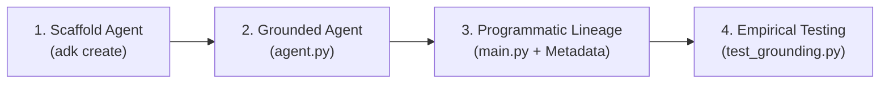

import Setup from '../_setup-snippet.mdx';

# Lab 12: Building a Web-Grounded Market & Adverse Intelligence Radar

**Learning checkpoint:** read the [module concepts](./README.md) first. Before each lab step, predict its input, returned value and failure outcome. Use the [course journey](../learning-journey.md) to connect this mechanism to the banking story; the example's fixture is not a live customer record.


## 🧭 The Enterprise Scenario: Commercial Credit Due Diligence

At **Sovereign Horizon Bank**, commercial loan underwriting officers evaluate middle-market corporate borrowers ($5M to $50M credit facilities). Before extending credit, the bank requires an **Adverse Media & Regulatory Intelligence Briefing** to confirm that prospective borrowers have no undisclosed criminal indictments, regulatory enforcement actions (e.g., SEC, EPA, DOJ, FTC), or material commercial litigation.

Performing manual web searches across dozens of news outlets and public registries takes **3 to 5 hours per borrower**.

In this lab, you will act as a **Google Principal Forward-Deployed Engineer (FDE)** to build the **Corporate Market & Adverse Intelligence Radar Agent**. You will equip a Google ADK 2.0 agent with live web grounding via `google_search`, execute it programmatically using `InMemoryRunner` (referencing Module 6), and extract structured **Grounding Metadata** (`web_search_queries`, cited web URLs, and page titles) to produce a compliance-ready, auditable risk briefing under Fed SR 11-7 standards.

---

## 🔁 The 4-Step FDE Development Loop



---

## 🚀 Step 1: Scaffold Your Environment

<Setup/>

1. **Scaffold the project directory:**
   ```bash
   uv run adk create adverse_intelligence_radar
   cd adverse_intelligence_radar
   ```
   *(Select "Other models (fill later)" when prompted by the CLI).*

2. **Configure Authentication:** Ensure your `.env` contains your `GOOGLE_API_KEY` (Gemini Developer API) or Vertex AI environment variables (`GOOGLE_GENAI_USE_VERTEXAI=true`, `GOOGLE_CLOUD_PROJECT`, `GOOGLE_CLOUD_LOCATION`).

---

## 💻 Step 2: Implement the Grounded Research Agent (`agent.py`)

Create `agent.py` and complete the active learning `TODO` section.

Equip your agent with the built-in `google_search` tool:

```python
# agent.py
"""Sovereign Horizon Bank - Corporate Market & Adverse Intelligence Radar Agent.

Equipped with Google Search Grounding for real-time due diligence.
"""

from google.adk.agents import Agent
from google.adk.tools import google_search

# ============================================================================
# TODO 1: CONFIGURE THE GROUNDED RESEARCH AGENT
# ============================================================================
# Instructions:
# 1. Set name="market_intelligence_agent".
# 2. Use model="gemini-2.5-flash".
# 3. Equip the agent with tools=[google_search].
#    CRITICAL CONSTRAINT: Do NOT include custom function tools in this list
#    (Gemini API enforces: multiple tools supported only when all are search tools).
# 4. Write an enterprise instruction directing the model to investigate:
#    - Regulatory penalties & enforcement actions (SEC, EPA, DOJ, FTC)
#    - Commercial lawsuits or breach of contract disputes
#    - Executive fraud or criminal investigations
#    - Synthesize findings with dates and news sources, confirming if clean.

market_intelligence_agent = Agent(
    # TODO: Fill in agent parameters
)

# Root agent export for ADK CLI discovery (adk run . or adk web .)
root_agent = market_intelligence_agent
```

---

## 🔍 Step 3: Programmatic Execution & Metadata Lineage (`main.py`)

In enterprise banking, compliance officers cannot rely on raw text alone. To satisfy **Federal Reserve SR 11-7 (Model Risk Management)**, your application must capture the exact search queries generated by Gemini and the specific source URLs retrieved.

Create `main.py` and complete `TODO 2` (Pydantic audit models) and `TODO 3` (async runner and metadata extraction):

```python
# main.py
"""Programmatic Execution & Grounding Metadata Extraction.

Builds on Module 6 (InMemoryRunner) to capture full citation lineage.
"""

import asyncio
from agent import market_intelligence_agent
from google.adk.runners import InMemoryRunner
from google.genai import types
from pydantic import BaseModel, Field

# ============================================================================
# TODO 2: DEFINE TYPED AUDIT CONTRACTS (PYTHON 3.10+ TYPING)
# ============================================================================


class GroundedSource(BaseModel):
    """Source URL and publication title extracted from grounding metadata."""

    title: str = Field(description="Web page or article title")
    url: str = Field(description="Canonical URL of cited source")


class GroundedAuditReport(BaseModel):
    """Audit-compliant intelligence report with full citation lineage."""

    entity_name: str
    briefing_text: str
    # TODO: Define search_queries as list[str] (no 'from typing import List')
    search_queries: list[str] = Field(default_factory=list)
    # TODO: Define sources as list[GroundedSource]
    sources: list[GroundedSource] = Field(default_factory=list)


# ============================================================================
# TODO 3: IMPLEMENT PROGRAMMATIC RUNNER & METADATA PARSER
# ============================================================================
async def run_grounded_research(entity_name: str) -> GroundedAuditReport:
    """Execute the grounded agent and extract grounding metadata.

    Instructions:
    1. Initialize runner = InMemoryRunner(agent=market_intelligence_agent, app_name="market_intel_app").
    2. Create a session via runner.session_service.create_session.
    3. Run runner.run_async(...) passing types.Content with user role.
    4. For each event:
       - If event.is_final_response():
         - Extract text from event.content.parts.
         - Inspect event.grounding_metadata:
           - Extract queries from event.grounding_metadata.web_search_queries.
           - Extract chunks from event.grounding_metadata.grounding_chunks.
             (For each chunk with chunk.web, extract chunk.web.title and chunk.web.uri).
    5. Return GroundedAuditReport.
    """
    pass


async def main():
    # Dynamic CLI argument or default fallback:
    if len(sys.argv) > 1:
        entity = " ".join(sys.argv[1:]).strip()
    else:
        entity = "Acme Industrial Corp"

    # [OPTIONAL] Uncomment below to prompt the user interactively:
    # prompt_input = input("\n🏢 Enter company name to investigate [Press Enter for default]: ").strip()
    # if prompt_input:
    #     entity = prompt_input

    print(f"\n🔍 Investigating entity: {entity}...")
    report = await run_grounded_research(entity)

    print("\n--- 🏛️ EXECUTIVE COMPLIANCE BRIEFING ---")
    print(report.briefing_text)

    print("\n--- 🔎 VERIFIED CITATION LINEAGE (FED SR 11-7) ---")
    print(f"Executed Search Queries ({len(report.search_queries)}):")
    for q in report.search_queries:
        print(f"  • {q}")

    print(f"\nAuthoritative Sources ({len(report.sources)}):")
    for src in report.sources:
        print(f"  • [{src.title}]({src.url})")


if __name__ == "__main__":
    asyncio.run(main())
```

---

## 🧪 Step 4: Unit Testing & Boundary Verification (`test_grounding.py`)

Create `test_grounding.py` to verify:
1. The agent is correctly configured with `google_search` and no conflicting client tools.
2. The metadata parser accurately converts `types.GroundingMetadata` into our typed `GroundedAuditReport`.
3. The model coexistence boundary is documented and defended.

```python
# test_grounding.py
"""Automated unit test suite for Web Grounding and Metadata Extraction.

Compatible with unittest, pytest, and direct Python execution.
"""

import unittest
from agent import market_intelligence_agent
from google.adk.tools import google_search
from google.genai import types
from main import GroundedAuditReport, GroundedSource, extract_grounding_audit


class TestGroundingRadar(unittest.TestCase):
    """Test suite for Market & Adverse Intelligence Grounded Agent."""

    # ========================================================================
    # TODO 4: IMPLEMENT AUTOMATED TESTS
    # ========================================================================
    def test_agent_grounding_configuration(self):
        """Verify that market_intelligence_agent is equipped with google_search."""
        # 1. Assert self.assertEqual(market_intelligence_agent.name, "market_intelligence_agent")
        # 2. Assert self.assertIn(google_search, market_intelligence_agent.tools)
        # 3. Assert self.assertEqual(len(market_intelligence_agent.tools), 1)
        pass

    def test_metadata_extraction_parsing(self):
        """Verify that GroundingMetadata chunks and queries are mapped correctly."""
        # 1. Construct a mock types.GroundingMetadata with:
        #    - web_search_queries=["Acme litigation 2026"]
        #    - grounding_chunks=[types.GroundingChunk(web=types.GroundingChunkWeb(title="SEC Docket", uri="https://sec.gov/news"))]
        # 2. Build mock Event and call extract_grounding_audit(...)
        # 3. Assert fields on returned GroundedAuditReport
        pass


if __name__ == "__main__":
    unittest.main()
```

---

## ⚡ Step 5: Test Your Solution

1. **Run direct CLI test:**
   ```bash
   uv run adk run . "Screen Boeing for recent FAA regulatory actions in 2026."
   ```

2. **Run programmatic execution with metadata logging:**
   ```bash
   uv run python main.py
   ```

3. **Run unit tests:**
   ```bash
   uv run pytest test_grounding.py
   ```

---

## 🧪 Self-Reflection Questions

1. **Why does placing `google_search` and a custom Python function in the same `tools=[...]` list raise `400 INVALID_ARGUMENT` at the Gemini API level?**
2. **How does extracting `event.grounding_metadata.grounding_chunks` satisfy Federal Reserve SR 11-7 model risk management standards?**
3. **What is the difference between Public Web Grounding (`google_search`) and Private Enterprise Grounding (Vertex AI Search Datastores)?**
4. **Why does modern Python 3.10+ deprecate `from typing import List, Dict` in favor of built-in `list` and `dict`?**

<hr/>

### 🕵️ Hidden Solution 🕵️

Looking for the solution? Here's a hint (Base64 decode me):
`L2dvb2dsZS1hZGstdHJhaW5pbmcvbW9kdWxlMTItYnVpbHQtaW4tdG9vbHMtZ3JvdW5kaW5nL2xhYi1zb2x1dGlvbg==`

<div style={{color: 'rgba(0,0,0,0.01)', userSelect: 'all', fontSize: '1px'}}>
    The direct link is: <a href="/google-adk-training/module12-built-in-tools-grounding/lab-solution" style={{color: 'inherit', textDecoration: 'none'}}>Lab Solution</a>
</div>

<!-- © 2026 Inder Chauhan (https://github.com/inderanz/google-adk-training). All rights reserved. Ref: IC-ADK-module12-built-in-tools-grounding-lab -->
---

## Official References

- Google ADK docs (latest): https://google.github.io/adk-docs/
- Google Search Grounding: https://ai.google.dev/gemini-api/docs/google-search
- Federal Reserve SR 11-7 (Model Risk Management): https://www.federalreserve.gov/supervisionreg/srletters/sr1107.htm
