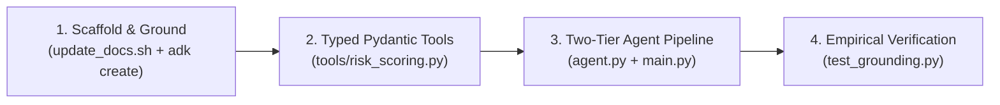

import Setup from '../_setup-snippet.mdx';

# Lab 12: Building a Research Assistant with Web Search Challenge
# Lab 12: Building an Adverse Media & Reputational Risk Radar with Web Grounding

## Goal
## 🧭 The Enterprise Scenario: Commercial Borrower Screening

In this lab, you will build a **Research Assistant** that can access up-to-date information from the internet and process it using custom Python logic. Since `google_search` can't share an agent with custom function tools (a Gemini API restriction, not an ADK one -- see the README), you'll build this as **two agents called in sequence**: a search specialist, then a formatter that receives its output.
At **Sovereign Horizon Bank**, middle-market commercial loan applications ($5M to $50M) cannot be submitted to the Credit Committee without an **Adverse Media & Sanctions Screening Review**. Credit officers must verify that prospective corporate borrowers have no undisclosed fraud indictments, environmental fines, or severe regulatory penalties.

### Prerequisites
*   **Agent Platform:** While `google_search` can work with AI Studio keys, the ADK standardizes on Agent Platform for grounding in enterprise scenarios. Ensure your `.env` is configured correctly (refer to Module 2).
Manual adverse searches across dozens of public news outlets take **3 to 5 hours per borrower**.
Manual adverse searches across dozens of public news outlets take **3 to 5 hours per borrower**.

### Step 1: Create and Prepare the Project
In this lab, you will act as a **Google Principal Forward-Deployed Engineer (FDE)** to construct the **Adverse Media & Reputational Risk Radar**. Because `google_search` cannot share an agent's `tools` list with custom function tools (the Gemini API `400 INVALID_ARGUMENT` restriction), you will implement an **Enterprise Two-Tier Sequential Multi-Agent Architecture**:
1. **Tier 1: Grounding Specialist (`adverse_media_agent`)** &mdash; Queries Google Search for live news, litigation, and regulatory enforcement actions.
2. **Tier 2: Compliance Risk Analyst (`risk_analyst_agent`)** &mdash; Ingests the grounded text, executes **Typed Pydantic Custom Tools** to assess severity, and generates a structured, auditable **Adverse Media Briefing**.

---

## 🔁 The 4-Step FDE Development Loop



---

## 🚀 Step 1: Scaffold & Ground Your Environment

<Setup/>

1.  **Create the agent project:**
    ```bash
    uv run adk create research_assistant
    cd research_assistant
    ```
1. **Scaffold the project directory:**
   ```bash
   uv run adk create adverse_media_radar
   cd adverse_media_radar
   ```
   *(Select "Other models (fill later)" when prompted by the CLI).*

2.  **Configure Authentication:** Ensure your `.env` file has your project ID and location set for Agent Platform.
2. **Configure Authentication:** Ensure your `.env` contains your `GOOGLE_API_KEY` or Vertex AI credentials.

### Step 2: Define the Two Agents
---

**Exercise:** Create `agent.py`. The custom tools and the `research_agent` are provided below. Your task is to complete `formatter_agent`.
## 💻 Step 2: Implement Typed Risk Scoring Tools (`tools/risk_scoring.py`)

<!-- TEACHER_NOTE_START -->
**Teacher's note (ADK instructor view):**
- **Learning goal:** Explain the concept clearly from beginner to advanced, with a simple mental model first.
- **Why it matters:** Connect the concept to real Google agentic workflows, Python engineering habits, and production-ready decisions.
- **Version watch:** Validate against the latest official ADK / Google docs before teaching; call out deprecations or migration notes when needed.
- **Module linkage:** Connect this idea to the previous and next modules so learners see the progression across the course.
- **Learning goal:** Teach learners that inter-agent communication and custom tool outputs must use structured Pydantic schemas.
- **Why it matters:** In regulated banking workflows, adverse findings require verifiable severities and citation attribution.
- **Version watch:** Standard Pydantic v2 `BaseModel` compatible with ADK 2.0.
<!-- TEACHER_NOTE_END -->
<!-- TEACHER_NOTE_START -->
**Teacher's note (ADK instructor view):**
- **Learning goal:** Explain the concept clearly from beginner to advanced, with a simple mental model first.
- **Why it matters:** Connect the concept to real Google agentic workflows, Python engineering habits, and production-ready decisions.
- **Version watch:** Validate against the latest official ADK / Google docs before teaching; call out deprecations or migration notes when needed.
- **Module linkage:** Connect this idea to the previous and next modules so learners see the progression across the course.
<!-- TEACHER_NOTE_END -->

Create `tools/risk_scoring.py` and complete the active learning `TODO` sections:

```python
# In agent.py
from datetime import datetime
from google.adk import Agent
from google.adk.tools import google_search
# In tools/risk_scoring.py
from typing import List
from pydantic import BaseModel, Field

# --- Custom Tools (Provided) ---
# ============================================================================
# TODO 1: DEFINE TYPED PYDANTIC MODELS FOR ADVERSE FINDINGS
# ============================================================================

def format_research_notes(topic: str, findings: str) -> dict:
    """Formats research findings into a structured document."""
    timestamp = datetime.now().strftime('%Y-%m-%d %H:%M:%S')
    document = f"""
# Research Report: {topic}
Generated: {timestamp}

## Findings
{findings}
    """.strip()
    return {"status": "success", "document": document}
class AdverseFinding(BaseModel):
  """Single risk finding extracted from grounded search results."""

def extract_key_facts(text: str, num_facts: int = 5) -> dict:
    """Extracts key sentences from a block of text."""
    sentences = text.split('.')
    facts = [s.strip() for s in sentences if len(s.strip()) > 10][:num_facts]
    return {"status": "success", "facts": facts}
  headline: str = Field(..., description="Summary of the adverse event")
  source_domain: str = Field(
      ..., description="Originating domain (e.g. reuters.com, sec.gov)"
  )
  risk_category: str = Field(
      ..., description="LITIGATION, REGULATORY, FRAUD, SANCTIONS, or ESG"
  )
  severity: str = Field(..., description="CRITICAL, ELEVATED, or LOW")

# --- Agent 1: Search Specialist (Provided) ---
# Only google_search -- it cannot be mixed with the custom tools below.

research_agent = Agent(
    model='gemini-3.5-flash',
    name='research_agent',
    instruction=(
        "You are a research assistant. Use google_search to find current "
        "information on the topic you're given, then summarize the key "
        "findings in a few plain-text sentences."
    ),
class AdverseMediaReport(BaseModel):
  """Consolidated adverse media assessment for the Credit Committee."""

  company_name: str = Field(..., description="Name of investigated entity")
  overall_risk_level: str = Field(
      ..., description="LOW_RISK, ELEVATED_CONCERN, or UNACCEPTABLE_RISK"
  )
  findings: List[AdverseFinding] = Field(
      default_factory=list, description="Extracted adverse findings"
  )
  is_eligible_for_credit: bool = Field(
      ..., description="True if no CRITICAL or active fraud issues"
  )
  summary_memo: str = Field(
      ..., description="Executive compliance briefing for Credit Committee"
  )


# ============================================================================
# TODO 2: IMPLEMENT DETERMINISTIC RISK EVALUATION TOOL
# ============================================================================


def classify_adverse_risk(
    company_name: str, raw_findings_summary: str
) -> AdverseMediaReport:
  """Analyze research findings and categorize the corporate borrower's reputational risk level."""
  # TODO: Check if raw_findings_summary indicates any fraud, criminal indictment, or sanctions.
  # If found -> overall_risk_level = "UNACCEPTABLE_RISK", is_eligible_for_credit = False.
  # If moderate regulatory fines or routine civil litigation -> overall_risk_level = "ELEVATED_CONCERN".
  # If no negative findings reported -> overall_risk_level = "LOW_RISK", is_eligible_for_credit = True.
  # TODO: Return a populated AdverseMediaReport instance.
  pass
```

---

## 🤖 Step 3: Define the Two-Tier Agent Architecture (`agent.py`)

Create `agent.py`. Notice how `adverse_media_agent` uses `google_search` exclusively, while `risk_analyst_agent` uses your custom Pydantic tool:

```python
# In agent.py
from google.adk import Agent
from google.adk.tools import google_search
from tools.risk_scoring import classify_adverse_risk

# ============================================================================
# TIER 1: WEB GROUNDING SPECIALIST (BUILT-IN TOOLS ONLY)
# ============================================================================
# Critical Constraint: google_search CANNOT share tools with custom functions!
adverse_media_agent = Agent(
    name="adverse_media_researcher",
    model="gemini-2.5-flash",
    instruction="""
You are an expert investigative corporate risk researcher at Sovereign Horizon Bank.
When given a corporate borrower name, use google_search to investigate:
1. Active regulatory investigations (SEC, DOJ, EPA, FTC, OCC).
2. Major commercial lawsuits or breach of contract disputes.
3. Executive fraud, embezzlement, or criminal indictments.
4. International trade or sanctions watchlist notices.

Synthesize all discovered facts with explicit dates and news source names.
If no negative information is found, explicitly confirm that no adverse signals were detected.
""",
    tools=[google_search],
)

# --- Agent 2: Formatter ---
# TODO: Define `formatter_agent`.
# 1. Use 'gemini-3.5-flash'.
# 2. Add `extract_key_facts` and `format_research_notes` to tools (do NOT
#    add google_search here -- that's the whole point of splitting these up).
# 3. Write an instruction telling it to: first call extract_key_facts on the
#    findings text it's given, then call format_research_notes with the
#    topic and those facts, then present the final document as its answer.
# ============================================================================
# TODO 3: DEFINE TIER 2 RISK ANALYST AGENT (CUSTOM TOOLS ONLY)
# ============================================================================
# Instructions:
# 1. Use model="gemini-2.5-flash".
# 2. Register tools=[classify_adverse_risk] (Do NOT include google_search).
# 3. Instruct the agent to parse the research findings and call classify_adverse_risk.
# 4. Synthesize a formal "🏛️ ADVERSE MEDIA COMPLIANCE BRIEFING".

formatter_agent = Agent(...)
# risk_analyst_agent = Agent(...)
```

### Step 3: Orchestrate the Two Agents
---

Since these are two separate agents, you need a small script to run one after the other, passing the first agent's output as the second agent's input -- exactly like the programmatic execution pattern from Module 6.
## 🚀 Step 4: Sequential Orchestration Pipeline (`main.py`)

**Exercise:** Create `main.py` and complete the `run_agent` TODO.
Implement programmatic execution in `main.py` using `InMemoryRunner` to pass output from Agent 1 into Agent 2:

<!-- TEACHER_NOTE_START -->
**Teacher's note (ADK instructor view):**
- **Learning goal:** Explain the concept clearly from beginner to advanced, with a simple mental model first.
- **Why it matters:** Connect the concept to real Google agentic workflows, Python engineering habits, and production-ready decisions.
- **Version watch:** Validate against the latest official ADK / Google docs before teaching; call out deprecations or migration notes when needed.
- **Module linkage:** Connect this idea to the previous and next modules so learners see the progression across the course.
<!-- TEACHER_NOTE_END -->
<!-- TEACHER_NOTE_START -->
**Teacher's note (ADK instructor view):**
- **Learning goal:** Explain the concept clearly from beginner to advanced, with a simple mental model first.
- **Why it matters:** Connect the concept to real Google agentic workflows, Python engineering habits, and production-ready decisions.
- **Version watch:** Validate against the latest official ADK / Google docs before teaching; call out deprecations or migration notes when needed.
- **Module linkage:** Connect this idea to the previous and next modules so learners see the progression across the course.
<!-- TEACHER_NOTE_END -->
```python
# In main.py
import asyncio
from agent import adverse_media_agent, risk_analyst_agent
from google.adk.runners import InMemoryRunner
from google.genai import types
from agent import research_agent, formatter_agent


async def run_agent(agent, app_name: str, message_text: str) -> str:
    # TODO: Implement this helper:
    # 1. Create an InMemoryRunner for `agent`.
    # 2. Create a session (user_id="student", session_id="s1" is fine).
    # 3. Call run_async with a user message built from `message_text`.
    # 4. Return the text of the final event you see (there's no need to
    #    check is_final_response() here -- just keep the latest text seen).
    ...
  # ============================================================================
  # TODO 4: IMPLEMENT ASYNC AGENT RUNNER HELPER
  # ============================================================================
  # 1. Initialize InMemoryRunner(agent=agent, app_name=app_name).
  # 2. Create session with user_id="risk_officer" and session_id="s1".
  # 3. Iterate over runner.run_async(...) and capture the final event text.
  # 4. Return final_text.
  pass

async def main():
    topic = "the latest AI developments from Google"

    findings = await run_agent(research_agent, "research_app", f"Research this topic: {topic}")
    print("--- RESEARCH FINDINGS ---")
    print(findings)
async def screen_borrower(company_name: str):
  print(f"\n🔍 [PHASE 1] Investigating adverse news for: {company_name}...")
  research_output = await run_agent(
      adverse_media_agent,
      "adverse_media_app",
      f"Investigate adverse media, litigation, and regulatory enforcement for"
      f" {company_name}.",
  )
  print("\n--- GROUNDED RESEARCH FINDINGS ---")
  print(research_output)

    report = await run_agent(formatter_agent, "formatter_app", f"Topic: {topic}\n\nFindings: {findings}")
    print("\n--- FINAL REPORT ---")
    print(report)
  print(f"\n⚖️ [PHASE 2] Synthesizing compliance risk report...")
  final_briefing = await run_agent(
      risk_analyst_agent,
      "risk_analyst_app",
      f"Borrower: {company_name}\n\nResearch Findings:\n{research_output}",
  )
  print("\n--- FINAL ADVERSE MEDIA BRIEFING ---")
  print(final_briefing)


if __name__ == "__main__":
    asyncio.run(main())
  asyncio.run(screen_borrower("Acme Industrial Corp"))
```

Run it with:
<!-- TEACHER_NOTE_START -->
**Teacher's note (ADK instructor view):**
- **Learning goal:** Explain the concept clearly from beginner to advanced, with a simple mental model first.
- **Why it matters:** Connect the concept to real Google agentic workflows, Python engineering habits, and production-ready decisions.
- **Version watch:** Validate against the latest official ADK / Google docs before teaching; call out deprecations or migration notes when needed.
- **Module linkage:** Connect this idea to the previous and next modules so learners see the progression across the course.
<!-- TEACHER_NOTE_END -->
<!-- TEACHER_NOTE_START -->
**Teacher's note (ADK instructor view):**
- **Learning goal:** Explain the concept clearly from beginner to advanced, with a simple mental model first.
- **Why it matters:** Connect the concept to real Google agentic workflows, Python engineering habits, and production-ready decisions.
- **Version watch:** Validate against the latest official ADK / Google docs before teaching; call out deprecations or migration notes when needed.
- **Module linkage:** Connect this idea to the previous and next modules so learners see the progression across the course.
<!-- TEACHER_NOTE_END -->
---

## ⚡ Step 5: Test Your Solution

Run the pipeline using UV:

```bash
uv run python main.py
```

**Observe the output:** the first agent grounds itself in real web results beyond its training data; the second agent never touches `google_search` at all, only your custom tools -- yet the final report still incorporates the first agent's findings, because you're the one passing the data between them.
### Expected Output Structure:
1. **Phase 1 Output:** Real-time web search findings with source mentions.
2. **Phase 2 Output:** A structured **Adverse Media Compliance Briefing** categorizing risk level (`LOW_RISK`, `ELEVATED_CONCERN`, or `UNACCEPTABLE_RISK`) and determining credit eligibility.

### Having Trouble?
---

If you get stuck, you can find the complete, working code in the `lab-solution.md` file.
## 🧪 Self-Reflection Questions

### Lab Summary
1. **Why does placing `google_search` and a custom Python function in the same `tools=[...]` list raise `400 INVALID_ARGUMENT` at the Gemini API level?**
2. **How does grounding search results protect a commercial bank from Fed SR 11-7 model risk compliance penalties?**
3. **What is the key difference between Public Web Grounding (`google_search`) and Private Enterprise Grounding (Vertex AI Search)?**
4. **Why is sequential multi-agent composition superior to writing custom web scraping scripts with BeautifulSoup or Selenium?**

You have successfully built a two-agent pipeline that bridges the knowledge gap of LLMs using built-in grounding tools. You have learned:
*   How to easily enable web search using the **`google_search`** built-in tool.
*   Why `google_search` can't share an agent with custom function tools, and how to work around that with **sequential composition** instead.
*   How to write instructions that guide each agent through its own focused part of a larger research-and-formatting workflow.
---

### Self-Reflection Questions
- Why is `google_search` considered a "built-in" tool while `format_research_notes` is a "custom" tool?
- What are the benefits of having the model perform the search inside its own environment rather than you writing a Python script to scrape Google results?
- `main.py` passes `findings` between the two agents as a plain string. What would you have to change if you instead wanted `formatter_agent` to be able to ask `research_agent` follow-up questions?

<hr/>

### 🕵️ Hidden Solution 🕵️

Looking for the solution? Here's a hint (Base64 decode me):
`L2dvb2dsZS1hZGstdHJhaW5pbmcvbW9kdWxlMTItYnVpbHQtaW4tdG9vbHMtZ3JvdW5kaW5nL2xhYi1zb2x1dGlvbg==`

<div style={{color: 'rgba(0,0,0,0.01)', userSelect: 'all', fontSize: '1px'}}>
    The direct link is: <a href="/google-adk-training/module12-built-in-tools-grounding/lab-solution" style={{color: 'inherit', textDecoration: 'none'}}>Lab Solution</a>
</div>

<!-- © 2026 Inder Chauhan (https://github.com/inderanz/google-adk-training). All rights reserved. Ref: IC-ADK-module12-built-in-tools-grounding-lab -->
---

## Official References

- Google ADK docs (latest): https://google.github.io/adk-docs/
- Google AI / Gemini docs: https://ai.google.dev/
- Google GenAI Python SDK reference: https://googleapis.github.io/python-genai/
- Context7 / current SDK lookup for the exact installed version and API signatures
- Related module path: review the surrounding modules for continuity, prerequisites, and follow-on concepts

- Google Search Grounding: https://ai.google.dev/gemini-api/docs/google-search
- Federal Reserve SR 11-7 (Model Risk Management): https://www.federalreserve.gov/supervisionreg/srletters/sr1107.htm
