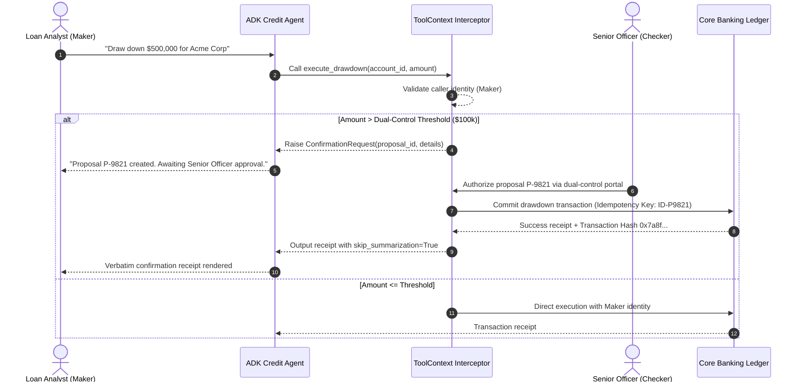
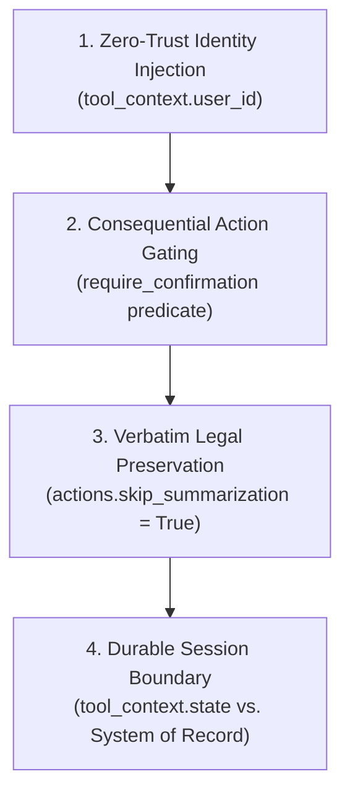

# Module 13 Enterprise Playbook: Dual-Control Governance & Consequential Operations

The enterprise stakeholder needs this result: High-stakes operations (such as credit drawdowns, customer refunds, and account limit updates) cannot be triggered autonomously by an LLM prompt. Every consequential transaction must enforce dual-control authorization, non-repudiable audit logging, and zero-trust identity extraction from authenticated runtime context.

Read the [plain-English task and term explanations](./README.md) before reviewing the implementation details.

## 1. Governance & Dual-Control Decision Matrix

In commercial banking and enterprise ERP systems, transactions exceeding operational thresholds mandate segregation of duties (Maker-Checker / Four-Eyes principle).

| Governance Requirement | Architecture Pattern | Implementation Mechanism |
|---|---|---|
| Zero-Trust Identity Injection | Server-side identity propagation | Never accept `user_id` as an LLM tool parameter. Extract authenticated caller credentials directly from `tool_context.user_id` or session auth tokens. |
| Dual-Control (Maker-Checker) | Human-in-the-Loop (HITL) Interception | Split execution into two phases: Propose (Agent drafts proposal with idempotency key) -> Approve (Secondary authorized officer signs proposal out-of-band or via secure callback). |
| Non-Repudiation & SOX Audit | Append-only event telemetry | Record immutable audit trails containing timestamp, authenticated identity, proposal payload, cryptographic hash, and sign-off decision before invoking core banking APIs. |
| Verbatim Legal Compliance | Bypass LLM Summarization | Set `tool_context.actions.skip_summarization = True` so legal disclaimers, compliance receipts, and cryptographic confirmation hashes render directly to the client without LLM hallucination. |

## 2. High-Stakes Transaction Lifecycle

<!-- TEACHER_NOTE_START -->
**Teacher's note (ADK instructor view):**
- **Learning goal:** Explain the concept clearly from beginner to advanced, with a simple mental model first.
- **Why it matters:** Connect the concept to real Google agentic workflows, Python engineering habits, and production-ready decisions.
- **Version watch:** Validate against the latest official ADK / Google docs before teaching; call out deprecations or migration notes when needed.
- **Module linkage:** Connect this idea to the previous and next modules so learners see the progression across the course.
<!-- TEACHER_NOTE_END -->

## 3. Production Hardening Checklist

1. **Identity Boundaries:** Verify that the ADK `Runner` populates `ToolContext` using cryptographically verified JWT tokens issued by the enterprise API gateway (e.g., Apigee, Cloud Endpoints).
2. **Idempotency Enforcement:** Ensure all downstream transactional tool calls supply a deterministic idempotency key (UUID or proposal hash) to prevent duplicate execution during network retries.
3. **Session State Isolation:** Never store uncommitted transactional state in global variables or process memory; bind proposal drafts to authenticated session state in durable stores (e.g., Firestore or Cloud SQL).

<!-- © 2026 Inder Chauhan (https://github.com/inderanz/google-adk-training). All rights reserved. Ref: IC-ADK-module13-enterprise-playbook -->
---

## 🏛️ The 4 Tenets of Production ToolContext Architecture

<!-- TEACHER_NOTE_START -->
**Teacher's note (ADK instructor view):**
- **Learning goal:** Explain the concept clearly from beginner to advanced, with a simple mental model first.
- **Why it matters:** Connect the concept to real Google agentic workflows, Python engineering habits, and production-ready decisions.
- **Version watch:** Validate against the latest official ADK / Google docs before teaching; call out deprecations or migration notes when needed.
- **Module linkage:** Connect this idea to the previous and next modules so learners see the progression across the course.
<!-- TEACHER_NOTE_END -->

### Tenet 1: Zero-Trust Identity Injection (Never Trust LLM Arguments)
The agent's LLM context is untrusted. Function arguments like `user_id`, `officer_role`, or `tenant_id` must never be passed as model-accessible parameters. All security attributes must be populated by the host HTTP layer and injected directly via `tool_context.user_id`.

### Tenet 2: Consequential Action Gating (Predicate Confirmation)
Operations that mutate durable state or exceed risk thresholds (e.g. drawdowns $\ge \$250,000$) must be wrapped with conditional confirmation (`require_confirmation=is_high_value_transaction`). The tool body does not execute until an authorized human signs off on the exact payload.

### Tenet 3: Verbatim Legal Preservation (`skip_summarization`)
Large language models naturally rephrase, compress, and alter wording. When a tool produces a legally binding receipt, cryptographic hash, or regulatory disclaimer, the tool MUST set `tool_context.actions.skip_summarization = True`. This forces the runtime to stream the raw function response directly to the client without LLM re-synthesis.

### Tenet 4: Scoped Session State Lifecycle
`tool_context.state` provides scoped working memory within the active conversation session. It is designed for multi-turn draft accumulation and intermediate calculations. Authoritative systems-of-record (booked loans, core ledger debits, compliance logs) must be committed to external transactional databases (Cloud SQL, Spanner, or Firestore).

---

## ⚠️ Enterprise Anti-Pattern Comparison Matrix

| Architectural Dimension | ❌ High-Risk Anti-Pattern | ✅ Google FDE Production Standard | Consequence of Failure |
|---|---|---|---|
| **Identity Resolution** | `def execute_drawdown(amount, user_id)` | `def execute_drawdown(amount, tool_context: ToolContext)` | Prompt injection allows attackers to forge executive identities. |
| **Mutation Execution** | Agent autonomously calls ledger mutations without human review | Conditional `require_confirmation` gating high-value transactions | Unchecked multi-million-dollar capital disbursement. |
| **Receipt Rendering** | Model summarizes raw receipt JSON into conversational prose | Setting `tool_context.actions.skip_summarization = True` | Altered transaction hashes; statutory Fedwire disclaimers omitted. |
| **State Persistence** | Storing uncommitted drafts in Python global dictionaries | Writing to `tool_context.state` backed by DatabaseSessionService | Race conditions in multi-tenant containers; memory leakage. |
| **Unit Discipline** | Using floating-point floats for money (`amount = 250000.50`) | Strict integer cents (`amount_cents = 25_000_050`) | Floating-point rounding drift causing audit discrepancies. |

---

## 🔗 Related Course Curriculum

* [Module 10 Theory](../module10-advanced-function-tools/README.md) — Advanced function tools and stateful session memory.
* [Module 11.5 Theory](../module11_5-enterprise-credit-underwriting/README.md) — Enterprise credit underwriting and commercial loan triage.
* [Module 13.5 Theory](../module13_5-firestore-persistence/README.md) — Durable ADK sessions and Firestore case records.
* [Enterprise ADK Roadmap](../enterprise-adk-roadmap.md) — Master roadmap for Google ADK enterprise architecture.

---

## 📚 Official References

- Google ADK ToolContext Documentation: https://google.github.io/adk-docs/tools/
- Google ADK Custom Tools: https://adk.dev/tools-custom/
- Google ADK Session & State Management: https://adk.dev/sessions/
- Federal Reserve SR 11-7 (Model Risk Management): https://www.federalreserve.gov/supervisionreg/srletters/sr1107.htm
---

## Official References

- Google ADK docs (latest): https://google.github.io/adk-docs/
- Google AI / Gemini docs: https://ai.google.dev/
- Google GenAI Python SDK reference: https://googleapis.github.io/python-genai/
- Context7 / current SDK lookup for the exact installed version and API signatures
- Related module path: review the surrounding modules for continuity, prerequisites, and follow-on concepts

