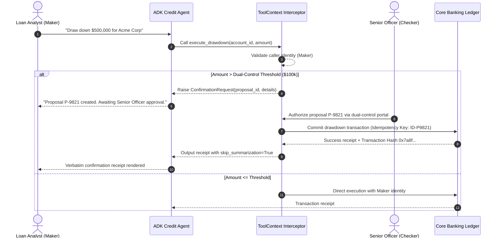

# Module 13 Enterprise Playbook: Dual-Control Governance & Consequential Operations

The enterprise stakeholder needs this result: High-stakes operations (such as credit drawdowns, customer refunds, and account limit updates) cannot be triggered autonomously by an LLM prompt. Every consequential transaction must enforce dual-control authorization, non-repudiable audit logging, and zero-trust identity extraction from authenticated runtime context.

Read the [plain-English task and term explanations](./README.md) before reviewing the implementation details.

## 1. Governance & Dual-Control Decision Matrix

In commercial banking and enterprise ERP systems, transactions exceeding operational thresholds mandate segregation of duties (Maker-Checker / Four-Eyes principle).

| Governance Requirement | Architecture Pattern | Implementation Mechanism |
|---|---|---|
| Zero-Trust Identity Injection | Server-side identity propagation | Never accept `user_id` as an LLM tool parameter. Extract authenticated caller credentials directly from `tool_context.user_id` or session auth tokens. |
| Dual-Control (Maker-Checker) | Human-in-the-Loop (HITL) Interception | Split execution into two phases: Propose (Agent drafts proposal with idempotency key) -> Approve (Secondary authorized officer signs proposal out-of-band or via secure callback). |
| Non-Repudiation & SOX Audit | Append-only event telemetry | Record immutable audit trails containing timestamp, authenticated identity, proposal payload, cryptographic hash, and sign-off decision before invoking core banking APIs. |
| Verbatim Legal Compliance | Bypass LLM Summarization | Set `tool_context.actions.skip_summarization = True` so legal disclaimers, compliance receipts, and cryptographic confirmation hashes render directly to the client without LLM hallucination. |

## 2. High-Stakes Transaction Lifecycle

## 3. Production Hardening Checklist

1. **Identity Boundaries:** Verify that the ADK `Runner` populates `ToolContext` using cryptographically verified JWT tokens issued by the enterprise API gateway (e.g., Apigee, Cloud Endpoints).
2. **Idempotency Enforcement:** Ensure all downstream transactional tool calls supply a deterministic idempotency key (UUID or proposal hash) to prevent duplicate execution during network retries.
3. **Session State Isolation:** Never store uncommitted transactional state in global variables or process memory; bind proposal drafts to authenticated session state in durable stores (e.g., Firestore or Cloud SQL).

<!-- © 2026 Inder Chauhan (https://github.com/inderanz/google-adk-training). All rights reserved. Ref: IC-ADK-module13-enterprise-playbook -->

