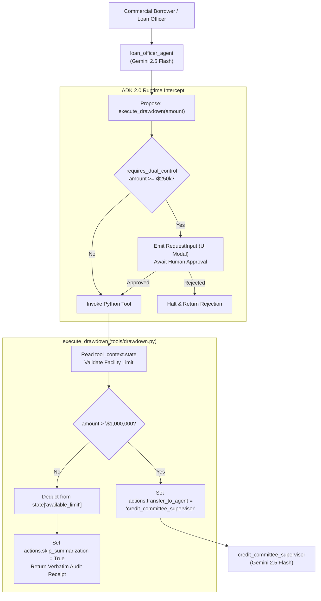

import Setup from '../_setup-snippet.mdx';

# Lab 13: Building a Secure Agent with HITL and Actions
# Lab 13: Building an Enterprise Dual-Control Drawdown Agent with HITL & ToolContext

## Goal
## 🎯 Executive Mission Briefing

In this lab, you will build a **Secure Finance Agent**. You will learn how to implement **Human-in-the-Loop (HITL)** for sensitive transactions and how to use **`tool_context.actions`** to dynamically escalate a conversation to a supervisor node.
Welcome back to the Sovereign Horizon Bank forward-deployed engineering engagement.

### Step 1: Prepare the Project
Following your successful deployment of the Financial Metric Extraction and Adverse Media Grounding agents, the Credit Risk Committee has greenlit **Project Aegis Underwrite Phase 3: Commercial Credit Facility Drawdown & Dual-Control Disbursement**.

Commercial borrowers holding multi-million-dollar revolving credit facilities (e.g., \$10,000,000 lines of credit) frequently request partial capital drawdowns to fund payroll, inventory purchases, or construction milestones.

However, Victoria Sterling (Managing Director & Head of Credit Risk) has issued an uncompromising governance directive:
> *"An autonomous agent must NEVER unilaterally disburse funds from a credit line without human verification. Any drawdown of \$250,000 or greater requires explicit Human-in-the-Loop (HITL) approval from a licensed Loan Officer. Furthermore, any single drawdown exceeding \$1,000,000 exceeds single-signature authority and must be dynamically escalated to the Senior Credit Committee Supervisor. Finally, our Fedwire audit receipts must reach the borrower verbatim without LLM re-phrasing."*

In this lab, you will engineer this mission-critical system using **Google ADK 2.0 `ToolContext`**, **`FunctionTool` confirmation predicates**, **dynamic workflow transfers**, and **summarization bypass**.

---

## 🏗️ Architectural Blueprint

The dual-control drawdown architecture operates across two coordinated agent nodes and an intercepted tool layer:



---

## 📋 Acceptance Criteria

To successfully complete this lab, your implementation must fulfill these 5 requirements:

1. **Zero-Trust Identity Extraction:** The tool must read the caller's identity directly from `tool_context.user_id` rather than trusting function arguments.
2. **Dynamic Confirmation Predicate (`requires_dual_control`):** Any drawdown of \$250,000 or more must trigger ADK's native `require_confirmation` checkpoint before execution.
3. **Session State Limit Tracking:** Credit facility limits must be initialized (default \$10,000,000.0) and tracked in `tool_context.state`. Drawdowns exceeding the available balance must be rejected.
4. **Dynamic Committee Escalation:** Drawdowns exceeding \$1,000,000.0 must programmatically set `tool_context.actions.transfer_to_agent = "credit_committee_supervisor"`.
5. **Deterministic Verbatim Output:** Successful drawdowns must set `tool_context.actions.skip_summarization = True` to deliver the official bank audit receipt directly to the user without model alteration.

---

## 🛠️ Step 1: Project Setup

<Setup/>

<!-- TEACHER_NOTE_START -->
**Teacher's note (ADK instructor view):**
- **Learning goal:** Explain the concept clearly from beginner to advanced, with a simple mental model first.
- **Why it matters:** Connect the concept to real Google agentic workflows, Python engineering habits, and production-ready decisions.
- **Version watch:** Validate against the latest official ADK / Google docs before teaching; call out deprecations or migration notes when needed.
- **Module linkage:** Connect this idea to the previous and next modules so learners see the progression across the course.
<!-- TEACHER_NOTE_END -->
<!-- TEACHER_NOTE_START -->
**Teacher's note (ADK instructor view):**
- **Learning goal:** Explain the concept clearly from beginner to advanced, with a simple mental model first.
- **Why it matters:** Connect the concept to real Google agentic workflows, Python engineering habits, and production-ready decisions.
- **Version watch:** Validate against the latest official ADK / Google docs before teaching; call out deprecations or migration notes when needed.
- **Module linkage:** Connect this idea to the previous and next modules so learners see the progression across the course.
<!-- TEACHER_NOTE_END -->
Initialize the project directory structure:

```bash
uv run adk create secure_finance
cd secure_finance
mkdir -p commercial_drawdown/tools
cd commercial_drawdown
```

### Step 2: Implement the Secure Tools
Verify your environment dependencies:
```bash
python3 -c "import google.adk; print('ADK Version:', google.adk.__version__)"
```

**Exercise:** Create `tools/finance.py`. You will implement a tool that handles investments.
---

<!-- TEACHER_NOTE_START -->
**Teacher's note (ADK instructor view):**
- **Learning goal:** Explain the concept clearly from beginner to advanced, with a simple mental model first.
- **Why it matters:** Connect the concept to real Google agentic workflows, Python engineering habits, and production-ready decisions.
- **Version watch:** Validate against the latest official ADK / Google docs before teaching; call out deprecations or migration notes when needed.
- **Module linkage:** Connect this idea to the previous and next modules so learners see the progression across the course.
<!-- TEACHER_NOTE_END -->
<!-- TEACHER_NOTE_START -->
**Teacher's note (ADK instructor view):**
- **Learning goal:** Explain the concept clearly from beginner to advanced, with a simple mental model first.
- **Why it matters:** Connect the concept to real Google agentic workflows, Python engineering habits, and production-ready decisions.
- **Version watch:** Validate against the latest official ADK / Google docs before teaching; call out deprecations or migration notes when needed.
- **Module linkage:** Connect this idea to the previous and next modules so learners see the progression across the course.
<!-- TEACHER_NOTE_END -->
## 💻 Step 2: Implement the Secure Drawdown Tool

Create `commercial_drawdown/tools/drawdown.py`.

You must implement:
1. `DrawdownReceipt`: A Pydantic `BaseModel` representing the structured audit record.
2. `requires_dual_control`: An async predicate returning `True` if `amount >= 250_000.0`.
3. `execute_drawdown`: The stateful, action-steering tool function.

Review the skeleton below and complete the marked `TODO` sections:

```python
# In tools/finance.py
"""Commercial credit line drawdown tool with state management and dynamic escalation.

File: commercial_drawdown/tools/drawdown.py
"""

from typing import Any, Dict
from google.adk.tools import ToolContext
from pydantic import BaseModel, Field

def execute_investment(amount: float, tool_context: ToolContext) -> str:
    """
    Executes a long-term investment.
    Use this tool only when the user explicitly asks to 'invest' or 'buy'.
    """
    # 1. Check for escalation: Any amount > 10,000 needs a human supervisor
    if amount > 10000:
        # TODO: Set tool_context.actions.transfer_to_agent to "supervisor"
        # Hint: This will dynamically route the user to a different node.
        pass
        return f"Amount ${amount} requires supervisor approval. Escalating..."

    # 2. Regular investment logic
    return f"Success! ${amount} has been invested in your portfolio."
class DrawdownReceipt(BaseModel):
  """Official disbursement audit receipt."""

  transaction_id: str = Field(..., description="Unique Fedwire transaction ref")
  facility_id: str = Field(..., description="Credit facility account ID")
  disbursed_amount: float = Field(..., description="Disbursed USD amount")
  remaining_limit: float = Field(..., description="Remaining available balance")
  authorized_by: str = Field(..., description="Authenticated user ID")
  status: str = Field(..., description="COMPLETED, ESCALATED, or REJECTED")


# ============================================================================
# TODO 1: IMPLEMENT DYNAMIC CONFIRMATION PREDICATE
# ============================================================================
async def requires_dual_control(
    facility_id: str, amount: float, tool_context: ToolContext, **kwargs: Any
) -> bool:
  """Evaluate if the requested transaction requires human dual-control approval.

  HINT: Return True if amount >= 250_000.0, else return False.
  """
  # TODO: Implement predicate logic
  pass


# ============================================================================
# TODO 2: IMPLEMENT THE STATEFUL DRAWDOWN FUNCTION
# ============================================================================
def execute_drawdown(
    facility_id: str,
    amount: float,
    disbursement_purpose: str,
    tool_context: ToolContext,
) -> str:
  """Execute a commercial credit line drawdown against the borrower's active facility.

  Args:
      facility_id: The commercial loan facility account identifier (e.g.
        'FAC-7700').
      amount: The USD amount to disburse to the borrower.
      disbursement_purpose: Business justification for the drawdown request.
  """
  # -------------------------------------------------------------------------
  # TODO 2A: EXTRACT AUTHENTICATED CALLER IDENTITY
  # Extract user ID from tool_context.user_id. Fall back to "OFFICER-UNKNOWN".
  # -------------------------------------------------------------------------
  officer_id = None  # TODO

  # -------------------------------------------------------------------------
  # TODO 2B: INITIALIZE AND VALIDATE FACILITY BALANCE IN SESSION STATE
  # Read "available_credit" from tool_context.state, defaulting to 10,000,000.0.
  # If amount > available_credit, return an explicit rejection string.
  # -------------------------------------------------------------------------
  # TODO: Check state and validate balance

  # -------------------------------------------------------------------------
  # TODO 2C: CHECK COMMITTEE ESCALATION THRESHOLD (> $1,000,000.0)
  # If amount > 1,000,000.0:
  # 1. Set tool_context.actions.transfer_to_agent = "credit_committee_supervisor"
  # 2. Set tool_context.actions.skip_summarization = True
  # 3. Return an escalation notification message.
  # -------------------------------------------------------------------------
  # TODO: Implement dynamic escalation

  # -------------------------------------------------------------------------
  # TODO 2D: ATOMIC STATE UPDATE & VERBATIM RECEIPT GENERATION
  # Deduct amount from available_credit and save back to tool_context.state.
  # Set tool_context.actions.skip_summarization = True so the LLM does not
  # alter the official audit receipt.
  # -------------------------------------------------------------------------
  # TODO: Mutate state and return formatted receipt string
  pass
```

### Step 3: Configure the Agent with HITL
---

**Exercise:** Open `agent.py`. You need to wrap your tool in a `FunctionTool` to enable the confirmation pop-up.
## 🤖 Step 3: Configure the Multi-Agent Node Hierarchy

<!-- TEACHER_NOTE_START -->
**Teacher's note (ADK instructor view):**
- **Learning goal:** Explain the concept clearly from beginner to advanced, with a simple mental model first.
- **Why it matters:** Connect the concept to real Google agentic workflows, Python engineering habits, and production-ready decisions.
- **Version watch:** Validate against the latest official ADK / Google docs before teaching; call out deprecations or migration notes when needed.
- **Module linkage:** Connect this idea to the previous and next modules so learners see the progression across the course.
<!-- TEACHER_NOTE_END -->
<!-- TEACHER_NOTE_START -->
**Teacher's note (ADK instructor view):**
- **Learning goal:** Explain the concept clearly from beginner to advanced, with a simple mental model first.
- **Why it matters:** Connect the concept to real Google agentic workflows, Python engineering habits, and production-ready decisions.
- **Version watch:** Validate against the latest official ADK / Google docs before teaching; call out deprecations or migration notes when needed.
- **Module linkage:** Connect this idea to the previous and next modules so learners see the progression across the course.
<!-- TEACHER_NOTE_END -->
Create `commercial_drawdown/agent.py`.

You must:
1. Define the `credit_committee_supervisor` agent node using `gemini-2.5-flash`.
2. Wrap `execute_drawdown` using `FunctionTool(..., require_confirmation=requires_dual_control)`.
3. Define the primary `loan_officer_agent` node, registering `supervisor` in `sub_agents` so the runtime can resolve the dynamic transfer destination.

Review the skeleton below and complete the marked `TODO` sections:

```python
# In agent.py
from google.adk import Agent, Workflow
"""Agent configuration for dual-control commercial credit disbursement.

File: commercial_drawdown/agent.py
"""

from google.adk import Agent
from google.adk.tools import FunctionTool
from .tools.finance import execute_investment
from .tools.drawdown import execute_drawdown, requires_dual_control

# --- 1. Define the Supervisor Node ---
supervisor = Agent(
    name="supervisor",
    model="gemini-3.5-flash",
    instruction="You are a senior supervisor. Review the large investment request and provide a final verdict."
# ============================================================================
# TODO 3: DEFINE THE SUPERVISOR NODE
# Create an Agent named 'credit_committee_supervisor' using 'gemini-2.5-flash'
# with instructions to evaluate escalated multi-million-dollar drawdowns.
# ============================================================================
credit_committee_supervisor = Agent(
    name="credit_committee_supervisor",
    model="gemini-2.5-flash",
    instruction="""You are the Senior Credit Committee Supervisor at Sovereign Horizon Bank.
Review commercial drawdown requests exceeding $1,000,000.
Evaluate borrower exposure, debt covenants, and issue final credit committee approval.""",
)

# --- 2. Wrap the Tool for Safety ---
# TODO: Create a FunctionTool named 'secure_investment_tool'
# Enable require_confirmation=True
secure_investment_tool = ...
# ============================================================================
# TODO 4: WRAP THE TOOL WITH DYNAMIC CONFIRMATION
# Wrap execute_drawdown with FunctionTool and bind require_confirmation
# to the requires_dual_control predicate.
# ============================================================================
secure_drawdown_tool = None  # TODO: FunctionTool(...)

# --- 3. Define the Main Agent ---
finance_agent = Agent(
    name="finance_agent",
    model="gemini-3.5-flash",
    instruction="Help users with their investments. Use 'execute_investment' for trades.",
    tools=[secure_investment_tool],
    sub_agents=[supervisor] # Required for discovery during transfer
# ============================================================================
# TODO 5: DEFINE THE PRIMARY LOAN OFFICER AGENT
# Configure 'loan_officer_agent' with 'gemini-2.5-flash', secure_drawdown_tool,
# and register credit_committee_supervisor in sub_agents.
# ============================================================================
loan_officer_agent = Agent(
    name="loan_officer_agent",
    model="gemini-2.5-flash",
    instruction="""You are a Commercial Loan Officer Assistant at Sovereign Horizon Bank.
Assist corporate borrowers with facility balance inquiries and credit drawdowns.
Always use the execute_drawdown tool to process disbursement requests.""",
    tools=[
        # TODO: Add secure_drawdown_tool
    ],
    sub_agents=[
        # TODO: Register credit_committee_supervisor for dynamic transfer
    ],
)
```

# --- 4. Build the Workflow Graph ---
root_agent = Workflow(
    name="SecureSystem",
    edges=[("START", finance_agent)]
)
---

## 🧪 Step 4: Verification and Execution Harness

Create `commercial_drawdown/test_drawdown.py` to verify your implementation across all three scenarios:
1. **Low-Value Drawdown (< \$250k):** Executes immediately without human interruption.
2. **Medium-Value Drawdown (\$250k to \$1M):** Triggers `require_confirmation` predicate, halts for approval, and returns verbatim audit receipt.
3. **High-Value Drawdown (> \$1M):** Triggers confirmation AND dynamically escalates to `credit_committee_supervisor`.

Run the test suite:
```bash
python3 test_drawdown.py
```

### Step 4: Test the Secure Workflow
---

1.  **Start the Dev UI:** `uv run adk web .`
2.  **Test HITL:**
    - Ask: "Invest $500 for me."
    - **Observe:** A confirmation box should appear. The code only runs if you click "Approve."
3.  **Test Dynamic Transfer:**
    - Ask: "Invest $50,000 for me."
    - **Observe:** Since `require_confirmation=True` wraps the tool unconditionally, you will see the *same* confirmation pop-up as above first — click "Approve" to let the tool actually run. Only then does the escalation logic inside `execute_investment` fire. In the Trace, you will see the `active_agent` change from `finance_agent` to `supervisor`.
## 🎓 Self-Reflection Questions

### Lab Summary
Before consulting the solution, answer these architectural questions:

You have built a production-ready secure agent! You learned:
*   How to **pause execution** for human approval using `require_confirmation`.
*   How to **reroute the conversation** dynamically using `tool_context.actions.transfer_to_agent`.
*   How to combine manual safety (HITL) with automated business rules (Escalation).
1. **Identity Grounding:** Why is extracting caller identity via `tool_context.user_id` strictly more secure than accepting a `user_id: str` function parameter from the LLM?
2. **Predicate vs. Static Confirmation:** What operational drawback would arise in a high-volume commercial bank if `require_confirmation=True` was used statically for all tool calls instead of using `requires_dual_control`?
3. **Sub-Agents Registration:** Why will `tool_context.actions.transfer_to_agent = "credit_committee_supervisor"` fail at runtime if `supervisor` is omitted from `loan_officer_agent.sub_agents`?
4. **LLM Bypassing:** Under what circumstances does an enterprise AI engineer use `tool_context.actions.skip_summarization = True` instead of letting the model formulate the final response?

### Self-Reflection Questions
- Why is it important to use `require_confirmation` for sensitive actions rather than just relying on the LLM's instructions?
- In the dynamic transfer example, why did we need to add the `supervisor` agent to the `sub_agents` list of the `finance_agent`?
- How does `tool_context.actions` allow you to implement business rules that the LLM cannot override?
---

<hr/>

### 🕵️ Hidden Solution 🕵️

Looking for the solution? Here's a hint (Base64 decode me):
`L2dvb2dsZS1hZGstdHJhaW5pbmcvbW9kdWxlMTMtdG9vbC1jb250ZXh0L2xhYi1zb2x1dGlvbg==`

<div style={{color: 'rgba(0,0,0,0.01)', userSelect: 'all', fontSize: '1px'}}>
    The direct link is: <a href="/google-adk-training/module13-tool-context/lab-solution" style={{color: 'inherit', textDecoration: 'none'}}>Lab Solution</a>
</div>

<!-- © 2026 Inder Chauhan (https://github.com/inderanz/google-adk-training). All rights reserved. Ref: IC-ADK-module13-tool-context-lab -->
---

## Official References

- Google ADK docs (latest): https://google.github.io/adk-docs/
- Google AI / Gemini docs: https://ai.google.dev/
- Google GenAI Python SDK reference: https://googleapis.github.io/python-genai/
- Context7 / current SDK lookup for the exact installed version and API signatures
- Related module path: review the surrounding modules for continuity, prerequisites, and follow-on concepts

- **Google ADK Documentation:** [https://google.github.io/adk-docs/](https://google.github.io/adk-docs/)
- **Google GenAI Python SDK:** [https://googleapis.github.io/python-genai/](https://googleapis.github.io/python-genai/)
- **Federal Reserve SR 11-7:** [https://www.federalreserve.gov/supervisionreg/srletters/sr1107.htm](https://www.federalreserve.gov/supervisionreg/srletters/sr1107.htm)
