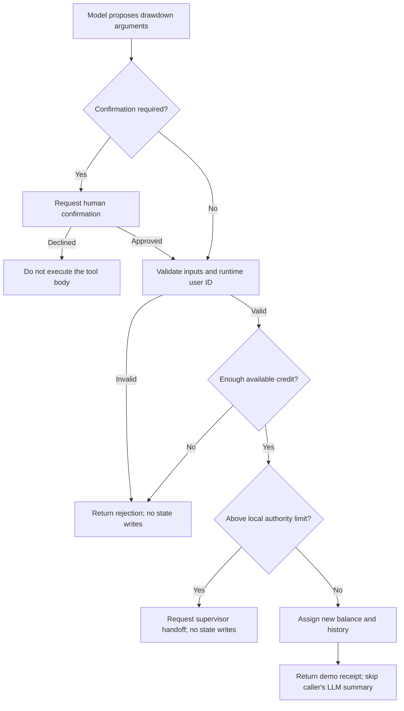

import Setup from '../_setup-snippet.mdx';

# Lab 13: Learn ToolContext Through a Simulated Drawdown

**Learning checkpoint:** read the [module concepts](./README.md) first. Before each lab step, predict its input, returned value and failure outcome. Use the [course journey](../learning-journey.md) to connect this mechanism to the banking story; the example's fixture is not a live customer record.


## What you will learn

Build a simulated drawdown tool for Sovereign Horizon Bank's demo credit facility. A **drawdown** means using part of an available credit line. Your tool will update session data, request confirmation for larger amounts, and hand off requests above its local authority limit.

This lab builds on the earlier function-tool modules. The aim is to explain and adapt each step, including the Python syntax, rather than only produce a working agent.

| Objective | Evidence that you understand it |
|---|---|
| Separate arguments from runtime context | Identify which values the model supplies and which ADK supplies |
| Read runtime identity | Explain why a session user ID still needs application authentication |
| Apply conditional confirmation | Predict when a predicate returns `True` and when the tool body runs |
| Read and update session state | Explain a default value, a state assignment, and a state delta |
| Request a supervisor handoff | Register the destination and leave balances unchanged on escalation |
| Control tool-result summarization | Find the function response and explain how a client displays it |

This is a **simulation**. It does not move money, authenticate bank officers, verify covenants, or provide a banking ledger.

## Version and Python preparation

This lab matches the revised solution's **ADK 2.10.0 / Python 3.12+** baseline, reviewed on 2 October 2026. The reference solution's 12 tool checks also passed with the repository's ADK 2.9.2 environment. See the [ADK 2.10.0 release](https://pypi.org/project/google-adk/2.10.0/).

Use these Python ideas as you work:

| Syntax | Meaning in this lab |
|---|---|
| `def name(...):` | Define a function; indented lines form its body |
| `value: int`, `-> str` | Type hints describing an integer input and a text result |
| `if condition:` | Run a block only when its condition is true |
| `return value` | Exit the function immediately with a result |
| `=`, `>=`, `>` | Assign a value; compare including the boundary; compare excluding it |
| `{"key": value}`, `[]` | Create a dictionary or an empty list |
| `f"Value: {value}"` | Insert a value into text |
| `object.attribute` | Access a property or method on an object |

Type hints help ADK describe the tool to the model. They do not replace business checks such as rejecting negative amounts. Use four spaces for each indentation level.

## Rules to implement

Use **integer USD cents** throughout the tool. USD 75,000.00 is `7_500_000` cents; USD 0.01 is `1` cent. The name `amount_cents` makes the unit explicit. Underscores make Python numbers readable without changing their values.

| Rule | Required behavior |
|---|---|
| Demo facility | Accept only `FAC-7700` |
| Starting credit | Use `1_000_000_000` cents, equivalent to USD 10 million, when the session has no stored balance |
| Inputs | Reject zero, negative, or non-integer cents, an unsupported facility, or a blank purpose |
| Caller identity | Read `tool_context.user_id`; reject a missing ID without inventing a fallback |
| Confirmation | Require confirmation at or above `25_000_000` cents, equivalent to USD 250,000 |
| Insufficient credit | Return `[REJECTED]` before considering escalation |
| Committee review | Above `100_000_000` cents, equivalent to USD 1 million, request `credit_committee_supervisor` and return `[ESCALATED]` |
| Successful drawdown | Deduct credit, record one history entry, and return `[COMPLETED]` with a clearly labelled demo receipt |
| Summarization | Set `skip_summarization = True` only for the successful receipt |

**Order matters.** The confirmation wrapper runs before the function body. A USD 15 million request therefore asks for confirmation first; after approval, the tool rejects it for insufficient credit. A USD 2.5 million request asks for confirmation, then escalates without changing the balance.



The model supplies `facility_id`, `amount_cents`, and `disbursement_purpose`. ADK injects `tool_context`, which provides runtime identity, session state, and actions. An **action** tells the runtime what to do after the tool produces its response.

## Step 1: Prepare the package

<Setup/>

Continue in your existing `adk-training` Python project (or use one of the launch options above). Check the active environment:

```bash
uv run --no-sync python -c "import sys; from importlib.metadata import version; print(sys.version); print('google-adk', version('google-adk'))"
```

If you are starting without an existing project, create a separate practice project first:

```bash
uv init adk-training --python 3.12
cd adk-training
uv add "google-adk==2.10.0" python-dotenv
```

From your Python project directory:

```bash
mkdir -p secure_finance/commercial_drawdown/tools
cd secure_finance
touch commercial_drawdown/__init__.py commercial_drawdown/tools/__init__.py
```

Keep your terminal in `secure_finance/` for all remaining commands. The package should become:

```text
secure_finance/
    commercial_drawdown/
        __init__.py
        agent.py
        tools/
            __init__.py
            drawdown.py
        test_drawdown.py
```

In `commercial_drawdown/__init__.py`, write `from . import agent`. Leave `commercial_drawdown/tools/__init__.py` empty. These files identify Python packages; the first also exposes the agent module. Edit the inner `commercial_drawdown/agent.py`, including if you already have a separate outer `secure_finance/agent.py`.

The `--no-sync` flag in later commands uses the environment you have already prepared.

## Step 2: Complete the tool

Create `commercial_drawdown/tools/drawdown.py` using this starter. The formatting helper is provided so the exercises can focus on context and control flow.

`uuid4()` creates a random demo reference. `divmod(cents, 100)` produces whole dollars and leftover cents; the two names on the left receive those values. In its f-string, `:,` adds thousands separators and `:02d` pads cents to two digits. This formats money without floating-point arithmetic.

```python
"""Practice ADK context, state, and actions with a simulated drawdown."""

from uuid import uuid4

from google.adk.tools import ToolContext

DEMO_FACILITY_ID = "FAC-7700"
INITIAL_CREDIT_CENTS = 10_000_000 * 100
CONFIRMATION_THRESHOLD_CENTS = 250_000 * 100
COMMITTEE_THRESHOLD_CENTS = 1_000_000 * 100


def format_usd(cents: int) -> str:
    """Format non-negative integer cents without floating-point arithmetic."""
    dollars, remaining_cents = divmod(cents, 100)
    return f"${dollars:,}.{remaining_cents:02d}"


def requires_dual_control(
    facility_id: str,
    amount_cents: int,
    disbursement_purpose: str,
    tool_context: ToolContext,
) -> bool:
    """Return whether this request needs the lab's confirmation checkpoint."""
    # TODO 1: Return True for integer cents at or above the confirmation threshold.
    # Return False for invalid amount types so the tool can reject them.
    raise NotImplementedError("Complete TODO 1.")


def execute_drawdown(
    facility_id: str,
    amount_cents: int,
    disbursement_purpose: str,
    tool_context: ToolContext,
) -> str:
    """Simulate a drawdown from the FAC-7700 demo credit facility.

    Args:
        facility_id: Demo facility identifier; must be FAC-7700.
        amount_cents: Positive whole USD cents; 7500000 means USD 75,000.00.
        disbursement_purpose: Business reason for this drawdown.

    Returns:
        A rejection, escalation notice, or simulated receipt.
    """
    # TODO 2: Reject invalid cents, unsupported facility IDs, and blank purposes.
    # Each rejection must return immediately, before any state assignment.

    # TODO 3: Read officer_id from tool_context.user_id.
    # Reject a missing ID. Do not create a fallback officer identity.

    # TODO 4: Read available_credit_cents with the demo starting balance as default.
    # Reject an amount greater than the available balance.

    # TODO 5: Above the committee threshold, set transfer_to_agent and transfer_reason.
    # Return an escalation notice without changing the balance or history.

    # TODO 6: Calculate new_balance and create a DEMO-prefixed UUID reference.
    # Make a history entry, copy the existing log, and append the new entry.
    # Assign the new balance and new log back to tool_context.state.

    # TODO 7: Set skip_summarization and return a clearly labelled demo receipt.
    # Use format_usd() to display amounts. No funds actually move.
    raise NotImplementedError("Complete TODOs 2–7.")
```

`raise NotImplementedError(...)` deliberately stops unfinished code. Replace these lines with your implementation. Avoid leaving `pass` or a placeholder that silently returns `None`.

### TODO 1: Answer the confirmation question

A **predicate** returns `True` or `False`. Use `type(amount_cents) is int` and compare with `CONFIRMATION_THRESHOLD_CENTS`. This exact type check also excludes Python Boolean values, which otherwise behave like integers.

The predicate accepts the same parameters as the tool because ADK passes the tool's arguments to it. Ordinary `def` is sufficient: this predicate does no asynchronous work. It decides whether confirmation is needed; `FunctionTool` manages the checkpoint.

**Predict:** what does it return for `24_999_999`, `25_000_000`, and `25_000_001` cents? Explain why the middle value matters.

### TODOs 2–3: Validate inputs and read identity

Reject invalid inputs with text containing `[REJECTED]`. Use `disbursement_purpose.strip()` to detect an empty or whitespace-only purpose. Reject a missing runtime user ID as well.

Do not add `user_id` to the function's arguments. The application must authenticate its caller and associate that identity with the session; an ID supplied by the development UI does not establish banking authorization.

**Explain:** why would subtracting a negative amount increase available credit? Which early return prevents that?

### TODO 4: Read state and check available credit

Use `tool_context.state.get("available_credit_cents", INITIAL_CREDIT_CENTS)`. The second argument is a fallback value for an absent key. Reading that default does not store it.

Reject insufficient credit before the committee check. Neither branch should update the balance or history.

**Predict:** with a USD 10 million starting balance, should a USD 15 million request be rejected or escalated after confirmation?

### TODO 5: Request a handoff

For amounts strictly above `COMMITTEE_THRESHOLD_CENTS`, set `tool_context.actions.transfer_to_agent` to `"credit_committee_supervisor"` and put a short explanation in `tool_context.actions.transfer_reason`. Return an `[ESCALATED]` notice explaining that no funds moved.

Leave `skip_summarization` unset on this branch. The runtime still needs to continue to the supervisor; a handoff is not a successful drawdown.

**Explain:** why is the committee condition `>` while the confirmation condition is `>=`?

### TODO 6: Assign the new state

Calculate the balance using integer subtraction. Create one history dictionary with these keys:

| Key | Value |
|---|---|
| `transaction_id` | `DEMO-` followed by a new UUID |
| `facility_id` | The requested demo facility |
| `amount_cents` | The amount deducted |
| `purpose` | The business purpose |
| `requested_by` | The runtime user ID |

Copy the current history with `list(tool_context.state.get("drawdown_log", []))`, then append your entry. Assign the new balance and new list to `state["available_credit_cents"]` and `state["drawdown_log"]`.

ADK records these assignments in the event's **state delta**, the collection of changed state entries. Copying and reassigning makes a list update explicit. The configured session service determines durability; two assignments are not an atomic financial transaction.

**Predict:** after two USD 75,000 requests in one session, what balance and history length should you see?

### TODO 7: Return a demo receipt

Set `tool_context.actions.skip_summarization = True` on the successful branch. Return a string containing `[COMPLETED]`, the demo reference, facility ID, amount, remaining balance, caller ID, and purpose. Label it **SIMULATED DRAWDOWN — NO MONEY MOVED**.

The flag skips the calling agent's LLM summary of the function response. A client must render that function response to display your receipt; the flag does not automatically create a text bubble in every interface.

**Explain:** how do a returned string, a state assignment, and a runtime action differ?

## Step 3: Register the tool and supervisor

Create `commercial_drawdown/agent.py`. Complete TODOs 8–10 and remove the deliberate `NotImplementedError` before importing or running the package.

```python
"""Wire the simulated drawdown tool into an ADK agent."""

from google.adk import Agent
from google.adk.tools import FunctionTool

from .tools.drawdown import execute_drawdown, requires_dual_control

# Remove this guard after completing TODOs 8–10 below.
raise NotImplementedError("Complete the agent wiring before running the lab.")

credit_committee_supervisor = Agent(
    name="credit_committee_supervisor",
    model="gemini-2.5-flash",
    instruction=(
        "Review escalated requests in this drawdown simulation. "
        "Explain what information a human credit committee would need. "
        "Do not claim that funds moved, covenants were verified, "
        "or a human committee approved the request."
    ),
)

# TODO 8: Replace None with FunctionTool configured with:
# func=execute_drawdown and require_confirmation=requires_dual_control.
secure_drawdown_tool = None

root_agent = Agent(
    name="loan_officer_agent",
    model="gemini-2.5-flash",
    instruction=(
        "Help users with simulated FAC-7700 drawdowns. "
        "Use execute_drawdown for a requested drawdown. "
        "Pass amounts as integer USD cents: USD 75,000.00 is 7500000 cents. "
        "Ask for a purpose if it is missing. "
        "Never claim that this simulation moves real money."
    ),
    tools=[],  # TODO 9: Register secure_drawdown_tool.
    sub_agents=[],  # TODO 10: Register credit_committee_supervisor.
)
```

Pass the predicate's name **without parentheses**: ADK needs a function to call later. Adding parentheses would call it immediately. `tools=[...]` and `sub_agents=[...]` are lists of registered objects; `root_agent` is the entry point ADK loads.

Keep the drawdown example's model setting for this exercise. The supervisor has no disbursement tool and only discusses the simulated review.

**Checkpoint:** explain why `tools=[execute_drawdown]` would bypass your configured confirmation rule, and why the supervisor's name must match the transfer destination.

The function name `requires_dual_control` is retained for continuity with the scenario. This lab implements one confirmation checkpoint. Enforcing two distinct authorized approvers needs application logic beyond a Boolean confirmation. ADK's [tool confirmation feature](https://adk.dev/tools-custom/confirmation/) is marked experimental.

## Step 4: Check your implementation without a model

Use the supplied harness below as `commercial_drawdown/test_drawdown.py`. It uses real ADK context and action objects, so unsupported SDK calls cannot be hidden by a permissive mock. It calls the **wrapped tool**, which tests whether confirmation blocks execution.

<details>
<summary>Expand the 12-case verification harness</summary>

```python
"""Check deterministic tool behavior without calling an LLM."""

import asyncio

from google.adk import Agent
from google.adk.agents.invocation_context import InvocationContext
from google.adk.sessions import InMemorySessionService
from google.adk.tools import FunctionTool, ToolContext
from google.adk.tools.tool_confirmation import ToolConfirmation

from .tools.drawdown import execute_drawdown, requires_dual_control


async def check_case(
    amount_cents: int,
    confirmed: bool | None,
    expected: str,
) -> None:
    # Use a fresh session so each scenario starts with the same demo credit.
    service = InMemorySessionService()
    session = await service.create_session(
        app_name="drawdown_lab",
        user_id="learner",
    )
    invocation = InvocationContext(
        invocation_id="test-invocation",
        agent=Agent(name="test_agent", model="gemini-2.5-flash"),
        session=session,
        session_service=service,
    )

    # None = no answer yet; False = rejected; True = approved.
    confirmation = None
    if confirmed is not None:
        confirmation = ToolConfirmation(confirmed=confirmed)

    context = ToolContext(
        invocation_context=invocation,
        function_call_id="test-call",
        tool_confirmation=confirmation,
    )
    tool = FunctionTool(
        func=execute_drawdown,
        require_confirmation=requires_dual_control,
    )
    result = await tool.run_async(
        args={
            "facility_id": "FAC-7700",
            "amount_cents": amount_cents,
            "disbursement_purpose": "Supplier payment",
        },
        tool_context=context,
    )

    # Test the wrapper, not just a separately calculated predicate.
    if expected == "pending":
        assert "requires confirmation" in result["error"]
        assert context.actions.requested_tool_confirmations
    elif expected == "declined":
        assert "rejected" in result["error"]
    else:
        assert expected in result

    if expected == "[COMPLETED]":
        assert context.state["available_credit_cents"] == (1_000_000_000 - amount_cents)
        assert len(context.state["drawdown_log"]) == 1
        assert context.actions.skip_summarization is True
        assert "available_credit_cents" in context.actions.state_delta
        assert context.actions.transfer_to_agent is None
    else:
        assert context.actions.state_delta == {}

    if expected == "[ESCALATED]":
        assert context.actions.transfer_to_agent == "credit_committee_supervisor"
        assert context.actions.transfer_reason

    print(f"PASS: {amount_cents} cents, confirmation={confirmed}: {expected}")


async def main() -> None:
    await check_case(7_500_000, None, "[COMPLETED]")
    await check_case(24_999_999, None, "[COMPLETED]")
    await check_case(25_000_000, None, "pending")
    await check_case(50_000_000, False, "declined")
    await check_case(50_000_000, True, "[COMPLETED]")
    await check_case(100_000_000, True, "[COMPLETED]")
    await check_case(100_000_001, True, "[ESCALATED]")
    await check_case(250_000_000, None, "pending")
    await check_case(250_000_000, True, "[ESCALATED]")
    await check_case(1_500_000_000, True, "[REJECTED]")
    await check_case(0, None, "[REJECTED]")
    await check_case(-1, None, "[REJECTED]")


if __name__ == "__main__":
    asyncio.run(main())
```

</details>

The harness is supporting infrastructure; explain your tool first. In the harness, `async def` creates a coroutine, `await` waits for ADK's asynchronous operations, and `asyncio.run(main())` starts execution. The confirmation values are `None` for no answer, `False` for rejection, and `True` for approval. `assert` fails a check if its condition is false.

From `secure_finance/`, run:

```bash
uv run --no-sync python -m commercial_drawdown.test_drawdown
```

`-m` runs the test as part of the package, allowing the relative import `from .tools.drawdown ...` to resolve correctly. All 12 checks should print `PASS`. They require no model credentials.

The harness verifies tool behavior, state deltas, and requested actions. It does not prove that a UI dialog appears, events persist through a runner, or the supervisor actually executes. Those require the next exercise.

## Step 5: Inspect a complete agent conversation

Use your existing model credentials, then run from `secure_finance/`:

```bash
uv run --no-sync adk web .
```

Select `commercial_drawdown`. Begin with: **“Draw down USD 75,000 from FAC-7700 for supplier payments.”** Inspect the tool-call arguments and confirm that the model sends `amount_cents=7500000`.

For each independent row below, use a fresh session. Otherwise previous successful drawdowns change the starting balance.

| Request in USD | Confirmation response | Expected outcome |
|---|---|---|
| 75,000.00 | Not requested | Completes; remaining credit is 9,925,000.00 |
| 249,999.99 | Not requested | Completes |
| 250,000.00 | No answer yet | Pending; function body has not run |
| 500,000.00 | Reject | Wrapper prevents execution; no state changes |
| 500,000.00 | Approve | Completes; remaining credit is 9,500,000.00 |
| 1,000,000.00 | Approve | Completes; exactly at the local authority limit |
| 1,000,000.01 | Approve | Escalates; balance and history unchanged |
| 2,500,000.00 | No answer yet | Pending; no handoff yet |
| 2,500,000.00 | Approve | Escalates; supervisor reviews the request |
| 15,000,000.00 | Approve | Rejected for insufficient credit |
| 0 | Not requested | Rejected |
| -0.01 | Not requested | Rejected |

Inspect the function response for the demo receipt, `actions.state_delta` for balance and history changes, and the subsequent event author for the supervisor. A missing text bubble does not by itself mean the tool failed. Invalid chat requests may be rejected by the model before it calls a tool; the harness tests those function-level cases directly.

Finally, make **two USD 75,000 requests in the same fresh session**. Confirm a remaining balance of USD 9,850,000 and two history entries. A new session starts this demo over; persistent banking balances would need a separate authoritative store.

## Step 6: Demonstrate understanding

Before opening the solution, answer these questions using your own code:

1. Which three arguments come from the model? Who supplies `tool_context`?
2. Why is a runtime user ID different from proof that someone is an authorized bank officer?
3. Which return statements prevent a rejected or escalated request from reaching state assignments?
4. Why does `state.get(..., default)` differ from `state[key] = value`?
5. What protects the function from running after confirmation is declined? What happens if Python code calls `execute_drawdown` directly?
6. Why does a UUID identify a demo record without preventing duplicate drawdowns on retries?
7. What does `skip_summarization` change, and what must the client still do?

Then change the confirmation threshold to USD 100,000. Predict and update the affected boundary checks before running them. Restore the original threshold before comparing with the reference solution.

**Completion criteria:** your original 12 checks pass, you can explain one successful request and one escalation line by line, and you can identify the differences between model arguments, runtime identity, session state, actions, and returned text.

The next persistence module builds on the distinction between session memory and durable storage. Do not describe this exercise as production banking software: authorization, separate approver verification, concurrent updates, retry protection, and payment settlement are separate responsibilities.

## Reference solution

<details>
<summary>Open after completing your implementation and predictions</summary>

Compare your work with the [Lab 13 solution](./lab-solution.md). It contains the completed code, a guided explanation of each section, and the same verification harness.

</details>

## Official references

- [ADK 2.10.0 release](https://pypi.org/project/google-adk/2.10.0/)
- [ADK function tools and context injection](https://adk.dev/tools-custom/function-tools/)
- [ADK tool confirmation](https://adk.dev/tools-custom/confirmation/)
- [ADK session state](https://adk.dev/sessions/state/)
- [ADK events and actions](https://adk.dev/events/)
- [Python functions and control flow](https://docs.python.org/3/tutorial/controlflow.html)
- [Python data structures](https://docs.python.org/3/tutorial/datastructures.html)

<!-- © 2026 Inder Chauhan (https://github.com/inderanz/google-adk-training). All rights reserved. Ref: IC-ADK-module13-tool-context-lab -->
